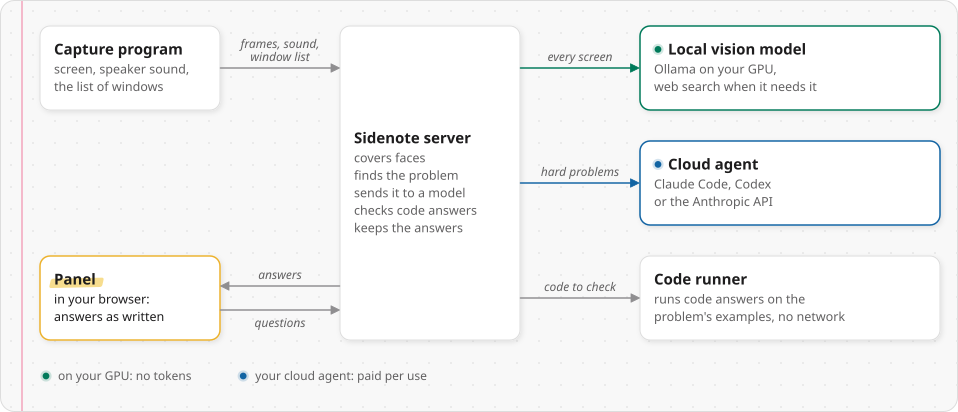
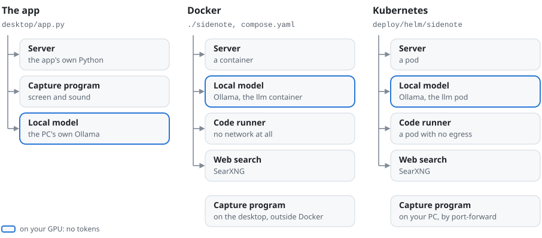
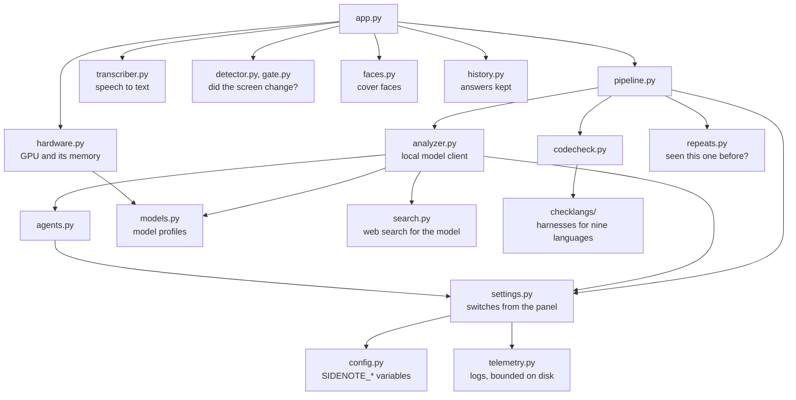

# Contributing to Sidenote

Thank you for helping. Most of Sidenote can be worked on without a GPU and without a cloud agent: the tests run the
server with stand-in models, and the panel runs in a headless browser against a stand-in server. This page gets you
from a fresh clone to a pull request.

- [Ways to help](#ways-to-help)
- [How the pieces fit](#how-the-pieces-fit)
- [Set up without a GPU](#set-up-without-a-gpu)
- [Run the tests](#run-the-tests)
- [Make a change](#make-a-change)
- [Recipes](#recipes): a model, a GPU vendor, a language, a cloud agent, a language for code checks
- [Report a bug](#report-a-bug)

## Ways to help

- **Run it on your hardware.** Sidenote's numbers come from one PC: Windows 11 with an NVIDIA RTX 4090 (24 GB). A
  report from an AMD GPU, a smaller NVIDIA card, a Linux desktop or a machine with no GPU is the most useful thing you
  can send: open a [hardware report](https://github.com/kanggu12/sidenote/issues/new?template=hardware_report.yml)
  with the output of `./sidenote doctor`, or of `python3 -m server.hardware` in a checkout.
- **Model profiles.** A vision model that reads screens well in 8 to 16 GB of GPU memory, measured on real problems
  ([add a model](#add-a-local-model)).
- **Translations.** English and Korean today; [add a language](#add-a-language).
- **The capture program on macOS and Wayland.** It runs on Windows and on Linux with X11 today
  ([docs/capture-client.md](docs/capture-client.md)).
- **Docs.** Anything that made you stop and search is worth a sentence.

Look for issues labeled `good first issue` and `help wanted`. For a larger change, open an issue first, so the design
can be agreed before the code is written.

**One rule for features.** Sidenote is for learning, practice and your own work ([Please use it
fairly](README.md#please-use-it-fairly)). A change whose purpose is to hide Sidenote from a proctor, an exam or a
screen share is not accepted.

## How the pieces fit

Four programs work together. The capture program sends the screen and the speaker sound; the server finds the
problem and asks the models; the panel shows the answers; the code runner runs code with no network.

<picture>
  <source media="(prefers-color-scheme: dark)" srcset="docs/assets/diagram-pieces-dark.svg">
  
</picture>

The same four programs run in three ways. The code is the same in each; what differs is who starts the parts and what
sits around them:

<picture>
  <source media="(prefers-color-scheme: dark)" srcset="docs/assets/diagram-ways-dark.svg">
  
</picture>

| | The app | Docker | Kubernetes |
|:---|:---:|:---:|:---:|
| Starts the parts | `desktop/app.py`, which restarts what stops | `./sidenote up`, compose's restart policy | the chart |
| Local model | the PC's Ollama, downloads from the panel | the `llm` container, `./sidenote llm pull` | the `llm` pod, the chart's pull Job |
| Web search, code checks | off | SearXNG, the code runner | SearXNG, the code runner |
| The agent's CLI | the PC's own `claude` or `codex` | built into the server image | Codex in the image, Claude Code fetched into the pod at its start |

Inside the server, `app.py` owns the connections and the one worker that analyzes one screen at a time. Everything
about a single problem happens in `pipeline.py`. The arrows below are imports.



| Path | What it is | Start reading at |
|---|---|---|
| `server/app.py` | FastAPI app: `/ingest` for the capture program, `/panel` for the panel, the analysis worker | `analysis_worker` |
| `server/pipeline.py` | one problem from screen to answer: the fast pass, the route, the crop, the agent hand-off, the code check | `Pipeline.solve` |
| `server/analyzer.py` | the local model over Ollama's or an OpenAI-compatible API, its prompts | `LocalLlmAnalyzer` |
| `server/agents.py` | Claude Code and Codex through their CLIs, the Anthropic API | `make_agent` |
| `server/models.py`, `server/hardware.py` | the model profiles, and the GPU and memory they are picked by | `choose`, `detect` |
| `server/config.py`, `server/settings.py` | the `SIDENOTE_*` environment, and the switches the panel changes at run time | `Config`, `Settings` |
| `panel/` | the panel: plain HTML, CSS and JavaScript, no build step | `app.js`, its `onmessage` |
| `client/capture.py` | the capture program (Windows, Linux with X11): screen, speaker sound, tray | `main` |
| `sidenote` | the launcher: `install`, `up`, `capture`, `status`, `doctor`, ... | `cmd_help`, and the `case` at its end |
| `desktop/` | the app for one PC without Docker: starts and watches the server, the capture program and Ollama; its build | `app.py`, `run()` |
| `docker/` | the code runner and its sandbox, the image's entrypoint, the panel's pinned libraries | `runner.py` |
| `deploy/helm/sidenote/` | the Helm chart | its `README.md` |
| `tests/` | the suites CI runs | [tests/README.md](tests/README.md) |

The whole design, with the protocol and the reasons behind each decision, is in
[docs/ARCHITECTURE.md](docs/ARCHITECTURE.md). Why the local model answers first is in
[docs/DESIGN-local-first.md](docs/DESIGN-local-first.md).

## Set up without a GPU

You need Python 3.10 or newer and git. The full test run also needs Node.js, gcc and g++.

```bash
git clone https://github.com/kanggu12/sidenote.git && cd sidenote
python3 -m venv .venv
.venv/bin/pip install -r server/requirements.txt -r server/requirements-audio.txt -c docker/constraints.txt
.venv/bin/pip install websocket-client
python3 docker/fetch_vendor.py docker/vendor.json panel/vendor     # the panel's libraries, checked against their checksums
```

Start the server with stand-in models, and send it a made-up problem from a second terminal:

```bash
SIDENOTE_ANALYZER=mock SIDENOTE_TRANSCRIBER=null .venv/bin/uvicorn server.app:app --host 127.0.0.1 --port 8800 --ws-max-size 67108864
SIDENOTE_INGEST_URL=ws://127.0.0.1:8800/ingest .venv/bin/python -m server.mock_capture
```

Open http://127.0.0.1:8800 and the panel shows the stand-in answer. Nothing reaches a model, a GPU or the network in
this mode, and port 8800 keeps it apart from a Sidenote you may already run on 8777. `SIDENOTE_TRANSCRIBER=null`
skips the speech model, which is otherwise downloaded on the first start. Add `?lang=ko` to the address to see the
panel in Korean. A warning from onnxruntime that "GPU device discovery failed" is harmless: the face detector then
runs on the CPU.

`.venv/bin/python -m desktop` runs everything the way the Windows and Linux app does (the server, the capture program,
Ollama when it is installed), with its logs in the data folder; `SIDENOTE_ANALYZER=mock .venv/bin/python -m desktop
--no-capture` is the same with stand-in models. `desktop/build.py` builds the app itself with PyInstaller.

To work with a real local model, run [Ollama](https://ollama.com), pull a model (`ollama pull gemma4:e4b`) and start
the server with `SIDENOTE_ANALYZER=local SIDENOTE_LOCAL_URL=http://127.0.0.1:11434/v1` instead. Sidenote also speaks
the OpenAI-compatible `/v1/chat/completions` API with images, which LM Studio, llama.cpp's server and vLLM serve: set
`SIDENOTE_LOCAL_MODEL` to the model's name. Only Ollama is measured so far; a report on another server is welcome.

## Run the tests

```bash
PY=.venv/bin/python tests/run.sh server      # the server and capture suites
tests/run.sh --list                          # what a run would start
```

The panel suites drive Chromium through Playwright, in a virtual environment of their own:

```bash
python3 -m venv .venv-panel
.venv-panel/bin/pip install -r tests/requirements-panel.txt
.venv-panel/bin/python -m playwright install chromium
PY=.venv/bin/python PW=.venv-panel/bin/python tests/run.sh panel
```

Each suite prints one line per check and a tally, and `tests/run.sh` prints one line per suite. A few checks read
measurement data that is not in the repository (real screenshots, a public problem corpus); they are skipped without
it, and the suite's line says so. [tests/README.md](tests/README.md) lists every suite and what it covers.

CI runs the same suites on every push and pull request, builds both images, lints and renders the Helm chart, and ends
with one verdict, the QA gate ([docs/QA.md](docs/QA.md)). A change to the chart or the images also installs the chart
on a throwaway k3d cluster.

## Make a change

- **One change per pull request**, with a test that fails without it. A bug fix starts with the check that shows the
  bug.
- **Keep the dependencies small.** The server's packages are pinned in `docker/constraints.txt`; `server/hardware.py`
  and `server/models.py` use the standard library only, so the launcher can run them before anything is installed.
- **Python**: 3.10, type hints on new functions. **JavaScript**: plain browser JavaScript, no build step, no
  framework. **Shell**: bash, `bash -n` clean.
- **Comments say why.** Write what the code does and why it is that way, in plain English, for someone who has never
  seen the file.
- **Words people see are translated.** Write them in English through `t()` and add the Korean to the tables
  ([add a language](#add-a-language)).
- **Commit messages**: a short summary line in the imperative ("Detect AMD GPUs through sysfs"), a blank line, and
  what changed and why.

A pull request is ready when `tests/run.sh` passes, the new behavior has a check, and the docs say what changed for
the person running Sidenote.

## Recipes

### Add a local model

The local model is picked by the GPU's memory. Each model Sidenote knows has a profile in `server/models.py`:

```python
Profile("mymodel:8b", r"^(sidenote-)?mymodel:8b", "mymodel:8b", "sidenote-mymodel:8b", TUNED_BATCH, 10.0,
        smaller="", note="One line for the setup page", size_gb=6.0)
```

- The fields in order: a short name, a `pattern` matched against the names the local server lists (the tuned copy's
  too), what `ollama pull` fetches, and the tuned copy Sidenote creates from it with `params` (`TUNED_BATCH` gives
  an image more tokens, so small code text stays sharp).
- `vram_gb` is the GPU memory it needs loaded with Sidenote's context; `size_gb` is what the download weighs, said
  beside the panel's Download button.
- `box_scale` is the grid of the boxes the model writes (Gemma answers in 0 to 1000), and `think_off` the request
  fields that turn thinking off for the fast pass.
- `smaller` is the profile used while another program keeps the GPU busy.
- `tested=True` only with a measurement: run the model on real problems and report the answers' quality and timing in
  the pull request.

Two functions use the profiles. `fits()` suggests the largest model in `TIERS` that fits the GPU with 0.5 GB to
spare, and the panel offers to download it; only measured models go in `TIERS`. `choose()` picks among the models
the local server already has: those that fit first, then the measured ones, then the larger.

Add its cases to `tests/models_check.py` (the pattern, and the tier each GPU size lands in).

### Add a GPU vendor

1. `server/hardware.py`: the vendor's PCI ID in `VENDORS` and its name in `SUPPORTED`, a parser for its tool's output
   in `detect()`, and its live readings in `usage()` (the panel's GPU card when no container writes them). Test the
   parsers on captured output in `tests/models_check.py`.
2. `compose.<vendor>.yaml`: the device access for the `llm` service, and a loop that writes
   `usedMiB, totalMiB, busy%, tempC, powerW` to `/gpu/now.csv` for the GPU card (see `compose.amd.yaml`). The
   launcher's `gpu_vendor()` picks the file by the vendor's name; add the name to its list.
3. The Helm chart: `llm.gpuVendor` in `values.yaml`, and the resource name and image in
   `templates/llm-deployment.yaml`, which switches between NVIDIA and AMD today.

### Add a language

1. `panel/i18n/<code>.js`: copy `panel/i18n/ko.js`, translate the right-hand sides, load it in `panel/index.html`
   after `panel/i18n.js`, and add the code to `SUPPORTED` in `panel/i18n.js`.
2. `server/locale/<code>.json`: copy `server/locale/ko.json`, translate the values, and add the code to `SUPPORTED` in
   `server/i18n.py`.
3. Keep the placeholders (`{n}`, `{name}`) as they are. The keys are the English text in the code and stay as written.

The panel follows the browser's first language, and its settings menu's **Language** picks one by hand: give the new
language a button in `#lang-seg` (`panel/index.html`), named in its own words. `?lang=<code>` picks one for a page.

Three small parts speak English and Korean only so far, each with a `KO` table or English and Korean pairs: the
capture program's tray (`client/capture.py`), the app's message boxes (`desktop/app.py`) and the launcher's messages
(`L` in `sidenote`). A third language there turns the Korean table into one per language.

### Add a cloud agent

An agent is a class in `server/agents.py` with `run(images, text, on_delta, web=False)`, which streams the answer
through `on_delta` and returns the result. Then name it where the agents are listed:

- `server/config.py`: the names `SIDENOTE_AGENT` accepts (`Config.__post_init__`), and `AGENT_LABELS` and
  `AGENT_SHORT`, the names the panel shows.
- `server/agents.py`: `make_agent()`; `auth_status()`, which tells the panel whether it is signed in or has its key;
  and `LOGIN_HINTS` and `DESKTOP_LOGIN_HINTS`, what the panel says to run to sign in.
- For an agent with a CLI: `cmd_login` and the agent's line in `cmd_doctor` in `sidenote`, and `agent_found()` in
  `desktop/app.py`, which picks the CLI up from the PATH.

The CLI agents are tested against stand-ins that speak the CLIs' output format (`tests/fake_claude.py`,
`tests/fake_codex.py`), so CI needs no login.

### Add a language for code checks

A coding answer is checked by running it on the problem's examples, in nine languages today (Python, C, C++, Java,
Kotlin, JavaScript, TypeScript, Go, Bash). A new language needs:

- `server/checklangs/`: a module that builds the harness calling the answer's function (see `go.py`).
- `server/codecheck.py`: the code block's language names in `CHECK_LANGS`, its name in `LANG_NAME`, and in
  `NODE_LANGS` when the harness builds trees and linked lists.
- `docker/runner.py`: its file name, compile and run commands in `LANGS`, and its compiler in
  `docker/Dockerfile.runner`.
- `panel/app.js`: `RUN_LANG`, so its code blocks get a Run button, and its name in `LANG_LABEL` and `CHECK_LANG`.

## Report a bug

Open an issue with what you did, what you expected, and what happened. These help:

- `./sidenote doctor`: Docker, the images, the GPU, the agent's sign-in, the capture program's packages.
- `./sidenote report`: each day's answers by engine, with their timing and cost.
- Your OS, GPU and memory, and the local model's name.

Please do not attach screenshots with private content. A security problem goes through [SECURITY.md](SECURITY.md),
not an issue.

By contributing, you agree that your contribution is licensed under the [MIT License](LICENSE).
