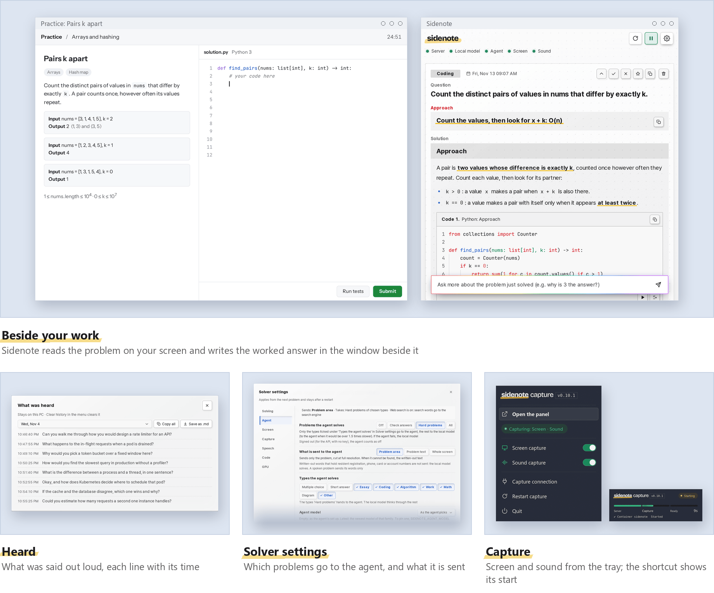
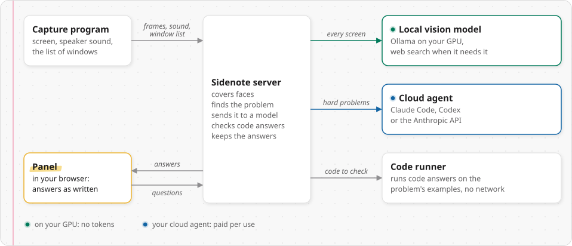

<p align="center">
  <picture>
    <source media="(prefers-color-scheme: dark)" srcset="docs/assets/logo-dark.svg">
    
  </picture>
</p>

<p align="center">
  <b>A study and work companion that reads your screen and writes the worked answer beside it.</b><br>
  A vision model on your own GPU looks at every screen first. Only the hard problems go to a cloud agent you already use.
</p>

<p align="center">
  <a href="https://github.com/kanggu12/sidenote/actions/workflows/ci.yml"></a>
  <a href="https://github.com/kanggu12/sidenote/releases"></a>
  <a href="LICENSE"></a>
  
  
</p>

<p align="center">
  <a href="#quick-start">Quick start</a> |
  <a href="#what-it-does">What it does</a> |
  <a href="#how-it-works">How it works</a> |
  <a href="#what-it-runs-on">What it runs on</a> |
  <a href="docs/README.md">User guide</a> |
  <a href="docs/API.md">API</a> |
  <a href="#contributing">Contributing</a>
</p>

<p align="center">
  <picture>
    <source media="(prefers-color-scheme: dark)" srcset="docs/assets/screens-dark.png">
    
  </picture>
</p>

Sidenote reads your screen and listens to your speakers. When a problem appears (a practice coding problem, a question in
your course material, an error log to debug, a question someone asks out loud), it writes a worked answer into a notebook
panel beside your work. It runs on your own PC, and the cloud agent sees only the problems that need it.

## Quick start

Install Sidenote, then add what solves, one or both: the [local model](#the-local-model-optional) on your GPU, or a
[cloud agent](#the-cloud-agent-optional) you already use. Docker adds web search and a sandbox that runs code answers on
the problem's examples.

**Windows 10 or 11** (PowerShell)

```powershell
curl.exe -fL -o "$env:TEMP\Sidenote.zip" https://github.com/kanggu12/sidenote/releases/latest/download/Sidenote-windows-x64.zip
mkdir -Force "$env:LOCALAPPDATA\Programs" | Out-Null; tar -xf "$env:TEMP\Sidenote.zip" -C "$env:LOCALAPPDATA\Programs"
& "$env:LOCALAPPDATA\Programs\Sidenote\Sidenote.exe"
```

**macOS 14 or newer** on Apple silicon (Terminal). It asks once for **Screen Recording**: the second block opens that
setting, and once Sidenote is on there, the third starts it again.

```bash
curl -fL -o /tmp/Sidenote.zip https://github.com/kanggu12/sidenote/releases/latest/download/Sidenote-macos-arm64.zip
ditto -x -k /tmp/Sidenote.zip /Applications
open /Applications/Sidenote.app
```

```bash
open "x-apple.systempreferences:com.apple.preference.security?Privacy_ScreenCapture"
```

```bash
osascript -e 'tell application id "io.github.kanggu12.sidenote" to quit'; sleep 3; open /Applications/Sidenote.app
```

**Linux** with an X11 session (on Ubuntu, Xorg from the gear on the login screen) and glibc 2.35 or newer

```bash
curl -fLO https://github.com/kanggu12/sidenote/releases/latest/download/Sidenote-linux-x64.zip
unzip -oq Sidenote-linux-x64.zip
./Sidenote/Sidenote
```

**Docker** on Linux, on WSL 2, or on a Mac with Docker Desktop (with `git` and `python3`; on a Debian or Ubuntu desktop
also `python3-venv`). On Windows, run it inside WSL 2, with [Python for Windows](https://www.python.org/downloads/windows/)
for the capture program.

```bash
git clone https://github.com/kanggu12/sidenote.git && cd sidenote
./sidenote install
./sidenote capture --up
./sidenote open
```

**Kubernetes**: the Helm chart, with the model downloaded during the install:
[running on Kubernetes](docs/README.md#16-running-on-kubernetes).

The first time, the panel opens its [setup guide](docs/README.md#the-setup-guide): the capture program's connection, what
solves, the screen, the sound and a sample problem to try. Starting, stopping, updating, checking a download and the
Mac's speaker sound are in the user guide's [First time](docs/README.md#3-first-time) and
[Everyday use](docs/README.md#4-everyday-use).

### The local model (optional)

It reads every screen first on your own GPU (NVIDIA, AMD or Apple silicon), with no account. Install Ollama, quit
Sidenote and start it again, and the panel offers the model that fits: choose **Download**.

```
# Windows (PowerShell)
winget install -e --id Ollama.Ollama --accept-source-agreements --accept-package-agreements
# macOS, with Homebrew
brew install ollama
# Linux
curl -fsSL https://ollama.com/install.sh | sh
```

With Docker, `./sidenote llm pull` and then `./sidenote up` download it into a container of its own; on a Mac, Docker
has no GPU and the model runs in Ollama for Mac ([how](docs/README.md#with-docker)).

### The cloud agent (optional)

It takes the problems that need reasoning, with an account you already use: [Claude
Code](https://docs.anthropic.com/en/docs/claude-code) or [Codex](https://github.com/openai/codex), signed in once in a
terminal with `claude` or `codex login`, or the Anthropic API. The app looks for it when it starts; with Docker,
`./sidenote login` checks the login ([more](docs/README.md#the-cloud-agent)).

## What it does

<picture>
  <source media="(prefers-color-scheme: dark)" srcset="docs/assets/stats-dark.svg">
  
</picture>

Most screens have nothing to solve: a chat, a blog, the editor between problems. A tool that sends every screen to a paid
model pays for all of them. Sidenote asks the model on your GPU first, which says "nothing here" in about a second, for
free.

- **Local first, and it shows the cost.** Each answer says which engine answered, how long it took and what it cost.
- **Uses the agent you already have.** Claude Code or Codex with your own sign-in, so no API key; or the Anthropic API.
- **Fits your GPU.** It reads the GPU's memory and picks the largest measured model that fits.
- **Checks code answers.** With Docker or Kubernetes, code runs on the problem's examples in a sandbox with no network.
- **Lets you try first, and keeps what you learn.** **Practice** shows the question, then one hint at a time. Star an
  answer, find it in the history, and export it as Markdown or as Anki notes.
- **Private by design.** Faces are covered before any model sees the screen, the windows you name stop the capture, and
  each answer lists what left your PC ([Security and privacy](docs/README.md#14-security-and-privacy)).

## How it works

<picture>
  <source media="(prefers-color-scheme: dark)" srcset="docs/assets/diagram-pieces-dark.svg">
  
</picture>

Everything but the cloud agent runs on your PC, or on your own server with Docker or Kubernetes.

- **It finds the problem on its own.** A frame goes when the screen changes and settles, and a question read out loud is
  picked up from the speaker sound.
- **It answers locally first.** Explanations, definitions and short questions come within a second or two.
- **It hands the hard ones to the agent:** code, algorithms, math, essays and work problems such as a log to debug, with
  only the problem's part of the screen by default. With no agent, the local model thinks them through itself.

## What it runs on

| Local model | GPU | Mac | Memory | Disk | Right of 56 |
|:---|:---|:---|:---|:---|---:|
| none: the agent answers | none | any | 8 GB | | |
| `gemma4:e4b` | 10 GB or more | 16 to 24 GB | 16 GB | 6.6 GB | 34 |
| `gemma4:26b` (recommended) | 24 GB, such as an RTX 4090 | 32 GB or more | 32 GB | 18 GB | 51 |

The GPU is NVIDIA or AMD, or a Mac's Apple silicon, which works in the Mac's own memory. Sidenote runs on Windows 10 or
11, macOS 14 or newer, Linux with X11 (Ubuntu 22.04 or newer), Docker on Linux, WSL 2 or a Mac, and Kubernetes. *Right
of 56* counts real screens and spoken questions with known answers, each model alone on an RTX 4090. The rest of the
measurements and what each setup supports are in [What was measured](docs/README.md#what-was-measured); reports from
other GPUs are welcome as a [hardware report](https://github.com/kanggu12/sidenote/issues/new?template=hardware_report.yml).

## Documentation

- **Using it**: [User guide](docs/README.md) · [Running with no internet](docs/air-gapped.md) · [Changelog](CHANGELOG.md)
- **Running it elsewhere**: [Helm chart](deploy/helm/sidenote/README.md) · [The capture program on its own](docs/capture-client.md)
- **Building on it**: [API](docs/API.md) · [Architecture](docs/ARCHITECTURE.md) · [Design decisions](docs/DECISIONS.md) ·
  [Local-first design](docs/DESIGN-local-first.md) · [Quality](docs/QA.md)

The panel and the commands speak English, or Korean when your browser or terminal is set to Korean; **Language** in the
panel's gear menu picks one by hand. To add a language, see [Add a language](CONTRIBUTING.md#add-a-language).

## Contributing

[CONTRIBUTING.md](CONTRIBUTING.md) has the setup, the tests (no GPU needed) and how a change goes in. Questions go to
[Discussions](https://github.com/kanggu12/sidenote/discussions), bugs to [Issues](https://github.com/kanggu12/sidenote/issues/new/choose).

## License

MIT ([LICENSE](LICENSE)). The libraries, fonts and models Sidenote uses, and the programs it runs beside it, are
listed with their licenses in [THIRD_PARTY_NOTICES.md](docs/THIRD_PARTY_NOTICES.md).
