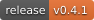
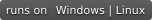
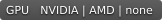
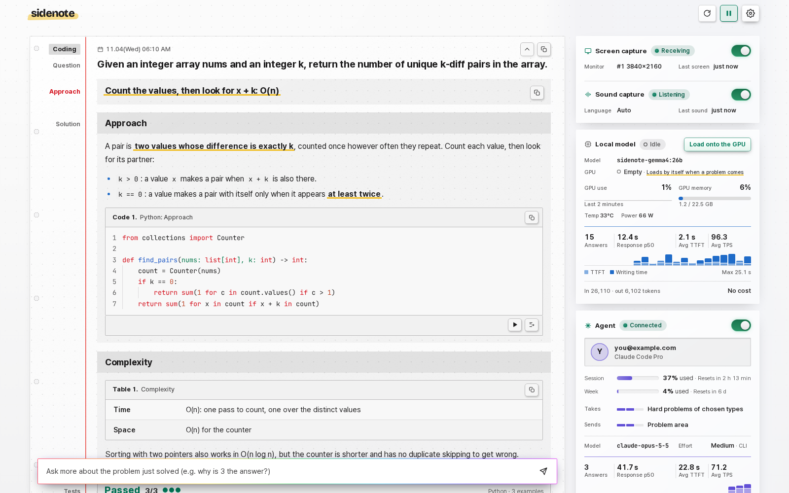
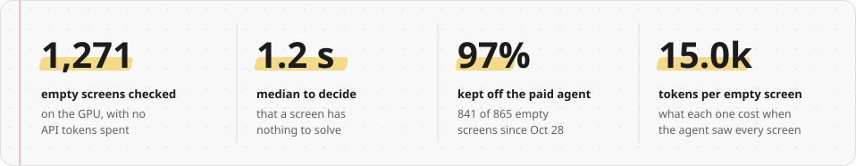
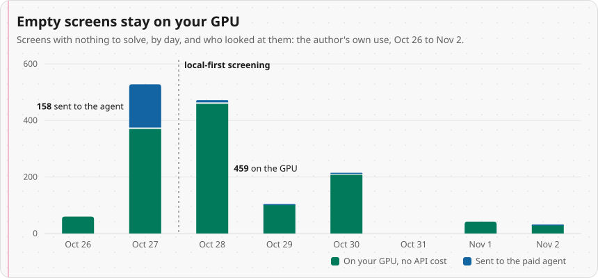

<p align="center">
  <picture>
    <source media="(prefers-color-scheme: dark)" srcset="docs/assets/logo-dark.svg">
    
  </picture>
</p>

<p align="center">
  <b>A study and work companion that reads your screen and writes the worked answer beside it.</b><br>
  A vision model on your own GPU looks at every screen first. Only the hard problems go to a cloud agent you already use.
</p>

<p align="center">
  <a href="https://github.com/kanggu12/sidenote/actions/workflows/ci.yml"></a>
  <a href="https://github.com/kanggu12/sidenote/releases"></a>
  <a href="LICENSE"></a>
  
  
</p>

<p align="center">
  <a href="#quick-start">Quick start</a> |
  <a href="#why-sidenote">Why Sidenote</a> |
  <a href="#what-it-runs-on">What it runs on</a> |
  <a href="docs/README.md">User guide</a> |
  <a href="docs/ARCHITECTURE.md">Architecture</a> |
  <a href="CONTRIBUTING.md">Contributing</a>
</p>

<p align="center">
  <picture>
    <source media="(prefers-color-scheme: dark)" srcset="docs/assets/screenshot-dark.png">
    
  </picture>
</p>

Sidenote reads your screen and listens to your speakers. When a problem appears (a practice coding problem, a question in
your course material, an error log to debug, a question someone asks out loud), it writes a worked answer into a notebook
panel beside your work. It runs on your own PC, and the cloud agent sees only the problems that need it.

## Quick start

| Your PC | Paste into | Needs |
|:---|:---|:---|
| **Windows 10 or 11** | [PowerShell](#windows) | nothing else |
| **A Mac with Apple silicon**, macOS 14 or newer | [Terminal](#macos) | [Homebrew](https://brew.sh) |
| **A Linux desktop**, X11, glibc 2.35 or newer | [a terminal](#linux) | `curl`, `unzip` |
| **Linux or WSL 2, with Docker** | [a terminal](#docker-on-linux-or-wsl-2) | Docker, `git`, `python3` |
| **A Mac, with Docker** | [Terminal](#docker-on-a-mac) | Docker Desktop, Homebrew, `git`, `python3` |
| **A Kubernetes cluster** | [a terminal](#kubernetes) | Helm 3 |

The app and Docker end with the panel open in your browser, where a band offers the model that fits your GPU: choose
**Download**. Not sure which? The app, one of the first three. Docker and Kubernetes add web search for the local model
and a sandbox that runs code answers on the problem's examples.

The cloud agent is optional, and is installed first, since Sidenote looks for it when it starts: [Claude
Code](https://docs.anthropic.com/en/docs/claude-code) or [Codex](https://github.com/openai/codex), signed in once in a
terminal with `claude` or `codex login`.

### Windows

```powershell
winget install -e --id Ollama.Ollama --accept-source-agreements --accept-package-agreements
curl.exe -fL -o "$env:TEMP\Sidenote.zip" https://github.com/kanggu12/sidenote/releases/latest/download/Sidenote-windows-x64.zip
mkdir -Force "$env:LOCALAPPDATA\Programs" | Out-Null; tar -xf "$env:TEMP\Sidenote.zip" -C "$env:LOCALAPPDATA\Programs"
& "$env:LOCALAPPDATA\Programs\Sidenote\Sidenote.exe"
```

Its icon is by the clock (on Windows 11 perhaps under the **^**): right-click it to quit. The last line starts it again.

### macOS

```bash
brew install ollama
curl -fL -o /tmp/Sidenote.zip https://github.com/kanggu12/sidenote/releases/latest/download/Sidenote-macos-arm64.zip
ditto -x -k /tmp/Sidenote.zip /Applications
open /Applications/Sidenote.app
```

macOS asks once for **Screen Recording**. The first line opens that setting: turn Sidenote on there, then run the
second line to restart it.

```bash
open "x-apple.systempreferences:com.apple.preference.security?Privacy_ScreenCapture"
osascript -e 'tell application id "io.github.kanggu12.sidenote" to quit'; sleep 3; open /Applications/Sidenote.app
```

Its icon is in the menu bar. For the speaker's sound, Sidenote listens to a loopback input such as BlackHole
(`brew install blackhole-2ch`): [the user guide](docs/README.md#the-app) says how to send the sound through it.

### Linux

```bash
curl -fsSL https://ollama.com/install.sh | sh
curl -fLO https://github.com/kanggu12/sidenote/releases/latest/download/Sidenote-linux-x64.zip
unzip -oq Sidenote-linux-x64.zip
./Sidenote/Sidenote
```

It reads an X11 session: on Ubuntu, pick the Xorg one from the gear on the login screen. Its icon is in the tray.

### Docker on Linux or WSL 2

```bash
git clone https://github.com/kanggu12/sidenote.git && cd sidenote
./sidenote install
./sidenote llm pull
./sidenote capture --up
./sidenote open
```

`install` builds the server, sets up the capture program and checks everything; `llm pull` downloads the model that
fits the GPU. An NVIDIA GPU on Linux also needs the [NVIDIA Container
Toolkit](https://docs.nvidia.com/datacenter/cloud-native/container-toolkit/latest/install-guide.html). On Windows, run
it inside WSL 2; the capture program then runs in Python for Windows (the `py` command, from
[python.org](https://www.python.org/downloads/windows/)). `./sidenote down` stops everything.

### Docker on a Mac

Docker on a Mac has no GPU, so the local model runs in Ollama on the Mac, on Apple silicon's GPU, and the server in
Docker asks it.

```bash
M=e4b                       # 26b on a Mac of 32 GB or more
brew install ollama && brew services start ollama
ollama pull gemma4:$M
printf "FROM gemma4:$M\nPARAMETER num_ctx 16384\nPARAMETER num_batch 1152\n" > Modelfile
ollama create sidenote-gemma4:$M -f Modelfile

git clone https://github.com/kanggu12/sidenote.git && cd sidenote
printf "SIDENOTE_LOCAL_URL=http://host.docker.internal:11434/v1\nSIDENOTE_LOCAL_MODEL=sidenote-gemma4:$M\n" >> .env
./sidenote install
./sidenote capture --up
./sidenote open
```

The first capture makes macOS ask for **Screen Recording** for your terminal: allow it, then run
`./sidenote capture --up` again. For the cloud agent, run `./sidenote login` once: the Mac keeps Claude Code's login in
the Keychain, where Docker cannot read it, so this makes the server a token of its own.

### Kubernetes

Write `my-values.yaml` with your GPU's memory, the Secret made below and the model download:

```yaml
server:
  env:
    SIDENOTE_LOCAL_VRAM_GB: "24"      # your GPU's memory in GB: it picks the model
agent:
  auth:
    existingSecret: sidenote-agent    # the Secret made below
llm:
  pull:
    enabled: true                     # download the model during the install
```

```bash
kubectl create namespace sidenote
kubectl --namespace sidenote create secret generic sidenote-agent \
  --from-file=.credentials.json="$HOME/.claude/.credentials.json"      # the agent's login: Claude Code here
helm install sidenote oci://ghcr.io/kanggu12/charts/sidenote --namespace sidenote -f my-values.yaml --timeout 2h
kubectl --namespace sidenote port-forward svc/sidenote-server 8777:8777
```

The install downloads the model, which is what `--timeout 2h` is for. The [chart's README](deploy/helm/sidenote/README.md)
has the Secret for each agent, an AMD GPU and a full values file. The capture program then runs on your PC
([docs/capture-client.md](docs/capture-client.md)).

<details>
<summary>Checking a download</summary>

The app is not signed by a publisher yet. Each release lists the SHA-256 of its files in `SHA256SUMS`: run
`sha256sum -c --ignore-missing SHA256SUMS` in the download folder; on macOS compare `shasum -a 256
Sidenote-macos-arm64.zip`, and in PowerShell `Get-FileHash Sidenote-windows-x64.zip`, with its line there. GitHub also
records where each file was built (from 0.1.1 on): `gh attestation verify Sidenote-windows-x64.zip --repo
kanggu12/sidenote`. A zip opened from a browser's download asks once before the app runs: on Windows **More info**,
then **Run anyway**; on macOS **Open Anyway** in **System Settings**, **Privacy & Security**.
</details>

<details>
<summary>Everyday use: starting, stopping, updating</summary>

| To | The app | Docker |
|:---|:---|:---|
| Start | `Sidenote.exe`; **Sidenote** in Applications on macOS; `./Sidenote/Sidenote` on Linux | `./sidenote capture --up` |
| Open the panel | the tray icon (on macOS, **Open the panel** in its menu), or open the app again | `./sidenote open` |
| See what runs | the panel's cards | `./sidenote status` |
| Stop | **Quit Sidenote** in the icon's menu | `./sidenote down` |
| Update | the newest release's zip, when the panel says one is out | `git pull && ./sidenote up` |
| Read the logs | `logs` in the data folder: `%LOCALAPPDATA%\Sidenote`, `~/Library/Application Support/Sidenote` or `~/.local/share/sidenote` | `./sidenote logs` |
</details>

## Why Sidenote

<picture>
  <source media="(prefers-color-scheme: dark)" srcset="docs/assets/stats-dark.svg">
  
</picture>

Most screens have nothing to solve: a chat, a blog, the editor between problems. A tool that sends every screen to a paid
model pays for all of them. Sidenote asks the model on your GPU first, which says "nothing here" in about a second, for
free.

<picture>
  <source media="(prefers-color-scheme: dark)" srcset="docs/assets/chart-screening-dark.svg">
  
</picture>

<sub>From the author's own use, Oct 26 to Nov 2, read from Sidenote's event log. Before local-first screening, an
empty screen sent to the agent cost a median of 15.0k input tokens.</sub>

- **Local first, and it shows the cost.** Each answer says which engine answered, how long it took and what it cost.
- **Uses the agent you already have.** Claude Code or Codex with your own sign-in, so no API key; or the Anthropic API.
- **Fits your GPU.** It reads the GPU's memory, NVIDIA, AMD or Apple silicon, and picks the largest measured model that
  fits.
- **Checks code answers.** With Docker or Kubernetes, code runs on the problem's examples in a sandbox with no network.
- **Lets you try first.** **Practice** shows the question, then one hint at a time, and the answer when you ask.
- **Keeps what you learn.** Star an answer, find it in the history, and export it as Markdown or as Anki notes.
- **Private by design.** Faces are covered before any model sees the screen, the windows you name (a password manager,
  a private browser window) stop the capture while they show, and each answer lists what left your PC.
- **Open source.** MIT licensed, with the test suite run on every push.

## What it runs on

| | No local model | `gemma4:e4b` | `gemma4:26b` (recommended) |
|:---|:---|:---|:---|
| GPU | none: the agent answers | 10 GB or more, NVIDIA or AMD | 24 GB, such as an RTX 3090 or 4090 |
| Memory | 8 GB | 16 GB | 32 GB |
| A Mac's memory, shared with its GPU | any | 16 to 24 GB | 32 GB or more |
| Disk, beside the app or the images | none | 6.6 GB | 18 GB |

It runs on Windows 10 or 11, macOS 14 or newer on Apple silicon, Linux with X11 (Ubuntu 22.04 or newer), Docker on Linux
or WSL 2, and Docker on a Mac. Measured on the test PC (Ryzen 9 9950X, RTX 4090 24 GB): the server takes about 0.1 GB of
memory, the speech model 0.6 GB, and Ollama with the 26b 14 GB of memory beside 22 GB of the GPU's; the rest of each
figure is room for the system and the browser. The speech model runs on the CPU: with `small`, 15 s of steady speech
takes about 8 s of CPU time. The app downloads as 111 MB on Windows, 76 MB on macOS and 217 MB on Linux; with Docker, the
images take about 8.5 GB, Ollama's 5.6 GB of it.

A Mac's GPU works in the Mac's own memory: macOS lets it use two thirds of it on a Mac with up to 36 GB, and three
quarters on a larger one, so Sidenote offers the e4b from 16 GB and the 26b from 32 GB. How fast the models are on a
Mac, and how well they answer there, has not been measured yet. CI builds the Mac app on macOS 15 and runs it there: its
server and its capture program, opened as the Finder opens it, opened again and quit as macOS quits it at log out. CI
also runs the Docker setup's control script and capture program on macOS. Outside CI the app has not been used on a Mac
yet.

| GPU memory | Local model | Right, of 56 | Code passing, of 7 | Spoken, of 8 | Empty screen |
|:---:|:---:|---:|---:|---:|---:|
| 24 GB or more | `gemma4:26b` | 51 | 7 | 8 | 1.3 s |
| 10 to 22 GB | `gemma4:e4b` | 34 | 3 | 8 | 0.7 s |
| 8 GB | `gemma4:e2b` | 24 | 1 | 7 | 0.65 s |
| 6 GB or less, or no GPU | none: the agent answers | | | | |

Each local model alone, with the cloud agent off, on an RTX 4090: 56 real screens and spoken questions with known
answers, 7 of them coding problems whose code is run. The last column is how long it takes to decide that a screen has
nothing to solve. With the agent on, what the small models miss most (code, multi-step reasoning) goes to the agent.

Most of the screens are Korean and were answered in Korean; asked to answer in English, the 26b got 52 of the 56 right. Any
other OpenAI-compatible server that takes images (LM Studio, llama.cpp's server, vLLM) can be used too: set
`SIDENOTE_LOCAL_URL` (its `/v1` address) and `SIDENOTE_LOCAL_MODEL`. With Gemma 4 E4B, vLLM got 39 of 56 and llama.cpp's
server 35, against Ollama's 38 in that separate run ([how to start
them](docs/air-gapped.md#with-a-model-server-you-already-run)). Reports from other GPUs are welcome: [open a hardware
report](https://github.com/kanggu12/sidenote/issues/new?template=hardware_report.yml).

| | The app on Windows | The app on macOS | The app on Linux (X11) | Docker | Kubernetes |
|:---|:---:|:---:|:---:|:---:|:---:|
| NVIDIA GPU | yes | no | yes | yes | yes |
| AMD GPU | yes, through Ollama | no | yes, through Ollama | Linux, with ROCm | yes, with ROCm |
| Apple silicon's GPU | no | yes, through Ollama | no | on a Mac, through Ollama for Mac | no |
| No GPU | the agent answers | the agent answers | the agent answers | the agent answers | the agent answers |
| Web search for the local model | no | no | no | yes | yes |
| Code checks in a sandbox | no | no | no | yes | yes |
| [No internet](docs/air-gapped.md) | yes | yes | yes | yes | yes |

## How it works

<picture>
  <source media="(prefers-color-scheme: dark)" srcset="docs/assets/diagram-pieces-dark.svg">
  
</picture>

Everything but the cloud agent runs on your PC, or on your own server with Docker or Kubernetes. One problem goes
like this:

<picture>
  <source media="(prefers-color-scheme: dark)" srcset="docs/assets/diagram-answer-dark.svg">
  
</picture>

- **It finds the problem on its own.** A frame goes when the screen changes and settles, and typing next to a problem
  does not start it over. A question read out loud is picked up from the speaker sound.
- **It answers locally first.** Explanations, definitions and short questions come within a second or two, and multiple
  choice gets a moment of thought first.
- **It hands the hard ones to the agent:** code, algorithms, math, essays and work problems such as a log to debug, and
  anything the local model would be much slower to start answering. The agent gets only the problem's part of the screen by
  default. With no agent, the local model thinks them through itself.

## How it compares

| | Sidenote | Interview and meeting copilots | Screen recorders with search | Local screen agents |
|:---|:---:|:---:|:---:|:---:|
| Answers the problem on screen as it appears | yes | yes | no, they search what was seen | some |
| A model on your own GPU looks first | yes | rarely | for indexing | yes |
| Uses your Claude Code or Codex sign-in | yes | rarely | no | no |
| Picks a model for your GPU's memory | yes | no | no | no |
| Runs code answers on the problem's examples | yes | no | no | no |
| Hides itself from screen sharing and proctors | no, by design | several do | no | no |
| License | MIT | many closed, some GPL | mixed | mixed |

## Choosing the cloud agent

| `SIDENOTE_AGENT` | Uses | Sign in |
|:---|:---|:---|
| `claude-code` (default) | the Claude Code CLI with this PC's login | `claude` once, or `./sidenote login` |
| `codex` | the Codex CLI with this PC's login | `codex login`, or `./sidenote login codex` |
| `anthropic-api` | the Anthropic API | `ANTHROPIC_API_KEY` |
| `off` | no cloud agent: the local model answers everything | |

With Docker, set it in `.env`; the app uses the one `SIDENOTE_AGENT` names, or the CLI it finds. The agent works as a
helper, not as your own session: none of your settings, plugins, rules or MCP servers are loaded. Claude Code gets no
tools but a web search, for a question about the present; Codex runs in a read-only sandbox. For Claude Code the model
setting offers `opus`, `sonnet` and `haiku`, each its newest release.

## Privacy

- Screens, crops and speech go to the local model and the speech recognizer on your PC.
- The problems that need reasoning go to the agent you signed in to (Anthropic for Claude Code and the API, OpenAI for
  Codex), by default as only the problem's part of the screen. **Solver settings** can send the problem's text or the
  whole screen instead, or nothing at all.
- While a window you named in **Skip windows** shows, no screen is captured: the common password managers and private
  browser windows are on that list from the start.
- Each answer lists what left your PC for it, and only this PC can open the panel: the server is reached on 127.0.0.1
  (on Kubernetes, through `kubectl port-forward`).
- Web searches go through SearXNG, and once a day the server asks GitHub whether a newer release is out, sending only
  Sidenote's version (`SIDENOTE_UPDATE_CHECK=0` turns that off).

The details are in [Security and privacy](docs/README.md#14-security-and-privacy).

## Documentation

- [User guide](docs/README.md): every control, setting and command, troubleshooting, security and privacy.
- [Architecture](docs/ARCHITECTURE.md): the components, the data flow and the protocol.
- [Design decisions](docs/DECISIONS.md): the reason for each part of the design, and the measurements behind it.
- [Local-first design](docs/DESIGN-local-first.md): why the local model answers first, and when the agent takes over.
- [Quality](docs/QA.md): from a test case through CI to a release.
- [Helm chart](deploy/helm/sidenote/README.md) and [the capture program on its own](docs/capture-client.md).
- [Running with no internet](docs/air-gapped.md): the local model and speech on a closed network, and what cannot work
  there.
- [Changelog](CHANGELOG.md): what changed in each release.

The panel, the server's messages and the command line speak English, or Korean when your browser or system is set to
Korean. **Language** in the panel's gear menu picks one by hand. To add a language, see
[Contributing](CONTRIBUTING.md#add-a-language).

## Contributing

Questions and ideas are welcome in [Discussions](https://github.com/kanggu12/sidenote/discussions). Most of Sidenote
can be worked on without a GPU: the tests run the server with stand-in models and the panel in a headless browser. Start
with [CONTRIBUTING.md](CONTRIBUTING.md): how the pieces fit, the setup, the tests, and recipes for adding a model, a GPU
vendor, a language or a cloud agent. Everyone taking part follows the [code of conduct](.github/CODE_OF_CONDUCT.md), and
security problems are reported as [SECURITY.md](.github/SECURITY.md) says.

```bash
python3 -m venv .venv
.venv/bin/pip install -r server/requirements.txt -r server/requirements-audio.txt -c docker/constraints.txt websocket-client
./sidenote qa server
```

## License

MIT ([LICENSE](LICENSE)). The libraries, fonts and models Sidenote uses, and the programs it runs beside it, are
listed with their licenses in [THIRD_PARTY_NOTICES.md](docs/THIRD_PARTY_NOTICES.md).
