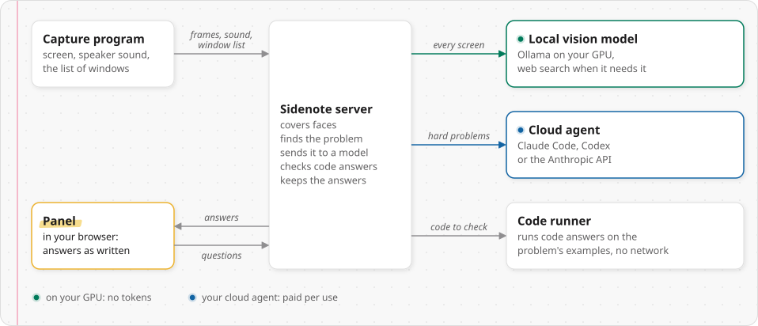
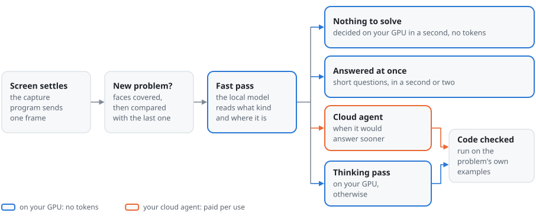

# Sidenote architecture

Sidenote reads the screen and the speaker sound, finds the problem in front of the user and writes the answer beside it
in a browser panel. The capture program sends frames, sound and the window list to the server. The server covers faces,
decides whether the screen holds a new problem, and has the local vision model on the GPU read every problem first; a
problem that needs reasoning goes to the agent (Claude Code, Codex or the Anthropic API) when the agent would answer
sooner or its type is set for the agent. One worker runs one analysis at a time. The panel shows each answer as it is
written, and the code in an answer runs on the problem's examples in a code runner with no network.

The same code runs in three ways. The app (`Sidenote.exe` on Windows, or the Linux app; both are `desktop/app.py`)
starts the server, the capture program and the PC's own Ollama as child processes and starts again what stops; it has no
code runner and no web search, since both are containers. With Docker, `./sidenote up` starts the server, the local
model, the code runner and SearXNG as containers (`compose.yaml`), and the capture program runs on the desktop. On
Kubernetes, the Helm chart (`deploy/helm/sidenote/`) runs the same four as pods, and the capture program on the PC
reaches the server through `kubectl port-forward`. In all three, the panel and the capture program reach the server at
`127.0.0.1:8777`.

## The pieces

<picture>
  <source media="(prefers-color-scheme: dark)" srcset="assets/diagram-pieces-dark.svg">
  
</picture>

Four programs work together: the capture program, the server, the panel and the code runner. The local model (Ollama)
and the web search (SearXNG) are services the server calls. Inside the server, `app.py` owns the connections and the one
analysis worker, and everything about a single problem happens in `pipeline.py`.

## One screen

The capture program sends a frame once the screen has changed and settled. The server covers faces, waits for the screen
to rest and compares it with the last one inside the last answer's problem region. A new problem goes to the local
model's fast pass, which answers at once, or the problem goes on to the agent (its crop or its text) or to the thinking
pass; the answer streams to the panel as `delta` messages. With **Check the examples** on, a coding answer then runs on
the problem's own examples in the code runner, with one retry after a failed example.

<picture>
  <source media="(prefers-color-scheme: dark)" srcset="assets/diagram-screen-flow-dark.svg">
  
</picture>

## One spoken question

With **Solve spoken problems** on, the capture program streams the speaker sound, one second of 16 kHz PCM a message.
Every 2 s Silero VAD reads the last 20 s; 1.5 s of quiet closes an utterance, which faster-whisper writes down whole as
Korean or English (a span under 0.8 s is skipped, and under 12 characters it is not a problem, under 6 when it looks
like a question). One that asks something is queued at once, up to 3 in one run of speech, and one that does not after a
6 s pause, behind any analysis of the screen: `question_kind` takes out a tag at the end of a clause, a reported
question and a stock rhetorical one before it looks ([note 106](DECISIONS.md#note-106)). The first pass and the agent
are told that a speaker telling a story asks the listener nothing (`SPEECH_RULE`). The agent gets the question part
written out, and the screen only with **Whole screen**.

A newer spoken problem replaces one that has written nothing yet. Once that one has written its first words it finishes,
and the newest speech waits behind it, reading what came after what was answered (`after_the_answer`). A sentence that
ended and was not taken tells the panel why (`utterance` with `why`). With **Keep what is heard** on, every closed
sentence also goes into `history.sqlite`.

<picture>
  <source media="(prefers-color-scheme: dark)" srcset="assets/diagram-voice-flow-dark.svg">
  
</picture>

## Who answers

`Pipeline.solve` picks the engine for each problem. The local model's fast pass reads every problem first, and on most
screens it finds nothing to solve in under a second (about 0.7 s with the 26b). The spend brake holds back only what the
watching sends by itself: **Reanalyze** and a question go through.

<picture>
  <source media="(prefers-color-scheme: dark)" srcset="assets/diagram-answer-dark.svg">
  
</picture>

| Case | Who answers |
|:---|:---|
| Neither engine can answer | nobody: `NoSolver`, and the card says so |
| Only the agent can answer | the agent, from the drawn region, the whole screen or the words heard; nothing goes out (`NotSent`) while the spend brake holds a problem the watching sent |
| **Think before answering** is **Never**, and the agent is off or on **Check answers** | one direct pass on the local model |
| The fast pass finds nothing to solve, or answers at once | the fast pass |
| It needs reasoning, and **Problems the agent solves** is **All** | the agent; with **All** the fast pass hands on every problem, and only `TYPE: none` ends there |
| It needs reasoning, the mode is **Hard problems** (the default), and there was a handoff | the agent |
| It needs reasoning, the mode is **Hard problems**, it is `hard`, and it has no type, is `slow_here`, or has a type in **Types the agent solves** | the agent |
| It needs reasoning otherwise, or the spend brake holds | the thinking pass on the local model, with the crop at full resolution, or the screen's halves on a wide screen |
| The agent declines, nothing is sent (`NotSent`), it writes a tool call out as text, or it fails | the thinking pass; after a decline only with **The local model answers when the agent declines** on (the default), otherwise its reply is the card |
| No first token in 6 s, and none again when the fast pass is asked once more | nobody: `GpuBusy`, nothing read and nothing sent |
| **Check answers** | the local model answers, and the agent checks each answer (`app.run_verify`); a different answer adds the fixed solution |
| The agent is at a limit or signed out, and the local model is switched off | the local model stands in (**The local model stands in at a limit**, on by default) |

A problem is `hard` when the fast pass's type is algorithm, coding, math or mcq, or its `ROUTE` is not `fast`; a pass
that brought no type counts as hard, and as having none. It is `slow_here` when the thinking pass's usual time to its
first word is 1.5 times the agent's or more (`SIDENOTE_LOCAL_SLOW_RATIO`, `pipeline.Speed`), or while another program
has the GPU. Before a handoff on a single screen, the fast pass is asked once more, on the model for a busy GPU, for the
kind and the place. Asked for with **Reanalyze**, a screen the fast pass reads as empty is looked at once more in halves
(on a landscape screen 3200 px or wider) before the card says there is nothing to solve. Notes
[48](DECISIONS.md#note-48), [53](DECISIONS.md#note-53) and [54](DECISIONS.md#note-54) give the reasons and the
measurements.

## Components

<picture>
  <source media="(prefers-color-scheme: dark)" srcset="assets/diagram-modules-dark.svg">
  
</picture>

| Part | Path | What it does | Start reading at |
|:---|:---|:---|:---|
| Server | `server/app.py` | FastAPI: `/ingest` for the capture program, `/panel` for the panel, the HTTP routes, and the panel's files on every other path. One worker settles, dedupes, transcribes and analyzes, one analysis at a time. Follow-up questions run as tasks a screen change does not stop; the code check, the verify check and the retry are tasks too, which stop when a newer answer replaces theirs. `engine_watch` looks at the local model every 20 s and frees the GPU after the idle time | `analysis_worker`, `ingest`, `prepare_frame` |
| Pipeline | `server/pipeline.py` | One problem to an answer: the image the model looks at, the fast pass, the route, the crop and text payloads, the verify check, and the code check with its one retry. `Spend` is the spend brake, `Speed` the first-word times the route compares. `Outcome.sent` lists what left the PC | `Pipeline.solve` |
| Local model client | `server/analyzer.py` | The local vision model over an OpenAI-compatible API (Ollama on the GPU): the fast and thinking passes, web search through tool calls, the prompts, the price table, error classification (`error_hint`) and the busy-GPU pace (`GpuPace`). `MockAnalyzer` streams fixed answers | `LocalLlmAnalyzer` |
| Agents | `server/agents.py` | The agents behind one shape (`run`, `auth_status`, `label`): Claude Code (`claude -p` with stream-json and a warm session), Codex (`codex exec --json`, one process an answer) and the Anthropic API; their sign-in checks | `make_agent` |
| Code check | `server/codecheck.py`, `server/checklangs/` | Runs a coding answer on the problem's own examples in the language it was written in: Python, JavaScript, TypeScript, Java, Kotlin, Go and C++ called as a function, those and C and Bash fed standard input. Each language's harness is in `checklangs/<language>.py` | `run_cases`, and `check_code` in `pipeline.py` |
| Change detection | `server/gate.py`, `server/detector.py` | The high-pass signature (a 160x120 edge map) and its distance; whether a screen is new, measured inside the last answer's problem region once one is known, with the cells that keep moving left out | `ChangeDetector` |
| Repeats | `server/repeats.py` | Knows a problem seen again by its picture (bands, then pieces) or by its words, before anything is spent on it | `Recent.match` |
| Speech | `server/transcriber.py` | Silero VAD, faster-whisper, and the utterance splitter | `UtteranceTracker` |
| Faces | `server/faces.py` | Finds faces (YuNet on onnxruntime) and paints them gray before anything reads the screen | `find`, `cover` |
| Web search | `server/search.py` | `web_search` through SearXNG and `fetch_page` from public addresses only, for the local model; each shown on the panel and logged | `WebTools` |
| History | `server/history.py` | The answers kept in SQLite with their follow-ups, code check, thumbnail and star | `History` |
| Settings | `server/config.py`, `server/settings.py` | The `SIDENOTE_*` environment, and **Solver settings**: a default, a kind of control and the dependencies for each stage, kept in `.settings.json` and applied to the next analysis | `Config`, `Settings` |
| Answer head | `server/heads.py` | Reads the `TYPE`, `ANSWER` and `REGION` lines every answer starts with, the same way as the panel | `head_start` |
| Models and GPU | `server/models.py`, `server/hardware.py` | The model profiles, picked by the GPU's memory; finding the GPU and its readings. Standard library only, so the launcher can run them before anything is installed | `choose`, `detect` |
| Logs and reports | `server/telemetry.py`, `server/report.py` | Log rotation and retention, `event()` records, the totals for `/stats`; `./sidenote stats`, `events` and `report` | `event`, `totals` |
| Safety nets | `server/forksafe.py`, `server/watchdog.py` | Keeps `fork()` away from the speech decoder's native threads (such a fork once wedged the server for 95 minutes); writes every thread's stack to `stall.txt` and ends the server when the event loop stops turning | `spawn_guard`, `start` |
| Translations | `server/i18n.py`, `server/locale/` | The server's words in English and Korean | `t` |
| Version and releases | `server/version.py`, `server/updates.py` | The one version (`VERSION`), which `/health`, the panel, `./sidenote version` and the release workflow read; the check for a newer release on GitHub, a minute after the start and then once a day | `ReleaseCheck.run` |
| Tools | `server/control.py`, `server/probe.py`, `server/mock_capture.py`, `server/ocr_gate.py` | `./sidenote gpu off`, `on` and `status` over the panel's own WebSocket; a check of a real engine with one image; a capture stand-in that sends made-up screens; the optional OCR gate, not in the image | `gpu`, `main` |
| Panel | `panel/` | Plain HTML, CSS and JavaScript with no build step: `index.html` (structure and style), `app.js`, `theme.js`, `i18n.js` and `i18n/ko.js`, and the pinned libraries in `vendor/`. `?demo=1` shows it with samples and no server | `handle` in `app.js` |
| Capture program | `client/capture.py`, `client/launch.pyw` | The screen, the speaker sound and the window list, on Windows and on Linux with X11: `SendGate`, `ScrollStitcher`, `Sender` and the tray menu | `main` |
| Desktop app | `desktop/` | `Sidenote.exe` and the Linux app: starts and watches the server, the capture program and Ollama, with capped logs; `build.py` builds it with PyInstaller | `run` in `app.py` |
| Code runner | `runner/` | Runs code with no network, one run at a time, each compile and each run as a user of its own: Python, C, C++, JavaScript, TypeScript, Java, Kotlin, Go and Bash | `LANGS`, `run` in `runner.py` |
| Launcher | `sidenote` | The user commands (`install`, `up`, `down`, `status`, `capture`, `login`, `llm`, `gpu`, `doctor`, `report` and more); reads `.env` as compose does and adds the GPU's compose file | the `case` at its end |
| Images and compose | `docker/`, `compose.yaml` | The server image, its entrypoint and pinned packages, the panel's pinned libraries, and the GPU files compose adds (`docker/compose.{nvidia,amd,cpu}.yaml`) | `docker/Dockerfile`, `services` in `compose.yaml` |
| Helm chart | `deploy/helm/sidenote/` | The same four services as pods, with NetworkPolicies, the runner's token and the model download Job | its `README.md`, `values.yaml` |

## How it runs

Under Docker, compose runs four services and a one-off model download; the capture program and the panel stay on the PC.
Every container drops all capabilities except the few it needs and runs with `no-new-privileges`, and the four services
write no core dumps ([note 39](DECISIONS.md#note-39)).

| Part | Service, container | Port | Networks | May reach | Reached by |
|:---|:---|:---|:---|:---|:---|
| Server | `server`, `sidenote` | 8777, published on `127.0.0.1` only (`SIDENOTE_PORT` moves the host side) | `default`, `llmnet` | the agent's service (claude.ai, chatgpt.com or the Anthropic API), the local model, SearXNG, public web pages, the runner's socket, api.github.com for the latest release | the capture program and the panel through the published port; `PeerGuard` takes only that port's gateway and the container itself |
| Local model | `llm`, `sidenote-llm` (Ollama) | 11434, not published | `llmnet` (`internal: true`) | nothing | the server |
| Web search | `searxng`, `sidenote-searxng` | 8080, not published | `default` | the search engines | the server |
| Code runner | `runner`, `sidenote-runner` | none: `/sock/runner.sock` in the `runner-sock` volume, which only root may open | none (`network_mode: none`) | nothing | the server, through the socket |
| Model download | `llm-pull`, run by `./sidenote llm pull` | none | `default` | the internet, for the model's files | nobody; it writes the `llm-models` volume and ends |
| Capture program | on the PC, outside Docker | none | the PC's | `ws://127.0.0.1:8777/ingest` | nobody |
| Panel | in the browser | none | the PC's | `http://127.0.0.1:8777` and its `/panel` WebSocket | nobody |

<picture>
  <source media="(prefers-color-scheme: dark)" srcset="assets/diagram-network-dark.svg">
  
</picture>

The search engines and the pages are reached by the server (`search.py`), never by the model, whose network has no way
out. A run's result goes only to the panel that sent the code. The app and the chart place the same parts this way:

| Part | The app | Kubernetes |
|:---|:---|:---|
| Server | a child process on `127.0.0.1:8777`, trusting loopback only (`SIDENOTE_TRUST_GATEWAY=0`) | a pod behind a ClusterIP Service on 8777; a NetworkPolicy lets no pod in, `kubectl port-forward` reaches it, and it trusts loopback alone |
| Local model | the PC's Ollama on `127.0.0.1:11434`, started as a child when it is installed and not running | a pod on 11434 that only the server reaches and that reaches nothing |
| Web search | off | a pod on 8080 that only the server reaches |
| Code runner | off, so there is no code check and no **Run** | a pod on TCP 8000 with no egress, reached only by the server; every run carries the runner's token |
| Model download | **Download** on the Local model card | the chart's pull Job: DNS and HTTPS out, nothing in |
| Capture program | a child process | on the PC, through the port-forward |
| The agent's CLI | the PC's own `claude` or `codex` | Codex in the image; Claude Code fetched into the pod when it starts |

## What is kept on disk

The server writes to its log folder: `~/.local/state/sidenote/logs` under Docker (bound to `/data/logs`), `logs/` in the
app's data folder (`%LOCALAPPDATA%\Sidenote` on Windows, `~/.local/share/sidenote` on Linux), and a
PersistentVolumeClaim on Kubernetes.

| File | What it holds | How long | How big |
|:---|:---|:---|:---|
| `server.log` | the server's log | rotated files deleted after 14 days (`SIDENOTE_LOG_DAYS`), at start and every 6 hours | 5 MB a file, 4 old files (`SIDENOTE_LOG_MAX_MB`, `SIDENOTE_LOG_FILES`; at least 64 KB and 1 file) |
| `events.jsonl` | one line per event: an analysis's start and end (type, one-line answer, time to the first character, elapsed time, region, tokens, cost), cancels, errors, follow-ups, panel actions, capture connections, sign-in changes; no screen images | as `server.log` | as `server.log` |
| `capture.log` | the capture program's log | deleted after 14 days without a line | under 4 MB, the older half dropped |
| `history.sqlite` | the answers with their follow-ups, code check, a small thumbnail of their screen and whether each is starred; nothing new with **Keep answers** off. A file from 0.1.0 gains the `starred` column when the server opens it, its rows kept. With **Keep what is heard** on, a table of its own (`heard`): one row a closed sentence, with its time, its length and its language | 90 days (`SIDENOTE_HISTORY_DAYS`); a starred answer until it is unstarred; what was heard goes by the same age | 200 MB (`SIDENOTE_HISTORY_MB`) for the answers that are not starred, counted in pages less the starred ones' bytes and what was heard; the starred ones stay beside them, and the log says once when they alone are over it. What was heard has its own 20 MB (`SIDENOTE_HEARD_MB`), the oldest going first |
| `.settings.json` | the values changed in **Solver settings** | until changed | a few values |
| `.switches.json` | the screen and sound switches and pause | until changed | a few values |
| `.speed.json` | the last 15 times to the first word of the thinking pass and of the agent (`pipeline.Speed`) | rolling | a few values |
| `.pace.json` | each local model's recent generation rates, for the busy-GPU check (`GpuPace`) | rolling | a few values |
| `.spend.json` | the last hour's spend on the agent and a rest on its usage limit | across restarts | a few values |
| `.restart.npz` | the problems answered lately and the last screen's signature, written when the server stops | read and removed at the next start, which takes up problems under 30 minutes old and a last screen under 10 | the gray pictures of up to six boxes, compressed |
| `stall.txt` | every thread's stack when the event loop stalls (`watchdog.py`) | each dump added; the file starts over at a start once past 1 MB | under about 1 MB |
| `none_*.png` | with `SIDENOTE_DEBUG_FRAMES` set, the screens read as nothing to solve | the last eight | a few MB each |
| Docker's container logs | each container's output (json-file) | rotated | the server 3 x 5 MB, the local model 2 x 5 MB, the runner and SearXNG 2 x 2 MB, the model download 1 x 2 MB |
| `hf-cache` volume | the speech model | until removed | about 0.5 GB for `small` |
| `llm-models` volume | the local model's weights | until removed | tens of GB a model |

The app also keeps what each child printed (`server-console.log`, `capture.log`, `ollama.log`) and its own `app.log`,
each rotated at 5 MB with one older file.

## Protocol

Both WebSockets carry JSON messages with a `type`. The server takes messages up to 64 MiB (`--ws-max-size` in
`docker/entrypoint.sh`), since a 3840x2160 frame of a photo-like screen can be over uvicorn's default 16 MiB; a larger
one is logged as lost (code 1009).

### Capture program to server, on `/ingest`

| Type | When | Main fields |
|:---|:---|:---|
| `hello` | first, on every connection | `info` (`capture/win32`, `capture/linux`), `screen`, `audio`, `no_audio`, `monitor`, `monitors` (what the panel offers), `flags` (the options it was started with, which win over the panel's last choice, sent once per start), `code` (the sha256 of the `capture.py` it runs) |
| `caps` | when it knows whether the sound device opened, and when a skip starts or ends | `screen`, `audio`, `audio_device`, `no_audio` (started with `--no-audio`), `monitors`, `skipping` (a window named in **Skip windows** is in front, so no frame comes; never which window) |
| `frame` | when the screen changed and settled, and no window named in **Skip windows** is in front | `data` (PNG, base64), `windows` (the visible top-level windows over the captured area, front to back, in fractions of it, without the desktop, the taskbar and tool windows), `extra` (with `--stitch`: the joined problem) |
| `audio` | each second while sound is on | `sr` (16000), `data` (16-bit mono PCM, base64) |
| `capture_set` | a switch in the tray menu, taken as the panel's are | `screen` or `audio` |

### Server to capture program, on `/ingest`

| Type | When | Main fields |
|:---|:---|:---|
| `control` | on connect and on every change | `screen`, `audio`, `stitch`, `monitor`, `skip_windows` (the words of **Skip windows**: no frame is sent while the window in front has one in its title or its program's name) |

### Server to panel, on `/panel`

| Type | When | Main fields |
|:---|:---|:---|
| `status` | everything on connect, then the keys that changed | `analyzer`, `paused`, `lang`, `audio`, `voice`, `can_ask`, `run_enabled` (the runner configured and responding, and **Run button** on), `runner`, `engines` (each engine's state; for the agent its `provider`, `label`, `short`, `login`, `effective` mode, payload, model, effort, `brake` and `limit_until`; for the local model `stand_in`), `version`, `update_check` (false when `SIDENOTE_UPDATE_CHECK=0` or mock mode leaves the check nothing to do), `update` (a newer release, `version` and `url`, or null; sent again when the check or **Check for new versions** changes it) |
| `settings` | `meta` and `values` on connect, then the changed `values` | `meta` (sections and items), `values`, `options` (a list of choices that changed: the pulled models, the monitors) |
| `capture` | on connect, on a change, and at most every 5 s while frames and sound arrive | `clients`, `info`, `last_frame`, `last_audio`, `screen_on`, `audio_on`, `caps`, `empty_run` and `quiet_sec` (the watching slowed by answers that found nothing) |
| `usage` | on connect and after each answer | `answers`, `empty` (analyses with nothing to solve), `tokens_in`, `tokens_out`, `cost_usd`, `errors`, `elapsed_p50`, `first_token_p50`, `first_token_avg`, `tps_avg`, `last_error` |
| `gpu` | every two seconds while a panel is open; `none` once when the readings stop | `util`, `used`, `total`, `temp`, `power` |
| `llm_pull` | while a model downloads from the panel | `model`, `status` (`pulling`, `tuning`, `done`, `failed`), `completed`, `total`, `error` |
| `analysis_start` | an analysis begins | `id`, `ts`, `thumb`, `transcript`, `pages`, `trigger` (`screen`, `voice`, `ask`, `retry`, `continue`), `roi` (the drawn box), `about` (for a follow-up: the answer it is about) |
| `stage` | the card's status line changes | `id`, `stage` (`think`, `local`, `extract`, `confirm`, `agent`, `halves`), `detail`, `thought` (the thinking pass's last finished sentence), `restart` (another engine starts the answer over, so the card is cleared) |
| `delta` | as the answer is written | `id`, `text` |
| `analysis_done` | the answer is complete | `id`, `text`, `usage`, `cost_usd` (null for the local model and for an agent with no price, such as a Codex login), `model`, `engine` (`local`, `agent`), `sent` (`to`: `search`, `page`, `agent`, and `what`), `stages`, `elapsed`, `region` |
| `analysis_cancelled` | an analysis stops | `id`, `reason` (`pause`, `screen_off`, `sound_off`, `reanalyze`, `voice`, `superseded`, `not_sent`) |
| `check` | the example check starts, then ends | `id` (a retry's number for the check of its fixed code), `running`; then `passed`, `total`, `how` (`function`, `stdin`), `rows` and `fails` (`input`, `expected`, `got`), or `none`, `error`, `cancelled` |
| `verify` | the **Check answers** check of an answer starts, then ends | `id`, `running`; then `verdict` (`ok`, `fix`, `other`), `text`, `model`, `usage`, `cost_usd`, `sent`, or `not_sent` (with `why`), `error`, `cancelled` |
| `agent_confirm`, `agent_confirm_done` | **Confirm before sending** asks, then the question ends | `id`, `cid`, `what`, `text`, `thumb`, `timeout` (120 s), `ts` |
| `problem_text`, `thumb` | the answer to the panel's request, to that panel only | `id` and `text` or `error`; `url` (the current screen to draw a box on), `ts`, `live` |
| `run_started`, `run_result` | a run from a code box, to the panel that sent it only | `id`, `lang`, `ok`, `stage` (`run`, `compile`), `exit`, `stdout`, `stderr` (each with a `_truncated` flag), `timed_out`, `output_limited`, `elapsed`, or `error` |
| `error` | an analysis fails | `id`, `text`, `hint` (`auth`, `limit`, `timeout`, `nosolver`) |
| `transcript` | the live window is written down | `text`, `lang` (`ko`, `en`), `waiting`, `pending` |
| `utterance` | a sentence ended, or the first pass found nothing to solve in what was heard | `text`, `lang`; `why` when it was not taken: `short` (under the limit, or sound too short to write down that the live words show), `told` (it only sounds like a question), `none` (nothing asked) |
| `notice` | a short notice | `text`, `level`, `of` (the answer it is about, brought into view when the notice is pressed) |
| `star` | an answer is starred or unstarred, from any panel, to every panel | `id`, `starred`, `n` (how many answers are starred now) |

An answer streams as `{"type":"delta","id":N,"text":"..."}` messages between its `analysis_start` and its
`analysis_done`.

### Panel to server, on `/panel`

| Type | Sent for | Fields |
|:---|:---|:---|
| `pause`, `resume` | the pause key | |
| `reanalyze` | **Reanalyze** | |
| `ask` | a follow-up question | `text` |
| `capture_set` | the screen and sound switches | `screen` or `audio` |
| `setting`, `settings_reset` | a change in **Solver settings**, or all of them back to their defaults | `key`, `value` |
| `set_lang` | the speech language, as the setting `speech_lang` sets it | `lang` (`auto`, `ko`, `en`) |
| `ui_lang` | the panel's own language, once it connects; the server's words follow it | `lang` |
| `run` | **Run** on a code box | `id` (`<per-panel prefix>-N`), `lang` (`python`, `c`, `cpp`, `javascript`, `typescript`, `java`, `kotlin`, `go`, `bash`), `code`, `stdin` |
| `agent_confirm_reply` | the answer to **Confirm before sending** | `cid`, `send` |
| `thumb`, `problem_text` | a screen to draw a region on; **Problem text** of an answer | `id` for `problem_text` |
| `gpu_release`, `gpu_load`, `gpu_load_cancel` | giving the GPU back, **Load onto the GPU**, stopping that load | |
| `llm_pull` | **Download** on the Local model card | `model` |
| `history_clear` | **Clear history** | |
| `star` | **Star** on an answer; refused with a `notice` to that panel alone when `history.sqlite` does not hold the answer | `id`, `starred` |

### HTTP

| Route | What it gives |
|:---|:---|
| `GET /` | the panel, and its files on every other path |
| `GET /health` | the state: `version`, the analyzer, the agent and its label, sign-in, capture, pause, `runner` (configured and responding), `activity` (what runs) |
| `GET /stats` | totals, recent response times and log size |
| `GET /heard` | what was heard and kept: `days` (each with `day`, `n`, `first`, `last`), `day`, and the `lines` of that day or the newest (`ts`, `secs`, `lang`, `text`; of a longer day its last 20,000) |
| `GET /history`, `GET /history/days` | the answers kept, newest first (`day`, `q`, `kind`, `starred=1` for the starred ones only, `limit`), each with its `starred`; and the days that have some, with how many answers are `starred` and whether anything heard is kept (`heard`) |
| `POST /capture/quit`, `POST /capture/restart` | asks the capture program to end or to restart (`./sidenote capture-stop`, a deploy); refused from a page |
| `POST /server/stop` | asks the server to close down by itself, as the app does when it quits (Windows has no SIGTERM); only with the token the app started the server with, in `X-Sidenote-Stop` |

### Code runner

The server reaches it through `/sock/runner.sock` under compose, and over TCP with a token on Kubernetes.

| Request | Answer |
|:---|:---|
| `POST /run` with `lang`, `code`, `stdin`, `timeout` | `ok`, `stage`, `exit`, `stdout`, `stdout_truncated`, `stderr`, `stderr_truncated`, `timed_out`, `output_limited`, `elapsed`; or `{ok: false, busy: true}` when the previous run does not end within 15 s |
| `POST /run` with `stdins` (1 to 8 inputs) in place of `stdin` | one compile and a run on each input: `runs` (one result as above per input) beside the last run's fields, or the compile's failure |
| `GET /health` | `ok`, `busy` |

## Security

| What is protected | Against | How | Where |
|:---|:---|:---|:---|
| The screen thumbnails, the speech heard and the switches | any page open in the browser, which can open `ws://127.0.0.1:8777/panel`; DNS rebinding | a WebSocket only with no Origin or an Origin equal to its Host; any request only with the Host `127.0.0.1` or `localhost`; refusals recorded as `refused` events | `same_origin`, `PeerGuard` in `server/app.py` ([37](DECISIONS.md#note-37)) |
| The server | a client beside it: code in the runner, another container or pod | connections only from the published port's gateway and from its own container, with nothing looked up by name; loopback alone on Kubernetes and in the app | `PeerGuard` ([37](DECISIONS.md#note-37), [87](DECISIONS.md#note-87)) |
| The panel page | an answer that repeats hostile text from the screen | DOMPurify keeps out images, media, svg, iframes, forms, styles and the `style`, `srcset`, `id`, `name` and `data-*` attributes, and `class` keeps only `language-*`; math goes back as text nodes; a diagram is mermaid's SVG (`securityLevel: "strict"`) shown as an `` | `panel/app.js` ([18](DECISIONS.md#note-18), [28](DECISIONS.md#note-28), [52](DECISIONS.md#note-52)) |
| What the panel loads | a CDN that changes, breaks or records each load | the libraries and fonts pinned and sha256-checked when the image is built, then served by the server; CSP `default-src 'none'` with `script-src 'self'` and `frame-ancestors 'none'`; nosniff, no referrer, COOP and CORP, no camera or microphone | `docker/vendor.json`, `docker/fetch_vendor.py`, `SecurityHeaders` in `server/app.py` ([38](DECISIONS.md#note-38)) |
| The PC and its network | code a model wrote, run for a check or by **Run** | the runner has no network and takes one run at a time, each compile and run as a user of its own, under rlimits and a time limit; output over 8 MB stops a run; what a run leaves is removed; a read-only root, 128 processes, 1 GB, 2 CPUs; a token for every run on Kubernetes | `runner/runner.py`, `compose.yaml` ([47](DECISIONS.md#note-47), [87](DECISIONS.md#note-87)) |
| The screens and speech the local model reads | leaving the PC | the local model is on `llmnet` (`internal: true`), with no route out; models come in through `llm-pull` | `compose.yaml` ([48](DECISIONS.md#note-48)) |
| People's likeness on the screen | going to a model, the agent or a thumbnail | faces found and painted gray before anything reads the screen (**Cover faces**, on by default) | `server/faces.py`, `prepare_frame` ([85](DECISIONS.md#note-85)) |
| A password manager or a private browser window in front | being sent at all | no screenshot is taken while the window in front has a word of **Skip windows** in its title or its program's name; the title and the name stay in the capture program, and only `skipping` goes out | `FrontWindow`, `screen_loop` in `client/capture.py` |
| Personal data on the screen | a search, a page address or a problem written out from the screen | a number shaped like personal data stops the search, the page read or the written-out problem; the local model solves instead | `personal_data` in `server/pipeline.py`, `server/analyzer.py` |
| The private network | the server reading a page for the model | pages are read from public addresses only: the name is resolved once, every address it gives must be public, and the connection goes to one of those addresses (a name that resolves elsewhere by the time of the connect gets no request) | `allowed_url`, `public_backend` in `server/search.py` |
| This PC's agent setup | the CLI in the container | Claude Code reads none of the PC's settings, hooks, plugins, MCP servers or skills and keeps no sessions; Codex reads none of its config or rules; the container's config backups and process registry stay in its own scratch space | `claude_args`, `codex_args` in `server/agents.py`, `compose.yaml` ([23](DECISIONS.md#note-23)) |
| The host | a container gone wrong | all capabilities dropped but the few each needs, `no-new-privileges`, read-only roots, caps on processes, memory and CPUs, no core dumps | `compose.yaml`, the chart's `values.yaml` ([39](DECISIONS.md#note-39)) |
| The settings, the capture program and the server itself | a page in the browser posting to the server | no HTTP endpoint changes a setting; the two that end or restart the capture program refuse an Origin other than the server's own; `/server/stop` takes only the token the app gave the server | `server/app.py` |
| The account the agent signs in as | the logs and the status pages | it goes only to the panel (`panel_engines`), not to `/health`, `/stats` or the logs | `server/app.py` ([97](DECISIONS.md#note-97)) |
| The panel, and what this PC tells GitHub | a reply to the release check that is not a release, or a page it links to elsewhere | the request carries no token and only Sidenote's version; of the reply only the tag's three numbers reach the panel, and its page only when it is under this repository's releases (checked by the server and again by the panel); drafts and pre-releases never count; `SIDENOTE_UPDATE_CHECK=0` makes no request | `server/updates.py`, `releaseLink` in `panel/app.js` |

## Limits and next steps

| Limit | What it means |
|:---|:---|
| Capture is started and stopped by hand | while it runs, the capture program keeps reading the screen and sound; nothing starts by itself and nothing stays resident |
| The duplicate check reads no text | it compares inside the problem region, so the next problem on the same template is caught, but a new problem outside the region while the old one stays in view is not solved by itself (**Reanalyze** solves it) |
| Cost is not optimized yet | most of a Claude Code call's cost is its own cache creation, so the model's price is the only lever; a Codex login reports no price at all |
| Real-model tests need this PC's login | the regression tests that call Claude Code run in a container with this PC's `~/.claude` bound, and are skipped when it is not signed in |
| The local model wants the GPU to itself | under WSL2 the runtime does not see other programs' GPU memory, so a busy GPU shows as slowness (the 26b generated 4.6 times slower beside another program writing 8 GiB of GPU memory); an answer under half its model's usual rate (`.pace.json`) moves to **Model when the GPU is busy** for 30 s (`SIDENOTE_LOCAL_BUSY_HOLD_SEC`), doubling up to 10 minutes while the GPU stays as busy |
| The problem box | the agent's crop and the thinking pass's zoom are cut from `REGION` with a margin of 15% on the left and 6% elsewhere, inside the window that shows most of it; a box of 80% of the screen or more, one mostly over the wallpaper, or one more than a fifth covered by other windows places nothing. Over 3 runs of 30 screens, 63 of 66 cut boxes held the whole problem and none held a pixel of another window. On a landscape screen 3200 px or wider with no usable box, the thinking pass gets the screen's two halves (the 4K desktop right 8 of 8 times, against 0 of 4 without) |
| A screen with nothing to solve takes about 0.7 s | with the 26b and two runtime slots (`SIDENOTE_LOCAL_SLOTS`, about 740 MiB of GPU memory each); one slot took 0.98 to 1.49 s after a thinking pass, and three made every request slower in a later run |
| A thinking pass can reach the output limit | `SIDENOTE_MAX_TOKENS` (8,000) covers the local model's thinking and answer together; a pass that ends there with little answer is answered once more with thinking off, from the end of its reasoning, and labeled `cut` |
| Next | horizontal scrolling and 2D stitching |

## Terms

| Term | Meaning |
|:---|:---|
| Fast pass (also the first pass) | the local model's first look at a problem: it writes the `TYPE`, `ROUTE`, `ANSWER` and `REGION` lines and answers at once what it can (`LocalLlmAnalyzer.fast`) |
| Thinking pass | the local model's second pass, with thinking on and the problem cut out at full resolution, for a problem the fast pass says needs reasoning (`LocalLlmAnalyzer.deep`) |
| Handoff | the fast pass brought no token within `SIDENOTE_LOCAL_FIRST_TOKEN_SEC` (6 s) while the agent could take the problem, so the agent gets it ([note 54](DECISIONS.md#note-54)) |
| The watching | the analyses Sidenote starts by itself when the screen changes or speech is heard, as against what the user asks for (**Reanalyze**, a question, a drawn region) |
| Problem region | the `REGION` line of an answer, `x0 y0 x1 y1` in percent of the screen: where the problem is, and what the change watch compares ([note 21](DECISIONS.md#note-21)) |
| Payload | what is sent to the agent, chosen with **What is sent to the agent**: **Problem area** (a crop), **Problem text** (the problem written out by the local model) or **Whole screen**; `Outcome.sent` lists it |
| Spend brake | `pipeline.Spend`, which holds back what the watching sends to the agent: for five minutes after six empty answers in a row, and while the last hour's cost is at **Hourly cost limit**; what the user asks for goes through |
| Stand-in | the local model answering while it is switched off, because the agent is at a limit or signed out (**The local model stands in at a limit**, [note 89](DECISIONS.md#note-89)) |
| Repeat | a problem seen again, known by its picture or its words, which ends the analysis without solving it again ([note 88](DECISIONS.md#note-88)) |
| Example check | running a coding answer on the problem's own examples, with one retry after a failed example (`codecheck.py`) |
| Right column | the cards beside the thread (the connections, the screen, the contents, the sums); the code calls it the rail (`.rail`, `fitRail`) |
| Thread (also the notebook) | the answers in the panel, oldest first ([note 27](DECISIONS.md#note-27)) |
| Known-answer set (also the bench) | real screens and spoken questions with known answers, run against the engines to measure a change ([DESIGN-local-first.md](DESIGN-local-first.md), sections 2 and 11) |

## Design decisions

The reasons behind the design, with the measurements, are in [DECISIONS.md](DECISIONS.md): 105 numbered notes, each
under the first of its topics. A note that a later one replaces says so on its first line.

| Topic | Notes |
|:---|:---:|
| [Capture, change detection and when an analysis runs](DECISIONS.md#capture-change-detection-and-when-an-analysis-runs) | 26 |
| [Choosing who answers (routing, handoff, spend) and what is sent](DECISIONS.md#choosing-who-answers-routing-handoff-spend-and-what-is-sent) | 14 |
| [The local model and the answer prompt](DECISIONS.md#the-local-model-and-the-answer-prompt) | 9 |
| [The agents](DECISIONS.md#the-agents) | 14 |
| [Code checks](DECISIONS.md#code-checks) | 11 |
| [The panel](DECISIONS.md#the-panel) | 33 |
| [Speech](DECISIONS.md#speech) | 6 |
| [Security and isolation](DECISIONS.md#security-and-isolation) | 9 |
| [Deployment and packaging](DECISIONS.md#deployment-and-packaging) | 9 |
