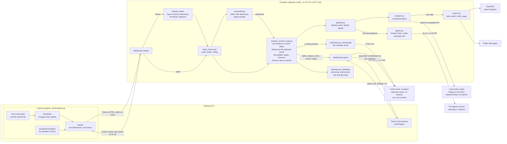
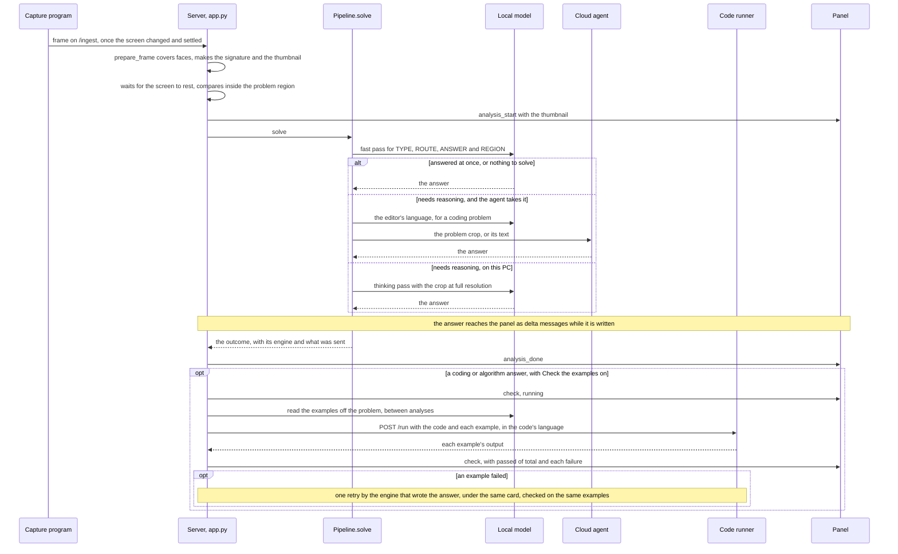
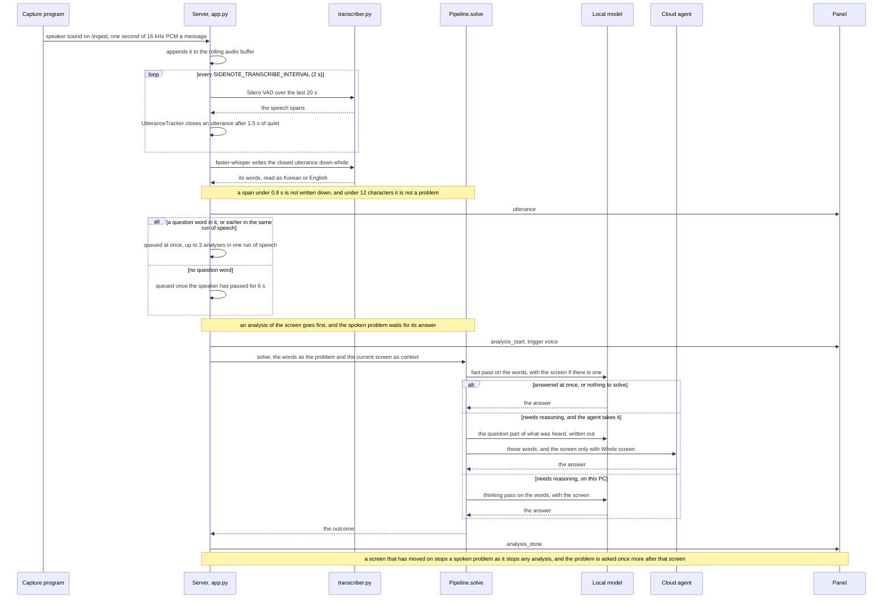
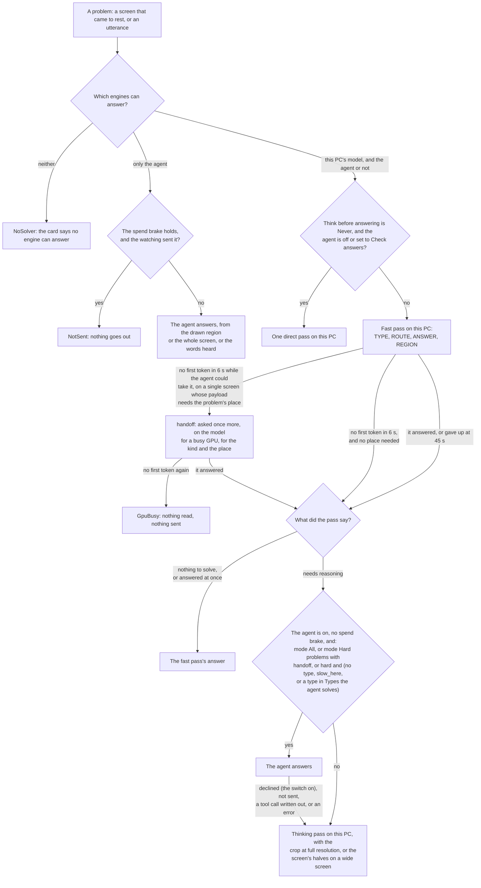

# Sidenote architecture

## Data flow

The capture program on Windows sends the screen and the speaker sound to the server, which runs in a container in
WSL and listens on 127.0.0.1:8777 only. One worker runs one analysis at a time: the local vision model reads every
screen first, and the problems that need reasoning go to the cloud agent (Claude Code, Codex or the Anthropic API)
when it is signed in. The panel in the browser gets each answer as it is written, and the code in an answer runs in
a container with no network.



The code runner is reached through a Unix socket in a volume the two containers share, and a run's result goes only
to the panel that sent the code (`run_result`). The search engines and the pages are reached by the server
(`search.py`), never by the model, whose network has no way out. One screen problem, from the frame to the checked
answer:



One spoken problem, from the speaker's sound to the same pipeline, with **Solve spoken problems** on:



The flowchart after [note 54](#note-54) shows how Pipeline.solve chooses between this PC's model and the agent.

## Terms

- **Fast pass** (also the first pass): the local model's first look at a problem. It writes the `TYPE`, `ROUTE`,
  `ANSWER` and `REGION` lines and answers at once what it can (`LocalLlmAnalyzer.fast`).
- **Thinking pass**: the local model's second pass, with thinking on and the problem cut out at full resolution,
  for a problem the fast pass says needs reasoning (`LocalLlmAnalyzer.deep`).
- **Handoff**: the fast pass brought no token within `SIDENOTE_LOCAL_FIRST_TOKEN_SEC` (6 s) while the agent could
  take the problem, so the agent gets it ([note 54](#note-54)).
- **The watching**: the analyses Sidenote starts by itself when the screen changes or speech is heard, as against
  what the user asks for (**Reanalyze**, a question, a drawn region).
- **Payload**: what is sent to the agent, chosen with **What is sent to the agent**: **Problem area** (a crop),
  **Problem text** (the problem written out by the local model) or **Whole screen**. `Outcome.sent` lists it.
- **Spend brake**: `pipeline.Spend`, which holds back what the watching sends to the agent: for five minutes after
  six empty answers in a row, and while the last hour's cost is at the panel's **Hourly cost limit**. What the user
  asks for goes through.
- **Stand-in**: the local model answering while it is switched off, because the agent is at a limit or signed out
  ([note 89](#note-89), the setting **This PC's model stands in at a limit**).
- **Right column**: the cards beside the thread (the connections, the screen, the contents, the sums). The code
  calls it the rail (`.rail`, `fitRail`).
- **Thread** (also the notebook): the answers in the panel, oldest first ([note 27](#note-27)).
- **Known-answer set** (also the bench): real screens and spoken questions with known answers, run against the
  engines to measure a change ([DESIGN-local-first.md](DESIGN-local-first.md), sections 2 and 11).

## Components

**Server (`server/`)**
- `config.py`: settings from environment variables (`SIDENOTE_*`). Mock and real runs, with sound on or off,
  go through the same code.
- `gate.py`: a high-pass signature (an edge map: a low-resolution grayscale image minus its blur) and MAD
  distance. Insensitive to background brightness, sensitive to changes in text and structure. The signature
  is read off the frame as it was grabbed, with no shrink to 1600 wide first: the signature shrinks what it is
  given to 160x120 and the scroll profile to 512x240 anyway, and that shrink cost 52 ms of a 60 ms poll on a 4K
  screen three times a second, for an image nobody looked at. Measured on 102 pairs of real 4K screens: the same
  send decision on all of them, the same scroll on all 12, and 60.9 ms down to 20.3 ms a poll on the test PC,
  18.3% of a core to 6.1%.
- `detector.py`: decides whether a screen is new. Pixel signature by default. Once an answer gives the
  problem's location (`REGION`), only the distance inside that region counts ([note 21](#note-21)). OCR mode is
  optional.
- `ocr_gate.py`: (optional, off by default) text extraction with rapidocr. Its bundled recognition model is for
  Chinese and English, so text on Korean screens comes out garbled. It is not in the container image. Given
  `SIDENOTE_GATE=ocr|hybrid`, the server logs a warning and runs the pixel gate, so it still starts.
- `transcriber.py`: faster-whisper transcription, Silero VAD speech detection, and the utterance splitter
  `UtteranceTracker`.
- `analyzer.py`: unifies the backends as `AnalysisResult` (text, tokens, cost). `LocalLlmAnalyzer`
  (default) talks to a vision LLM on this PC over an OpenAI-compatible API (Ollama on the GPU); a fast pass
  answers at once or says the problem needs reasoning, a thinking pass solves what does, and web search runs
  through tool calls (`search.py`). `MockAnalyzer`/`MockLocal` stream fixed answers. The prompts, the price table
  and error classification (`error_hint`: auth, limit, timeout) live here too.
- `agents.py`: the cloud agents behind one shape ([note 86](#note-86)), picked by `SIDENOTE_AGENT` (`make_agent`).
  `ClaudeCodeAgent` runs `claude -p` with stream-json input and output and a persistent warm session
  (`ClaudeCodeSession`); `CodexAgent` runs `codex exec --json`, one process per answer; `AnthropicApiAgent` is for
  an API key. The sign-in checks (`claude auth status --json`, `codex login status`) live here too.
- `pipeline.py` also holds `Spend`, the spend brake on asking the agent about nothing: measured with Claude Code, 93
  turns in 21 minutes, every one of them "nothing to solve", 1.53M input tokens and $3.61, while a game was on the
  screen and people were talking. Six empty answers in a row pause automatic sending for five minutes, an hour has a
  ceiling in dollars (**Hourly cost limit**, counted only for an agent that reports a price: a Codex login reports
  none), and anything the user asks for (**Reanalyze**, a question, a drawn region) goes through regardless. A turn
  cut short (a newer screen, the pause, a canceled check) counts toward the ceiling too, at the middle of what the
  last whole turns cost: the CLI is killed with it and never says its price, but its request was paid for, and
  uncounted, a screen that kept changing was seen one turn in three. A turn that ends in an error counts at its own
  cost, not at the session's running total.
- `pipeline.py`: one problem to an answer through the stages the panel switches: the image the model looks at
  (whole screen or the drawn box), the fast pass, routing to the local thinking pass or to the agent, the crop and
  text payloads (cut inside the window that shows the problem, where windows in front are painted over; no crop
  when the box is the whole screen or split between windows, and no text written out from the whole screen that
  holds numbers shaped like personal data), the verify mode's check by the agent, the problem written out as text for
  the panel, and the code check with its one retry (the languages are `codecheck.py`'s). `Outcome.sent` lists
  what left the PC.
- `codecheck.py` with `checklangs/`: the example check of a coding answer, in the language it was written in.
  - Languages and files: Python, JavaScript, TypeScript, Java, Kotlin, Go and C++ called as a function, those and C
    and Bash fed standard input; an answer only in another language (Swift, C#, SQL and so on) is said to be one,
    without reading the examples. `codecheck.py` holds what every language shares (which block runs, the arguments an
    example stands for, how a result compares, `run_cases`, and `run_design` for a problem that asks for a class);
    each language's harness and what it reads off a declaration are in `checklangs/<language>.py`, and what those
    share in `checklangs/common.py`.
  - Which block runs: the block is chosen with the examples, as the last that defines the function they call (an
    approach shown and dropped comes first), or the last program that reads input. When no block defines that
    function, the one function the answer defines that takes as many arguments runs instead: the problem's own name is
    often only in the editor, which the crop the examples are read from leaves out, so the model writes a likely name.
    A shell block that runs another program (`cat in.txt | python3 main.py`) is not taken for the solution.
  - The harness: each language's harness writes the examples as values of the parameters' own types, read off the
    declaration (a type it does not know means no check, said on the card, rather than a wrong one), and keeps the
    answer's code as written. Python runs it as its own compiled unit; C++ puts a printer that uses only `std::` names
    after it, with the answer's `#define int` and `#define endl` set aside around its includes; Java takes the
    `public` off the answer's top-level classes so the harness's own class holds the file, drops a `package` line and
    puts a method given without its class into one; Go gets a package clause when it has none, and prints a nil slice
    as an empty list and a `byte` or `rune` as its character. The harness calls a new `Solution` for each example as a
    judge does, sends what the answer prints itself to nowhere while it runs, so that a table it prints cannot push
    the results past the runner's 64 KB, and prints each example's result on a line of its own with its number; an
    example after the run stopped counts as failed. C++'s stream settings an answer leaves (`cout << hex`) are put
    back before the results print, JavaScript's output while the answer loads is thrown away too, and Go's `[]rune`
    and `[]byte` results print as characters (a list of characters and a string of them compare the same). A program's
    examples go to the runner in one request, compiled once, each input ending with a newline.
  - What a judge adds: code in LeetCode's form (a `class Solution` method with the problem's own name,
    `_leetcode_form`) gets what its judge adds without an import: Python the names of collections, heapq, bisect,
    itertools, functools, math, string and operator (never one that hides a builtin), Java java.util and its function
    and stream packages, C++ every header and `using namespace std` (also given to C++ code with no `#include`).
    Programmers' judge adds nothing, so there a missing import is an error.
  - Declarations: they are read with comments and strings blanked out, from the function's name outward (a 28 KB
    answer in 0.01 s): the overload that takes as many arguments as the examples (not a private helper of the same
    count when there is another), the definition that runs (Python's and JavaScript's last), its parameters' names and
    defaults (arguments given by name, or one not in a list, decided over all the examples, are put in their order),
    and what it says it returns, a Python 2 docstring's `:rtype:` too. A method is called on the top-level class whose
    body holds it, not on a helper or nested class or one named in a comment. Python, JavaScript and TypeScript have
    no types to fill, so a parameter or result of a type of the answer's own (a TreeNode, a ListNode: an example's
    level-order list is not one), found in its annotations, its docstring, a parameter used as `root.left` or
    `head.next`, or LeetCode's node class in the code, is not run, as in the typed languages.
  - Answers that return nothing: such a function is judged by its first list argument (LeetCode's in-place problems
    all work on the first). When it says it returns nothing (`void`, `Unit`, `-> None`, `@return {void}`, `: void`)
    the argument has to end as expected; when it says nothing (a Kotlin expression body included), it has to have
    changed it in some example; Programmers' `solution` (void or not), or a function that says it returns a value,
    fails (a merge that never copied its second array passed 3 of 3, matching it on an unchanged argument). The card
    and the retry show the argument as it was left.
  - How results compare: True is not 1, whole numbers compare exactly, a double against a whole number within 1e-5 of
    the double's exact value (5.000000075e17 is not 500000007500000028), a double counts within half the expected
    value's last place and at most 1e-5, and a program's output compares as text unless an example shows more places
    than a double holds (then number by number within 1e-9, as such a problem says).
- What the problem itself says about the judging is read with the examples (`analyzer.EXTRACT_CASES`: `returns`,
  `order`, `tolerance`) and named in the check card's note as "any order", "in place" and "tolerance 1e-09". An answer
  whose statement says any order counts however the elements of its answer are ordered, but not how each element is
  ordered inside (`_unordered`): Permutations says "in any order" too, and there the order inside each element is the
  answer, so one that sorted each permutation must fail. A failing example that holds the expected values in another
  order at any depth is marked `order_only`, whether or not the problem said anything, and the card says so as a fact:
  on a sorting problem that is the mistake, on Group Anagrams, whose groups the judge reads as sets, the answer may
  still be right. The example reader often writes the `any` of "in any order" under `returns` instead of `order`
  (26 of 85 corpus statements that say it), and `any` answers nothing `returns` asks, so it is read as the order it means:
  56 of the 85 read as any order before, 83 after, and still 1 of 85 statements that say nothing of order. It matters
  beyond the label: the reference answers of those 85 pass 82 times with the order free and 54 with it counted, and
  each of the other 28 is a failed card and a retry. `returns` decides the in-place rules over the declaration, so a
  function that forgot its return fails on a problem that asks for a value, and one that fixes its argument passes on
  a problem that asks for that, Programmers' `solution` included. `tolerance` (only 0 < t <= 0.1 counts) is the error
  every number is read within, for a function's result and for a program's output. Asking for the three fields in the
  prompt beat forcing the answer into a JSON schema, which made the model write a screen's example values as strings
  holding JSON (measured on 14 problems as text and on four screens).
- `settings.py`: every stage has a setting with a default from `config.py`, a kind the panel draws a control
  for, and its dependencies. Values persist in `.settings.json` and apply to the next analysis without a restart.
- `heads.py`: the `TYPE`/`ANSWER`/`REGION` head every answer starts with, read the same way by the server, the
  pipeline and the panel.
- `search.py`: `web_search` and `fetch_page` tool calls for the local model: searches go through a SearXNG
  instance, and the server reads result pages itself, from public addresses only; every search and page read
  is shown on the panel and logged. A query or page address holding a number shaped like personal data is not
  sent (`analyzer.py`, checked on the address as read too), and a search the engines turned away comes back to the
  model with their reasons.
- `app.py`: FastAPI. `/ingest` (capture input, delivery of the switches), `/panel` (panel traffic), `/health`,
  `/stats`, and static files from `panel/` on every other path. A single worker handles cancellation, dedupe,
  transcription and analysis. Follow-up questions run as separate tasks that a screen change does not stop; the code
  check, the verify mode's check and the one retry after a failed example (run as a follow-up) are tasks too, and a
  newer analysis stops them. Pause stops all of them, and switching a source off stops the ones that send it. The
  switches and pause are kept in `.switches.json` in the log folder ([note 26](#note-26)). `engine_watch` looks at the
  local model server every 20 seconds (and, while the agent's CLI is not signed in, at its login) and takes the model
  off the GPU after the idle time set in the panel. Every response carries security headers, and requests are checked
  for Host and Origin ([notes 37](#note-37) and [38](#note-38)).
- `telemetry.py`: log rotation and retention (`setup`, `prune`), event records `event(kind, **fields)`, totals
  since start `totals()` (screens with nothing to solve counted apart as `empty`), and `snapshot()` for
  `/stats`.
- `forksafe.py`: keeps `fork()` and the threads that decode speech apart. Starting a child process forks the whole
  server, and a fork from a process whose other threads are inside a native parallel region can leave the child
  waiting on a lock no thread holds in it: in one measured case that wedged the server for 95 minutes at 660 to 800%
  CPU. The transcriber holds the lock while it decodes; every spawn waits for it, by polling on the event loop so a
  canceled analysis cannot leave the lock taken.
- `watchdog.py`: notices that the event loop has stopped turning. A heartbeat on the loop re-arms
  `faulthandler.dump_traceback_later`, which is C and does not need the GIL, so it still fires when the loop
  is stuck inside a C call holding it (which is exactly what the 95 minutes were). It writes every thread's
  stack to `stall.txt` and ends the process; a plain Python thread writes an earlier warning dump while the
  loop is merely slow. `docker kill -s USR1 sidenote` dumps on demand.
- `report.py`: `python -m server.report stats|events|report`. `./sidenote stats|events|report` runs it inside
  the image.
- `probe.py`: checks the real engine with one image, without any capture (the local model by default, the cloud
  agent with `SIDENOTE_ANALYZER=agent`). `mock_capture.py`: a test capture that sends synthetic screens.

**Capture program (`client/capture.py`, Windows)**
- `SendGate`: sends only when the screen changed and then settled (a change of 0.1 or more, stable for 2
  polls). Filtering is the server's job, by problem region.
- The poll rate follows the screen. One look at a 4K screen costs 174 ms (112 of it the grab, 25 the buffer
  turned into an image, 35 the gate's two readings), so three a second is a third of a core whether the
  screen holds a problem or the desktop it held ten minutes ago; the running program measured 7.0 s of
  processor time in 20 s. Both of those readings are taken off one gray plane per look (`gray_plane()`), which is
  also what a frame being joined is read through, so the frame is turned gray once rather than once for each reading.
  With `--no-auto-stitch` the row profile is not taken at all, since nothing reads it. Measured on a 3840x2160
  screen, with both readings checked to come out bit for bit the same: 24.2 ms for the two readings each turning
  the frame gray, 20.9 off one gray plane, 12.9 with the profile left out.
  After `STILL_POLLS` looks in a row that each differ from the one before by no more than the settle threshold
  (`--settle`, 0.3), the loop waits `STILL_PERIOD` between looks, and the first look that moves more than that
  puts the rate straight back (`SendGate.stable` counts those looks, so nothing has to decide when to wake). A
  screen that changes in smaller steps is still sent once it is far enough from the last screen sent
  (`--threshold`, 0.1), at the slower rate. The numbers are set so somebody at the keyboard hardly notices it:
  it starts after half a minute without a larger move, and then the looks are half a second apart. A scroll is
  never read across one of those waits (`tests/poll_rate.py`), and the loop writes what it costs to the
  log every five minutes, which is where these numbers come from instead of a probe beside it.
- `ScrollStitcher` (`--stitch`): finds the pane that actually scrolls and joins it at native resolution.
- `Sender`: a receive thread per connection answers the server's keepalive pings (otherwise the connection
  drops every 40 seconds) and takes the server's `control` to change `wants` (screen, sound). It reports
  whether the sound device opened through `caps`, and reconnects through `keepalive()` even with nothing to
  send ([note 34](#note-34)).
- `screen_loop`: does not capture while the screen is off, sends the current screen as soon as it is switched
  on again, and retries every 2 seconds when grabbing the screen fails. `audio_loop`: opens the device only
  while sound is on and there is a server to send to, and moves to the new device when the device is lost
  or the default speaker changes. Without that second condition a program left running after the server
  went down recorded the speakers into a queue it then threw away. It asks
  for a device buffer of two seconds (`AUDIO_BUFFER_SEC`): soundcard otherwise takes one device period (about
  10 ms), so the sound had to be read within that, and at times it was not ("data discontinuity in recording",
  two lines each time; one time five at once, as the 4K screen came back after the screen saver). One
  second was not enough on a busy day (44 of them that day, every cluster while 4K screenshots were being
  encoded), and it is not more than two because WASAPI has its own ceiling on a shared-mode buffer. Dropped
  sound is counted and said once a minute at most.

**Panel (`panel/`)**: `index.html` (structure and style), `app.js` (behavior), `new.css` (the New design, all of
it under `data-skin="new"`; switched off and not loaded, see [note 98](#note-98)), `theme.js` (theme before the
first paint), `fonts.css`, `i18n.js` and `i18n/ko.js` (the panel's Korean, keyed by its English words), and `vendor/`
(libraries and fonts fetched when the image is built). It subscribes to the `/panel` WS and appends solutions to the
thread ([note 27](#note-27)). `?demo=1` previews it with samples and no server.

**Deployment**
- `Dockerfile`: on python 3.10 slim, the server dependencies, the panel libraries (pinned versions from
  `docker/vendor.json`, sha256-checked, `docker/fetch_vendor.py`) and the agents' CLIs: Claude Code (the same
  version as this PC's, sha256-checked against the release manifest) and Codex (this PC's version when it has one,
  checked against the npm registry's sha512). Runs as root of the container ([notes 23](#note-23) and
  [39](#note-39)).
- `compose.yaml`: services `server` (container `sidenote`) and `runner` (container `sidenote-runner`), with `llm`
  (`sidenote-llm`) and `searxng` (`sidenote-searxng`) in the `local` profile and the model download `llm-pull` in
  the `tools` one. The port
  on `127.0.0.1` only, `restart: "no"`, caps of 8 GB of memory and 8 CPUs, whisper models in the `hf-cache`
  volume, logs bound to `~/.local/state/sidenote/logs`, this PC's `~/.claude` bound to `/root/.claude` (with
  `backups` and `sessions` under it as container scratch space) and `~/.codex` to `/root/.codex`. One capability
  (CHOWN), no privilege escalation, a read-only root, a cap of 512 processes. Networks: `default` (the agent's
  service: claude.ai, chatgpt.com) and `llmnet`
  (`internal: true`, the local model); the code runner has no network and is reached through its socket in the
  `runner-sock` volume. The server takes connections only through its published port (the gateway of its default
  route) and from itself (`PeerGuard` in `app.py`, [note 37](#note-37)). Docker's own copy of each container's
  output is capped too ([note 24](#note-24)).
- `docker/runner.py`, `docker/Dockerfile.runner`: the code runner service ([note 47](#note-47)). One stdlib HTTP
  server takes `POST /run`, compiles and runs per language, and returns the result. Python, C, C++, JavaScript,
  TypeScript 4.9 (types stripped by `docker/ts_strip.js`, with no type checking), Java 21, Kotlin 2.0 (JetBrains'
  compiler, pinned by its sha256), Go 1.24 and Bash, on Debian 13 (its packages: Debian 12's Go 1.19 had no `min`
  or `max` and its Node 18 no `toSorted`); the image is 1.24 GB (455 MB with four languages). C++ is compiled as
  C++23 and, when that fails, as C++17 (from C++20 `<string>` brings `std::count` along, and a global `count`
  beside `using namespace std` stops compiling); the C++23 errors are the ones returned. Go 1.20 stopped shipping
  its standard packages compiled, so each run compiled them again (4.3 s, and one file over the 8 MB a run may
  write): the image compiles the common ones once into `/opt/gocache` (43 MB, `docker/go_warm.go`) and each Go
  compile starts from a copy of its own (32 ms; a shared one could be changed by a run), and a compiler may write
  files of 64 MB. A JVM or a
  Go program gets its own memory limit and a 768 MB limit on writable memory (`RLIMIT_DATA`) instead of the
  address-space limit it cannot start under, and is told of two CPUs (`-XX:ActiveProcessorCount=2`,
  `GOMAXPROCS=2`: the container's `cpus: 2` is a quota, so they saw the host's 32 and started threads for each,
  and `go build` hit the process cap); a compile has 20 s and 40 CPU seconds of its own. Java's file is named
  after its top-level public class and the class with `main` runs, read with comments and strings blanked out,
  and a `package` line is dropped. `stdins` (up to 8) runs one compile on several inputs, each from the same
  start: each input runs as a user of its own in an empty folder, and what the one before it left is cleaned up
  first (the example check sends a program's examples together: eight through Kotlin took 29.6 s one by one and
  4.4 s together). The runner is root of its container with four capabilities, for itself alone (SETUID, SETGID,
  CHOWN, KILL): it starts every compile and every run as a user of its own, one of `RUN_UIDS` in turn, and hands
  it its folder. The compile writes with umask 022 in a folder of its own, so a run reads and executes what it
  made but cannot change it; a run writes with umask 077 in a folder only it may enter. `Popen` is given no
  `cwd`: the folder is entered in `preexec_fn`, after the user has been taken on, since root without
  CAP_DAC_OVERRIDE cannot enter another user's folder. The output files are in `/out`, a tmpfs only the runner
  may open. After a run every process of those users is killed, pass after pass, and reaped before the next run
  starts (a JVM compile after a fork bomb could not start its threads otherwise), and a helper (this same file
  with `--clean`) runs as each user that owns anything to remove what it owns in `/work`, `/tmp`, `/dev/shm` and
  `/dev/mqueue`, walked by file descriptor so that no tree is too deep, too long or too unreadable, and its
  System V shared memory, semaphores and message queues: root without CAP_FOWNER or CAP_SYS_ADMIN cannot remove
  another user's file from a sticky folder or its IPC. If anything is still left after that, the runner takes no
  more runs and `/health` says it is not ok, until it is restarted. The runner makes itself not dumpable as
  well, so nothing it starts can read its memory or trace it. It has no network at all (`network_mode: none`):
  the server reaches it through `/sock/runner.sock`, a socket only root may open, in a volume the two share.
- `docker/entrypoint.sh`: hands folders left by an older image (uid 10001) back to root and starts uvicorn.
- `sidenote`: the user commands, as the `case` at the end of the script lists them: install, version, uninstall, up
  (or start), qa, down (or stop), restart, status, stats, events, report, logs, login (and login codex), capture,
  capture-stop, capture-restart, open, llm, gpu, doctor, setup-windows, shortcut and help. Reads the settings in
  `.env` the same way compose does. `gpu off|on|status` runs `server/control.py` in the server container, which sets
  `local_llm` over the panel's own WebSocket on loopback: the GPU is given back at once and the agent keeps working.
  The server has no HTTP endpoint that changes a setting, on purpose, since a page open in the browser could post to
  one; the two that ask the capture program to end or restart refuse an Origin other than the server's own.
  `shortcut` makes a Desktop shortcut that starts the capture program through `client/launch.pyw`, which shows a
  small window of what the start is at.

## Key design decisions

Notes by topic (a note that spans two topics is under both):

- **Capture, change detection and when an analysis runs**: [1](#note-1), [3](#note-3), [6](#note-6),
  [11](#note-11), [14](#note-14), [16](#note-16), [21](#note-21), [22](#note-22), [26](#note-26), [30](#note-30),
  [34](#note-34), [35](#note-35), [40](#note-40), [44](#note-44), [51](#note-51), [55](#note-55), [56](#note-56),
  [57](#note-57), [64](#note-64), [69](#note-69), [71](#note-71), [88](#note-88), [91](#note-91), [93](#note-93),
  [97](#note-97), [103](#note-103)
- **Choosing who answers (routing, handoff, spend) and what is sent**: [2](#note-2), [10](#note-10),
  [10b](#note-10b), [48](#note-48), [49](#note-49), [50](#note-50), [53](#note-53), [54](#note-54), [71](#note-71),
  [77](#note-77), [78](#note-78), [81](#note-81), [88](#note-88), [89](#note-89)
- **The local model and the answer prompt**: [3](#note-3), [15](#note-15), [41](#note-41), [66](#note-66),
  [71](#note-71), [76](#note-76), [80](#note-80), [94](#note-94), [100](#note-100)
- **The agents**: [5](#note-5), [7](#note-7), [8](#note-8), [9](#note-9), [19](#note-19), [23](#note-23),
  [29](#note-29), [67](#note-67), [68](#note-68), [71](#note-71), [86](#note-86), [87](#note-87), [89](#note-89),
  [90](#note-90)
- **Code checks**: [42](#note-42), [43](#note-43), [47](#note-47), [68](#note-68), [69](#note-69), [71](#note-71),
  [75](#note-75), [79](#note-79), [82](#note-82), [83](#note-83), [84](#note-84)
- **The panel**: [4](#note-4), [18](#note-18), [20](#note-20), [27](#note-27), [28](#note-28), [33](#note-33),
  [44](#note-44), [45](#note-45), [52](#note-52), [58](#note-58), [59](#note-59), [60](#note-60), [61](#note-61),
  [62](#note-62), [63](#note-63), [65](#note-65), [70](#note-70), [72](#note-72), [75](#note-75), [83](#note-83),
  [90](#note-90), [91](#note-91), [92](#note-92), [93](#note-93), [95](#note-95), [96](#note-96), [97](#note-97),
  [98](#note-98), [99](#note-99), [101](#note-101), [102](#note-102), [104](#note-104), [105](#note-105)
- **Speech**: [12](#note-12), [13](#note-13), [17](#note-17), [31](#note-31), [32](#note-32), [46](#note-46)
- **Security and isolation**: [18](#note-18), [28](#note-28), [37](#note-37), [38](#note-38), [39](#note-39),
  [43](#note-43), [47](#note-47), [85](#note-85), [87](#note-87)
- **Deployment and packaging**: [23](#note-23), [24](#note-24), [25](#note-25), [36](#note-36), [39](#note-39),
  [73](#note-73), [74](#note-74), [87](#note-87), [90](#note-90)

A note that a later one replaces starts with "Superseded by note N". The suites that check what these notes
describe are in `tests/` ([tests/README.md](../tests/README.md)). Figures in these notes come from measurement runs
on the project's test PC (Windows 11, RTX 4090); the scripts and their data are not published.

1. <a id="note-1"></a>**Debouncing is everything.** A call on every frame would blow up cost and latency, so the
   capture program sends only when "the screen changed and stayed stable for a few polls", and the server filters
   again by the distance from the last analyzed screen. Analyses keep a minimum interval between them. The server
   waits for the screen to come to rest as well (`SIDENOTE_SETTLE_SEC`): the frame waiting there is replaced by each
   newer one, so what is asked about is the screen the user stopped on rather than the first frame of a burst, and a
   screen that never rests still goes after `SIDENOTE_SETTLE_MAX_SEC`. In one day of use, 214 of 515 analyses started
   on a screen that moved again within 1.2 s. One rest is not like another, so there are two of these waits. A frame
   whose predecessor arrived less than `SIDENOTE_BUSY_GAP` ago is part of a screen being driven and has to rest
   `SIDENOTE_SETTLE_BUSY`; a frame arriving on a screen that had gone quiet is somebody reaching something, and goes
   at the short `SIDENOTE_SETTLE_SEC`. With one wait for both, 50 of 122 analyses over 14 minutes of real use were
   canceled by the next frame, 37 of them within two seconds of starting; replaying that stretch's frames against the
   two waits leaves 138 starts instead of 203. After a run of answers that all find nothing (`SIDENOTE_QUIET_AFTER`)
   the watching quiets down: a small change then waits `SIDENOTE_QUIET_SEC`, while a new window or page, a question,
   **Reanalyze** or a drawn region is never held back. In one hour of that day's use the local model answered 293
   times and said "nothing to solve" 291 times, for 954,784 input tokens and 522 s of the GPU.
2. <a id="note-2"></a>**A vision model reads and solves, with no OCR.** The pipeline goes straight from capture to a
   vision model: this PC's model first, and the agent for the problems that need reasoning ([note 48](#note-48)). One
   vision call does detection, classification and solving: the fast pass for what it can answer at once, and the
   agent's call or the thinking pass for the rest.
3. <a id="note-3"></a>**One analysis at a time, and cancellation.** With a single worker, calls never overlap. When
   another screen arrives during an analysis, the call in progress is canceled (`analysis_cancelled`) and starts over
   on the new screen (capped by [note 22](#note-22)). Loading the local model is not part of the call: a model that is
   not on the GPU is loaded by a request of its own, which a cancel does not close, and the next call waits for the
   same load; a pause or giving the GPU back stops it (a call still waiting for it then fails), and the local time
   limit (`SIDENOTE_LOCAL_TIMEOUT`) bounds it. Ollama aborts a load whose request goes away: with the load inside the
   call, two screen changes and then a spoken question canceled three analyses in a row while the model was loading,
   the last 71 s into its load, and the spoken question waited 41.7 s for a load from the start.
4. <a id="note-4"></a>**Header line contract.** The first line `TYPE:` gives the type, the second `ANSWER:` the
   one-line answer, and the third `REGION:` the problem's location. The panel hides these lines from the body, even
   while streaming. `TYPE: none` is left as a single "nothing to solve" line.
5. <a id="note-5"></a>**Streaming.** Every engine's text is relayed to `/panel` as it comes: the local model's stream,
   Claude Code's `text_delta`, Codex's agent messages (passed on as they grow, or whole at their end) and the
   Anthropic API's `text_stream`. Tokens, cost and elapsed time are sent with the completion.
6. <a id="note-6"></a>**Swappable gate.** Pixel signature by default. A different problem on the same template is
   caught by comparing the problem region ([note 21](#note-21)). The OCR gate remains as an option.
7. <a id="note-7"></a>**The agent's CLI in a container, this PC's login.** Claude Code and Codex run as subprocesses
   with no separate API key or token, signed in with this PC's own login ([note 23](#note-23)). Claude Code takes the
   images inline as base64 in the stream-json input, which avoids file paths and tool permissions and finishes in one
   turn; Codex takes them as PNG files in a temporary folder of the run's own ([note 86](#note-86)). Canceling kills
   the subprocess, and `SIDENOTE_CLI_TIMEOUT` bounds it.
8. <a id="note-8"></a>**A persistent session, for speed.** Keeping a `claude` process up and reusing it every turn
   makes Claude Code's first token fast (measured with the default model: warm first token about 1.4 s, cold about
   2.7 s). `--tools ""` drops the tool schemas. To keep history from piling up it restarts every 8 turns, and each turn is
   told to analyze independently. Codex has no such session: `codex exec` answers one request and ends, so each answer
   starts a process of its own.
9. <a id="note-9"></a>**The speed levers are the model and the effort.** By measurement (with Claude Code) these are
   the only two that move latency. `SIDENOTE_FAST=1` (measured on Sonnet 5.5 at low effort; it takes the newest
   Sonnet, and Codex at low effort) gave a warm first token of about 0.6 s and about 3.0 s in total on a standard
   coding problem, with no loss of quality (about 46% less than the default). Shrinking the image only cut tokens, not
   latency.

10. <a id="note-10"></a>Superseded by [note 10b](#note-10b).\
    **Problem-region crop (optional, only with OCR on).** With `SIDENOTE_CROP` set and OCR on, the screen is cropped
    to the text area (plus a margin) to drop the background. Change detection never reads that crop, so the crop
    cannot make it miss a new screen. The crop that goes out to the agent is cut from the model's own box (note 10b).

10b. <a id="note-10b"></a>**Growing the model's box to its block of writing** (`grow_to_block`, `SIDENOTE_CROP_SNAP`).
     The model places its box by eye and often lands inside a paragraph, so the crop that goes out holds part of the
     problem and the answer is to a question nobody asked. The box is walked out to the gutters around it; the ink is
     read either way from the page's own color, because an editor is usually light letters on a dark page and reading
     only "darker than the page" there marks the background as ink and never finds a gutter. Measured on the 102 boxes
     four runs of the known-answer set recorded: the box with its margin alone holds the whole problem on 95 of them
     and keeps as little as 36 per cent of one; this takes it to 99 with the worst at 63 per cent. A line that runs
     unbroken across nearly the whole window (a toolbar's edge, a pane divider) is taken for the window's frame and
     left out of the test across it: one such line in the box's rows put ink in every column, the walk sideways ran to
     both edges of the window, the guard below refused a growth that wide, and a 4K crop kept 87 per cent of its
     problem. The text detector can be asked as well (`SIDENOTE_CROP_SNAP=detector`), and was measured rather than
     assumed: it is reached on 18 of the 102 recorded boxes, where the walk ran out of room rather than meeting a
     gutter, and holds the whole problem on none more than the walk does, for about 1.2 s of CPU each time, so it is
     not the default and is not in the image. Every growth is refused unless it is free, because a crop is shrunk to
     `CROP_MAX_SIDE` before it goes out: unguarded, one 4K crop came back with its text at less than half the size,
     and three screens came back as the whole desktop, which would also have walked past the check for personal data
     that the whole screen has. It is off for anything that already means what it says: the halves of a screen, the
     whole view, and the region the user drew.

11. <a id="note-11"></a>**Scroll stitching first finds "the area that scrolls".** Coding test screens are split, so
    treating the whole screen as one vertical move fails on the fixed editor and header. Two frames are cut into 40 px
    bands, the bands that moved by the same dy are found, the row range is settled first, and the columns are judged
    inside it. The comparison is the normalized edge-energy mismatch `Σ|a−b|/Σ(a+b)`, so blank margins do not sway it.
    A long result is split by the server into 1500 px tiles (40 px overlap): the model shrinks an image whose long
    side exceeds its limit, so one tall image would smear the text.
12. <a id="note-12"></a>**Speech languages are Korean and English.** `auto` picks between those two only (a detection
    of another language is transcribed again with the likelier of Korean and English), and the session votes on which
    of the two it is hearing. Whisper decides the language from the utterance in front of it, and a short one does not
    hold enough of it: of 126 spans cut out of real recordings, 32 of the 108 Korean ones were read as English and
    none of the 18 English ones was read as Korean, so English is where it lands when a clip is too short to tell. The
    confidence it returns does not mark the wrong ones (median `p(en)` 0.96 on them), length does (15 of 42 spans of
    0.8 s wrong against 6 of 42 of 2 s), and picking by which language the decoder scores the sound higher is worse
    still (38 of 126). So each utterance adds its length times those odds to a decayed vote, and one read as English
    in a session that has been speaking Korean is decoded again as Korean; only that direction, since letting the vote
    push Korean into English made things worse than doing nothing. Over a sitting that goes Korean, then English, then
    Korean, that is 32 of 126 read as the wrong language without it against 16 with, and 19 against 12 among the ones
    long enough to be sent on as a question. Pinning the language in the panel is still the whole fix. With `en`
    pinned, Korean speech is translated into English by Whisper (measured). Continuous transcription judges new audio
    by the total received, not by the rolling buffer length, since once the buffer fills its window its length stops
    growing. The VAD decides whether the live window is written down at all: without it the loop held 1.5 cores of the
    test PC for as long as the server ran, on a locked screen with nobody speaking, because writing down
    `SIDENOTE_TRANSCRIPT_WINDOW` of silence costs 2.30 s of CPU every `SIDENOTE_TRANSCRIBE_INTERVAL` and returns "".
    The VAD answers the same question over the same audio in 0.016 s. Idle server CPU went from 158% to under 4%,
    which is also the CPU the capture program was losing its sound to.
13. <a id="note-13"></a>**Problems given by voice.** Every pass runs Silero VAD over the last 20 seconds, and
    `UtteranceTracker` cuts utterances; a closed utterance is transcribed whole and starts an analysis. Pauses are
    also found between speech spans inside the tail, so a pass that runs late on a busy CPU does not fuse two
    utterances. Spans straddling a point already closed count as the old utterance, so that VAD edge jitter does not
    open new utterances. Utterances less than 6 seconds apart are grouped into one problem.
14. <a id="note-14"></a>**Scroll stitching at native resolution.** Browsers draw scroll positions on physical pixels,
    so the shift between native frames is an exact integer. Shrinking 4K to 1600 wide turns it into a subpixel shift
    and the matching falls apart, so the stitcher takes native frames and only the image sent out is shrunk.
15. <a id="note-15"></a>**Answers by type, with a one-line answer.** The prompt sets how to answer for each type (mcq,
    short, essay, coding, algorithm, work, math, diagram, other). Graded with the real model on 10 screens that are
    not coding tests: 10/10; on 13 adding the same quiz and a real split screen, every answer was right as well. It
    also says what each type owes beyond the answer (why the other options are wrong, why the complexity comes out
    that way, what command would confirm the diagnosis, what to check the arithmetic with), because without it the
    answers were thin: over the 56 known-answer cases the body went from 669 characters to 941, the ones that say why
    another option is wrong from 1 to 6, and the ones that name an edge case from 0 to 5, with the answers themselves
    unchanged at 55 of 56 and the header lines at 55 of 56. Asked case by case which of the two answers is the better
    technical answer, blind to which prompt wrote it, Claude (as the judge) chose the fuller one 34 times against 16
    with 6 ties. It costs time: the median case went from 17.9 s to 23.1. Saying it the other way round, by replacing
    the line that asks for brevity instead of adding to it, was measured first and is worse: 53 of 56, with one answer
    coming back as three header lines and no body at all and another giving up on a search it makes otherwise. The
    agent writes to the same prompt, and with Claude Code it lands the same way there: on ten screens of the kinds a
    day's log showed it answering, the answers and the header lines are unchanged (8 of 10 and 9 of 10 either way, the
    same two cases), the body goes from 734 characters to 1,790, the median case from 8.5 s to 15.1, and the blind
    judge takes the fuller answer 9 times out of 10. Measured with no local model at all, so the whole screen goes to
    Claude Code and no GPU is involved; ten screens twice cost $1.81.
16. <a id="note-16"></a>**Follow-up questions are separate tasks.** A question being answered is not canceled when
    the screen changes. Context: the last real analysis and its screen, and the three latest follow-up questions. When
    no image goes with a follow-up to the agent (the problem went as text, or was a question heard), the problem goes
    again as the words it first went as (`words`), or the agent would be asked to fix an answer to a problem it is not
    shown; it is dropped with the screen or the sound switched off, as everything else read off them is.
17. <a id="note-17"></a>**The voice trigger filters by question phrases.** An utterance with a question or task phrase
    is analyzed at once; one without is analyzed once after the speaker pauses for the gap. Analyzing every utterance
    flooded a lecture video with superseded analyses. The phrase has to be in the utterance itself, or in an earlier
    sentence of the same unbroken run of speech, not anywhere in `recent_speech()`, which holds up to
    `SIDENOTE_SPEECH_CONTEXT` (two minutes) of what was heard: looked for there, one "why" (in Korean) in a video's
    dialogue made every sentence for the next two minutes queue a problem of its own, 43 in one hour, against two
    answers worth reading. One unbroken run may start `SIDENOTE_SPEECH_GROUP_TRIES` analyses, because a video's
    dialogue is also one unbroken run and it goes on for minutes; whatever is still being read is solved whole once
    the speaker stops. A span shorter than `SIDENOTE_UTTER_MIN` is not transcribed at all. The speech model does not
    come back empty-handed from noise: of 313 utterances in one day of use 178 were under 0.8 s, 172 of those came
    back as English on a Korean speaker's machine, and one held 70 characters from 0.3 s of sound.
18. <a id="note-18"></a>**The panel does not trust model output.** The model can repeat strings from the screen.
    Markdown HTML goes in only after DOMPurify. Math is taken out before the markdown conversion and, after
    sanitizing, put back into text nodes only, as `<span class="math">`, and only those spots are drawn with KaTeX.
    Put back into the sanitized HTML string instead, a placeholder that lands inside an attribute value lets the
    quotes in the math break the attribute and run a script. KaTeX auto-render is not used either: it pairs the two
    `$` of prices such as "$20 ... $240" as math. Inline math has to touch its `$`, and the closing `$` must not be
    followed by a digit. Loading and styling: [note 28](#note-28). Charts and diagrams: [note 52](#note-52).
19. <a id="note-19"></a>**CLI session cost as the difference per turn.** Claude Code's warm session reports
    `total_cost_usd` as a running total for the process (measured: 0.039, 0.061, 0.083 for the same question three
    times). The session remembers the previous total and reports the difference as that turn's cost. Tokens are shown
    with cache reads and writes added.
20. <a id="note-20"></a>**Korean bold through a CJK-friendly extension.** CommonMark does not close bold text that
    ends in punctuation when a Korean particle follows it directly, as with a bold "virtualization (VM)" written in
    Korean with its topic particle right after it. `marked-cjk-friendly` fixes that, and the rules it relies on
    required marked 18.
21. <a id="note-21"></a>**Whether to solve again is decided by the problem region the answer points to.** The answer's
    third line `REGION: x0 y0 x1 y1` (percent of the screen) is where the problem is. The server stores it pulled in
    by 1 point on each edge (at most 20% of the box). Windows are often placed right against the problem, and a box
    that takes in even a little of the neighboring window would solve the same problem again every time that window
    scrolls. Boxes under 2% and values out of range are dropped. After that, a frame counts as new only by the
    signature distance inside the region (`SIDENOTE_REGION_THRESHOLD` 0.25) (measured: using another window, whole
    screen 7.08, region 0.000; Q7 to Q8, whole screen 0.318, region 1.06 to 2.87). With no region known it falls back
    to the whole-screen distance (`SIDENOTE_CHANGE_THRESHOLD`). Because of this rule the capture program sends even
    small changes (0.1).
22. <a id="note-22"></a>**A cap on consecutive cancels.** An analysis in progress is canceled by screen changes at
    most `SIDENOTE_SUPERSEDE_LIMIT` (2) times in a row, and after that runs to the end. On a real screen, 6 minutes of
    using another window canceled all 79 analyses, with 0 answers. With the cap, the same reproduction answered at
    55 s after two cancels, and did not analyze again while the other window kept changing. An analysis that has run
    `SIDENOTE_SUPERSEDE_KEEP_SEC` (20 s) is in its long pass and is let finish too: of 16 analyses stopped after 30 s
    or more, 9 were followed by screens with nothing to solve, while a stopped analysis runs 1.35 s at the median.
23. <a id="note-23"></a>**The server in a container, signed in with this PC's own agent login.** The server and test
    servers both run as containers to keep the host clean. The tool works together with the agent that is already
    signed in on this PC, so this PC's `~/.claude` is bound to `/root/.claude` (and `~/.codex` to `/root/.codex`, for
    Codex) and the CLI in the container signs in as one more session of this PC. Claude Code itself handles several
    processes on one login: token refresh takes `~/.claude/.oauth_refresh.lock`, the holder updates the lock's
    modification time every 5 seconds, and another process takes over only after 60 seconds without an update (the
    modification time, not a PID, so containers in another PID namespace interlock too). If another process refreshed
    first, its token is picked up. That is why the whole folder is bound, not one file (Claude Code replaces the file
    by writing a new one, so a file bind keeps seeing the old content). `./sidenote up` builds both CLIs at this PC's
    versions when it has them (`SIDENOTE_CLAUDE_VERSION`, `SIDENOTE_CODEX_VERSION`). Claude Code reads none of this
    PC's settings, hooks, plugins, MCP servers or skills, and keeps no sessions (`--setting-sources ""`,
    `--strict-mcp-config`, `--disable-slash-commands`, `--no-session-persistence`, `--tools ""`); Codex reads none of
    its config or rules and keeps no session (`--ignore-user-config`, `--ignore-rules`, `--ephemeral`, with a
    read-only sandbox and no approval asked). Measured, the container writes the login file and two other things in
    `~/.claude`: config backups and the process registry. Only the latest 5 config backups are kept, so every
    container start would push one of the PC's real backups out. So `backups` and `sessions` are covered with
    container scratch space (with that, three analyses and a restart left the test PC's backups as they were). The
    login file belongs to root, so the container runs as root as well and drops privileges instead
    ([note 39](#note-39)). A long-lived token from `claude setup-token`, passed as a secret, would add a separate
    sign-in step, so the login folder is shared instead. The port is opened on `127.0.0.1` only (the panel has no
    login and shows screen thumbnails). The port and address inside the container are fixed in compose, so `.env`
    cannot change them.
24. <a id="note-24"></a>**Logs are capped by size and age.** `server.log` and `events.jsonl` are replaced every 5 MB,
    keeping up to 4 old files (`SIDENOTE_LOG_MAX_MB`, `SIDENOTE_LOG_FILES`), and old files replaced more than 14 days
    ago are deleted at server start and every 6 hours (`SIDENOTE_LOG_DAYS`). `capture.log` is written by the
    windowless capture program itself, which keeps it under 4 MB by dropping the older half; with `--console`,
    `./sidenote` writes it, checks its size every 100 lines and replaces it by the same rule. Docker's json-file copy
    of each container's output is capped too (`logging` in `compose.yaml`): the server's at 3 files of 5 MB, the local
    model's at 2 of 5 MB, the runner's and the search engine's at 2 of 2 MB, and the model download's at one of 2 MB.
    Test: with small caps (0.1 MB, 2 old files), writing 4.4 MB leaves 0.5 MB, and prune deletes only old files past
    14 days.
25. <a id="note-25"></a>**History is kept per event.** `telemetry.event()` writes one line per event to
    `events.jsonl`: the start and end of an analysis (type, one-line answer, time to the first character, elapsed
    time, region, tokens, cost), cancellations, errors (with their class), follow-up questions, panel actions, capture
    connections and caps, and sign-in changes. The totals since start stay in memory and go to `/stats` and the
    panel's `usage`. `events.jsonl` holds no screen images. The answers kept for the panel's contents carry a small
    thumbnail of their screen, in `history.sqlite` in the log folder, under its age and size limits
    (`SIDENOTE_HISTORY_DAYS`, 90, and `SIDENOTE_HISTORY_MB`, 200); with **Keep answers** off no new answer is kept
    ([note 91](#note-91)). `SIDENOTE_DEBUG_FRAMES`, unset by default, keeps the last eight screens read as nothing to
    solve in the log folder, for working out why.
26. <a id="note-26"></a>**The capture switches are enforced on both sides and survive restarts.** The panel's
    `capture_set` changes the server state (`screen_on`, `audio_on`), and the server sends `control` to every
    connected capture program (also when one connects). The capture program stops capturing the screen and closes the
    sound device. Data that still arrives (from an older capture program) is dropped by the server. Switching the
    screen off also deletes the last screen held. Switching sound off empties the buffer, utterances and transcript,
    so sound from while it was off is never analyzed later. The switches and pause are kept in
    `/data/logs/.switches.json` and survive a server restart: kept only in memory, a single `./sidenote login` turned
    a screen switched off for privacy back on. Tests: the real `Sender` and both loops with only fake devices put in,
    20 items (capture stops, the device closes, switching on sends the current screen, the start state of a capture
    program that connects late, the caps display, records), and a real container restart, 10 items (switches and pause
    kept, reconnection of a capture program with both switches off, new analysis numbers, the screen from just before
    switching off, speech during pause). The capture program's tray menu has the same two switches and sends the same
    `capture_set` over `/ingest`, so the server keeps them, every panel is told and the program gets them back as
    `control`; they are grayed out while no server is connected, and the menu is built again whenever what it shows
    changes (pystray builds a Windows menu again only after a click). Test: `tests/tray_switch.py`.
27. <a id="note-27"></a>**The notebook thread.** Solutions pile up downward, oldest first. Only the latest 3 stay
    expanded and the rest fold to their answer line, but the solution being read is never folded. The view follows new
    answers down only while the end of the notebook is on screen (or just below it), and scrolling up by wheel, key or
    touch, even one step, stops following at once and only shows the **New answer** button, so that one wheel step
    within the 140 px tolerance is not dragged down by the next characters. Stopped following turns on again only when
    a new answer enters the notebook 8 seconds after the last manual scroll (in either direction). It does not pull
    down while the same answer grows or finishes, or after a move through the contents. Scrolling the panel does by
    itself does not count as the user's. A follow-up answer keeps its end in view while it is written, rather than
    being pushed off screen when a new problem streams in below. Wheel events while the right column or the transcript
    box scroll by themselves do not count. A finished solution is not redrawn, so a scheduled redraw cannot overwrite
    the finished render, and code highlighting and math stay. The highlight is inline so that it paints line by line
    (as a flex child it painted the whole box). The right column never scrolls inside itself ([note 102](#note-102)).
    A follow-up question attaches below the solution the server names with `about` (not below an error card or a new
    problem being streamed).
28. <a id="note-28"></a>**Solution HTML can load nothing and cannot imitate the panel.** DOMPurify forbids image,
    media, svg, iframe, form and style tags and the `style`, `srcset`, `id`, `name` and `data-*` attributes, and
    `class` keeps only the `language-*` that marked puts on code blocks. An `` repeated from the screen could
    make external requests, style could redraw the panel, `id="ask"` or `id="thread-tail"` could take over panel
    elements (new answers stopped being appended), and `class="btn" data-copy="..."` could make a real-looking
    copy-command button. Links open in a new tab with `target=_blank rel=noopener`. Test: on hostile answers
    (`onerror`, `<script>`, `javascript:` links, `<svg onload>`, math inside attributes, fake buttons, id takeover): 0
    images, 0 on* attributes, 0 scripts, 0 fake buttons.
29. <a id="note-29"></a>**Sign-in state and error classification.** `loggedIn` from `claude auth status --json` does
    not know whether the token is valid, and neither does `codex login status`. So a CLI result with `is_error` is
    raised as an error, not shown as an answer, and its message is sorted into auth, limit or timeout so the panel can
    say how to fix it. An auth error stops automatic analysis and shows an alert, and a success brings it back. The
    sorting is by phrase ("not logged in", "/login", "oauth", "401" and so on). Sorting by the bare words "token" or
    "auth" turned output limits such as "output token maximum" into a rejected login and stopped automatic analysis. A
    CLI that ends without a result line (a crash, a kill) is not a sign-in problem but "ended without an answer (exit
    code N)", and a timeout is classified as timeout instead of an empty message.
30. <a id="note-30"></a>**A failed screen is not solved again automatically.** Failed frames are recorded as seen too,
    so that a usage limit or a broken CLI does not ask about the same screen every 1.5 seconds and pile up error cards
    (7 times in 10 seconds without it). Repeated failures rest automatic analysis: 60 seconds on a limit, otherwise
    from 5 seconds, doubling up to 60 seconds. Rests of 20 seconds or more are announced in the panel. The
    **Reanalyze** button does not wait.
31. <a id="note-31"></a>**Discarded speech does not come back.** Sound off, pause and resume clear all the speech
    heard and bump `speech_epoch`. A pass that was transcribing in the executor drops its result when it ends if the
    number has changed, so speech from before switching off is not analyzed after it. Utterances pushed out of the
    buffer are skipped, so a 160-second utterance is not built after a long pause. Live transcription is cleared once
    it goes quiet, so a sentence from minutes ago is not attached to every later screen analysis.
32. <a id="note-32"></a>**The screen comes first, and a problem heard is asked again after it.** What the microphone
    hears is mostly whatever the PC is playing, so a spoken problem never stops an analysis of the screen: it waits
    and starts as soon as that answer is written. A screen that has clearly moved on stops a spoken problem on the
    same terms as any other analysis (`supersede_now`, with the cap of [note 22](#note-22)), and the spoken problem it
    stopped is asked once more after that screen (`voice_retake`). Once only, so the PC's own sound cannot keep itself
    going against a changing screen.
33. <a id="note-33"></a>**Analysis numbers start from the clock.** They start at the server's start time in
    milliseconds and go up by 1. Counting from 1 again made new answers overwrite the oldest solutions in an open
    panel. When disconnected, the panel marks the solution being written as interrupted, and on reconnecting follows
    the server's `can_ask`.
34. <a id="note-34"></a>**The capture program reconnects even with nothing to send.** With both switches off, or a
    still screen, there is nothing to send, so without this it would never reconnect after a server restart (the panel
    would show it as off and the switches could not reach it). On every pass of the screen loop, and every 0.5 s for a
    loop that is off, `keepalive()` checks the connection at 2-second intervals. A connection failure is printed once,
    when the connection drops. Failures to grab the screen (the lock screen and the like) and sound device errors do
    not end the loops; they retry, and a change of the default speaker is followed within 5 seconds. A sound device is
    reported as "open" only after it has actually recorded once.
35. <a id="note-35"></a>**Windows capture processes are found by command line and counted again after stopping.**
    PowerShell `-like` does not treat backslashes as escapes, so the path goes in as it is: with the backslashes
    doubled it finds nothing, and then `capture-stop`, `down`, the cleanup after Ctrl+C and the duplicate-run guard
    all do nothing. The searching PowerShell has that path in its own command line too, so it is left out by its name:
    only the programs that run the client are matched, by their whole names (cmd.exe, py.exe, pyw.exe, python.exe and
    pythonw.exe; a `py*.exe` pattern also matches pycharm64.exe). A query that prints nothing is reported as unknown,
    not as a program running, and the duplicate-run guard then asks the server whether a capture program is connected.
    After stopping, the processes left are counted again, and "stopped" is printed only at 0. Tests use a fake capture
    process that captures nothing (a Windows Python sleep).
36. <a id="note-36"></a>**Lenient settings, caps that cannot be turned off.** An empty or non-numeric value falls back
    to the default for that setting only, with a warning, rather than the server not starting at all and
    `./sidenote up` reporting no response only after 3 minutes. `SIDENOTE_LOG_FILES=0` and `SIDENOTE_LOG_MAX_MB=0`
    would turn off RotatingFileHandler's rotation, so they are raised to at least 1 file and 64 KB. `./sidenote` reads
    `.env` with the same rules as compose (export, quotes, ` # comment`, trailing spaces) (test: 12 cases compared
    with `docker compose config`). `up` reports a compose failure, Docker being off, and an exit while starting right
    away. Capture output is passed on line by line with `sed -u` instead of `tr` (`tr` holds 4 KB and throws it away
    on Ctrl+C).
37. <a id="note-37"></a>**Who can reach the server.** The server listens on `127.0.0.1` only, but any web page open in
    the browser can open `ws://127.0.0.1:8777/panel` (browsers do not block WebSockets to other sites). Left like
    that, such a page could read the screen thumbnails and transcribed speech, and even change the switches. So a
    WebSocket is accepted only with no Origin (the capture program, curl) or with an Origin equal to the request's
    Host (the panel itself), and any request only with the Host `127.0.0.1` or `localhost` (against DNS rebinding:
    resolving someone else's domain to 127.0.0.1 to pass as the same origin). Rejections are recorded as `refused`
    events. Test: in a real browser, a page on another site (`http://evil.test`) cannot open the panel WebSocket
    (1006), and the panel itself opens it and receives the state. Code in the code runner is a client without an
    Origin too and can send any Host, and the example check runs code a model wrote from the screen, so the server
    takes connections, before either check, only from the gateway of the network its default route goes through
    (Docker's proxy for the published port connects from there) and from inside its own container. Nothing is looked
    up by name: finding the runner's network from its name made every request wait 2 s on a resolver that hung, and
    let everything through until it answered. Test: a run in the runner opening `/panel` and `/ingest` and asking for
    `/stats` and `/` got 101, 101, 200 and 200 without the guard and 403 for all four with it; a container beside the
    server on its default network, with `X-Forwarded-For: 127.0.0.1`, got 403; the published port got 101, 101 and 200
    (`/health`, 1.6 to 2.3 ms) either way, and the container's own loopback 200. Under compose the runner has no
    network at all ([note 47](#note-47)), and on Kubernetes the server trusts loopback alone ([note 87](#note-87)), so
    the guard is a second wall against any other client beside the server.
38. <a id="note-38"></a>**The panel loads nothing from outside the server.** The five libraries and the fonts are
    fetched at pinned versions when the image is built, sha256-checked, put in `panel/vendor`, and served by the
    server. There are no inline scripts (they are in `app.js` and `theme.js`), so the CSP allows only
    `script-src 'self'` (`default-src 'none'`, `connect-src` for the server and the 127.0.0.1 WebSocket,
    `frame-ancestors 'none'`). Inline styles are allowed because KaTeX uses them to draw math (style attributes in
    answer HTML are removed by DOMPurify). Also nosniff, no framing, no referrer, COOP and CORP, and headers that
    forbid the camera and microphone. Loaded from a CDN, the libraries would change or break with a change or block at
    the CDN, and every panel load would leave access records at three outside sites. Measured: 12 to 15 requests per
    panel load, all to 127.0.0.1.
39. <a id="note-39"></a>**The containers run with privileges dropped.** Every one drops all capabilities and runs with
    `no-new-privileges`. The server keeps one capability, CHOWN (used only to hand folders left by the old uid
    10001 image back), a read-only root filesystem (writes go only to the `/tmp` and `/root` scratch space and
    the log, model, `~/.claude` and `~/.codex` binds), and caps of 512 processes, 8 GB and 8 CPUs. The code runner keeps
    SETUID, SETGID, CHOWN and KILL, to start each run as a user of its own, with a read-only root filesystem,
    no network, 128 processes, 1 GB and 2 CPUs. The local model keeps no capability and its root filesystem is
    writable (256 processes, 24 GB, `SIDENOTE_LLM_CPUS` CPUs); the search engine runs as user 977 on a
    read-only root filesystem (128 processes, 512 MB, no CPU cap); the model download has the local model's
    CPU cap and no other limit.
40. <a id="note-40"></a>**The capture program starts capturing after it receives the switches.** It connects first,
    receives the switches (waiting up to 3 seconds), and then starts: loops started right away record a second of
    sound before the server's `control` arrives, even when switched off in the panel (the server drops it). Test:
    started with both switched off, 0 screens and 0 seconds of sound.
41. <a id="note-41"></a>**Technical and knowledge problems only.** Personal questions such as motivation, strengths or
    self-introduction, speaking and answering strategy, and advice on attitude are not solved; they pass as
    `TYPE: none`. An analysis of the question's intent, the structure of an answer or speaking tips is never
    written. Taking such questions would make answers drift into coaching, so the scope is stated in the prompt.
    If the model now and then puts an explanation before `TYPE:`, the server and the panel strip the preamble
    before the first `TYPE:` line so it does not leak into the answer. Test (real model): career,
    self-introduction and motivation questions give `none`; questions about technical terms are solved.
    A technical question is solved wherever it shows: one line in the local model's prompt names a list of
    technical questions in a picture, a poster, a video thumbnail or a slide, small on the screen or beside other
    windows, as a problem to answer. Without it, a screen with such a list in a video thumbnail was read as nothing
    to solve by the 26b and the e4b alike, in the first pass and the thinking pass, with a weaker added line and
    with the halves, while the picture cropped alone was read (type other). With the line, on 37 screens read twice
    each, that screen was answered both times, the 8 screens with nothing technical to answer (food, games, a travel
    FAQ, an FAQ about oneself, a course ad, a bare desktop, a blog, a chat) stayed none, and no other screen lost.
42. <a id="note-42"></a>Superseded by [note 47](#note-47).\
    **Code solutions are checked by actually running them.** Code boxes in coding and algorithm solutions get a
    **Run** button that shows, in place, the real output of running that code (Python, C, C++, JavaScript, TypeScript,
    Java, Kotlin, Go, Bash, optional standard input). The panel takes the code out of the box and sends it to the
    server (`run`), and the server passes it to the isolated `runner` container (`run_started`, `run_result`) and
    returns the result to the panel. The runner has no network at all and is reached through a Unix socket in a
    volume the two containers share (note 43); every run gets CPU, memory and file size rlimits and a time limit
    (going over ends the whole process group), and what it leaves is removed afterwards. Test: 4 languages,
    standard input, exit code, runtime error, compile error, time limit, memory cap, output truncation and no
    network (11 items), plus 6 panel round trips.
43. <a id="note-43"></a>Superseded by [note 47](#note-47).\
    **The runner is a separate container with no network.** The `runner` service has no network at all
    (`network_mode: none`): the server reaches it through `/sock/runner.sock`, a socket only root may open, in the
    `runner-sock` volume the two share. It is root of its container with four capabilities, for itself alone
    (SETUID, SETGID, CHOWN, KILL), and starts every compile and every run as a user of its own. A read-only root,
    `no-new-privileges`, caps of 128 processes, 1 GB of memory and 2 CPUs. The only writable places are the tmpfs
    `/work` (`exec`, mode 1777, because compiled programs run from there), `/tmp`, and `/out` (mode 0700: the runs'
    output files, which only the runner may open). Code run in the server container could go out over its network
    to claude.ai, so it runs here instead. An empty `SIDENOTE_RUNNER_URL` turns the feature off and the button
    disappears from the panel.
44. <a id="note-44"></a>**Pause and screen off also stop the analysis in progress, and there are no letter
    shortcuts.** Pausing or switching the screen off cancels not only the automatic triggers but also the analysis
    running now (`request_stop`), so that no late answer turns up after stopping. What stops depends on the reason:
    pause stops both running analyses and follow-up questions, screen off stops analyses and follow-up questions that
    include a screen (problems given only by voice go on), and sound off stops problems given by voice. Switching the
    screen off also drops the screen being prepared (`screen_epoch`), later follow-up questions do not send the old
    screen, and the panel deletes the screen thumbnails it holds (only hidden, they would come back when switched on).
    A cancellation reaches the panel with its reason (`reason`), and a half-written answer stopped by pause or a
    switch stays with a **Stopped** mark. Answers replaced by a new screen, a new utterance or **Reanalyze** are
    removed. A cancellation during the sending of the start notice is reported to the panel too, so the progress
    indicator does not stay forever. There are no letter shortcuts (R, P, L and / were confusing): everything is done
    with buttons, and only Esc (close a menu) and scrolling up (stop following) act without one. Test: pausing or
    switching the screen off during an analysis gives `analysis_cancelled` and no `analysis_done`; switching the
    screen off deletes the thumbnails; letter keys do nothing.
45. <a id="note-45"></a>**Header lines are looked for only in the first few lines.** A `TYPE:` line counts only as the
    first line, or after at most three lines of the preamble the model now and then adds. A `TYPE:` after a code block
    or further down is content (YAML `type: none` inside a Spring configuration answer was read as "nothing to solve"
    and blocked follow-up questions). The server (`head_start`) and the panel (`headStart`) use the same rule, and
    `REGION:` is also looked for right after the header lines.
46. <a id="note-46"></a>**If what was heard is not a problem, the screen is left alone.** Even when a remark in a
    lecture or a meeting matches a question phrase and starts a voice analysis, an answer of "nothing to solve" does
    not mark the screen as seen. So the problem on the screen that the remark pushed aside is solved again. Such
    "nothing to solve" answers are common, since only technical questions are solved ([note 41](#note-41)).
47. <a id="note-47"></a>**The runner is isolated and does not break.** The runner has no network at all
    (`network_mode: none`); the server reaches it through `/sock/runner.sock`, a socket only root may open, in the
    `runner-sock` volume the two share (on Kubernetes it listens on TCP and a run must carry its token,
    [note 87](#note-87)). It is root of its container with four capabilities, for itself alone (SETUID, SETGID, CHOWN,
    KILL), and takes one request at a time: it starts every compile and every run as a user of its own, one of
    `RUN_UIDS` in turn, which can neither signal nor read it (`docker/runner.py`). Output goes to files in `/out`, a
    tmpfs only the runner may open, instead of the runner's memory, and a run stops on the spot after writing more
    than 8 MB, so that one endless output cannot kill the runner by running out of memory (with `restart: "no"` it
    would stay dead); one that catches the write error and carries on is reported as stopped there too. After each run
    every process of those users is killed, by user rather than by a marker in the environment, which
    `setsid env -i sleep` outlives; `/work`, `/tmp`, `/dev/shm` and `/dev/mqueue` are emptied, walked by file
    descriptor, and System V IPC objects removed. Each of these is there for a case met in a run: a background process
    left behind changes the next run's output, a file left in `/dev/shm` and a shared memory segment stay for the next
    run, and a folder 1,500 deep makes a recursive removal fail in every run after it. An init in the container reaps
    orphan processes (twenty runs of a test problem that forks piled up zombies until C/C++ could no longer compile,
    since the process cap is shared by the host's processes with the same uid). node gets a heap cap instead of an
    address space limit (sorting an array of 500,000 elements died under a 512 MB address space). Core dumps are off
    in the server, the runner, the local model and the search engine (`ulimits: core: 1`): WSL writes dumps into the
    Windows temp folder (240 MB for one node), and they are skipped only when the limit is exactly 1 (0 does not
    work). A run killed by the CPU time limit is reported as a timeout too, JavaScript with `import` syntax runs as a
    module, and C links the math library. The server returns a run's result only to the panel that sent it, so another
    panel never receives someone else's result under the same number, checks the runner's health every 3 to 15 seconds
    and hides the panel's run button when it is down, lets at most two runs wait on the runner at once (`MAX_RUNS`;
    the runner itself does one at a time), and rejects code that is too long instead of cutting it.
48. <a id="note-48"></a>**The local model answers first, and every stage has a switch.** A vision model on this PC
    (gemma4:26b through Ollama on the GPU, on a network with no internet) reads every problem: a fast pass answers
    what it can at once and hands the rest to a thinking pass, which also gets the problem cut out at the screen's own
    resolution, and web search through SearXNG covers current facts. The cloud agent is an assist given only the
    problem (by default a crop of the problem part): in the default `hard` mode it solves the problems that need
    reasoning of the types chosen in the panel, and of any type when the local model would be 1.5 times as slow to
    start ([note 53](#note-53)); `verify` has it check each local answer instead, `all` gives it every problem, and
    `off` keeps it out. A reply from the agent with no header line at all is it declining rather than answering. When
    the agent declines a screen, the local model answers it instead (**This PC's model answers when the agent
    declines**, `local_on_decline`, on by default): what did leave the PC stays on the card, and what the agent wrote
    is cleared from the card first (`restart` on the stage message) so the new answer is not written underneath it.
    With the switch off, with no local model, or when the local model fails on it or writes nothing, the agent's own
    reply is the card, so the problem always ends with an answer of one or the other. Every stage has a setting in the panel (`settings.py`) that
    applies to the next analysis and survives restarts, and each answer lists what left the PC. Switching the agent
    off also reaches an analysis already under way: it is asked again once the payload is made and again after a
    confirm, so the problem does not go out on a setting read before the switch. Design, decisions and measurements:
    [`DESIGN-local-first.md`](DESIGN-local-first.md). Test: 35 of 36 on the known-answer set with the local model
    alone, code tests 3 of 3.
49. <a id="note-49"></a>**Several problems on one screen.** The prompt says to solve every problem that is there in
    number order, to put the answers on one `ANSWER` line (`1) ③  2) X`) and to give a `REGION` that wraps all of
    them. Seven screens of the known-answer set are built to measure it (a quiz of three questions, a test page of
    two, one problem with three sub-questions, two questions in a messenger, two output-prediction snippets, three
    work questions on a wiki page, and two problems in two separate windows). The local model answered 14 and then
    15 of the 15 problems over two runs (the one miss was a misread character in a code snippet, not a skipped problem)
    and listed them on the ANSWER line on every screen; Claude Code answered 13 of 15 and declined one screen. What
    makes the crop whole is the margin around the box, not the box: the `REGION` line itself wraps 54 to 91 per cent
    of the problems' text, while the crop cut from it holds all of it on 4 of 6 screens for the local model and 6 of 6
    for Claude Code. Two problems in two windows are both answered because the thinking pass sees the whole screen
    beside the crop. The region the duplicate check watches is left as the model drew it rather than widened to the
    crop: on a screen of several problems the one thing that changes inside an unwatched problem is the user writing
    their own answer into it, and re-solving the screen for that is the waste the watch exists to avoid.
50. <a id="note-50"></a>**The agent is told the code language when the editor is not in what it gets.** The problem
    box is kept off the code editor on purpose (typing there must not read as a new problem), so a crop of it has no
    editor, and the agent is given the crop and a fixed request. Sent the problem part of ten screens whose editor
    holds a C++, Java, Kotlin, Go or JavaScript template, Claude Code answered in Python on all ten, and in the
    editor's language on all ten with the editor in the picture. So for a coding or algorithm problem that goes as the
    problem part or as text, the local model, which has the whole screen, is asked for the language by name
    (`analyzer.EXTRACT_EDITOR`, about 0.9 s, at most `EDITOR_WAIT` before the agent goes on without it), and that one
    word goes with the request and is listed with what was sent. It named the editor's language on all 14 known
    screens that have one; on 11 of 39 without one it named the language of the code they show (a traceback, a Java
    question), which is where an answer's code belongs there too, so the sentence says "the editor or the code" and
    claims no editor. No more of the screen goes out for it: widening the crop to the editor would shrink the
    problem's own text, which the crop guard refuses everywhere else.
51. <a id="note-51"></a>**The capture program is one client, not half the program.** Everything that reads the screen
    and the sound sits behind the `/ingest` protocol below, and the server keeps no other way in: it counts clients,
    tells them what to capture, and takes frames and audio from whichever one is connected. `client/capture.py` is the
    one that ships, and the parts of it that use Windows (the window list that paints this tool's own panel out of the
    picture, the display metrics that notice a monitor being plugged in, the notification icon) each return nothing
    anywhere else, so the screen loop, the sound loop, the send gate and the scroll stitcher are plain Python on
    Pillow, numpy and mss. Checked rather than claimed: that same file, run as a process on Linux against the running
    server with a fake grabber in place of a display, is counted as a client and has its frame taken. The hello says
    which platform it came from (`capture/win32`, `capture/linux`), so a second machine's client is told apart in the
    log. The server itself runs in a container and needs nothing of the host but a port.
52. <a id="note-52"></a>**Pictures in an answer are drawn by the panel, from text the model writes.** The answer
    prompt asks for a `` ```chart `` block (a JSON spec: bar, line, stack, gantt) when values of one unit are compared
    or change or a schedule runs over time, and for a `` ```mermaid `` block for an exchange, a flow, a state machine,
    an architecture or the relations of tables, with values only as the problem states them or the solution computes
    them. The panel draws a chart itself as SVG (`panel/app.js`, drawChart), every word set as text, with the marks of
    the data-viz method: bars at most 24px thick with the value end rounded, a 2px gap of the sheet between touching
    marks, words in text colors, a legend from two series up, and every value in a table under it that **View as a
    table** opens (three of the eight series colors sit under 3:1 on white). A diagram is drawn by mermaid 11 (loaded
    the first time one is needed, 3.5 MB, `securityLevel: "strict"`, labels as SVG text) and shown as an `` of
    its SVG, where nothing in it can run, restyle the panel or load anything; it is drawn again when the theme
    changes. A spec or a diagram that cannot be drawn stays the code block it came as, with the reason over it.
    Measured on twelve spoken questions, eight that call for a picture and four that do not: Claude Code drew the
    right kind for all eight (a Gantt chart, three charts, four diagrams) and none for the four, $1.18 for the twelve.
    The local model drew three of the four diagrams and none of the four charts, with the cases spelled out or not: it
    wrote the schedule as a table or an ASCII drawing and the numbers as tables and lists. Asking it for a picture in
    a pass of its own after the answer drew all five it should have, in 1 to 2 s, but also a diagram for all four
    questions that needed none, and moved a p95 of 450 ms to 600, so that is not done. All sixteen pictures the two
    models wrote were drawn. On the 56 known screens no answer held a picture, and the answers stayed in the range of
    earlier runs (52/56 with the final wording and 50/56 with the first, against 51 to 54 in five runs before; the
    misses were the current-version questions that come and go, the narrow window on a 4K screen, and one misread line
    of code).

53. <a id="note-53"></a>**The agent answers what the local model would be slow on; the local model answers when the
    agent cannot.** The rule: a problem the local model would take 1.5 times as long as the agent to start answering
    goes to the agent, whatever its type, and the local model answers only when the agent declines, fails, is offline,
    signed out or over its spending limit. The first pass stays local: it starts in about a second, faster than the
    agent, and most screens hold nothing. When it says a problem needs reasoning, the pipeline compares the thinking
    pass's time to the first word of its answer with the agent's (pipeline.Speed: the median of the last 15 of each,
    kept in the log folder; before anything is measured 20 s and 8 s, from six runs over the 56 known screens and from
    real use of Claude Code) and sends it to the agent when the ratio is 1.5 or more (SIDENOTE_LOCAL_SLOW_RATIO), or
    while another program has the GPU. The type list (**Types the agent solves**) still sends its types to the agent
    when the ratio does not hold; by default it holds work, essay and other beside algorithm, coding and math, since
    the local answers to those three were found shallow. Measured on 46 recent LeetCode problems with the editor's
    template given: Claude Code passed the examples of all 46 (median 14, 22 and 27 s for easy, medium and hard), the
    local model 42 (16, 53 and 104 s, one at 448 s).
54. <a id="note-54"></a>**A first pass that brings nothing in 6 seconds hands the screen on.** It normally starts
    within a second or two (p90 2.0 s over a week of screens); nothing by local_first_token_sec (6 s) means another
    program has the GPU. When the agent could take the screen, it gets it then, instead of after the first pass's 45 s
    limit (`SIDENOTE_LOCAL_FAST_TIMEOUT`), which every busy screen otherwise waits out (13 times in a week of screens,
    and once a problem on screen took 83 s to answer, 45 of them waiting). The GPU is counted busy, so the smaller
    model reads the next screens for the hold. Without the agent the pass waits out its limit, there being nothing
    else to answer with. A first token is any token: an answer, thinking or a tool call (a search can come first). The
    pass that brought nothing has not read where the problem is, which the crop and the problem text both start from,
    so it is asked once more, with the same deadline, on the model used while the GPU is held: a screen with nothing
    on it ends there, a problem goes to the agent as its crop, rather than the busy GPU writing out the whole screen
    with no time limit and an empty screen ending in a toast and a thinking pass. When that look brings nothing
    either, nothing leaves the PC; a screen the watching asked about then leaves no card (a quiet back-off of 15 s to
    a minute and one note per busy stretch), while **Reanalyze** and a spoken problem still get theirs. A wait behind
    this server's own request does not count the GPU busy.

The flowchart below shows how Pipeline.solve chooses between this PC's model and the agent ([notes 48](#note-48),
[53](#note-53) and [54](#note-54)). `hard`: the fast pass says the type is algorithm, coding, math or mcq, or its
`ROUTE` is not `fast` (a pass that brought no type counts as hard, and as having none). `slow_here`: the thinking
pass's usual time to its first word is 1.5 times the agent's or more (`SIDENOTE_LOCAL_SLOW_RATIO`, `pipeline.Speed`),
or another program has the GPU. `handoff`: the first pass brought no token within 6 s while the agent could take the
problem. The spend brake (`Spend`) holds back only what the watching sends by itself: **Reanalyze** goes through it.
In the **Check answers** mode the agent then checks each answer this PC's model wrote to a problem (`app.run_verify`).
Asked for with **Reanalyze**, a screen the fast pass reads as empty is looked at once more in halves (on a landscape
screen 3200 px or wider) before the card says there is nothing to solve.



55. <a id="note-55"></a>**What keeps moving is left out of the change comparison while it moves.** The change detector
    compares signatures (160x120 edge maps) by their mean difference, so a video call in a corner of an otherwise
    still screen made every frame a new screen, and with no box for the answered problem (it was answered as text, the
    GPU having been busy) the same problem went to Claude Code three times in two minutes, once cut off by the next
    frame. Every frame marks the cells that moved by more than 12 in at least 2 of the last 4 steps from frame to
    frame; those are left out of is_new, moved_on and jumped while frames keep coming. Once the screen has been still
    for 3 s nothing is left out, so a scroll that has stopped is compared in full. A mask of "each of the last two
    steps" is not enough, since a person in a call moves now and then: on a rehearsed call beside a problem page it
    held 21 to 236 of the call's cells, the distance from the screen being analyzed reached 0.52, and the analysis was
    cut off with its Claude turn under way. Counted over four steps the same frames stay under 0.26, and a problem
    that appears (one step of change) is never left out (2.4). The settle reads the same mask (`stamp_frame`): a frame
    that changed nothing but what keeps moving does not restart the wait for the screen to rest. Without that, the
    call's frames, one a second, kept the screen from ever resting, so every analysis beside it waited
    `SIDENOTE_SETTLE_MAX_SEC` (8 s); rehearsed with it, the analysis started in 1.6 s instead of 8.5 s (5.6 s with the
    margin of [note 71](#note-71)), with no cut-off, and its first words came at 12 s instead of 37 s.
56. <a id="note-56"></a>**A drawn region is not saved.** It lasts until the capture program starts again or the server
    restarts. Saved, a region drawn on one screen hid every problem outside it in a later sitting, twice: once with a
    region of 16% of the screen, and once when a region drawn the day before kept the models on a patch of desktop
    icons beside a problem; the alert at the top of the panel was there both times and was missed. It is cleared when
    a capture program starts (its hello carries `flags`), not when one reconnects after a dropped connection, which
    says nothing of the user's choice.
57. <a id="note-57"></a>**A problem scrolled together after its answer fills that answer out.** The capture program
    joins a scrolled problem into pages (section 10 of [the guide](README.md)). When the last answer is under
    10 minutes old (SIDENOTE_CONTINUE_WINDOW_SEC), the joined pages go to the engine that wrote it as a follow-up under
    the same card (app.CONTINUE_QUESTION): the answer is filled out from what the scroll revealed, the changed answer
    first, or one line saying nothing changes. Solving it again from the start would put a second, full card for the
    same problem under the first. It continues only an answer to a screen (not one to a problem heard) that is the
    last screen analysis started, with no screen since that moved on from it: otherwise a problem the user scrolls
    right after moving to the next one is filed under the old answer. Not while a region is drawn, not twice from the
    same pages, and not while the agent's spend brake holds (then the pages are solved by this PC's model as a
    problem). The continuation and the retry after a failed example have a slot each.

58. <a id="note-58"></a>**Code is shown the way an editor shows it.** After highlight.js colors a block, lineCode
    cuts its output into one element per line (a span open at a line break is closed there and opened again on the
    next line), so each line has its number, its long rows wrap and hang from its indentation (padding and a negative
    text-indent of that many columns), and its indentation is drawn as guides every step (the smallest indentation
    above zero, usually 4). The block's text holds the numbers, so copying and running read the code kept apart as
    written (codeText). The hover over built-in and library functions reads panel/code-docs.json, written by
    docker/make_code_docs.py: the Python entries are the code runner's own Python's signatures and docstrings, the
    other languages' the most used functions of a coding test. Every entry also carries what it does, what goes in and
    what comes out in Korean (docker/code-docs-ko.json, merged by the script, which stops when an entry it writes has
    none), and the box shows those first and the reference's English line last, smaller: the English alone was one
    more thing to translate before it said anything. Python names are resolved through the block's imports
    (`from collections import deque` makes `deque` collections.deque).
59. <a id="note-59"></a>Superseded by [note 102](#note-102).\
    **The right column follows the scroll.** Sticking only while all its cards fit the window, it would stay at the
    top of the page with a long index. The index's list gives way (scrolls inside its card, four rows at
    the least) so the cards fit; when even that is too tall for the window, the column moves with the scroll between
    the bound that shows its bottom and the one that shows its top, so every card can be brought into view and
    scrolling back up brings the switches and the screen card down at once.
60. <a id="note-60"></a>**A neutral palette for the light and the dark theme.** The page, the sheets, the levels of
    text, the borders, the accent and the signal colors form one neutral palette for each theme; the values worked
    out from others say so in index.html. Nothing glows behind the page, and the kind colors stand at the lightness
    of colored text rather than as pastels. Every text was measured on the rendered page in both themes (636 per
    run), none under 4.5:1.
61. <a id="note-61"></a>**The frame round the sheets.** The dark page is #161719, near black but not black (L* about
    8, black being 0), with a faint blue cast, and every gray above it keeps its step (sheets +3.5 L*). The page is a
    frame: a step lighter at the top of the window than at the bottom, with the notebook's dot grid over it fading out
    toward the bottom, both on layers fixed to the window (body::before and ::after, which the compositor moves; a
    background-attachment: fixed would repaint the page on every scroll). At the top of the page the top bar has no
    surface or edge of its own on that frame ([note 65](#note-65)); once the thread scrolls under it, it is glass,
    with a hairline and a soft shadow. The scrolled bar's blur is on its `::before`, since a `backdrop-filter` on the
    bar itself leaves the menu inside it nothing to see through. The five signals sit in one sunken well, with
    presence marks (a filled dot for working, a ring for off or unknown), and the brand keeps its highlighter stroke,
    slanted, in the dark theme brighter, thinner and lower so it does not turn brown on the near black.
62. <a id="note-62"></a>**The question box has two shapes.** Where it rests at the end of the thread (nothing to
    scroll, or scrolled to the bottom) it is the thread's width with the sheet's corners, so the column reads as one
    piece. While the thread runs on below the window it floats over it, 16 px above the bottom edge, narrower and
    centered, with a shadow (a strip glued to the bottom at the thread's width looked wrong while it moved). app.js
    tells the two apart from where the column ends: sticky positioning moves the box but not the column, so the
    column's lower edge less the box's margin is where the box stands at rest.

63. <a id="note-63"></a>**The watching's own work stays out of the user's way.** Live, while the user works, an
    automatic analysis starts every few seconds and most find nothing within a second or are stopped by the next
    change of the screen. So an automatic look is said only once it has run 2 s (REVEAL_MS; a spoken problem and
    **Reanalyze** at once), rather than each one drawing a "looking" line, moving the thread 15 px, flipping the right
    column's screen card and rebuilding the index, which drops the keyboard focus. An analysis that never reached the
    thread redraws nothing when it goes, and the foot of the thread is written only when it changed. Whole-entry
    redraws (a check starting or ending, the next answer finishing) keep the focus and its caret on the same control
    and wait for a press under way to end, and the page does not scroll under a press, so that a **Copy**, **Run** or
    **Send** pressed across a redraw is not lost. The continuation and the retry are broadcast as the watching's own
    turns (`trigger` "continue", "retry"): they never take the view, and one stopped before it wrote anything leaves
    no stub. On the server an analysis that merely starts does not stop the last answer's example check, the agent's
    check or continuation; they stop when a new answer replaces it (a retry or continuation on this PC's model still
    stops at the start, since the GPU is what the new analysis needs).
64. <a id="note-64"></a>**The capture program says why sound was lost only when it measured it.** Its log's minute
    line does not say "this program fell behind reading it" for every WASAPI discontinuity: a recorder with the same
    settings and nothing else to do got one too, never more than 60 ms behind its 2 s buffer, with the device position
    jumping 40 ms ahead, so Windows' side can lose sound by itself. The loop tracks its own lag (time since the device
    opened less the sound read) and says it fell behind only when the lag rose far enough for the buffer to have
    filled; otherwise the line says the sound was not lost by reading late. Over 25 minutes of real use the minutes
    with drops were the ones with many screens sent (median 22.5 against 3), which fits both causes, so these lines
    are what tells them apart.

65. <a id="note-65"></a>**The right column says states in plain words, with the controls where the state is.** The
    **Local model** card says whether the model is on the GPU and answers at once (**On GPU**, "Loaded · Solves at
    once") or the GPU was given back and the model goes on again by itself with the next problem (**Idle**, "Empty ·
    Loads by itself when a problem comes"), where "unloaded (loads on the next problem)" did not say what it meant. It
    offers **Load onto the GPU** (`gpu_load`, which loads the main model as the next problem would and counts as a use
    for the idle release). A load the server refused is read back with `loaded()` and reported as failed, and a cancel
    unloads only when it stopped a live load and no problem is waiting on it. The agent has its own switch on its
    card; off keeps the mode it had (sidenote.agentMode in the browser), so on restores it. The signals are lit like
    lamps (a bright center and a halo of their color), and a source's mark takes the color of its state. The GPU
    gauge goes when its readings stop (`{"type": "gpu", "none": true}`, the socket closing, or ten quiet seconds). The
    dark theme's text and kind colors are lifted (text #e3e4e5, kinds at OKLCH L .78 up to C .15), since on the
    near-black page they read as dim, and at the top of the page the bar has no surface of its own (as glass it
    blurred the dot grid into a band).
66. <a id="note-66"></a>**The idle release gives the GPU back once per idle stretch.** It releases once, and again
    only after this server uses the model. Looking only at this server's own last use, while another client of the
    same runtime kept the model loaded (a benchmark container, for 19 minutes), every status check saw it listed and
    released it again: 40 releases in 14 minutes and 15 reloads of that client's model.

67. <a id="note-67"></a>**A question about the present goes to the agent with what was found, and the web search.**
    When the first pass searched (the local model calls the web search for a current version, a release, a price), its
    results (up to 8, `searched_facts`) go to the agent after the problem with today's date, and Claude Code gets the
    web search alone (`--tools WebSearch --allowedTools WebSearch`, at `--effort low`) in a process of its own: it
    answers from the results when they hold the fact and searches when they are missing, old or at odds. Codex and the
    Anthropic API agent get the results and no search of their own (`codex exec` takes no search switch), so they
    answer from them and from what they know. The agent otherwise runs with no tools: given the question as its words
    alone, Claude Code got none of three spoken questions right (the latest Kubernetes, Python and Docker Engine), and
    declined, wrote Bash `curl` calls out as text with "cannot confirm" (in Korean) under them (on the card as they
    were), or ran past the scene. The local results alone gave 4 right answers of 5 over two runs (one run of SearXNG
    returned only 3.14.8 for Python); with the search allowed the three were right in both runs, the first words 17 to
    35 s from the question. At the CLI's own effort the searched ones took 31 to 35 s to their first word. Tool calls
    written out as text are dropped from an answer (outside code blocks), and a note run into the head on its line is
    cut off at `TYPE:`; a reply with nothing left counts as declined, so this PC's model answers. Asking how many
    ("how many is it", in Korean) or asking to be told ("please tell me") counts as a question word, so such a
    question does not wait out the 6 s gap.

68. <a id="note-68"></a>**A retry is asked for only on the problem's own examples, and the agent's turn stops at a
    written-out tool call.** An example counts only when its inputs are written after an example heading in the
    problem's own text (the same images written out: the Korean headings for input/output examples, example input and
    input example, Example, For example, and a bare Korean "e.g.:"), as whole words; with no such heading nothing is
    checked. An expected number in quotes is that number. The agent's stream goes through `guarded`: a written-out
    call never reaches the card, and a complete one stops the turn, which kills the CLI's process (the first answer
    then goes to this PC's model, a retry ends with the reason). The retry says that code cannot be run here. Code
    answers come runnable: the function as it is submitted, and under it the problem's examples run and printed beside
    what they should give (`if __name__ == "__main__":`, a main, or the calls at the end in JavaScript), which the
    check's harnesses step over. The case behind these rules: in live use a picture of the KAKAO "String Compression"
    problem (a blog image: its example table nowhere on screen) went wrong four ways in a row. The examples came back
    as the model's own ("aabbbcccc" -> 4) or as the statement's illustration ("aabbaccc" -> "2a2ba3c", the compressed
    string, where the function returns its length 7), and an expected "5" in quotes did not equal a returned 5; the
    right answer failed all of them, the retry they asked for went to Claude Code with no tools, and it wrote the same
    Bash `echo test` call out as text for 108 s, to the card, until the user paused (in another run the retry rewrote
    the right answer to fit them and "passed"). With the rules, the same screen gets one answer, right on all five of
    the problem's examples, its code printing `7 7`, `9 9`, ..., and no retry.
69. <a id="note-69"></a>**A problem read by scrolling is joined under a bar that stays put, and its continuation is
    checked.** scroll_shift compares each band over the rows that changed only, the mean taken out there, and reads
    40, 80 and 120 px as 9, 18 and 27 rows. With the mean taken out over all rows, a header that stays put moves with
    every change of the page under it, and the right shift (18 rows) matched at 0.90 of the unshifted error against
    the 0.55 it needs, so nothing was joined. The code a continuation ends with (its own when it wrote some, else the
    answer's) is run on the whole problem's examples under the continuation, and a failure gets the retry a failed
    first check gets (app.check_continuation): unchecked, a continuation said the three new examples came out right
    from working them by hand. Rehearsed with the whole "String Compression" problem drawn as a page in a coding test
    site's layout (the site's header on top, the problem pane scrolling under it, the editor beside it) and the
    screens of someone scrolling to its example table fed through the capture program's own screen loop: the first
    answer was checked on the one example its screen showed, the continuation on all five, 5/5. The check's log names
    the examples it left out.
70. <a id="note-70"></a>**An answer reads the same while it is written as at its end.** While an answer streams, its
    code blocks are highlighted, numbered and barred as a finished block is (liveCode: finished blocks kept by
    language and text, the one being written redone each frame and not kept, with the cursor at the end of its last
    line and **Writing** in its bar alone), and textStyle sets the step headings, number columns, table scrollers and
    short inline code every frame, as enhance does at the end; otherwise a code box being written has no line numbers
    or other styles until the answer is finished. Measured on the rendered page, and each held by a check: Korean in
    code is Pretendard (--mono), not the browser's own fixed-width font (GulimChe on a Korean Windows); comments are
    JetBrains Mono's own italic (vendored) at .9em, as comments are meant to be italic, not the upright face slanted
    by the browser at 11.6 px; the dark answer band is a brighter stroke under the letters as the brand mark has
    (--hl-mix, --hl-top, --hl-bot), level in both themes, since a kind color at 40% over black went brown and olive
    (and 178deg drifted 22 px over a long line); prose stops at 42em (about 60 characters) on a wide window; nothing
    is under 12 px; line numbers are 4.5:1 in light; a failed example of standard input is shown as written; tables
    and diagrams fit a 420 px window; math is at the size of the text in a table cell; the faded chart bars are at
    3:1; and a shell block in an answer that is not a coding problem gets no **Run**.
71. <a id="note-71"></a>**A typed line holds the settle, examples and tool calls are read strictly, and a failed turn
    is paid for.** Rules of the server, each a check in `tests/integ.py` (`test_server_examples_hold`):
    - The screen being driven is a change of 0.08 or more outside the moving cells and two cells round them
      (`driven_threshold`, `LIVE_MARGIN`). At `change_threshold`, the mark of a new problem, a line typed into an
      editor (0.19 to 0.23) does not hold the settle, and an analysis began every three seconds while the user typed.
      The margin keeps a video's wandering edge out; its first frames still count, so the rehearsed corner call of
      [note 55](#note-55) starts at 5.6 s, not 1.6.
    - The examples: a class problem's calls go through `seen_cases` too; a string is looked for with its spaces folded
      as the text's are, and a number by value ("2.00000"); a number read in quotes is a number only where the problem
      writes it bare (`pipeline._expected_as_shown`), and `_same` does not take "94" for 94.
    - A head is lifted only as a word of its own with its ANSWER line, outside code. A written-out tool call has to
      begin a line and carry its parameter, so an answer explaining `<invoke>` is not cut.
    - The web turn of [note 67](#note-67) is for a question about the present only (`present_question`: a version, a
      release, a price or the news as of now), so an error message searched keeps the warm session and the effort set,
      and its first word is not timed for the routing. The facts put the official release page first, each address
      once, with dates.
    - A turn that ended in an error after it went out is paid for (`Spend.failed`: its cost, or a cut-short turn's)
      and keeps the row of empty answers, and what went out stays on the card's record.
    - The busy-GPU hold doubles until the slow model itself answers at its usual rate (not the smaller one), its
      streak is bounded, and a hold made longer while it runs is told to the panel.
72. <a id="note-72"></a>**Code in an answer keeps its dollars and its columns, and an answer stopped by the pause is
    not the one asked about.** Rules of the panel, each a check of the panel's measurement runs:
    - Dollars inside code that is not a ``` block (a ~~~ block, an indented one, ``code``) are put back as written,
      not set as math on screen, in the copy or in what **Run** runs.
    - A block with no language is plain text while it is written and guessed once at the end, since highlight.js's
      guess, run over it every frame, changes its mind as lines come. A block of 150 lines or more being written is
      lined again at most every 150 ms.
    - An answer stopped by the pause is not the last one answered, so the asks and **Problem text** stay under the
      answer the server holds.
    - A press on a button while a follow-up streams holds the page still until it ends, as the following does.
    - A line's indentation stands outside its color spans, so the next lines of a comment set a size smaller stand at
      their column.
    - The Korean in code is Pretendard for Hangul only ("Pretendard Hangul"), so without JetBrains Mono code is still
      fixed-width.
73. <a id="note-73"></a>**A deploy waits while the server is in use.** `./sidenote up` and `restart` restart the
    server, which drops what runs and the last answer a follow-up is asked about (a deploy that restarted it under
    someone using it had the same problem solved twice). So /health says what runs (app.activity(): analyses,
    follow-ups, the code check, the agent's check, runs) and when the last answer came, and the script waits (in_use,
    wait_idle, polled every 15 s) while anything runs, an answer came in the last 10 minutes, or the screen is watched
    (not paused, a capture program connected) and changed in the last 5. `--now` restarts at once. A server that does
    not answer, or is not running, is not waited for.
74. <a id="note-74"></a>**A deploy brings the capture program onto its new code.** The capture program runs this
    checkout's client/capture.py, read when it starts, so after a deploy it would run the old code until restarted by
    hand. It says which code it runs (code_mark, the file's sha256, in its hello); `./sidenote up` compares that with
    the file it deployed (capture_follow) and, when they differ, asks it through the server to restart at a quiet
    moment (POST /capture/restart?quiet=1). The program does so the way its tray's **Restart** does (the same command
    line again, then it ends and takes its tray icon), once the screen has rested for 20 s and the server is quiet
    (activity(): nothing running, nobody being listened to, no answer in the last minute), and never into a file that
    does not compile. The deploy decides, not the file: watching the file would restart the program into a change
    still being made in the checkout. `./sidenote capture-restart` restarts it at once. A capture program that does
    not report its code (an older one) has to be restarted once by hand, and the deploy says so.
75. <a id="note-75"></a>**Tables, charts and the answer's foot are set to be read, and an answer's runner reads the
    input box.** A table stands in a rounded hairline frame as wide as it is, its head on the code bar's gray, air in
    every cell, every other row a shade apart and the first column a little stronger; a chart sits on a plate of its
    own with bars up to 40 px. The foot is 13 px in the second ink with the engine lit as the header's signals are;
    the tokens, the cost and the search words and pages sent out open from a worded button (**Details**) and stay open
    through a redraw, and the asks are raised buttons. The right column's values are in the first ink, the GPU's state
    lit, the agent's effort on a line of its own. **Run** and **Input** sit in a bar of their own at the foot of the
    code ([note 83](#note-83)). The agent's runner reads the input box (a value a line, as the examples write it) and
    runs the examples when it is empty, under a comment that names the problem's input/output examples, by which the
    panel lets an empty box run (runsExamples), so that a runner with its examples written in does not print nothing
    when run on values typed into its input. The local model keeps the runner that prints the examples, its answers
    kept short of max_tokens. Each rule is a check in `tests/panel_run.py` or of the panel's measurement runs.
76. <a id="note-76"></a>**Where the local model's GPU memory goes, and why it stays as it is** (measured with the 26b
    loaded on the 24 GB card with the desktop's 1.1 GB: 21.6 GB in use, 1.5 GB free). The weights 16.3 GB; the KV
    cache 1.5 GB in f16 (5 full-attention layers over 16384 cells and 25 sliding-window layers over 2304, for 2 slots;
    the other layers share theirs); the vision encoder 1.3 GB at most; a second small model with its own cache and
    buffers 0.8 GB; compute 0.4 GB. Flash attention is on already (auto). A q8_0 KV cache would free about 0.9 GB,
    where a video call that takes 5.8 GB needs over 4 GB: the rest would have to come from a smaller quant of the
    weights, one slot instead of two (the fast pass's prompt then goes with each thinking pass, 0.7 s becoming 1.0 to
    1.7 s, see the compose file), or fewer image tokens (small code text blurs), each a loss of quality or speed. So
    the memory is left as it is, and a busy GPU is met by the smaller model and the doubling hold (GpuPace).
77. <a id="note-77"></a>**Which engine answers, and why, is in the log.** Pipeline.solve logs, for every problem it
    routes, the engine and the fast pass's type and route, whether it counts as hard, a handoff, the GPU slow here,
    the agent on, the mode and a brake when one holds, and `NotSent` logs and records (`agent_not_sent`) why nothing
    went ([note 78](#note-78)). Without that, a coding problem answered by the local model's thinking pass in 169 s on
    a busy GPU, while the agent (Claude Code) was on and set to take such problems, left no record of which condition
    sent it there. Its events narrowed it to the agent's branch ending before anything was sent: no brake, no refusal,
    no error, no outbound record, and the thinking pass under way 7 s in. That left `NotSent`, the problem written out
    from the whole 4K screen coming back as nothing or with numbers shaped like personal data in it, a path that had
    no record of its own.
78. <a id="note-78"></a>**Where a problem is written out from when its box places nothing.** The fast pass's box that
    runs into the next window places nothing, so nothing is cut for the agent, and the problem goes as words written
    out on this PC. On a landscape screen 3200 px or wider whose box keeps at least 1.2 times the screen image's
    resolution (`pipeline.box_first`) the words are read from the box, and from the whole screen only when it gives
    nothing; any other screen is written out from the whole screen, once, which the model gets 1600 px across.
    Measured on the multi-window screens of DESIGN-local-first.md section 11 (63 real fast passes, 11 boxes that
    placed nothing, and a box the size of the one in [note 77](#note-77)): on the 4K desktops the whole screen came
    back with nothing 6 times of 6 at 100 and 125 per cent scaling and lost 2 or 3 of 7 key phrases each time at
    150 per cent, where the box (its crop at 0.66 of the resolution, the screen at 0.42) gave all 7, 9 times of 9. At
    1440p and 1080p the whole screen gave the problem whole, and the box, half in another window, lost the middle of a
    statement it ran off (`roi_corner_1440`) or wrote out the code in the editor beside the problem
    (`roi_split_editor`), which the agent is never given. The box is cut as the model gave it (`read_images`, as the
    thinking pass reads it), stays on this PC, and what is read from it goes through the same check for numbers shaped
    like personal data. On the large screen the code check and **Problem text** then read the same box
    (`Outcome.local_view`).
79. <a id="note-79"></a>**The example check gives way to the next analysis.** An answer's example check goes on into
    the next analysis, since most of them find nothing, but it reads with the same model, one request at a time. So
    each of its reads with the model runs only while no analysis runs (`app.between_analyses`, passed to `check_code`
    as `gap`): an analysis that begins stops that request, and that read alone starts over when none runs. Without the
    gap, a check once read its examples for 84 s on a busy GPU (and found none written after a heading, so it checked
    nothing), and the first passes of the two screens that came meanwhile waited behind it, gave up at 6 s, and were
    taken up again 15 and 30 s later. The runs on the code runner are left alone: they use no model, and a run cut
    there goes on in the runner's thread while the check sends it again, as it did with the whole check put through
    the wrapper. A class problem's examples are two requests (`local.cases`), so one cut in the second reads the first
    again too, which costs only time. A newer answer stops the check for good, and screen-off stops the continuation's
    check too, which reads that screen as the first check does. `tests/server_review.py gap`: with the model serving
    one request at a time, the next screen's first pass waited 8 s behind the check without the gap and starts at once
    with it, and the check finishes after that analysis without reading again what it had, nor cutting or resending a
    run.

80. <a id="note-80"></a>**A model server that answers nothing is started again.** A request that has brought no token
    for `local_stuck_sec` (60 s), while the server streamed nothing to any other request of this one either, is
    checked with a one-token request (`local_probe_sec`, 20 s). One that comes back means a slow or busy runtime, and
    the request waits on; silence means stuck, and the model is taken off (keep_alive 0, `local_stuck` in the event
    log, counted by `./sidenote report`). The case behind it: a thinking pass with two images stopped inside the
    second image's encoding, and the runtime answered nothing more, not even a one-line request, for 8 minutes, until
    the model was taken off the GPU; each request waited out `local_timeout` (180 s) and ended in an error (eight
    analyses had ended so on two earlier days, with nothing on record to say why). Measured on a test instance of the
    same Ollama with its runner frozen: the one-token request gets nothing, keep_alive 0 is taken at once with the
    stuck request still open, Ollama ends that runner (in 10 s: a stopped process takes no SIGTERM) and starts
    another, and hands it the request that waited, which the server's own thinking pass then answered (67.6 s from the
    request, with its thinking). A request that fails instead, with nothing streamed, is sent once more. Ollama
    restarts a runner whose process answers nothing at all by itself, after about 22 s; what this catches is the
    runner whose own server still answers while its work stands still, as in that case. The limits keep clear of a
    runtime that is only slow: the longest first token seen from one that was not stuck is 45 s, the first request a
    newly created container serves (its kernels built on first use); a runner started again in a warm container gave
    its first image pass's first token in 1.9 to 4.7 s, and the one-token request beside it came back in 1.5 to 4.2 s.
    With the limits cut to 5 s the check took that first slow image for a stuck runtime, which is why they are not
    shorter. The first pass has its own deadlines, which end it first. The check's own rules, each a check in
    `tests/integ.py` (stuck runtime): when the one-token request gets no slot, the request it watches is looked at
    again first, since it may have begun to stream meanwhile; a model not on the GPU, being loaded, is not checked at
    all; the mark that the check took the model off goes before the unload, which runs to its end and is recorded even
    when the request ends meanwhile; a request that fails after the user gave the GPU back or switched models is not
    sent again (it would load the model back); and the request is watched on, on the runner that takes it over, so one
    stuck again is taken off again, twice at most (with 5 s limits a runtime only slow to start was taken off four
    times running).
81. <a id="note-81"></a>**The verify mode reads the problem where the answer's own path reads it.** The answer carries
    the model's own box, placed or not (`Outcome.seen`, the fast pass's box), and the verify mode passes it on as the
    answer's path does ([note 78](#note-78)); smaller screens read the whole screen once (`tests/agent_first.py`,
    verify). Made from the placed box alone, the payload on a 4K screen whose box ran into another window went from
    the whole screen, which there comes back empty, and nothing was sent (`NotSent`), where the agent's own answer on
    the same screen read the words from the box. Only the fast pass's box counts: a direct pass (no thinking, no first
    pass) writes its REGION y first at times, so it gives none. **Confirm before sending** previews the problem's
    words, not the end of the request, which in this mode is this PC's own answer and would hide them behind a long
    one. The log line of what the agent gets says when its words were written out from the box, so whether the route
    is taken in real use is one search of the log. Rehearsed on the real server with a 4K desktop at 150 per cent and
    the problem's window listed as two: the box placed nothing, 528 characters of the problem went to Claude Code with
    the editor's language, its first word came at 10.6 s, and the example check read both examples from the same box
    and passed them.
82. <a id="note-82"></a>**What the example check read is on record, and a text that stopped short is read again.** A
    check records how many examples were read off the screen, how many the problem's text shows, the text's length and
    whether it has an example heading, and `./sidenote report` counts the ones left out apart from those where none
    were read. Of nine checks in real use six ended with no examples, and the record could not tell a screen without
    examples from examples read and then left out by the cross-check (`seen_cases`): in one of them three were left
    out, all of them what the statement illustrates on a picture of the problem with no example table, which is the
    cross-check doing its job. A text with no example heading and nothing of the examples read written anywhere in it
    is read once more and judged by that reading: on the bench's 17 coding screens (183 readings in all) the
    cross-check left out real examples once, where the text, read with sampling, ended at 305 characters with the
    example table left out, while the next reading of the same crop gave 418 with it. A picture whose statement
    illustrates them is not read again, since what it illustrates is in its text. What counts as written is a string
    of two characters or more, a line of standard input, or the numbers of a list, three or more found in a row
    (`missed_examples`): seen_cases' own rule keeps an example made only of numbers in lists once any heading is
    there, so over a text cut short such examples look written and it would never be read again. A class problem's
    statement names its calls, so it is never read again for them. The Korean headings for example input and example
    output with no number after them are example headings too.

83. <a id="note-83"></a>**A function's runner gets what was typed laid out one argument a line, Run and Input sit at
    the foot of the code, and a table copies.** The runner an answer carries for a function problem reads one argument
    a line and runs the examples when it reads nothing ([note 75](#note-75)), and typed any other way it goes wrong
    without a word: run again through the runner, the Java runner of a programmers problem from real use printed AA
    where FBABD was right for the matrix pasted over five lines (it read the first row alone), and ran the examples
    instead of the value typed under a blank line. So the server lays the input of such a runner (known by the comment
    its first line carries, RUNNER_MARK) out as it reads it (codecheck.args_lines): a value ends at a line end, a tab
    or a comma outside brackets and quotes (no value of an example has a bare comma of its own), a line end inside
    brackets is a space, labels and names (`Input:`, `nums =`) come off, blank lines go, and a pasted example stops at
    its Output. A program that reads the problem's own input gets what was typed as it is. The record of a run carries
    how much went in (stdin_chars, stdin_lines) and whether it was laid out, since a record of only the language and
    the code's size cannot tell which of these was met in use. **Run** and **Input** sit in a bar of their own at the
    foot of the code, over the input and the output they open, not in the head bar beside **Copy**: the reason for the
    head bar, a one-line shell command made three times its height, is gone since such a block outside a coding answer
    gets no run box. A table has the code block's bar: **Table**, and once the answer is done a copy button that puts
    the table on the clipboard twice, as a bare HTML table that a spreadsheet or a document keeps as rows and columns
    and as tab-separated lines for a plain paste (a formula as its TeX, inline code bare). The table scrolls sideways
    in a scroller of its own under the bar, so the button stays in view. Checks: `tests/integ.py` (`test_run_args`),
    `tests/panel_run.py`, and the panel's measurement runs.
84. <a id="note-84"></a>**The example check's crop reaches down to the last example.** A crop that is read on this PC
    and never sent may go on down past blank runs shorter than READ_REACH (0.04), over the columns the crop is cut
    across, as far as its letters stay as large as they were; the guard's area cap is not asked of it, since it is
    about what leaves the PC. The model's box sometimes ends above the last example: of 170 code-check readings of the
    bench's coding screens, 2 lost one (Baekjoon's second sample, LeetCode's Example 2), because the ink walk that
    grows a crop ([note 10b](#note-10b)) stops at the first blank band deeper than 0.008 of the screen, and the blank
    between two examples is 0.02 to 0.03. The code check asks for the reach; the panel's problem text does not, since
    a crop carried past the problem picks up the panes under it (a run's output, a test-case box) and that text would
    be shown as the problem. On the 102 recorded boxes the crop holds the whole problem on 100 instead of 99, with no
    crop's letters smaller and no more reaching into the editor. Read again from the very boxes the runs recorded, the
    28 crops it changes gave one example fewer 4 times in 56 readings without the reach and once with it, with none
    made up and none left out.
85. <a id="note-85"></a>**Faces on the screen are covered before anything reads it.** This is for people's portrait
    rights: a video call beside the problem, a video, a photo or a profile picture shows somebody's likeness, and a
    screen goes to this PC's model, to the cloud agent when it answers, and into the panel's thumbnail. Each screen
    that comes in (and each scrolled page) has its faces found and painted gray in prepare_frame, so the change
    signature, the model's picture, the crops and the thumbnail are all made from the covered screen (server/faces.py;
    the **Cover faces** switch, on by default; the analysis's record carries how many were covered). The finder is
    YuNet (OpenCV Zoo, MIT licence, 232 KB of ONNX) on onnxruntime, single-threaded so that no native thread pool sits
    beside a fork (forksafe). Its input is fixed at 640 x 640, so a screen is read whole and in overlapping tiles (2 x
    2 up to 2560 wide, 3 x 3 above). A finder trained on photos takes some drawn circles for faces (a graph's node, a
    lamp on a grid): on the public corpus's 2,279 problem pictures it boxed one on 116 at score 0.6. A box is
    therefore kept only when its middle looks like a face in a photo: 30% or more of it in skin's chroma, 30 or more
    colors at 16 levels a channel, and a brightness spread of 70 or less (no black digits on a pale fill). Measured:
    0 boxes on the bench's 67 screens; 3 of the 2,279 pictures keep one, each a node drawn with a pale skin-like fill;
    faces pasted onto a 4K screen are covered 17 of 18 at 96 px wide and 18 of 18 at 320, onto a 1080p one 14 of 18 at
    64 px and 16 of 18 at 96, and 116 of 117 pass the color test. Smaller faces (a 32 px avatar) are covered about
    half the time. A face in a black-and-white photo is not covered, the price of leaving the problems' figures alone.
    The cost is one read of the screen, 48 ms at 1080p and 123 ms at 4K on one core, and the screen is written again
    (fast PNG) only when something was covered.

86. <a id="note-86"></a>**The cloud agent is a choice: Claude Code, Codex or the Anthropic API.** The tool should work
    with the coding agents people already pay for, Codex among them, and describe itself without naming one vendor.
    The agents live in server/agents.py behind one shape: `run(images, text, on_delta, web)` returns an
    AnalysisResult, `auth_status()` says whether it can answer, and each has a `label` for the panel and a sign-in
    command (LOGIN_HINTS). SIDENOTE_AGENT picks one: `claude-code` (the Claude Code CLI on this PC's login, the
    default, and the agent of every measurement in the notes before this one), `codex` (the Codex CLI on this PC's
    login), `anthropic-api`, or `off`. The rest of the server speaks of "the agent": the engine slot, the settings
    (agent_mode, agent_payload, agent_hard_types, agent_model_name, agent_effort, agent_hourly_usd, agent_confirm),
    the protocol (`engine: "agent"`, `to: "agent"`, the stage, `agent_confirm`), the status the panel draws (with the
    agent's `label` and `login`), and the log. What was written under the old names still reads: SIDENOTE_CLAUDE and
    SIDENOTE_CLAUDE_BIN, _MODEL, _EFFORT and the brake's settings are read when the new ones are not set, a settings
    file's `claude_*` keys move to `agent_*`, the first-word times kept as `claude` in .speed.json become the agent's,
    and the report counts old `engine: "claude"` events with the new ones. Codex runs as
    `codex exec --json --ephemeral --skip-git-repo-check --ignore-user-config --ignore-rules --sandbox read-only` with
    approvals never asked, the request on stdin and the pictures as PNG files in a temporary folder of the run's own;
    its JSON events are read as they come (an agent message passed on as it grows or whole at its end), and
    turn.completed's usage is mapped onto the same fields (the cached input counted apart). A ChatGPT login reports no
    price, so a Codex answer's cost stays unknown and the hourly ceiling counts only the agents that report one; the
    brake on empty answers in a row applies to all. Models follow new releases: the panel offers Claude's families
    (`opus`, `sonnet`, `haiku`, which the CLI takes as the newest of each) instead of versions, a version chosen
    before moves to its family, the Anthropic API agent looks the family's newest model up in the API's model list
    when it starts, and a release newer than the price table is priced as its family's newest. Codex's own default is
    used unless SIDENOTE_AGENT_MODEL names one. Checks: `tests/codex_agent.py` (against a fake CLI,
    `tests/fake_codex.py`, that streams, sends whole, fails, dies and signs out), `tests/integ.py` and the panel
    suites under the new names.

87. <a id="note-87"></a>**One rule picks every agent's model and effort; on Kubernetes a run needs the runner's token
    and the server trusts loopback alone.**
    - `agents.chosen()` is the one rule for every agent's model and effort: the panel's choice, which the environment
      starts; empty, a CLI's own default or, for the API, SIDENOTE_MODEL and SIDENOTE_EFFORT. The Anthropic API agent
      takes the panel's choice like the others. The agent's card shows what `chosen()` returns, not the environment's
      effort after the panel changed it, and a family name is resolved by release date, once per family, not by the
      model list's first entry.
    - `./sidenote events --errors` shows the spend brake and a stuck model server besides the *_error events, since
      that is where to look for why nothing was solved.
    - On Kubernetes, where the runner listens on TCP, a run must carry RUNNER_TOKEN (the server sends
      SIDENOTE_RUNNER_TOKEN; the chart keeps one in a Secret across upgrades), which the runner takes out of its
      environment before any run starts, so neither a run in its own pod nor the node can queue code. The server can
      be told to trust loopback alone (SIDENOTE_TRUST_GATEWAY=0, which the chart sets, as the pod's gateway is the
      node's bridge). The runner cleans up at start as after a run, since an emptyDir outlives a restarted container;
      the server sets its own core-dump limit to 1 (compose's `ulimits: core: 1`, which a pod cannot set); and Codex's
      login is copied into the pod's writable home rather than mounted read-only, as Codex writes there.
    - The runner refuses to start where its root filesystem is writable: its cleanup empties /tmp, /work and /dev/shm,
      which on a host are other programs' files.
    - `tests/run.sh` passes a suite only on a zero exit status and a tally that says nothing failed: going by the exit
      status alone, `report_period`, still expecting the engine name of before [note 86](#note-86), failed unseen.
    - Checks: integ (the peer guard with the gateway not trusted, the runner's token over a real HTTP server, the
      container guard), codex_agent (chosen(), release dates, the panel's family and effort), report_period
      (`events --errors`), and the chart rendered 20 ways and validated with kubeconform.

88. <a id="note-88"></a>**A problem seen again is known by its picture; an agent at its limit rests.** server/repeats.py
    keeps gray pictures of the last six answered boxes (30 minutes) at 1600 work pixels, high-passed (the image less
    its 9 px box blur), and looks for them in the box the first pass gives a hard problem, before the agent or the
    thinking pass: the picture is cut in bands of about 24 px (3 to 8), each correlated (normalized
    cross-correlation by FFT) over the new box with a 12% margin and the other way round; it is the same problem
    when every band (all but one from four up) scores 0.70 or more at one common place, and fewer than three bands
    with any detail decide nothing; [note 93](#note-93) adds a comparison in pieces and [note 97](#note-97) a search
    of the whole screen and a floor on glyph agreement. The kinds need not agree ([note 91](#note-91)). Calibrated on
    the bench's 40 real screens with the local model's boxes: without the high-pass, unrelated screens of the same
    layout (a white pane beside a dark one) matched at 0.95; with it, the 1,560 pairs of different problems score at
    most 0.525 and none passes 0.70, while 89 of 140 simulated repeats (the box redrawn, scrolled 37 or 121 px at 4K,
    scrolled with code typed beside it) are found; the rest are thin boxes or heavy typing and are solved again, the
    safe side. A look costs about 0.3 s. A repeat ends the analysis (pipeline.Repeat), the change watch moves to the
    new box, and the panel is told once per answer; **Reanalyze** always solves. Without it, in real use a knight-move
    problem was solved three times in nine minutes and a multiplication twice: scrolled or come back to, the problem
    stood elsewhere, and the change watch only knew the old box had changed. An error that names a usage limit (or a
    rate limit) rests the agent until the time it gives (pipeline.limit_until reads "resets Nov 3, 3am", "resets
    5pm", "try again in 2 hours 13 minutes"; an hour without one, two minutes for a rate limit), for the watching and
    the user alike, with an agent_limit event and one notice: Claude Code was otherwise asked 15 times in 17 minutes
    after "You've hit your weekly limit". Checks: tests/repeats_check.py.
89. <a id="note-89"></a>**At the agent's limit the local model stands in, and the record says why each engine
    answered.** The rule for the agent's limit: answers come from this PC's model where they can, not from another
    agent. With that model switched on that is so already; switched off, it stands in (`Pipeline.standing_in`: a
    used-up plan, a lost sign-in, the hourly cost ceiling; the setting `local_fallback`, **This PC's model stands in
    at a limit**, on by default) through `Settings.stand_in`, which makes `on("local_llm")` true without changing the
    switch the panel shows, so the thinking, the web search and the smaller model on a busy GPU work as when it is on.
    A two-minute rate limit (`Spend.limit_kind` "rate") and the cool-down after empty answers in a row (the screens
    hold nothing) do not load it. The limit is armed in `_agent_solve` itself, so it holds on the agent-only path too,
    and the problem that met it is answered by the stand-in. engine_watch tells the panel when it starts and ends and
    takes the model off the GPU at the end, once nothing is running. At the ceiling, **Reanalyze** still goes to the
    agent whatever its kind, as with the model off; the watching's own screens keep the mode chosen in the panel, so
    easy ones stay on the fast pass. The rest comes from two weeks of the event log:
    - `events` prints reason, after, of, score, engine, via and sent, and `report` breaks the cancels, the repeats
      ([note 88](#note-88)) and the agent's turns that found nothing down by those. Every cancel had its reason in the
      log, but with none of those fields printed it read as unrecorded: 358 of 486 cancels were a newer screen, 49 of
      those after more than 10 s (2,137 s in all).
    - analysis_done says what went (`sent`) and why the agent got it (`via`: handoff, unknown, slow, kind, all, only),
      so a look at what the agent was sent needs no server log. The agent's "nothing to solve" turns cost $15.97 in
      401 turns, almost all on two days, and after them about $0.4 a day, from stitched pages, crops and first passes
      too slow to read the screen.
    - The card shows the thinking pass's last finished sentence (`pipeline.thought_line`, from the reasoning stream
      the analyzer reads for the character count), not only the count: in real use the local model took 30 s to its
      first word on a screen at the median and 100 s for the slowest tenth. The fast pass is not asked to write a line
      for this, since one more form in a prompt costs the other readings (`EXTRACT_DESIGN`).
    - With no examples to check, the local model is asked on its own for three inputs the problem allows, without
      answers (`EXTRACT_PROBES`), and the code runs on them to see that it ends without an error
      (`codecheck.run_cases` with "probe"): 12 of 17 code checks had run nothing for want of examples. No retry is
      asked from such a run: the input may be the one at fault.
    - The agents' edges: Codex 0.165's "try again at 12:26 PM" is read, as is the form with a day; Codex's canceled
      turns are not priced, since it reports no prices (at $0.04 each, 50 of them tripped the $2 ceiling;
      `Spend.priced`); Codex sends its answer whole, so a quiet stream is one still working, which only the turn
      budget bounds. The Anthropic API agent has a turn bound and reads `stop_reason` (a refusal goes to this PC's
      model, a cut answer says so), and it streams with a limit of 64,000 tokens (`STREAM_MAX_TOKENS`, or
      `SIDENOTE_MAX_TOKENS` when that is larger), since its thinking cannot be turned off and counts against the
      limit; `SIDENOTE_MAX_TOKENS` (8,000) stays the local model's limit. "401" inside a request id is not read as a
      rejected sign-in. A chart rendered without a cluster keeps one runner token (`runner.token`,
      `runner.existingSecret`), with a checksum that rolls both pods when a given token changes.
    - In the panel, a jump to an answer stops the following of the newest one, a countdown never says "3 h 60 min",
      and a search does not match an answer's head lines.
90. <a id="note-90"></a>**Small rules across the server, the launcher and the panel.** The panel's were checked with
    the panel rendered in 45 states at six widths in both themes:
    - An answer's picture is kept by a task of its own, not with an await after the answer is done, where a cancel
      would leave its card running for ever.
    - `gpu off` switches `local_fallback` off too, and `gpu on` back on, so the stand-in of [note 89](#note-89) does
      not take the GPU back.
    - A problem seen again sends questions to the answer it points to, read from the screen it stands on now, not to
      the newest answer.
    - A local server's 500 hands the problem on (`LocalServerError`) rather than ending in an error card, and head
      lines written before a search are kept in the result.
    - `./sidenote up` looks for a quiet server after a build of minutes too, not only before it ([note 73](#note-73)),
      and a capture program that restarts itself is not a new sitting, so the drawn region stays.
    - In the panel, a toast is not held to half the window at 360 px or hidden under the settings sheet, and a search
      left in the field does not hide later answers.
    - Korean particles after a Latin word or a number are attached to it in everything the user sees; they are left in
      the model's prompts, which were tuned by measurement, and after a command that has to stay copyable.
    - Codex signed in with an API key is priced from its tokens for the hourly ceiling (a figure, not a bill); a
      JavaScript answer that is an async function is judged by what it resolves to; a model slow at eight tries in a
      row has that rate taken as its usual one.
91. <a id="note-91"></a>**Answers are kept, and a problem seen again is also known by its words.** server/history.py
    keeps each answer in SQLite (`history.sqlite` in the log folder) with its follow-ups, its code check and the small
    picture of its screen, under an age and a size limit; the panel restores them on load and filters by day, kind and
    words. The answer keeps a yellow highlighter on every kind, and alert bands are sticky under the bar. The picture
    check of [note 88](#note-88) runs whatever kind the first pass reads (the 1,560 pairs of note 88 held across
    kinds), and the words about to go to the agent are compared with those of recent answers (difflib 0.85 and the
    same numbers, `repeats.same_words`, which [note 93](#note-93) makes stricter): the same ten questions were solved
    twice in real use when, on a busy GPU, the small model called the essay "other" and gave no box, so the picture
    check was skipped twice over. The look is Classic ([note 98](#note-98)), and the right column moves as
    [note 102](#note-102) says.
92. <a id="note-92"></a>**New and Classic: a design is its parts.** New (`panel/new.css`, not loaded;
    [note 98](#note-98)) follows the parts of three MIT-licensed Hallmark themes, credited in THIRD_PARTY_NOTICES.md.
    Changed tokens and a picture laid under the page, with every part left as it was, do not make a design, so New
    takes the parts themselves: a floating pill bar and ringed selection, machined pills, recessed beds, hairline
    lists and switch rows, lit panels, run heads, ruled lists with a dot and flagged strips. The one sheet with its
    margin column becomes one panel per answer with its labels above the content. A connection's details fold under
    its name, unless it is in trouble. Hangul carries the display lines, and Instrument Sans' narrow word space closes
    them up, so Pretendard sets them and Instrument Sans keeps the wordmark. The panels hold every row to one grid:
    one inset in every panel and the bar, a connection's state in its own column with or without a switch, the answer
    as the panel's title with its kind and time under it, and code, tables and charts ending on one edge
    (tests/panel_new.py, rows and columns). Classic is the tokens and rules of index.html, untouched by any New rule.
    The yellow highlighter is shared: bold in prose wears it, a line that is only bold is a heading and does not, and
    the welcome's headline carries it on its key phrase.
93. <a id="note-93"></a>**A repeat must match glyph by glyph, history writes never wait, and a long answer draws only
    its tail.**
    - Calling a new problem the same loses its answer, while calling the same one new only solves it again, so the
      repeat check refuses what it cannot tell apart. Once the bands of [note 88](#note-88) agree, the picture is
      compared in pieces of 36 by 24 work pixels at that place: a scroll landing between pixels blurs every piece
      about alike (min over median 0.86 at worst, 4K renders drawn at 1600) and a changed glyph falls away from the
      rest, so a piece may lose at most 1.25 times the median's own loss plus 0.015. On bands alone a changed number
      scored 0.999. With no band tolerated this also refuses a typed-over line, the safe side: it is solved again.
    - The words need the same numbers and operators in order, the same counts of the words that turn a question round,
      and no run of six changed letters: without that, "128 + 57" and "128 - 57" passed the words at over 0.96.
    - History writes go to one thread and are never awaited, since each await is a place a cancel can land (a
      follow-up stayed "analyzing"; an answer lost its check). The size cap counts pages, not characters. The limit
      and the hour's spend survive a restart (`.spend.json`).
    - In the panel, history is fetched on every connection, a card the drop cut off is replaced by the whole answer, a
      page opens on the newest answer, the view stays on the entry read while crossing a gap, filters count and say
      when nothing matches, and Export writes what is listed.
    - Performance, by measure: from 4,000 characters a live answer freezes finished blocks and draws only its tail
      (30,000 characters: main thread 91% to 31%, the stream's last third 21 to 59 fps), a folded answer's body is
      drawn when opened (200 restored: 560 to 285 ms, 80,000 to 23,000 nodes), the listening bars animate a transform,
      a check replaces only its row, and New's bar and question box are solid rather than blurred (about 60% of a
      scroll's CPU in software rendering).
    - Left as they are, by measure: content-visibility (scrolling got slower and scrollHeight misleading), a thumbnail
      route (18 ms at 200 rows on loopback), the output guard's rescan (0.46 ms a delta at 30,000 characters), and the
      index rebuild on a status message (21 ms at 200 rows, 0.1 a second).
    - Checks: tests/panel_new.py, tests/repeats_check.py.
94. <a id="note-94"></a>**A cold model is not a busy GPU.** Until a model has answered once since it was loaded, the
    first pass's limit is SIDENOTE_LOCAL_COLD_FIRST_TOKEN_SEC (45 s), not the six seconds of [note 54](#note-54), and
    the wording says the GPU was slow to answer, which is what is known. The six seconds were measured on a model with
    the prompt in its cache (0.7 s in use). A model just loaded reads the whole prompt, about 8 s at 520 tokens a
    second on an idle GPU, so under the six-second limit each first pass after a load was stopped and called "another
    program on the GPU", the smaller model swapped in and met the same, and nothing ever warmed up. 16 of the 44
    first-token "busy" events on record fall within ten minutes of a server start.
95. <a id="note-95"></a>Superseded by [note 97](#note-97).\
    **Classic is the notebook.** Classic is the default; New (Beta) is switched off ([note 98](#note-98)). Classic
    keeps its grays. Its frame stays graphite and white, with no blue or navy; what is written on the page is in the
    ink, with the red pen for what is marked on it (note 97); gauges take blue, green and red, and charts put red late
    among their series. Yellow is the highlighter and orange means take care (a warning, giving the GPU back), and
    neither is used for anything else. On is green. A screen or sound switch turned off is red, so that it is not
    forgotten; what is at rest (the agent switched off, the model off the GPU, a capture program that is not running)
    is gray, and red otherwise marks a fault (note 97). Everything is squared. Paper grain, a dot grid, holes down the
    margin and a stack of pages under the thread; the right column is frosted glass, its contents a ruled index page
    with the red margin. A right column taller than the window goes with the page's scroll, with no scroller, snap or
    fade of its own ([note 102](#note-102)).
96. <a id="note-96"></a>Superseded by [note 102](#note-102).\
    **What the right column gives up, one thing at a time.** `fitRail` measures after every step: the contents list to
    four rows, small print, the sums, the list to three, the picture to 140 px, the agent card, the picture to 120 px,
    the list to two, the words heard, and only then the GPU gauge; a very short window then loses the rest of the
    words but keeps the search box. Whatever the last step freed goes back to the list. Hiding a whole tier at once
    left up to 262 px blank with the gauge gone.

97. <a id="note-97"></a>**Red is kept to what is marked, every detail is shown, pictures are captioned, and a moved
    repeat is found.** The right column shows every detail it holds ([note 102](#note-102)). A capture program that is
    off is gray and its switches disabled, not red. The agent card names the model, the effort, the thinking mode and
    the output limit as they are: `agents.probe_cli` starts the CLI as for an answer with its API address on a
    listener here and reads them from its first request, which nothing else says (0.4 s, no API call). The account it
    is signed in as is added only to what the panel gets (`panel_engines`), not to `/health`, `/stats` or the logs.
    Averages of TTFT and TPS are in the sums (`telemetry.totals`), and each answer's meta line has its own. A code
    check lists every run (`rows`): input, expected, output, verdict. Every kind of answer is set in blocks; every
    kind is in the ink, and the red pen is left to what is marked on the page (the margin, a label, a question's
    number), since a page with every heading in it was all red. Tables, pictures, programs and commands are numbered
    and captioned (`captionFigures`). Chart series put red late, validated on both themes. The panel draws what a crop
    takes (`shown_box`), not the model's first box: once the box was a third of the problem while the crop held it
    all. The repeat check also searches the whole screen for the latest problem, for a window dragged across it, and a
    glyph-agreement floor (`TILE_MEDIAN` 0.6) stops problems that share only blank layout: on 29 real screens,
    different pairs called the same went from 18 of 812 to 0, and a window moved 10% and down 2% was found on 15 of
    29, from 6. A look ends as soon as a second band is found nowhere, which took a new problem's look from 0.58 s to
    0.25 s. The start window has no acrylic, which painted over everything Tk drew. The tray's right-click menu is
    drawn by a small program of its own (`TRAY_MENU` in `client/capture.py`, run for as long as it is open, answering
    in its exit code), since Tk in a thread of the capture program can bring it down when Python frees it from another
    thread. Windows' own menu, in its dark style (uxtheme ordinals 135, 136), stays for a Python without tkinter.
98. <a id="note-98"></a>**New (Beta) is switched off.** `theme.js` sets Classic before the first paint whatever was
    stored, the menu has no Design choice, and `index.html` does not load `new.css`. The file and its rules (all under
    `data-skin="new"`) stay in the repository for when the design is taken up again; the checks that were written for
    it run on Classic (tests/panel_new.py), and one checks that a New picked before opens Classic. The Auto theme is
    written out as `data-theme` (light or dark) in `theme.js`, so every rule naming a theme holds for it. The menu's
    heading marks go by the buttons under each heading (`h3:has(+ #theme-seg)`), not by place (`h3:nth-of-type`),
    which with Design gone would slide onto the wrong headings and leave Motion's with none (a filled square).
99. <a id="note-99"></a>**Rules the panel keeps for its states, meters, captions, bands and the question box.** Each
    is a check in tests/panel_layout.py (`group_controls`) or tests/server_scenarios.py:
    - The agent switched off is gray, its card at rest; the GPU key's words are green; the highlighter is on what is
      meant to stand out.
    - The plan's meters: a window past its reset reads as not started, an old reading is faint, another account
      empties them and a read begun before it is dropped, and the watcher reads in a task of its own.
    - The 20 s after which a screen change no longer stops an analysis ([note 22](#note-22)) counts no wait on the
      user's **Send** (`analysis_age`).
    - A backup of Claude Code's config that names no account is a sign-out.
    - A program's caption does not take a step comment, an include or a shebang.
    - The menu's headings stand on its items' columns, a band's mark is level with its words in the bar, and a notice
      stands under floating bands.
    - A failed answer's date stands in every date's place, and its command is a chip.
    - A particle after a key's name follows its last letter, the agent's **Review** row is named on one line with no
      lone colon, and the working line is said one way.
    - The panel says to start the capture program on the capture PC, and a limit band does not ask to turn on a model
      that is on.
    - With a day chosen, the kind filter offers that day's kinds, and a dropdown is placed by its laid-out size.
    - The question box grows to six lines: Enter sends, Shift+Enter adds a line, and an input method's Enter stays its
      own.
    - Left as they are, by choice: bands over the head of the thread at the top of a narrow window (toasts above the
      thread, the thread level with the right column), and Export saying when there is nothing to save.
100. <a id="note-100"></a>**The answer prompt asks for the shapes the panel draws, and a program that reads input
     prints its answer only.** The body is asked in the shapes the panel draws (a table for two or more compared,
     numbered steps, `- **name**: words` for terms, `A → B → C` for a flow), and a program that reads standard input
     prints its answer only: without that line it ran the examples itself and printed their expected values into its
     output (2 of 4 made-up inputs). On the 56-screen bench with the local model: answers 51/56 as before (the
     infographic line alone gave 50/56, and 9/10 against 10/10 on five corner screens run twice, within the runs'
     spread), answers with a picture 38 → 43, term cards 18 → 33, the median time 30.9 → 30.8 s; the made-up inputs
     ran 4/4 with only the answers printed. Both lines are in SYSTEM_PROMPT, so the agent's and the local model's
     prompts carry them (tests/integ.py).
101. <a id="note-101"></a>**The question box keeps its off look as a textarea, an empty GPU keeps its words, and what
     was sent to the agent is not written under an answer.** The question box is a textarea ([note 99](#note-99)), and
     its off look (a fainter edge, the glass blur, a gray hint) names `#ask`, since the rules written for an input
     match nothing on a textarea. An empty GPU's line keeps its words, "Loads by itself when a problem comes", which
     are meant to stay in view. What was sent to the agent is not written under an answer: in the details it read
     "sent to the agent: problem area 1344×1600", which says nothing useful. The search words and pages read stay in
     the details, and the screen card says when only the marked part went. Left as they are: on one row, the session's
     and the week's meters are as long as their halves of the card's grid allow (54 and 30 px at 1920), and at 1366 a
     model name too long for the first half puts the effort on a row of its own rather than cut the name. Checks:
     tests/panel_layout.py, `group_recheck`.
102. <a id="note-102"></a>**The right column shows everything at every size.** Nothing in the right column folds,
     shrinks or hides to fit the window: folded step by step to fit under the bar ([note 96](#note-96)), it hid the
     GPU's gauges and their words on a real 1920x1040 window. `fitRail` folds nothing, and the 151 rules and 52
     selectors in `index.html` that only those steps used are gone (the computed style of every element, in six
     states, is the same without them), as are the figures on the GPU's line and the cost beside the count that stood
     in for what was folded. Shown whole, the column is about 1,770 px at 1920x1040, nearly twice the window, and it
     moves the way the body text does: while it fits under the bar it follows the scroll, one gap under it; taller, it
     drifts with the page ([note 104](#note-104)), and the page is as tall as it is, so its foot is always reached. It
     never scrolls inside itself. The contents' list shows nine lines (rows and day tabs) and scrolls inside its card;
     a column that follows gives the room it leaves to the list, in whole lines and then air in each, so its foot
     stays level with the question box's. The pause key's mark is what pressing it does, as its tooltip says (the two
     bars while watching, the triangle while paused); its color stays the state's. A column taller than the thread
     makes the page longer than the thread, so the thread's column runs the page's height (`.stage` stretched, a
     growing `.stage-fill` above the question box): the box stands at the column's foot and floats at the window's
     foot until the page's end, not in the window's middle under a notice, or above the window once scrolled further,
     as it did resting at the thread's end. Short answers show that case and long ones hide it, so CI's short fake
     answers are what check it. `stageEnd` leaves the fill out, so following a new answer goes to the thread's end,
     not to the foot of the page.
103. <a id="note-103"></a>**The tray's right-click menu is drawn with the panel's own parts.** The capture program
     then reads as part of the same tool as the panel. Each item wears the panel's own mark (the screen and the sound
     as on the capture card, lit green while on; the turn of **Reanalyze** for **Restart**; a box with an arrow for
     **Open the panel**; the power mark for **Quit**), the state line is the panel's pill (green taking, gray taking
     nothing, red with no server), and the switches are the panel's, with their rim and the knob's shadow. Tk draws
     its shapes unsmoothed on Windows (the switch's edge stepped at 100%), so everything but the words is one picture
     drawn three times over in Pillow and brought down, under Tk's own words. It is checked where Tk and a virtual
     display are at hand, with Windows' calls stubbed and every row under the pointer in turn (tests/tray_switch.py),
     since a slip there would otherwise show only as the tray falling back to Windows' plain menu.
104. <a id="note-104"></a>**A right column taller than the window follows too.** Flowing with the page
     ([note 102](#note-102)) left the column out of sight down a long thread on every window under 2400 px wide, where
     its cards stand in one column of about 1,800 px. It drifts instead: going down it moves with the page until its
     foot is in the window and stays there; going up it moves back until its head is one gap under the bar and stays
     there. Every card is reached by scrolling toward it, nothing is folded or cut, and it still never scrolls inside
     itself. `fitRail` sets the two bounds from the window and the column's height (its foot level with the question
     box's, as when it fits), and a scroll listener moves it between them through the sticky `top`
     (`--drift-top`). Near the page's ends the page holds it where the sticky `top` cannot, so it goes on from where
     it really stands. It starts from where it is seen, or from its foot when the page is already scrolled past its
     own place (it grew while the page followed the newest answer). Held up by the page's end after a move the panel
     made itself (following the newest answer) or a change of its cards, its foot shows whole; a column held at its
     foot keeps it in view as its cards grow, except while it is in use (typed into or pointed at), when it does not
     move by itself. Checks: tests/panel_new.py, tests/panel_limits.py, tests/panel_design.py.
105. <a id="note-105"></a>**The panel's language is picked in its menu.** The panel follows the browser's first
     language, and `?lang=` in the address was the only way to choose another, which nobody finds. The settings menu
     has **Language** (**Auto**, **English**, **한국어**), each language named in its own words. A pick is kept in the
     browser (`sidenote-lang`), the page opens again in it, and the server's messages follow, as the panel tells the
     server its language when it connects (`ui_lang`). `?lang=` still picks one for a single page, and a pick drops
     it from the address. Checks: tests/panel_lang.py, `group_menu`.

## Protocol

Capture program -> `/ingest` (JSON over WS):
- `{"type":"hello","info":"capture/win32","screen":true,"audio":true,"no_audio":false,"monitor":1,"monitors":[[1920,1080]],"flags":{"monitor":1,"stitch":false}}`
  (`monitors`: what the panel offers, also in `caps` once known; `flags`: options it was started with, which
  win over the panel's last choice, sent once per start)
- `{"type":"caps","screen":true,"audio":false,"audio_device":"","no_audio":false}`  (whether the sound device
  opened; `no_audio` means it was started with `--no-audio`)
- `{"type":"frame","data":"<PNG base64>","windows":[[x0,y0,x1,y1]]}`; `windows` are the visible top-level
  windows over the captured area, front to back, in fractions of it, without the desktop, the taskbar and tool
  windows (a crop stays inside one of them, and any window in front of that one is painted over; a box the user
  drew is cut as drawn); with
  `--stitch`, `"extra":["<expanded problem PNG>"]` is added. A 3840x2160 frame of a photo-like screen (a game, a
  video) can be over uvicorn's default 16 MiB as this message (one of random pixels is 31.7 MiB); the server takes
  messages up to 64 MiB (`--ws-max-size` in `docker/entrypoint.sh`) and logs a larger one as lost (code 1009)
- `{"type":"audio","sr":16000,"data":"<int16 mono PCM base64>"}`
- `{"type":"capture_set","screen":false}` or `{"type":"capture_set","audio":true}`  (the tray menu's switches,
  taken as the panel's are)

Server -> capture program (`/ingest`): `{"type":"control","screen":true,"audio":false,"stitch":false,"monitor":1}`
(on connect and on every change)

Server -> `/panel`:
- `{"type":"status","analyzer":"local","paused":false,"lang":"auto","audio":true,"voice":true,"can_ask":false,"run_enabled":true,"runner":true,"engines":{"local":{...},"agent":{...},"search":{...},"ready":true}}`
  (everything on connect, then only the keys that changed. `run_enabled` is true only when the runner is configured
  and responding and **Run button** is on, and code boxes then get the run button. `engines`: each engine's state;
  for the agent also which one it is (`provider`, `label`, `short`), the command that signs it in (`login`), its mode
  in effect (`effective`), its payload, model and effort, the spend brake while it holds (`brake`) and until when
  it rests on its plan's limit (`limit_until`); for the local model why it stands in for the agent (`stand_in`))
- `{"type":"settings","meta":{"sections":[...],"items":[...]},"values":{...}}` on connect, then
  `{"type":"settings","values":{"key":value}}` after a change, and `"options":{...}` when a list of choices
  changes (the pulled models, the monitors)
- `{"type":"capture","clients":1,"last_frame":ts,"last_audio":ts,"screen_on":true,"audio_on":true,"caps":{...}}`
- `{"type":"usage","answers":3,"empty":2,"tokens_in":...,"tokens_out":...,"cost_usd":...,"errors":0,"elapsed_p50":3.2,"first_token_p50":1.6,"first_token_avg":1.7,"tps_avg":45.2,"last_error":null}`
- `{"type":"gpu","util":40,"used":8000,"total":23000,"temp":60,"power":100}` every two seconds while a panel is open, `{"type":"gpu","none":true}` once when the readings stop
  (`empty` is the number of analyses with nothing to solve)
- `{"type":"analysis_start","id":N,"ts":...,"thumb":"data:...","transcript":"...","pages":0,"trigger":"screen|voice|ask|retry","roi":[x0,y0,x1,y1]}`,
  and for a follow-up question `"about":M` (the number of the solution the answer is about). `retry` is the
  automatic one after a failed example; its `transcript` is what the panel shows for it. `roi` is the box the
  user drew, if any
- `{"type":"stage","id":N,"stage":"think|local|extract|confirm|agent|halves","detail":"...","thought":"..."}`  (the card's
  status line; `thought`: the thinking pass's last finished sentence, while it thinks)
- `{"type":"delta","id":N,"text":"..."}`
- `{"type":"analysis_done","id":N,"text":"<whole
  text>","usage":{...},"cost_usd":0.01,"model":"...","engine":"local|agent","sent":[{"to":"search|page|agent","what":"..."}],"stages":{...},"elapsed":3.1,"region":[x0,y0,x1,y1]}`
  (`cost_usd` is null for this PC's model and for an agent that reports no price, such as a Codex login)
- `{"type":"analysis_cancelled","id":N,"reason":"pause|screen_off|sound_off|reanalyze|voice|superseded|not_sent"}`
- `{"type":"check","id":N,"running":true}`, then `{"type":"check","id":N,"passed":2,"total":3,"how":"function|stdin","rows":[{"ok":true,"input":...,"expected":...,"got":...}],"fails":[{"input":...,"expected":...,"got":...}]}`
  or `"none"`, `"error"`, `"cancelled"` (N may be a retry's number: the check of its fixed code)
- `{"type":"verify","id":N,"running":true}`, then `{"type":"verify","id":N,"verdict":"ok|fix|other","text":"...","model":"...","usage":{...},"cost_usd":...,"sent":[...]}`
  or `"not_sent"` (with `"why"`, the reason, when it was not the user's choice), `"error"`, `"cancelled"` (the
  verify mode's check of answer N)
- `{"type":"agent_confirm","id":N,"cid":"cN","what":"...","text":"...","thumb":"data:...","timeout":120,"ts":...}`
  and `{"type":"agent_confirm_done","id":N,"cid":"cN"}` (**Confirm before sending**)
- `{"type":"problem_text","id":N,"text":"..."}` or `"error":"..."`, and `{"type":"thumb","url":"data:...","text":null}`
  (the current screen, to draw a box on). Both go only to the panel that asked
- `{"type":"run_started","id":"..."}`, and `{"type":"run_result","id":"...","lang":"python","ok":true,"stage":"run|compile","exit":0,"stdout":"...","stdout_truncated":false,"stderr":"...","stderr_truncated":false,"timed_out":false,"output_limited":false,"elapsed":0.01}`
  or `{"type":"run_result","id":"...","lang":"python","error":"..."}`. Both go only to the panel that sent
  `run`
- `{"type":"error","id":N,"text":"...","hint":"auth|limit|timeout|nosolver|"}`
- `{"type":"transcript","text":"...","lang":"ko|en"}`, `{"type":"utterance","text":"...","lang":"ko"}`
- `{"type":"notice","text":"...","of":N}`  (a short notice; `of`, when there: the answer it is about, which pressing
  the notice brings into view)

Panel -> `/panel`: `{"type":"pause"}`, `{"type":"resume"}`, `{"type":"reanalyze"}`,
`{"type":"ask","text":"follow-up question"}`, `{"type":"set_lang","lang":"auto|ko|en"}`,
`{"type":"capture_set","screen":false}` or `{"type":"capture_set","audio":true}`,
`{"type":"run","id":"<per-panel prefix>-N","lang":"python|c|cpp|javascript|typescript|java|kotlin|go|bash","code":"...","stdin":"..."}`,
`{"type":"setting","key":"...","value":...}`, `{"type":"settings_reset"}`,
`{"type":"agent_confirm_reply","cid":"cN","send":true}`, `{"type":"thumb"}`, `{"type":"problem_text","id":N}`,
`{"type":"gpu_release"}`, `{"type":"gpu_load"}`, `{"type":"gpu_load_cancel"}`

HTTP: `GET /` the panel, `GET /health` the state (analyzer, the agent and its label, sign-in, capture, pause,
`runner`: configured and responding, `activity`: what runs), `GET /stats` totals, recent response times and log
size, `GET /history` the answers kept, newest first (`day`, `q`, `kind`, `limit`), and `GET /history/days` the
days that have some. `POST /capture/quit` and `POST /capture/restart` ask the capture program to end or to restart
(`./sidenote capture-stop`, a deploy); they are refused from a page.
Code runner `runner` (no network: the Unix socket `/sock/runner.sock`, or TCP with a token on Kubernetes):
`POST /run {lang,code,stdin,timeout}` ->
`{ok,stage,exit,stdout,stdout_truncated,stderr,stderr_truncated,timed_out,output_limited,elapsed}`, or
`{ok:false,busy:true}` if the previous run does not end within 15 seconds; with `stdins` (1 to 8 inputs) in place
of `stdin` the code is compiled once and run on each, and the answer adds `runs` (one result as above per input)
to the last run's fields, or is the compile's failure; `GET /health` -> `{ok,busy}`.

## Limits and next steps

- **Capture is started and stopped by hand.** While it runs, the capture program keeps reading the screen and
  sound. There is no automatic start and nothing resident.
- **Limits of the duplicate check.** The signature cannot read text. Since the distance is measured only inside
  the problem region, the next problem on the same template is caught, but a new problem that appears outside
  the region while the old one stays visible is not analyzed again automatically (the panel's **Reanalyze**).
- **Cost is not optimized yet.** Most of the cost of a Claude Code call is its own cache creation, so the only
  lever that works is the model's price; a Codex login reports no price at all. For now speed and quality come
  first.
- **Real-model tests use this PC's login.** Regression tests that call a real agent (Claude Code) run in a
  container with this PC's `~/.claude` bound. They are skipped when Claude Code is not signed in.
- **The local model wants the GPU to itself.** Under WSL2 the model's runtime does not see other programs' GPU memory
  (with 8 GiB held elsewhere it still reports about 21 GiB free and loads the 26b whole), so a busy GPU shows as
  slowness rather than as a model that does not fit: with another program writing 8 GiB of GPU memory continuously,
  the 26b generated 4.6 times slower and gemma4:e4b 1.26 times. So each answer's generation rate is compared with that
  model's usual rate, the median of its recent ones (kept in `.pace.json` in the log folder); under half switches to
  the smaller model set in the panel (**Model when the GPU is busy**, gemma4:e4b) for 30 seconds
  (`SIDENOTE_LOCAL_BUSY_HOLD_SEC`), and then the chosen model is tried again (DESIGN-local-first.md, section 13.4). A
  retry that meets the GPU as busy as before (a busy verdict within two minutes of the hold's end) doubles the hold,
  up to 10 minutes (`SIDENOTE_LOCAL_BUSY_HOLD_MAX_SEC`); a verdict long after the last hold, or an answer at the usual
  rate, starts from 30 seconds again. Measured with a Discord video call holding 5.8 GiB of the card and its video
  encoder busy: the 26b read each screen in about 100 s or not at all (its image step stalled, with or without the
  requests before it cut off; a text-only request took 4 s), while gemma4:e4b beside the same call answered 20 first
  passes in 0.4 to 1.9 s. Retried every half minute, the 26b would be loaded again each time (18 GB, 12 s) and stall
  the screen it was tried on; the same 45 s silence had held a screen twice, ten minutes apart, during a video call.
- **The problem box.** The agent's crop and the thinking pass's zoom are cut from the fast pass's `REGION` with a
  margin of 15% on the left and 6% elsewhere, inside the window that shows most of it, with the parts of windows in
  front of that one painted over. A box of 80% of the screen or more, one mostly over the wallpaper, or one with
  more than a fifth shown by other windows places nothing, and nothing is cropped. Over 3 runs of 30 screens (the
  23 known-answer screens with a problem box and 7 desktops of DESIGN-local-first.md section 11), with
  the window rectangles the capture program would send, 66 boxes were cut (offline, on the saved boxes): 63 held
  the whole problem (the misses: a terminal whose box stopped short on the right, three times) and none held a
  pixel of another window (counted on a map of the windows cut by the server's crop code). The other 24 placed
  nothing: 18 whole-screen boxes (the four task-and-terminal screens 10 times, coding sites 4, the 4K desktop with
  14 px text 2, two problems side by side 2), 5 split between windows and 1 mostly over the wallpaper. The capture
  program does not list tool windows (most pop-up notices among them), untitled windows or windows under 1% of the
  screen, so those are not painted over. It does not list the desktop either, so a window over the whole screen is
  a full-screen program. The thinking pass's own view stays on this PC: a box that places nothing (and covers less
  than 80% of the screen) is cut as the model gave it, over any windows, and on a landscape screen 3200 px or wider
  with no box, a box of 80% or more, or an unplaced box too large to read from its crop, it gets the screen's two
  halves (`pipeline.halves`, overlapping by an eighth of a 16:9 screen's width). The 4K desktop came out right 8 of
  8 times at 100% scaling and 8 of 8 at 150% with it, against 0 of 4 and 1 of 4 without.
- **A screen with nothing to solve takes about 0.7 s** with the 26b: 0.65 to 0.90 s for the first one after a
  direct answer, after Claude Code's answer with its example check and after a thinking pass, and 1.31 to 1.46 s once
  after a thinking pass with its example check (2 rounds each). That holds with two runtime slots that
  keep the fast pass's prompt apart from the thinking pass's (`SIDENOTE_LOCAL_SLOTS`, about 740 MiB of GPU memory
  each); with one slot it took 0.98 to 1.49 s after a thinking pass or an example check. Three slots, measured at
  0.66 to 0.92 s in one run, made every request slower in a later one (each new screen 1.6 to 1.9 s; the cause
  was not found, DESIGN-local-first.md section 10), so two is the default. llama.cpp's full-size sliding-window
  cache (`LLAMA_ARG_SWA_FULL=1`) made every screen slower (1.4 to 2.0 s, 22.5 GiB of GPU memory) and denser context
  checkpoints changed nothing, so both stay off.
- **A thinking pass that reaches the output limit.** `SIDENOTE_MAX_TOKENS` (8,000) covers the local model's thinking
  and answer together (the Anthropic API agent streams with more, [note 89](#note-89)). On the first screen the real
  capture program sent (a multiple-choice problem on the 4K monitor), the thinking used all 8,000 tokens in 76 s and
  left 34 characters of answer, cut in its REGION line. The runtime's own thinking budget (llama-server
  `--reasoning-budget`, `LLAMA_ARG_THINK_BUDGET`) had no effect: with a budget of 300 the model still thought until
  its 6,000-token cap (Ollama starts llama-server with `--no-jinja --chat-template chatml` and writes the prompt
  itself). So a thinking pass that ends at the limit with little or no answer (under a tenth of the characters it
  wrote, about a quarter of the tokens) is answered once more with thinking off, from the end of that reasoning (as
  many characters as 3,000 of its tokens) and the start of the cut answer; its label gets `cut`, the panel shows that
  answer when the analysis ends, and if that request fails or brings nothing the cut answer stays. A long answer cut
  at its end stays as it is.
- Next: horizontal scrolling and 2D stitching.
