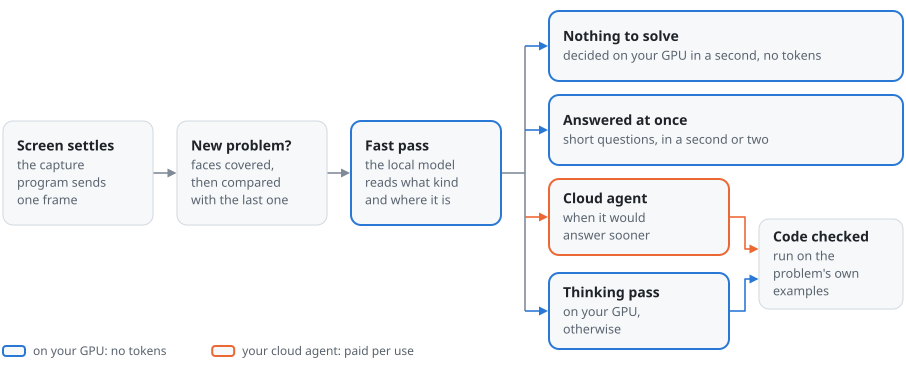

# Local-first pipeline: design and measurements

Status: implemented. Why the local model answers every screen first, when the cloud agent takes over, and the
measurements behind each choice.

- Sections 1 to 12 are the first design. Where the code went another way, the code and section 13 are current: the
  per-type table became the ticks of **Types the agent solves**, one payload setting covers every type (the crop by
  default), a retry goes to the engine that wrote the answer, the panel protocol is `setting` with `.switches.json`
  kept for the capture switches, there is no search signal, and the server takes the model off the GPU itself
  instead of sending `keep_alive`.
- The cases of section 11 were built and measured. On the server's own path the known-answer set came out 34 to 36
  of 36 a run, and the crops held the whole problem in all but at most two a run, with no pixel of another window in
  any. The 4K desktop is read at 100% and 150% scaling since the thinking pass gets a sharper view of it (section 4),
  and a screen with nothing to solve takes about 0.7 s with two runtime slots (section 10).
- The end-to-end runs on a real screen (phase 4, section 12) turned up a frame over the server's message limit, an
  answer cut at the thinking pass's output limit, and a model load thrown away by each canceled analysis, all fixed.
  Then came two more search engines, the local model's one-line answers in Korean, the example check in JavaScript,
  C++ and C, and a larger sound buffer in the capture program. Section 13 records the decisions.

The cloud agent is now a choice: Claude Code, Codex or the Anthropic API (`SIDENOTE_AGENT`,
[DECISIONS.md, note 86](DECISIONS.md#note-86)). Every measurement here was made with Claude Code, and the passages
that record one name it; "the agent" is whichever of them is set. The measurements ran on the test PC (Windows 11, an
RTX 4090 with 24 GB). Their scripts and data are not published; the suites that check the behavior are in `tests/`.

## 1. Defaults

- The local LLM with web search answers by default, even when the cloud agent is signed in.
- Everything before solving runs on this PC: capture, change detection, cropping to the problem (ROI), text
  extraction, speech recognition, code checks.
- The cloud agent is an optional assist that gets only what the problem needs (section 6). With the agent signed
  in it takes algorithm, coding and math problems (`hard`, section 13); without a login it stays out.
- Every stage has a switch in the panel. Switches apply without a restart and survive restarts.

## 2. Measured baseline

Known-answer set: 25 browser-rendered screens (coding test sites, quiz and exam pages, a terminal next to a
task, screens with nothing to solve) and 11 spoken questions (Windows TTS, transcribed by the server's Whisper).

| Path | Answers | Latency | Notes |
|:---|:---|:---|:---|
| Local gemma4:26b, router `auto`, search on | 31/32 without current-info questions; code tests 3/3 | nothing to solve <= 1 s, explanations 2 to 5 s, multiple choice, math and code 10 to 37 s | current-info questions 1/4: the fast pass did not call search |

Other facts the design relies on:
- Ollama runs gemma4 with `-ub 512`, which caps an image at 512 tokens; a derived model with
  `PARAMETER num_batch 1152` gives 627 tokens for a 1600x900 screen and fixed misread code.
- With that model loaded the GPU sits at 21.9 of 23 GB, so the local LLM cannot share the GPU with other
  heavy work.
- Without thinking, multiple choice with a trap option was wrong 8 of 8 times; hidden calculation 1 to 2 of 6.

## 3. Pipeline

<picture>
  <source media="(prefers-color-scheme: dark)" srcset="assets/diagram-answer-dark.svg">
  
</picture>

The fast pass writes `TYPE`, `ROUTE`, `ANSWER` and `REGION`; the ROI of section 4 is cut from that region, or from a
box the user drew. Besides the screen's path in the picture:

- Speech takes the same path from the fast pass on: voice activity detection and Whisper write the utterance down,
  and the fast pass reads it, with the screen as context.
- Text extraction runs only when a later stage needs it (section 5).
- The thinking pass may search the web, and in the `verify` mode the agent checks the local answer instead of
  solving the problem (section 6).

Each card in the panel says which stages ran: ROI, local (think), search N, the agent (verify or solve), examples
passed or failed, and what was sent out (section 8).

## 4. ROI: cropping to the problem

Three sources, in order of precedence:

1. **Manual box.** The user drags a box on the screen thumbnail in the panel ("only this area"). It stays until
   cleared. Stored as a setting; drawn on the thumbnail. It is cut as drawn, whatever windows it covers.
2. **Model box.** The fast pass already returns `REGION` (0 to 1000 grid for local models).

   A box does not place the problem when it covers 80% of the screen or more, lies mostly over the wallpaper, or has
   more than 20% of it shown by windows other than the one that shows the most of it (the wallpaper and the taskbar
   strip do not count). Then nothing is cropped: the thinking pass reads the screen, and the agent gets the problem
   written out (section 5). It gets nothing at all when the local model cannot write the problem out, when the text
   holds a number shaped like personal data (section 6), or when extraction is off; the local model answers then, and
   the panel says why.

   Any other box is padded by 15% of the screen on the left and 6% on the other sides, and clipped to the window that
   shows most of it (item 3). The parts of windows in front of that one are painted over, so no window the capture
   program lists comes along (it leaves out tool windows, such as most pop-up notices, untitled windows and windows
   under 1% of the screen).

   A line the box cuts short stays cut: the boxes stopped short of a long terminal command in 3 of 3 runs. Following
   such a line to its end inside the window was tried and dropped. On the saved boxes it made that terminal whole, but
   on other layouts it pulled in other content (the next column across a narrow gutter, the next question's line in
   the margin, a pop-up the capture program does not list lying over the line), and a crop is a rectangle, so
   following one line widens all of it.

   Measured weaknesses: Gemma's boxes run tight, most of all on the left, where they often start at the code or the
   body (6% on every side held the whole problem 61 of 69 times over 3 runs of the 23 known-answer screens, 15% on
   the left 65, counting whole-screen boxes as crops then), hence the padding. They come back as the whole screen on
   a task next to a terminal, at times on a coding site, on a 4K desktop with small text and on two problems side by
   side. On desktops with several windows they ran a third to a half of their width into the next window, at times
   the wrong one (section 11).

   The y-first variant is still open: the thinking pass's own REGION line came back y first, Gemma's own order, in 17
   of 266 thinking-pass answers over two days of runs, the fast pass's in none of 246 boxes. So what may go out later
   (the verify mode's crop, a follow-up to the agent) is now cut from the fast pass's box only, as the agent's crop
   is, and the duplicate check watches that box too; the code check and the problem text, which stay on this PC, read
   what the thinking pass read. A sentence restating the order at the end of the thinking pass's request was tried as
   well: 2 of 60 y first over two runs, against 10 of 148 in five runs without it, not a difference worth keeping it
   for. Measured afterwards over 116 thinking answers: the fast pass's box was the region of 96, 16 had no REGION
   (spoken problems), and the thinking pass's own line decided 4 (two spoken questions with a screen, two
   current-info questions), none of them y first; the 4 lines that were y first all had a box from the fast pass.
3. **Window bounds.** The capture client sends the rectangles of visible top-level windows with each frame (Win32
   window list with DWM extended frame bounds, front to back). Used to clip item 2 and to tell a box that runs over
   two windows, not on their own: the focused window is often the editor, not the problem. The list holds no
   desktop and no taskbar (read on this PC: the desktop is a tool window, and the client skips it by
   name as well), so a window over the whole screen is a full-screen program, such as a browser in full screen, and
   what no window covers is the wallpaper. The section 11 desktops had been built with a desktop entry at the end,
   and the server took the last full-screen entry for the desktop: a box in a full-screen program then placed
   nothing. Both have been changed.

What the crop is used for:
- The thinking pass gets the whole screen downscaled (context) and the crop at native resolution (more image tokens
  per character). That image stays on this PC, so a box that places no crop is cut as the model gave it, over any
  windows, unless it covers 80% of the screen or more; a placed box is always cut as it is. On a landscape screen
  3200 px or wider, seen whole by the model, whose halves keep at least 1.2 times the resolution of the screen
  image (a square screen gains nothing, and a tall one was not measured), the thinking pass gets the screen's two
  halves instead when there is no box, a box of 80% or more, or a box that places nothing and whose crop would keep
  less of its resolution than the halves (the 4K desktop at 100% got its top half, 3840x1080 px, which keeps 0.42
  at 1600 px against 0.74). On a 16:9 screen the halves overlap by an eighth of its width at no cost in sharpness,
  so a line on the seam is whole in one. Measured: the 4K desktop of section 11 right 8 of 8 times at
  100% and 8 of 8 at 150% with this view (4 runs of its first form, whose halves did not overlap, and 4 of the
  final one), against 0 of 4 and 1 of 4 in the runs without it; the rest of the bench unchanged.
- The agent assist with the `crop` payload (section 6).
- Duplicate detection compares only inside the model's box, also when that box places no crop (without it,
  typing next to a problem would have it solved again).

Switches: ROI on/off, manual box set/clear, window clipping on/off.

## 5. Text extraction

A no-thinking local pass that writes out the problem inside the crop as Markdown (code blocks kept, math in
LaTeX). It runs only when something needs it:
- The agent assist with the `text` payload.
- Code checks (the examples in the statement).
- **Problem text** in the panel (copyable).

Code and math lose their layout more readily as text, so for those types the default agent payload is the crop image.
Switch: extraction on/off (stages that need it say so when it is off).

## 6. Routing and the agent assist

The router stays as in the first implementation: the fast pass writes `TYPE` and `ROUTE`; multiple choice, math, coding and
algorithm always go to a thinking pass; `ROUTE: deep` or a missing route goes there too. Changes:

- **Current-info questions** (measured 1/4): the fast-pass note tells the model to call `web_search` first when
  the answer depends on current facts (versions, releases, prices, news), and such questions route deep if it
  did not.
- **Per-type table** in settings: for each type, local fast, local deep, or the agent. Defaults as above.

Agent assist modes (`hard` by default, section 13):

| Mode | What happens | Why |
|:---|:---|:---|
| `off` | the agent is never called | privacy first |
| `verify` | after the local answer, the agent gets the problem payload and the local answer and replies "OK" or a corrected answer; a disagreement shows both on the card | small requests, a second opinion |
| `hard` | the types ticked in the table (default algorithm, coding, math, later widened to work, essay and other: [DECISIONS.md, note 53](DECISIONS.md#note-53)) are solved by the agent instead of the local thinking pass | Claude Code measured faster on algorithms (11 to 16 s against 24 to 37 s) |
| `all` | every problem goes to the agent | the current main behavior, but with the smaller payload |

Payload (what the agent receives):
- `text`: the extracted problem text only (default for prose problems).
- `crop`: the ROI image only (default for code and math).
- `screen`: the whole screen (the current main behavior); never the default.
- Nothing else: no history, no transcript unless the problem was spoken, no other windows. While the local model is
  on, the whole screen goes only when `screen` is chosen: a problem it can neither place nor write out stays with
  it (section 4), and so does a problem written out from the whole screen whose text holds a number shaped like
  personal data (a resident registration, phone, card or bank account number), since another window's text can come
  along with it. A card number in spaced groups, a registration number without its hyphen and an account number
  without dashes are not caught: a row of numbers in a problem and a timestamp look the same.

Backend (Claude Code): the existing warm `claude -p` session takes text-only or one-image messages. The per-turn
cost of the CLI is mostly Claude Code's own cache creation, so the smaller payload mainly reduces what leaves the
PC, not cost.

## 7. Code checks

For coding and algorithm answers with a code block, when the extracted statement has input/output examples:
run them in the existing runner sandbox, compare, and mark the card "examples passed" or "failed: input X gave Y,
expected Z". On a failure, one automatic retry with the failing example in the prompt (local thinking pass, or
the agent if the assist mode allows). Switch: automatic checks on/off.

## 8. What leaves the PC

| Data | Leaves the PC | When |
|:---|:---|:---|
| Screens, crops, extracted text, speech | no | always local (LLM, Whisper, runner) |
| Search queries | to search engines through SearXNG | search on and the model calls `web_search`, without numbers shaped like personal data |
| Page reads | to that site | page reading on and the model calls `fetch_page` (public addresses only, without numbers shaped like personal data) |
| Agent payload | to the agent's service: Anthropic for Claude Code and the Anthropic API, OpenAI for Codex | the agent assist on, in the chosen payload form |

Every outbound item is shown as it happens (a notice, plus "sent: ..." on the card) and logged in
`events.jsonl` with kind, destination and size, never the screen itself.

## 9. Settings and the panel

**Model.** `server/settings.py` defines every setting with a default from the environment (`SIDENOTE_*`), a type,
a label, a one-line help text, and its dependencies. Values persist in `/data/logs/.settings.json`, which
replaces `.switches.json` (migrated on first start).

**Protocol** (on `/panel`):
- server to panel: `{"type":"settings","values":{...},"meta":{key:{"label","help","kind","options","needs","state"}}}`
  on connect and after every change;
- panel to server: `{"type":"settings_set","key":"...","value":...}`; the server validates, applies,
  persists and broadcasts, or answers with a notice when the value is not allowed.
- Capture-side settings (`stitch`, `monitor`) ride on the existing `control` message to the capture client, so
  `--stitch` no longer needs a restart of the capture.

**Applying.** Hot for everything except the Whisper model size (transcriber reloaded in a thread, a few seconds)
and the local model name (the next call loads it; the panel shows "loading").

**Panel.** A settings sheet from the **Settings** menu, one section per stage: capture, preprocessing (gate, ROI,
extraction), solving (local LLM, thinking mode, per-type table), agent assist (mode, payload, confirm), search
(search, page reading), speech (auto-solve spoken problems, language, Whisper hint), code (run button, automatic
checks), resources (GPU release, model). Each row: switch, help line, live state (for example
"gemma4:26b, 19 GB on the GPU"). Rows that depend on a switched-off stage are grayed out with the reason. The top
bar gains two signals: local LLM and search.

Current switches and where they move:

| Today | After |
|:---|:---|
| screen, sound, pause (panel) | unchanged, now part of the settings model |
| speech language (panel menu) | settings sheet |
| `SIDENOTE_ANALYZER`, `SIDENOTE_LOCAL_THINK`, `SIDENOTE_SEARCH_URL`, `SIDENOTE_VOICE_TRIGGER`, `SIDENOTE_WHISPER_HINT`, `SIDENOTE_RUNNER_URL` (env only) | settings sheet, env stays as the default |
| `--stitch`, `--monitor` (capture command line) | settings sheet, sent through `control` |

## 10. GPU and resources

- Release the GPU when idle: requests carry Ollama's `keep_alive` from the setting "unload after N minutes"
  (default 10); a "release now" button unloads at once.
- Load the model by a request of its own. A model that is not on the GPU is loaded before the request that needs
  it, by a generate request with no prompt that a canceled analysis does not close, since Ollama aborts a load
  whose request goes away. A pause, the release button, switching the local model off or picking another stops
  that load, and a request still waiting for it then fails rather than load the model itself; a load past
  `SIDENOTE_LOCAL_TIMEOUT` fails the requests waiting for it, as it did inside the request.

  Measured with the request canceled 2 s into the load: before (3 rounds), the load was aborted each time and the
  next request took as long as one alone (6.1, 6.3, 6.1 s against 6.1, 5.9, 5.9 s); after (7 rounds), no load was
  aborted and the next request ended with that load, 3.8 to 5.1 s after the cancel (one alone: 5.8 to 24.4 s).
  A pause and a release 2 s into a load each aborted it, a release also with a request still waiting, which
  failed, and the model was not on the GPU 15 s later. The lookup this adds before each request (`/api/ps`)
  took 0.5 ms (median of 20, at most 1.1 ms). Loads that finished took 4.8 to 41.7 s at the time; the last of the
  three thrown away on the real screen had run 71 s (section 12).
- Before a local call, check that the model is loaded or that enough VRAM is free (`ollama ps`, free memory from
  the runtime). If not, the panel offers: wait, a smaller local model, or the agent for this problem (only if the
  assist mode allows it). Measured: under WSL2 neither tells whether the model fits; a busy GPU
  is told by speed instead (13.4).
- The image budget can come down once the thinking pass gets a crop plus a small full screen: measure whether
  `num_batch` 768 to 1024 keeps accuracy and frees VRAM.
- Two runtime slots (`SIDENOTE_LOCAL_SLOTS`, Ollama's `OLLAMA_NUM_PARALLEL`) keep the prompts of the fast pass and
  the thinking pass apart, and idle slots are not copied to system memory on each new request
  (`LLAMA_ARG_CACHE_IDLE_SLOTS=false`).

  With one slot, the first screen with nothing to solve after a problem that needed the thinking pass or the example
  check took 0.98 to 1.49 s (3 rounds of each flow): the thinking pass's prompt differs from its first tokens
  (thinking on), and swapping 650 to 870 MiB of state with system memory took 0.46 to 0.68 s.

  Three slots (one more for the code check's example reading) first measured 0.66 to 0.92 s after every flow, at
  22,432 MiB of GPU memory in use at the peak against 20,945 MiB with one slot (the desktop's 860 MiB included), about
  740 MiB a slot. Later the same three slots made every request slower: each new screen 1.6 to 1.9 s after every flow
  (the 847 tokens of its image and text processed in 1.56 to 1.69 s against 0.56 s with one slot), and two runs of the
  bench took a median of 17.6 and 19.3 s a case against 11.8 s before (with 12% more tokens written). Moving the 200
  MiB context checkpoints (one slot moves them too and stays fast), the RAM prompt cache (`--cache-ram 0` changed
  nothing) and the GPU clock (at its top, 2,775 MHz) were ruled out, and the cause was not found: GPU memory read
  22,288 to 22,314 of 23,028 MiB in the slow runs, below the fast runs' peak, with the desktop at 1,008 to 1,574 MiB
  against 860 MiB then.

  Two slots peaked at 21,860 MiB and measured 0.65 to 0.90 s for the first screen after a direct answer, Claude Code's
  answer with its example check or a thinking pass, and 1.31 to 1.46 s after a thinking pass with its example check (2
  rounds), so two is the default. Answers that ran alongside another request do not count for the busy-GPU switch
  (13.4).

## 11. Measurement plan (needs the GPU)

Additions to the bench:
- ROI cases: the problem in a corner of 2560x1440 and 3840x2160 screens with small text; a split screen with the
  editor focused; a chat window with personal data next to the problem; two problems in two windows.
- Four more current-info questions, answers checked against official sources on the day.

Comparisons: whole screen, crop, crop plus small whole screen for the local thinking pass (accuracy, latency);
`text` against `crop` payload for the agent assist on code and math.

Acceptance:
- no regression: at least 31/32 on the existing set, code tests all passing;
- current-info questions at least 3/4;
- the crop holds the whole problem text in at least 95% of ROI cases and never another window;
- an agent payload never contains anything outside the crop (checked against the truth boxes);
- nothing-to-solve screens stay at 1 s or less;
- every setting round-trips through the panel, applies without a restart, and survives a restart.

Results. The bench runs each case through `Pipeline.solve` as the server does (the agent off, the window rectangles
the capture program would send, three runtime slots). Further scripts save the fast pass's boxes and cut them with the
server's crop code, and time the screens with nothing to solve after each kind of problem. The earlier bench never
gave the thinking pass the crop, so this is the first full run of the server's path.
- Built: six desktops with several windows (a problem window in a corner of a 2560x1440
  screen with 13 px text and of a 3840x2160 screen with 14 px text, a split screen with the editor focused, a
  messenger with personal data beside the problem's window and in front of it, two problems in two windows; later
  the 4K desktop again at 150%, laid out at 2560x1440 and rendered at 3840x2160, not run yet) and four current-info
  questions (Go and Rust on screen, Docker Engine and Terraform spoken), their answers checked on the day of the run
  on the projects' release pages. Ollama v0.40.11 came out in the meantime, so that answer moved again.
- No regression: the known-answer set 36 of 36 with the crop beside the screen, every code test passing.
- Current info: the four new questions 3 of 4 in each of three runs (misses: Go twice, answered with an older
  release or a pointer to the download page after a search, and Docker Engine once, with the release before); all
  eight 5 to 7 of 8 a run.
- Crops: in 3 runs of the 30 screens with a box, 67 were cut and 64 held the whole problem (the misses: the
  terminal whose box stopped short on the right, three times). No crop held a pixel of another window, counted on
  maps of the windows cut by `crop_image`. 23 boxes placed nothing (section 4) and the thinking pass read the
  screen. Offline on the same boxes, with the window rectangles the capture program would send on the known-answer
  screens too (a browser over the whole screen; a task and its terminal as two windows), 66 were cut and 63 held
  the whole problem, and 24 placed nothing: 18 whole-screen boxes, 5 split between windows and 1 mostly over the
  wallpaper.
- What the thinking pass looks at, one run each on 46 cases: the screen and the crop (the server's choice) 44
  right (the known-answer set 36, current info 7 of 8), the screen only 43 with one empty answer (35, 6 of 8),
  the crop only 41 with one empty answer (34, 5 of 8); median time 11.8, 11.7 and 14.7 s. The screen and the crop
  stay.
- Nothing to solve: 0.65 to 0.70 s in the runs that give the thinking pass the screen (0.99 and 1.02 s in the
  crop-only run), and 0.66 to 0.92 s after every kind of problem (section 10).
- Not met: the 4K desktop with 14 px text, where no box placed the problem and the thinking pass, reading the
  screen at 1600 px, answered 84 and 5,040 runs instead of 180. At 150% the same text is 21 px, 8.75 px at 1600 px,
  near the 8.1 px of the 2560x1440 desktop, which the thinking pass answered from the screen in both runs that gave
  it the screen (its box placed nothing either); that case is built, not run. After these results the handling of
  boxes over the wallpaper, boxes the user drew and an unplaced problem's payload changed, and then that of
  full-screen programs and personal data in the text payload (sections 4 and 6); the server's path had not been run
  again since, and what the local model writes out from a whole desktop for the agent (the payload when no crop is
  cut) was not measured yet. Both were run next (below).

Next run: the server's path after those changes, the window rectangles on every screen, the 4K
desktop at 150% added.

- Two runs with three runtime slots: the known-answer set 34 and 36 of 36, the new current-info questions 3 of 4
  each, the section 11 desktops 6 and 5 of 7 (two problems side by side counted right when the answer gets either
  one), code tests 6 of 6; 26 of 26 and 25 of 26 crops held the whole problem, none a pixel of another window.
- The 4K desktop at 150%: in the four runs without the view of section 4 the thinking pass read only the screen at
  1600 px, right once and wrong three times (the crontab misread, as `*` for `*/15` or as `* * 15 9 * * 1-5`); at
  100% wrong four times. With that view (its first form, halves that did not overlap) 4 of 4 at 150% and 4 of 4 at
  100%; a full run with it: the known-answer set 36 of 36, the section 11 desktops 7 of 7, the new current-info
  questions 2 of 4 (Go, which the server without the change also missed 2 of 3 times within that hour, and Docker
  Engine), nothing to solve 0.69 and 0.74 s.
- Without that view the thinking pass reached its 8,000-token limit 1 to 3 times a run, 8 times over the four runs
  (7 on the 4K desktops, 1 on the 2560x1440 one), each answered again (`cut`, ARCHITECTURE.md); none in the full
  run with it.
- What the agent would get without a crop (3 runs of the 9 desktops): the problem came through in
  18 of 27, no text of another window in any, so nothing was held back for personal data; nothing came out of the
  4K desktop at 100% and of the chat and issue screens with current-info questions.
- Boxes (3 runs of the 31 screens with a box, cut offline by the server's code): 60 cut, 56 held the
  whole problem (the misses: the terminal with the spoken question 3 times, a coding site once at 0.95), none a
  pixel of another window, 33 placed nothing. The 4K desktop at 150% placed its box 1 of 3 times.
- Slots: three made every request slower in this run (section 10); two is the default.
- The final code (the cut answer written again only when the thinking took most of the limit, what goes out cut
  from the fast pass's box, overlapping halves): the 4K desktop right 3 of 3 times at 100% and at 150%, then a full
  run with the known-answer set 32 of 36, all four misses current-info questions, the section 11 desktops 7 of 7,
  21 of 21 crops whole, nothing to solve 0.67 and 0.68 s, no answer at the limit. By then the search engines behind
  SearXNG were turning searches away after a day of benches (a query right after the run: no results, brave and
  Google CSE suspended for too many requests, DuckDuckGo a CAPTCHA), and in that run no current-info question was
  answered right (0 of 8, against 5 and 3 of 8 in the two runs before it); the model, given no results and no
  reason, answered from memory or pointed to the project's site. A search that comes back empty with the engines'
  reasons now carries them to the model, which is told to say it could not check.

Last run: what was left after Phase 4.

- Search: SearXNG's general engines here are brave, duckduckgo, google cse, wikipedia and wikidata. After a day of
  benches brave answered "too many requests", duckduckgo a CAPTCHA and wikidata a timeout, so google cse answered
  alone. Asked one at a time, bing (0.1 to 0.3 s) and yahoo (1 to 1.4 s) answered with the right page first, qwant
  and google turned the PC away, naver and mwmbl put unrelated pages first; bing and yahoo are now on
  (`docker/searxng.yml`). The final runs below answered 5 and 6 of the 8 current-info questions.
- The local model's ANSWER line: over a day's runs 69 of 437 thinking answers wrote it in English, most of them
  the approach line of an algorithm problem (code_lc_jobs 11 of 11, code_prog_distinct_k 8 of 11, Korean problems
  among them), while the body was Korean in 414 of 423 (most of the others answer a question spoken in English).
  Asked in its system prompt for the gist and approach in Korean, terms, commands, code and values as they are: on
  the eight cases where it happened, 10 of 14 descriptive lines in English before, 0 of 14 after, all answers right
  in both (two runs each); saying it once more at the end of the thinking pass's request gave 0 of 14 too and was
  left out. In the full runs: 1 of 20 (git commands) and 0 of 19.
- Final full runs (all of the above): the known-answer set 35 and 36 of 36, code tests 6 of 6 each, 19 of 19 crops
  whole each, no pixel of another window shown (the bench had counted the part of a window in front that the crop
  paints over as shown; the crop holds only the paint there), nothing to solve 0.65 to 0.72 s, median 14.2 and
  14.7 s a problem.
- The example check in other languages (ARCHITECTURE.md): two Programmers screens rendered with the C++ template in
  the editor, solved by the local model and checked on the real runner: C++ answers 6 of 6, every example passed,
  as on the same screens with Python. On the real screen of Phase 4 (section 12) neither answer got a check, which fits an
  answer in a language the check did not run then; the answers were not kept, so that is not known.
- Languages: besides Python, JavaScript, C and C++, the code runner got TypeScript, Java 17, Kotlin
  2.0, Go 1.19 and Bash (its image from 455 MB to 1.37 GB), and the example check calls a function in Python, Java,
  C++, JavaScript, TypeScript, Kotlin and Go and feeds input to programs in all nine (`codecheck.py`). On the real
  runner, 33 answers of every form (Programmers', LeetCode's, in place, failing, not compiling, of a type it does
  not know, in Swift) came out as expected; a compile of Kotlin takes about 3 s, of the others under 0.5 s.
- The languages work had more to fix: code in the runner able to open the panel like the capture program
  (101 on `/panel`; now 403 from the runner's network, the published port unchanged), a run's leftover outliving
  the kill by clearing its environment, a file left in `/dev/shm` for the next run, `go build` hitting the process
  cap, and harness faults: a method called on a helper, nested or commented class, nil slices printed as null, a
  void function failing an example whose answer is its input, LeetCode's 0.73278 failing, a shell block that runs
  `python3` taken for the solution. On the real runner 20 cases test those (19 added, and Python's standard input
  case now has such a shell block): with the check's code before, 18 of them failed, and the other two (Java's
  main class) failed on the runner before; now all 52 cases come out as expected.
- More faults, by area. The runner: a folder 1,500 deep made its recursive
  removal fail in every run after it, a shared memory segment stayed for the next run, a `package` line inside a
  Java text block was dropped, and inputs of one batch shared the files they wrote. The server's guard looked the
  runner up by name, so a hanging resolver delayed every request by 2 s and let everything through meanwhile; it
  now takes only the published port's gateway and its own container. The check, 19 kinds: a merge that never
  copied its second array passed 3 of 3 (an unchanged argument matched), `return arr.sort()` passed, tree and
  linked-list answers in Python and JavaScript failed, Baekjoon's A/B failed on its 32 places, inputs without a
  final newline hung, one `Solution` served every example, a table the answer printed pushed out the results,
  LeetCode's implicit imports were missing, and an overload with a helper first was not run. On the real runner
  76 cases for all of these (now 78) come out as expected; with the check's code before, 49 of the 76
  did not. The runner moved to Debian 13 for current toolchains (Go 1.24, Node 20, g++ 14 with C++23, Java 21),
  and Go compiles start from a copy of a cache built with the image (0.3 s, against 4.3 s without it). Answers
  allowed in any order are still compared in order: the example reader does not say which problems allow it.
- Those fixes left nothing serious in the runner or the guard (a `package a . b ;` line, a
  `static public void main`, a run that kept going past its output cap reported as fine, a route's gateway other
  than the default route's trusted), but 13 kinds of fault in the check: a void `solution` passed, a double passed against
  500000007500000028 off by 28 (the expected value had become a double), and right answers failed on a tree typed
  only in a docstring, `cout << hex` left by the answer, a one-element example beside flat ones, a private
  overload first, a default parameter, a second definition and a JavaScript answer printing while it loads. All
  fixed; the 57 probes for them, with what a right judgment is, come out as expected (24 with the check before), the
  others 53 and 78, integ 262. Left as they are: a function without a declared type that sorts its argument and
  forgot its return looks done in place, and an exact 40-place decimal is met by a double's 17 places.
- The deferred end-to-end runs (the GPU free again): the two Programmers problems with each
  language's template in the editor, 2 rounds, 24 screens. Every answer came in the editor's language (C++,
  Java, Kotlin, Go, JavaScript, Python, 4 of 4 each) and every example passed on the real runner, the check
  taking 2.8 s in the middle. With Claude Code writing the answer instead of the local model, the C++ screen came
  back in C++ (3 of 3 examples) and the Java screen in Java (2 of 2), at $0.069 and $0.056.
- The three limits left above are gone, because the problem's own words are now read with its
  examples (`returns`, `order`, `tolerance`). Measured against the prompt as it was, on 14 problems as text over
  3 rounds and on four new screens (`real/spec`: Group Anagrams, Merge Sorted Array, Sort an Array, Baekjoon
  1008) over 3 rounds: on the screens the words came out right 11 of 12, 3 of 3 and 3 of 3, with no field
  claimed where the problem said nothing, and the examples themselves as before. Forcing the answer into a JSON
  schema was tried first and dropped: it read the fields equally well but made the model write a screen's
  example values as strings holding JSON, and Group Anagrams came out wrong every round. Three of the four
  screens now run their check in every round, and three of the four pass every example. The fourth, Group
  Anagrams, fails one: "any order" counts however the elements of an answer are ordered, but not how each
  element is ordered inside, since Permutations says "in any order" as well and there that order is the answer.
  The card says the result holds the expected values in another order, so the user can see what happened.
  The three places an example may be written are named as a closed list on purpose: letting the line also read
  "or written in the text" made the model make up an example for a problem that shows none, 5 times in 9
  against 1, while the closed list read the examples a Codility problem states in prose either way.
- The check no longer gives up when the examples name a function the answer does not define: the problem's name
  is often only in the editor, which the crop read for the examples leaves out, so the model writes `solution`
  and nothing matched. The one function the answer defines that takes as many arguments is run instead, which
  took the four spec screens from 6 checks run in 8 to 12 in 12.
- The code the check runs is written by a model from what is on the screen, so each compile and each example's
  run now has a user of its own inside the runner (the runner itself is root of its container with SETUID,
  SETGID, CHOWN and KILL, and nothing else). A run cannot read or change another's files, stop another's
  processes, change the compiled program it was given, or stop the runner, and the container has no network at
  all: the server reaches it over a Unix socket. A check of nine properties showed the need: on the runner as it
  was, two failed and the third killed the runner outright.
- Sound: the capture program asked for no buffer of its own, so soundcard took one device period (about 10 ms),
  and the sound was dropped at times ("data discontinuity in recording", five at once as the 4K screen came back
  after the screen saver). Asked for half a second, it dropped sound 3 times in the first minute after a start and
  not once in the hour after, with 18 frames of the 4K screen; it asked for a second after that, as Microsoft's
  own capture sample does, and counts what is dropped. A second was still not enough on a busy day: 44 of those
  warnings that day, up to 19 in a minute, every cluster of them while this same program was encoding 4K
  screenshots and the GPU was answering. It asks for two seconds now, which is as far as a shared-mode WASAPI
  buffer can be pushed without risking a recorder that will not open, and the read still takes a second at a
  time, so nothing waits longer than it did.

## 12. Phases

1. **No GPU.** Settings model, persistence, protocol, the panel sheet, the capture `control` extension; tested
   with the mock analyzer and headless browser checks.
2. **No GPU.** Split `analysis_worker` into stages behind the switches; agent assist adapter (modes and payloads,
   confirm before sending, decline shown as is); automatic code checks with the runner; outbound ledger.
   The agent's path is checked with a few real calls (Claude Code).
3. **GPU.** ROI crops into the thinking pass, the extraction pass, the current-info routing fix, idle unload,
   the derived model created by `./sidenote llm pull`; bench re-run against section 11.
4. **GPU and Windows capture.** End-to-end with the real capture program and recorded speech; README and docs.
   Begun with the capture program on the test PC's 4K screen at 150%: it told the screen saver apart,
   sent frames and got an answer (a multiple-choice problem, 76 s). The connection dropped right after two of the
   first three frames, which fits a message over uvicorn's 16 MiB limit (a 4K test frame of random pixels is 31.7
   MiB as a message), so the server now takes up to 64 MiB and logs a larger one; the thinking pass used its whole
   8,000 tokens and left the answer cut in its REGION line, so such an answer is now written again from the end of
   the thinking. The screen saver came back a minute after the last input (its timeout was 60 s), so the rest
   waited for someone at the PC. Later, with the fixes: 46 frames of the 4K screen over one connection
   and no drop. The example on the screen, an algorithm problem, went to Claude Code as a crop of 1365x1457 and was
   answered in 31 s; the same screen solved locally with the agent off took 74 s, its thinking used the whole 8,000
   tokens with 373 characters of answer, and the answer was written again (2,610 characters). A spoken question
   played on the PC (a problem read out, 37 s of speech) was written out by the transcriber, its question part
   (168 characters) went to Claude Code as text, and the answer came 54 s after the speech was taken up. 42 s of that
   was loading the model again: it had been taken off after 10 idle minutes, and two screen changes and then
   the spoken question had canceled the three analyses running while it loaded, each cancel throwing away the
   load, the last after 71 s (section 10).

## 13. Decisions

The four open questions of the draft, decided with measurements: the known-answer set of
section 2 (the 25 screens rendered again, the same 11 spoken questions), the first implementation,
Ollama 0.40.5 on an RTX 4090 (24 GB, 1.4 GB of it in use by the desktop). Current-info answers are checked
against the facts of the day they were measured (the newest Ollama was then v0.40.10).

1. **Agent assist default: `hard`.** With the agent signed in, algorithm, coding and math (the default types of
   section 6, where Claude Code was measured faster on algorithms; later widened to work, essay and other,
   [DECISIONS.md, note 53](DECISIONS.md#note-53)) go to the agent as the problem crop, and
   everything else stays with the local model; without a login it behaves as `off`. The local model alone answered 35
   of 36 (the miss: the latest Python patch release, answered with the newest 3.14 instead of 3.15), so `off` stays a
   full choice for keeping everything but search queries on the PC. Without the local model
   (`SIDENOTE_ANALYZER=agent`, or its earlier names `cli` and `api`) the default is `all`, since the agent is then
   the only engine.
2. **Payload for code and math: `crop`.** Writing the problem out (`text`) held up better than the draft
   expected: on the 11 code and math screens the 26b kept every number and every indented code line in 22 of
   22 runs (math as LaTeX, examples as tables; the two runs a token count flagged wrote the superscript in
   10⁵ as `10^5`), in 0.4 to 2.6 s (median 0.7 s). The crop still wins for these
   types: a figure or diagram in a problem cannot be written out, nothing is copied by hand on the way, and
   the agent starts without that pass. `text` stays the choice for sending words only. One setting covers all
   types, so prose goes as a crop too unless `text` is chosen. Both payloads are cut from the same box, the
   fast pass's REGION with a margin (15% on the left, 6% elsewhere), which held the whole problem 65 times
   in 3 runs of 23 screens (the misses: one terminal screen whose box stopped short on the right, three
   times, and a coding screen whose box stopped short at the bottom, once; whole-screen boxes counted as crops
   then, see section 4 for the rules since); that box is the limit of either payload, not a reason to pick one.
3. **Confirm before sending: off.** What goes out is fixed in advance by the mode and the payload setting (both
   in the panel, with what they send in their help lines), and every payload is shown on its card and logged
   as it goes (section 8). A confirmation per problem would hold each hard problem's answer for a click (up to
   2 minutes) and undo the speed `hard` is for. The switch stays, to see each payload before it goes.
4. **A smaller model while the GPU is busy: gemma4:e4b, switched on measured speed.** The two candidates on the same
   set: gemma4:12b answered 29 of 36 and needs 9.6 GiB, but 5 cases came back empty after 72 to 97 s, most likely out
   of its 8,000 tokens while thinking (a rerun of one used 7,874 and answered), and spoken questions took 17.4 s
   against 5.1 s; gemma4:e4b answered 29 of 36 (code tests 1 of 3) in 5.5 GiB, faster than the 26b (screens 11.4 s
   against 19.7 s).

   The check section 10 plans does not work here: under WSL2 the runtime does not see other programs' GPU memory (with
   8 GiB held elsewhere it reported about 21 GiB free and loaded the 26b whole), and Ollama's `ollama ps` sizes leave
   out most of the model on this runner (1.5 GB for the 26b). A busy GPU shows as slowness instead: with another
   program writing 8 GiB continuously, the 26b generated 4.6 times slower (173 to 37.5 tokens/s), the e4b 1.26 times.
   On four cases the 26b took 84 to 186 s per screen on the busy GPU against 11 to 39 s free, and 24 s against 4.7 s
   for a spoken question; the e4b on the busy GPU took 12 to 25 s and 8 s, with 3 of the 4 answers right.

   So each answer's generation rate (tokens after the first, over the time they took) is compared with that model's
   usual rate, the median of its last 10 normal ones, kept across restarts; under half of it switches to the e4b for
   30 s, a hold that doubles while the GPU stays busy, up to 10 minutes ([the user guide](README.md#12-settings),
   section 12), and the next problem after that tries the chosen model again. Answers under 200 tokens or 1 s are not
   measured, so a busy GPU shows on thinking passes and long answers, not on short direct ones. The model that
   answered is named on the card and the panel's connection line says while the e4b is in use.

   On the real server the first screen on the busy GPU took 80 s on the 26b and was measured at 29.8 tokens/s against
   133.3 (the fastest rate then; the usual rate is now the median); the next two went to the e4b (57 s with the model
   change, then 18 s), all three answers right. The e4b is pulled with the default model; the panel can switch this
   off or pick another pulled model.
