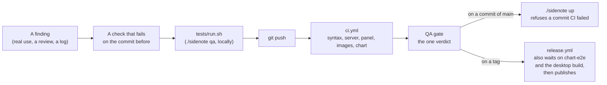

# Quality: from a test case to a deploy

Every change goes through one line, and each stage can stop it.

## The rule

A finding is not fixed until a check fails without the fix and passes with it. The check goes in the suite it belongs to, so the same defect cannot come back unnoticed. A
green suite is not evidence of the absence of defects: when a check passes on an older commit it was meant to fail on, the check is wrong (run it there; for a panel suite: `PANEL_DIR=/older/panel`).

## Test suites and test cases

`tests/run.sh --list` prints every suite. `tests/README.md` says what each one checks. The groups:

| Group | Runs in | Stands in for | Suites |
|---|---|---|---|
| server and capture | `server` job, mock engines | the GPU, the network, the agent, Windows | `integ`, `server_review`, `server_scenarios`, `ci_gate`, ... |
| panel | `panel` job, headless Chromium with the server's CSP | the server, its socket | `panel_review`, `panel_scenarios`, `panel_design`, `panel_layout`, ... |
| images and chart | `images`, `chart`, `chart-e2e` | nothing: the real images on a throwaway cluster | `k3d_check.sh` |

The newest suites hold the long, tangled cases:

- `panel_scenarios.py`: whole sittings played through the page's real paths. The place being read, kept through focus, picks, filters and resizes; a connection dropped in the middle of a
  stream and what came meanwhile; messages out of order; hostile answers (scripts, handlers, `javascript:` links in every place an answer's words reach); broken answers (unclosed
  code, tables and formulas, a 3,000-letter token, 140 steps, 40 columns); a sitting of 400 answers; boxes on portrait and ultrawide screens.
- `panel_design.py`: what a design promises, measured. The column's cards read back off a screenshot at each window size in both themes; the matrix of 5 widths by 8 heights, with the
  capture program gone and with the agent off, for what overflows, what is cut and what has gone that was promised to stay; contrast of every kind of text against the pixels behind it;
  every answer drawn from its words with none lost, over samples in CI and over the bench's real answers where they are at hand.
- `panel_layout.py`: an audit of the page as laid out, in 30 states of the column at 11 window sizes, 22 shapes of answer and what opens over the page: words cut with no tooltip, words out of their box or the window, words over words or over a key, a row off its baseline by one to five pixels, a column off its edge, words off the middle of a key, one kind of box set two ways, uneven gaps. It plants a defect of each kind and checks it finds it. Each defect seen on the real page is a check of its own. Motion: nothing loops at rest, what comes in comes to rest where it would have stood anyway.

## What CI keeps

- The run's page shows a table of every suite with its checks and seconds (`results.md`), and the QA gate's table of jobs.
- Each job's artifact holds `cases.md`: every test case by name with its result, suite by suite, to read or to compare between two runs.
- Each job's artifact holds the logs. The panel job's also holds the screens the suites took (`shots/`), so a change in looks can be seen from the run without checking it out.
- A weekly run with nothing pushed shows when a browser, a pinned package or a runner image has moved on.
- `tests/run.sh --check`, in the `syntax` job, fails when a suite on disk is in no list or is not in `tests/README.md`: a suite that never runs looks exactly like one that passes.

## Deploying

`./sidenote up` asks what CI said of the commit it is about to deploy (`ci_gate`):

| The commit | `./sidenote up` |
|---|---|
| passed | goes up, and says so |
| failed, canceled, timed out | refuses; `--no-ci` goes up anyway |
| still being checked | goes up with a warning; `--when-green` waits for the answer and goes up only if it passes |
| not pushed, or no `gh` here | goes up; `--when-green` refuses, not knowing |
| uncommitted changes | goes up with a warning: this code has not been through CI |

`./sidenote restart` and `install` are not held up. `./sidenote up` also waits until the server is idle (`--now` skips the wait). `./sidenote status` says whether the panel running is the code here and what CI said of this commit.

A version tag (`v1.2.3`) publishes: `release.yml` runs `ci.yml`, `chart-e2e.yml` and `desktop.yml` first and publishes nothing if any of them fails.

## What no check here can say

Whether it looks right, and how it holds under a real sitting on a real PC. Screens go to a person for the first, and the logs of real use (`./sidenote report`, `./sidenote events`) for
the second: a real problem read end to end is the bar, not a green run.
