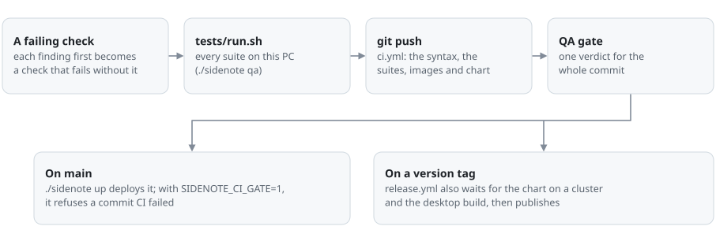

# Quality: from a test case to a deploy

Every change goes through one line, and each stage can stop it.

<picture>
  <source media="(prefers-color-scheme: dark)" srcset="assets/diagram-qa-dark.svg">
  
</picture>

## The rule

A finding is not fixed until a check fails without the fix and passes with it. The check goes into the suite it
belongs to, so the same defect cannot come back unnoticed.

A green suite does not show that there are no defects. When a check passes on an older commit it was meant to fail
on, the check is wrong: run it there to see (for a panel suite, `PANEL_DIR=/older/panel`).

## Test suites and test cases

`tests/run.sh --list` prints every suite, and [tests/README.md](../tests/README.md) says what each one checks. The
groups:

| Group | Runs in | Stands in for | Suites |
|:---|:---|:---|:---|
| server and capture | the `server` job, with mock engines | the GPU, the network, the agent, Windows | `integ`, `server_review`, `server_scenarios`, `ci_gate`, ... |
| panel | the `panel` job, in headless Chromium with the server's CSP | the server and its socket | `panel_review`, `panel_scenarios`, `panel_design`, `panel_layout`, ... |
| images and chart | the `images`, `chart` and `chart-e2e` jobs | nothing: the real images on a throwaway cluster | `k3d_check.sh` |

The newest suites hold the long, tangled cases:

- `panel_scenarios.py` plays whole sittings through the page's real paths: the place being read, kept through focus
  changes, picks, filters and resizes; a connection dropped in the middle of a stream, and what came meanwhile;
  messages out of order; hostile answers (scripts, handlers and `javascript:` links in every place an answer's words
  reach); broken answers (unclosed code, tables and formulas, a 3,000-letter token, 140 steps, 40 columns); a sitting
  of 400 answers; boxes on portrait and ultrawide screens.
- `panel_design.py` measures what a design promises. It reads the column's cards back off a screenshot at each window
  size in both themes, and runs a matrix of 5 widths by 8 heights, with the capture program gone and with the agent
  off, for what overflows, what is cut and what has gone that was promised to stay. It checks the contrast of every
  kind of text against the pixels behind it, and that every answer is drawn from its words with none lost, over
  samples in CI and over the bench's real answers where they are at hand.
- `panel_layout.py` audits the page as laid out: 31 states of the column at 11 window sizes, 22 shapes of answer, and
  whatever opens over the page. It looks for words cut with no tooltip, words out of their box or the window, words
  over words or over a key, a row off its baseline by one to five pixels, a column off its edge, words off the middle
  of a key, one kind of box set two ways, and uneven gaps. It plants a defect of each kind and checks that it finds
  it, and each defect seen on the real page is a check of its own. For motion: nothing loops at rest, and what comes
  in comes to rest where it would have stood anyway.

## What CI keeps

- The run's page shows a table of every suite with its checks and seconds (`results.md`), and the QA gate's table of
  jobs.
- Each job's artifact holds `cases.md`, every test case by name with its result, suite by suite, to read or to compare
  between two runs.
- Each job's artifact holds the logs. The panel job's also holds the screens the suites took (`shots/`), so a change
  in looks can be seen from the run without checking it out.
- A weekly run with nothing pushed shows when a browser, a pinned package or a runner image has moved on.
- `tests/run.sh --check`, in the `syntax` job, fails when a suite on disk is in no list or is missing from
  `tests/README.md`: a suite that never runs looks exactly like one that passes.

## Deploying

`./sidenote up` deploys the code that is checked out. A maintainer can have it ask CI first: with
`SIDENOTE_CI_GATE=1` in `.env`, `up` asks what CI said of the commit it is about to deploy (`ci_gate`).

| The commit | `./sidenote up` with `SIDENOTE_CI_GATE=1` |
|:---|:---|
| passed | deploys it, and says so |
| failed, canceled or timed out | refuses; `--no-ci` deploys it anyway |
| still being checked | deploys it with a warning; `--when-green` waits for the answer and deploys only if it passes |
| not pushed, or no `gh` here | deploys it with a warning; `--when-green` refuses, not knowing |
| with uncommitted changes | deploys with a warning: this code has not been through CI |

Without the gate, nothing asks `gh`, and `--when-green` refuses to run. `./sidenote restart` and `install` are never
held up. `up` also waits until the server is idle (`--now` skips the wait). `./sidenote status` says whether the
running panel is the code here, and with the gate on, what CI said of this commit.

A version tag (`v1.2.3`) publishes: `release.yml` runs `ci.yml`, `chart-e2e.yml` and `desktop.yml` first, and
publishes nothing if any of them fails. Before tagging, set the release's number in `server/version.py` (`VERSION`)
and in `deploy/helm/sidenote/Chart.yaml` (`version` and `appVersion`), and commit them. At its start the release job
runs `.github/check_version.py`, which refuses a tag that is not `v` and that number, or a chart that says another,
before an image is built or anything is pushed; `version_check.py` holds the two files to one number on every push.

## What no check here can say

Whether it looks right, and how it holds up in a real sitting on a real PC. Screens go to a person for the first, and
the logs of real use (`./sidenote report`, `./sidenote events`) for the second. The bar is a real problem read end to
end, not a green run.
