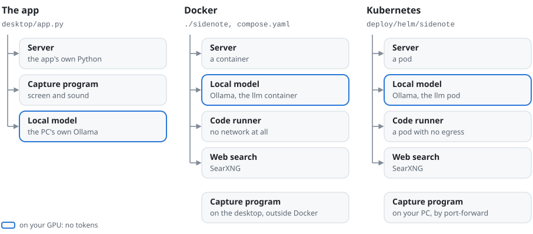
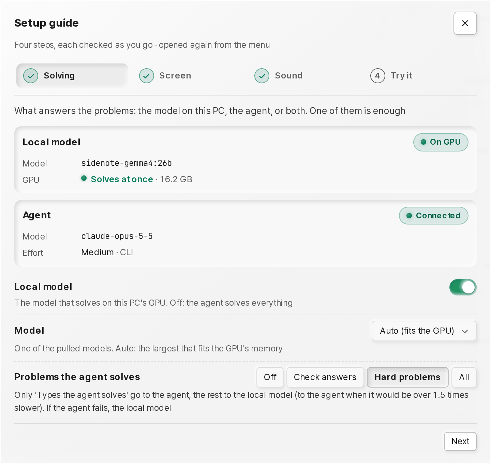
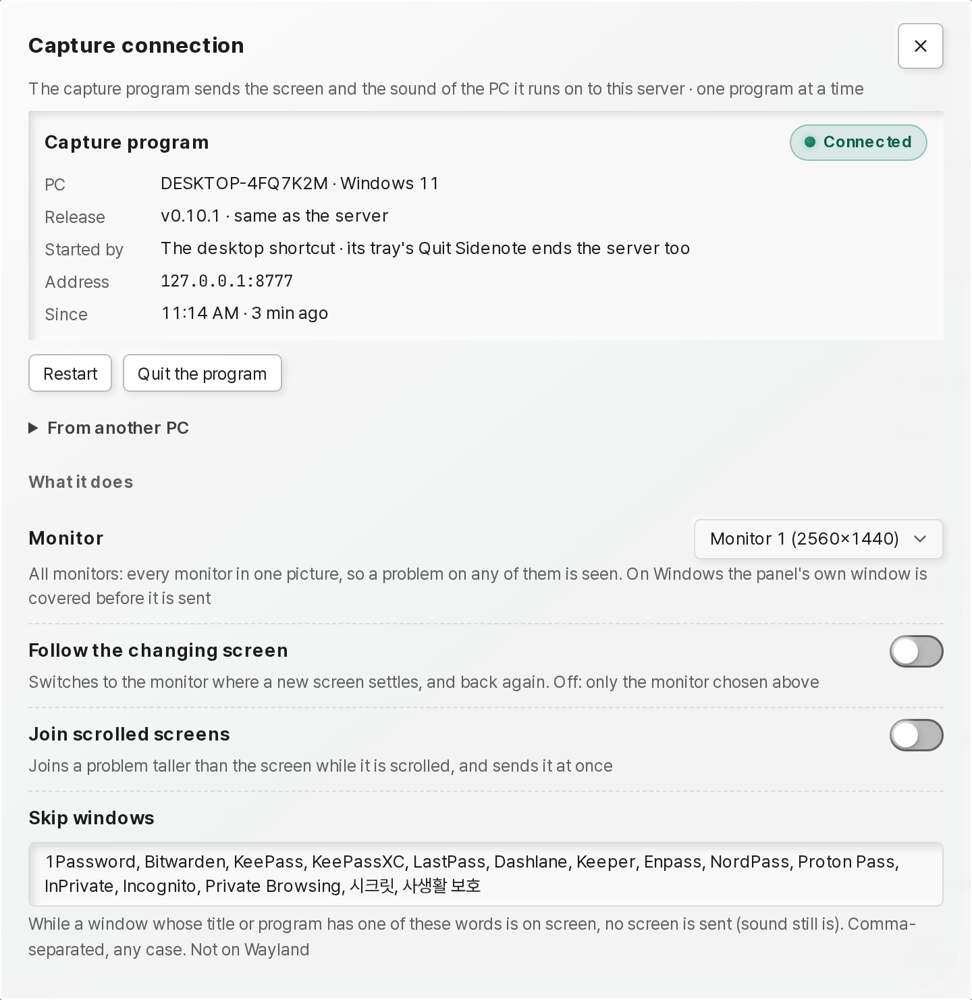
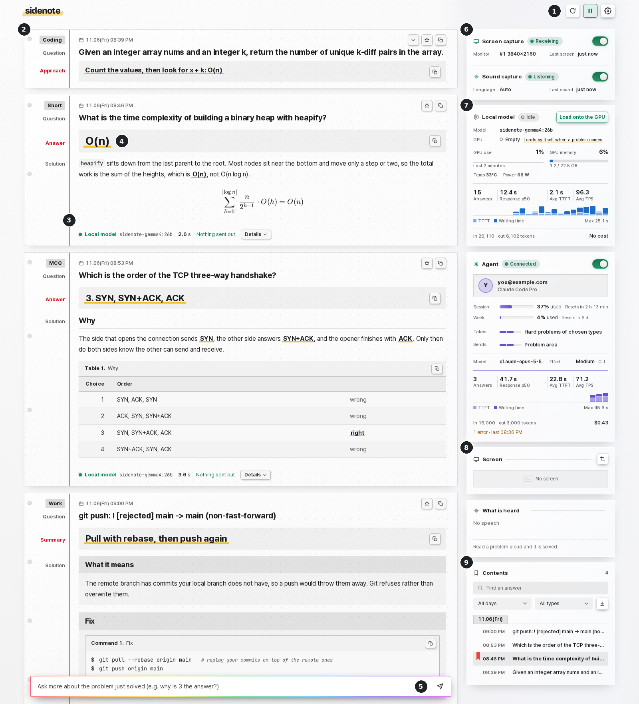
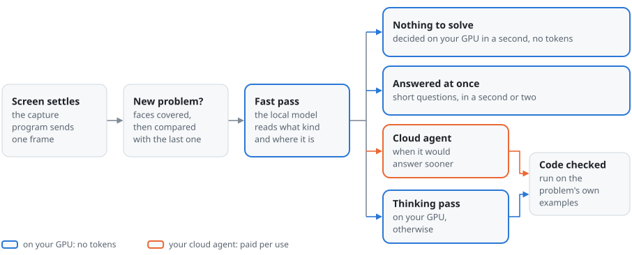
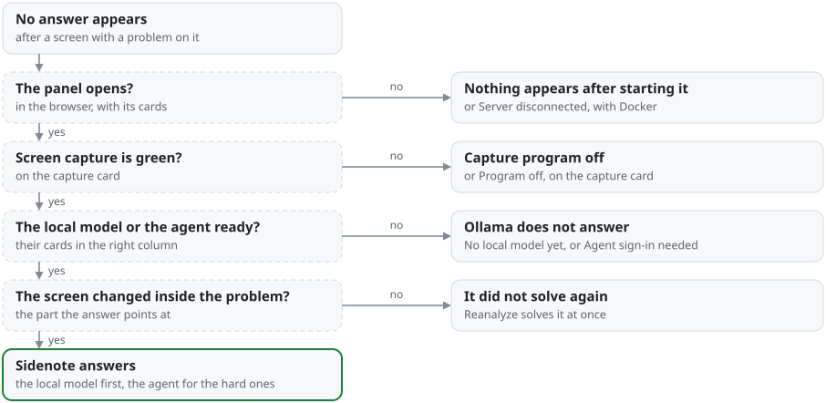

# Sidenote user guide

Sidenote finds the problems on your screen and in what you hear, and writes worked solutions into a panel in your
browser. A vision model on this PC's GPU reads every screen. The problems that need longer reasoning go to a cloud
agent you are signed in to: Claude Code, Codex or the Anthropic API.

It runs in one of three ways:

- **The app** (Windows, macOS or Linux, no Docker): `Sidenote.exe`, `Sidenote.app` or the Linux `Sidenote` starts
  everything on this PC, with Ollama for the local model (section 3).
- **With Docker** (Linux, Windows with WSL 2, or a Mac): `./sidenote <command>`, typed in a terminal in this repository's
  folder, runs the server in containers and adds web search for the local model and a sandbox for code checks.
  `./sidenote help` lists the commands. Most of this guide describes this setup.
- **On Kubernetes**: the Helm chart (section 16).

The panel, the server's messages and the commands speak English, or Korean when the browser (for the panel) or the
terminal's locale (for the commands) is set to Korean. The capture program and the app speak English unless
`SIDENOTE_LANG=ko`. **Language** in the panel's gear menu picks one by hand, and `SIDENOTE_LANG=en` or `ko` fixes one for
the server's messages, the commands and the capture program. This guide calls each control by its English label;
section 18 gives the Korean label of each.

In this guide:

- Setting up: [1. What runs where](#1-what-runs-where), [2. Requirements](#2-requirements),
  [3. First time](#3-first-time), [4. Everyday use](#4-everyday-use)
- Using it: [5. Reading the panel](#5-reading-the-panel), [6. Screen and sound switches](#6-screen-and-sound-switches),
  [7. What it solves and how](#7-what-it-solves-and-how), [8. When it solves again](#8-when-it-solves-again),
  [9. Problems given by voice](#9-problems-given-by-voice),
  [10. Long problems](#10-long-problems-joining-while-you-scroll)
- Looking after it: [11. Status, history and logs](#11-status-history-and-logs), [12. Settings](#12-settings),
  [13. Troubleshooting](#13-troubleshooting), [14. Security and privacy](#14-security-and-privacy)
- Other setups and reference: [15. For developers](#15-for-developers),
  [16. Running on Kubernetes](#16-running-on-kubernetes),
  [17. Running the capture program on its own](#17-running-the-capture-program-on-its-own),
  [18. Panel labels](#18-panel-labels)

## 1. What runs where

Sidenote is a few programs that work together. Which of them run, and where, depends on the setup.

<picture>
  <source media="(prefers-color-scheme: dark)" srcset="assets/diagram-ways-dark.svg">
  
</picture>

| Part | What it does | In the app | With Docker |
|:---|:---|:---|:---|
| Capture program, `client/capture.py` | Captures the screen and the speaker sound and sends them to the server | a process the app starts | Windows Python, or the Python of a Linux desktop or a Mac |
| Server, `server/` | Finds the problems in screens and speech, solves them with the local model or the agent, and reads the web pages the local model asks for | a process the app starts | the `sidenote` container |
| Local model | The vision model that solves (Ollama) | this PC's Ollama | the `sidenote-llm` container, on the GPU, with no internet |
| Web search | Sends the local model's searches to search engines (SearXNG) | none | the `sidenote-searxng` container |
| Code runner, `runner/runner.py` | Runs the code you run from the panel and the example checks, and returns the real output | none | the `sidenote-runner` container, with no network |
| Panel, `panel/` | Writes the solutions down one below the other, like a notebook | a browser tab the app opens, and its icon's **Open the panel** | a browser tab `./sidenote open` opens |
| Cloud agent, `server/agents.py` | Solves the problems that need reasoning, with this PC's own login (section 3) | the Claude Code or Codex CLI on this PC, or the Anthropic API | the CLI inside the `sidenote` container, or the Anthropic API |

With Docker on Windows, the server runs in WSL, which cannot see the Windows screen or sound, so only the capture
program runs on Windows. `./sidenote capture` starts it from the WSL terminal and returns at once: the program runs
without a window, with an icon in the notification area, and is ended from that icon or with
`./sidenote capture-stop` (section 4). On a Linux desktop or a Mac the same command runs the capture program there, from a
virtual environment of its own (`.venv-capture`).

## 2. Requirements

What each setup needs before its first start. The memory, GPU and disk each model needs, with what was measured, are in the
README's [What it runs on](../README.md#what-it-runs-on).

- **The app**: Windows 10 or 11; macOS 14 or newer on Apple silicon; or Linux with an X11 session and glibc 2.35 or
  newer (Ubuntu 22.04 or newer, Debian 12 or newer). [Ollama](https://ollama.com/download) runs the local model. On a
  Mac the sound needs a loopback input such as BlackHole.
- **Docker**: Docker with its Compose plugin, `docker compose` 2.24 or newer, and `python3` (both inside WSL on Windows;
  on a Debian or Ubuntu desktop also `python3-venv`, for the capture program's packages),
  and for an NVIDIA GPU on Linux the NVIDIA Container Toolkit. `./sidenote doctor` checks the Compose version. On Windows, also Python 3 for Windows (the `py` command); `./sidenote setup-capture`
  installs the capture program's packages into it.
- **Docker on a Mac**: Docker Desktop, `python3`, and [Ollama for Mac](https://ollama.com/download), which runs the
  local model on Apple silicon's GPU (Docker on a Mac has none): the README's
  [local model](../README.md#the-local-model-optional) part. For the sound, a loopback input such as BlackHole. Not yet
  measured on a Mac: how fast the models are there and how well they answer.
- **The local model**: an NVIDIA or AMD GPU, or a Mac's Apple silicon. Sidenote reads its memory and picks the largest
  measured model that fits: `gemma4:26b` on 24 GB, `gemma4:e4b` on 10 to 22 GB, `gemma4:e2b` on 8 GB. A Mac's GPU works
  in the Mac's own memory and gets as much of it as macOS lets it use (two thirds on a Mac with up to 36 GB, three
  quarters on a larger one, or `iogpu.wired_limit_mb` when raised): the e4b from 16 GB, the 26b from 32 GB. With less,
  or no GPU, the cloud agent solves everything (a model can still be pulled to run on the CPU, slowly).
  `SIDENOTE_LOCAL_MODEL` names one by hand.
- **The cloud agent** (optional): Claude Code (the `claude` command) or Codex (the `codex` command), signed in with an
  account that can use it, or an Anthropic API key. With Docker the server runs its own copy of the CLI with the login from
  WSL (`~/.claude`, `~/.codex`); `./sidenote login codex` signs Codex in even without `codex` in WSL. The server uses the
  CLI's login as it is (section 3). Docker on a Mac cannot read Claude Code's login, which the Mac keeps in the
  Keychain: there `./sidenote login` gives the server a token of its own.

## 3. First time

Install Sidenote, start it once, and add what solves: the local model, the cloud agent, or both.

### The app

1. Optional, for the hard problems: install Claude Code or Codex and sign in once in a terminal (`claude`, or
   `codex login`). The app uses the CLI it finds when it starts, Claude Code first: after installing one while the app
   runs, quit Sidenote and start it again. Opened from the Finder or a desktop's menu, the app asks your login shell for
   its `PATH`, so it finds a CLI the shell finds.
2. Install Sidenote with the commands in the README's [quick start](../README.md#quick-start), one block for each
   system. The first start can take a minute. Then the panel opens in the browser, and an icon appears in the
   notification area (on Windows 11 it may be hidden under the **^** by the clock), or in the menu bar on macOS.
3. Optional, on your GPU: install Ollama with the line for your system in the quick start's
   [local model](../README.md#the-local-model-optional) part, then quit Sidenote and start it again: the app starts
   Ollama when it starts. The **Local model** card then offers the model for this GPU with **Download**, shows how far
   the download has got, and says when the model is ready. Without Ollama, the agent solves everything; turn **Local
   model** off in **Solver settings** so the panel stops asking for it.
4. On macOS, the first capture makes macOS ask for **Screen Recording** for Sidenote. Choose **Open System Settings**
   and turn Sidenote on, then quit Sidenote from its menu bar icon's menu and open it again: until then the screen holds
   only the desktop picture. For the speaker sound, install BlackHole (`brew install blackhole-2ch`), make a
   **Multi-Output Device** of your speakers and BlackHole in **Audio MIDI Setup**, and choose it as the output; macOS
   then asks once for the microphone, as Sidenote hears BlackHole as an input.

To install from a browser instead, download `Sidenote-windows-x64.zip`, `Sidenote-macos-arm64.zip` or
`Sidenote-linux-x64.zip` from the [releases](https://github.com/kanggu12/sidenote/releases/latest):

- **Windows**: right-click the zip, choose **Extract All**, then open the `Sidenote` folder inside and run
  `Sidenote.exe`: it does not start from inside the zip. The app is not signed by a publisher yet, so the first time
  Windows may warn about an unknown publisher: **More info**, then **Run anyway**.
- **macOS**: double-click the zip to unpack it, drag **Sidenote** into **Applications**, and open it from there. macOS
  stops an app from a browser's download that no publisher signed: in **System Settings**, **Privacy & Security**,
  choose **Open Anyway** at the bottom (on macOS 14, right-click the app, choose **Open**, then **Open** again). The
  quick start's `curl` leaves the zip unmarked, so macOS does not ask there.
- **Linux**: `unzip Sidenote-linux-x64.zip && ./Sidenote/Sidenote`.

When it starts, the app starts Ollama if it is installed but not running, and while it runs it starts again any part it
started that stops. **Quit Sidenote** in its icon's menu, in the tray or the menu bar, stops everything. Starting the
app again while it runs opens the panel, and starting it while it is still closing down starts it once that is done.
`SIDENOTE_*` settings (section 12) are read from the environment the app starts with. Options go after `Sidenote.exe`,
after `Sidenote.app/Contents/MacOS/Sidenote` on macOS, or after the Linux `Sidenote`:

| Option | Meaning |
|:---|:---|
| `--no-browser` | Start everything without opening the panel |
| `--no-capture` | Start the server and the panel only |
| `--port 8778` | The server's port on 127.0.0.1 (default 8777) |
| `--check` | Start the server with stand-in models on a free port, check that it answers, and stop |

On Linux, `./Sidenote/Sidenote --check` prints its result in the terminal, and on macOS
`/Applications/Sidenote.app/Contents/MacOS/Sidenote --check` in Terminal. The Windows app has no console, so there it
writes the result to the file `SIDENOTE_CHECK_LOG` names. In PowerShell, in the `Sidenote` folder that holds
`Sidenote.exe`:

```powershell
$env:SIDENOTE_CHECK_LOG = "$env:TEMP\sidenote-check.txt"
Start-Process .\Sidenote.exe -ArgumentList '--check' -Wait
Get-Content $env:SIDENOTE_CHECK_LOG
```

The app keeps its files in a data folder: `%LOCALAPPDATA%\Sidenote` on Windows, `~/Library/Application Support/Sidenote`
on macOS, `~/.local/share/sidenote` on Linux (`$XDG_DATA_HOME/sidenote` when that is set), or the folder
`SIDENOTE_DATA_DIR` names. Its `logs` folder holds the
logs (section 11 lists them), the panel's settings (`.settings.json`) and the kept answers (`history.sqlite`).

`./sidenote stats`, `events`, `report` and `gpu` run inside the server's container, so the app has no counterpart to
them. Instead, `http://127.0.0.1:8777/stats` gives the data of `stats` as JSON, `events.jsonl` in the `logs` folder
holds the events, and **Solver settings** gives the GPU back: turn **Local model** off, and **The local model stands
in at a limit** off.

### With Docker

```bash
./sidenote install         # the server, the capture packages, the desktop shortcut on Windows, a check, what is left to do
./sidenote llm pull        # optional: the local model for this GPU and its smaller one (a few GB to tens of GB)
```

`install` runs the steps in the order they need and skips the ones already done, so it is safe to run again after a
change. It does not download the models by itself, since they take a few to tens of gigabytes; it points at
`llm pull` instead (`./sidenote install --with-models` does both). Until a model is there, a signed-in agent solves
everything.

The GPU is found by itself: `./sidenote` adds `docker/compose.nvidia.yaml`, `docker/compose.amd.yaml` or
`docker/compose.cpu.yaml` to `compose.yaml`, and `./sidenote doctor` says which (`COMPOSE_FILE` in `.env` picks one by
hand). The steps of `install`, by hand:

```bash
./sidenote up              # build the server image and start it (a few minutes the first time)
./sidenote setup-capture   # install the capture packages: into Windows Python, or .venv-capture on Linux and macOS
./sidenote shortcut        # a desktop shortcut that starts the server and the capture program (Windows)
./sidenote doctor          # check the setup
```

### The cloud agent

By default the problems that need reasoning go to a cloud coding agent: algorithm, coding, math, work, essay and other
problems, and any problem the local model would take 1.5 times as long as the agent to start answering. **Solver settings**
(in the gear menu) changes which problems go, or switches the agent off. `SIDENOTE_AGENT` in `.env` chooses the agent; its
other settings are in section 12.

| `SIDENOTE_AGENT` | Uses | Sign in |
|:---|:---|:---|
| `claude-code` (default) | the Claude Code CLI with this PC's login (`~/.claude`) | `./sidenote login` |
| `codex` | the Codex CLI with this PC's login (`~/.codex`) | `./sidenote login codex` |
| `anthropic-api` | the Anthropic API | `ANTHROPIC_API_KEY` in `.env` |
| `off` | no cloud agent: the local model answers everything | |

The panel calls it **Agent**, whichever it is: its card in the right column, its section in **Solver settings**, and its
signal in the top bar on a narrow window. The card names the product (Claude Code, Codex or Anthropic API) beside the
account it is signed in as.

Signing in:

- The CLI agents use this PC's own login as it is; there is no token to create or paste, except with Docker on a Mac.
- `./sidenote login` signs in the agent the server is set to use, when it is not signed in.
- `./sidenote login codex` signs Codex in. With the `codex` command in WSL it signs in there; without it, the server's
  own copy shows an address to open and a code to enter there (the server has to be running, and the login lands in the
  same `~/.codex`).
- Docker on a Mac cannot read Claude Code's login, which the Mac keeps in the Keychain. There `./sidenote login` runs
  `claude setup-token` (one sign-in in the browser), asks for the token it prints, keeps it in `.env` as
  `CLAUDE_CODE_OAUTH_TOKEN` and starts a running server again with it.
- The server notices a new login within 20 seconds, with no restart.
- Without a login the local model solves everything, but the **Agent** card says **Sign-in needed** and an alert asks
  for the login. Setting **Problems the agent solves** to **Off** clears both.

New models are used without a change. For Claude Code the model setting offers the families `opus`, `sonnet` and
`haiku`, each meaning the newest release of its family, and an empty setting uses the CLI's own default.
`SIDENOTE_AGENT_MODEL` pins a version (for example `claude-opus-5-5`). A Codex login reports no price, so the hourly
cost limit counts only the agents that report one (section 12).

`up` builds the Claude Code and Codex CLIs into the server image at the versions this PC has, so after the PC's CLI
updates, the next `up` rebuilds the image. When the PC has none, it uses the versions `compose.yaml` names.

The agent runs as a helper, with none of your own setup. Claude Code loads none of this PC's settings, hooks, plugins,
MCP servers or skills, Codex none of its config or rules, and neither keeps a session history. Claude Code is offered
no tools but a web search, for a question about the present; Codex runs in a read-only sandbox that asks for no
approval. Claude Code's token refresh goes through its own lock, so it does not collide with other Claude Code
sessions on this PC.

### The setup guide

The first time a browser opens the panel of a server that has kept no answer, the panel opens the **Setup guide**, once
in that browser; the gear menu opens it again at any time. It has five steps, and each is ticked in the row of steps once
what it is about works:

<p align="center">
  <picture>
    <source media="(prefers-color-scheme: dark)" srcset="assets/setup-guide-dark.png">
    
  </picture>
</p>

1. **Connection**: the capture program, as **Capture connection** shows it ([The capture
   connection](#the-capture-connection)): connected or not, the wait for one with its seconds, and the ways to start one
   where this server runs. The step is ticked once one connects, and says which PC it is on.
2. **Solving**: the **Local model** and the **Agent**, each as its card says how it stands, with the **Local model**
   switch, **Model** and **Problems the agent solves**. One of the two is enough.
3. **Screen**: the capture as its card says it, the screen the server receives (**Show the screen it receives**),
   **Monitor** and **Skip windows**. With no capture program connected it says that comes first, with the way back to
   the first step. On a Mac the capture program needs **Screen Recording**.
4. **Sound**, which is optional: what is heard as it comes, with **Solve spoken problems** and **Speech language**.
5. **Try it**: **Open the sample problem** opens a question in a new tab. With that tab on the screen, the step
   follows the answer it gets and offers **See the answer**.

Its settings are the rows of **Solver settings**, and change the same values.

## 4. Everyday use

Start Sidenote, stop it, and lend the GPU to other work. With the app, start it (`Sidenote.exe`, **Sidenote** in
Applications, or the Linux `Sidenote`) and quit it from its icon in the tray or the menu bar; the rest of this section
is the Docker setup.

```bash
./sidenote up        # start the server; when it is running, rebuild only what changed and show the status
./sidenote capture   # start screen and sound capture (windowless, with a tray icon; the command returns at once)
./sidenote open      # open the panel in the browser
```

When the server is in use, `./sidenote up` and `./sidenote restart` wait until it is idle before restarting it; `--now`
restarts at once.
With `SIDENOTE_CI_GATE=1` in `.env`, `up` also refuses a commit that CI failed ([QA.md](QA.md)).

When you are done, **Quit Sidenote** in the capture program's tray menu ends what the desktop shortcut started: the
capture program, and the server the shortcut brought up for it. A server you started yourself with `./sidenote up`
stays up: there the menu says **Quit**, which ends the capture program alone, and `./sidenote down` stops the server
and the capture program. `./sidenote capture-stop` ends the capture program alone either way. `./sidenote restart`
restarts the server, which also applies a
change to `.env` or to the code. The server does not start by itself when
the PC or Docker restarts.

A server, model server or code runner that ends by itself in failure is started again inside its container, at most 5
starts in 10 minutes (the first included); past that its container stays ended until `./sidenote up`. `./sidenote status`
says why the server is off (its exit code, a memory kill, the watchdog, or the starts given up on) and why the model
server's container is off (its exit code or a memory kill); of the code runner it says only that it is off. A code runner
that could not clean up after a run ends itself and starts again clean.

`./sidenote capture-stop` also stops a capture program left behind (one started with `--console` whose terminal was
closed, for example), and if some are still left, it says how many.

### The capture program

`./sidenote capture` starts it windowless: no console and no taskbar window, only the icon in the notification
area. What it prints goes to `capture.log`, kept under 4 MB (a trim keeps the newest half). `--console` keeps it in
the terminal instead, where Ctrl+C ends it; that is the way to see what stops it from starting.

Clicking the icon opens the panel. Right-clicking it opens a menu with **Open the panel**, the **Screen capture** and
**Sound capture** switches, **Capture connection** (the panel's sheet of that name), **Restart capture** and **Quit**
(**Quit Sidenote** where it ends the server too: in the app, which it ends whole, and after a start that brought the
server up);
on macOS a click on the icon in the menu bar opens that menu. On Windows the menu uses the panel's look: the same icons,
the same status pill (green while it captures, red with no server, amber with **Skipped window** while a window named in
**Skip windows** is on screen) and the same switches.

The icon needs `pystray`, which `./sidenote setup-capture` installs. Without it the program still runs, with no icon, and
says so once. Started windowless it then has neither a window nor an icon, so `./sidenote capture` says so before it starts
it, with `./sidenote capture-stop` as the way to end it. `./sidenote install` installs the package, and `./sidenote doctor`
reports it missing.

One capture program runs for a server. `./sidenote capture` typed again finds the one that runs and says so, and the
desktop shortcut clicked while one runs opens the panel. A second capture program started anyway (one the launcher
could not see) says one is running and ends with exit code 76 before it captures anything. One that connects from another PC or another
account, where this PC's guard cannot see it, takes over: the one before ends itself, and the panel says so. After `SIDENOTE_PORT` changes, stop the capture program and start it again
(`./sidenote capture-stop`, then `./sidenote capture`); on WSL make the desktop shortcut again too (`./sidenote shortcut`).

The capture program reads its code when it starts. After `./sidenote up` deploys new code for it, it restarts itself
into that code at a quiet moment (the screen at rest for 20 seconds, nothing being analyzed or listened to, no answer
in the last minute), as **Restart capture** in its tray menu does. `./sidenote capture-restart` restarts it at once.

The panel switches the screen and the sound on and off, chooses the monitor and pauses the answers, but it cannot
start the capture program, which runs outside the server's container: its **Capture connection** gives the command for
where the server runs, and waits for the program to connect. Once that is started, everything else is the
panel's.

Capture options go after `./sidenote capture`:

| Option | Meaning |
|:---|:---|
| `--monitor 2` | Capture monitor 2 (default 1, the primary monitor; 0 takes all monitors as one image) |
| `--list-monitors` | Only list the monitor numbers |
| `--stitch` | Join a problem longer than one screen while you scroll through it (section 10) |
| `--no-audio` | Do not capture sound |
| `--once` | Send the screen as it is now and exit (no sound, nothing left running). It runs in this terminal, which shows what it sent |
| `--no-tray` | No icon in the notification area (windowless, so `./sidenote capture-stop` is then the way to end it) |
| `--console` | Keep it in this terminal instead of starting it windowless; Ctrl+C ends it |
| `--up` | Start the server first if it is not running (what the desktop shortcut runs, with no terminal). In a terminal, a failure waits for Enter before the script ends |
| `--no-auto-stitch` | Do not join a scrolled problem by itself |
| `--no-auto-update` | Do not restart into new code when `./sidenote up` deploys it (by default it does, at a quiet moment) |
| `--audio-device "part of the name"` | The device to take sound from (default: the default speaker; on a Mac, the first loopback input such as BlackHole) |

Each option reaches the capture program as typed, so a device name with spaces goes in quotes as usual
(`--audio-device "Realtek USB2.0 Audio"`). On Windows the options pass through cmd.exe, which would act on some
characters itself, so a value holding one of `" % & | < > ^` is refused with a message. Give a part of the name
without it: any part of a device's name finds it.

### The capture connection

**Capture connection** in the gear menu opens the panel's sheet for the capture program: the program as the server
knows it, the way to start one, and what it is asked to do. The capture card's foot opens it too (**Manage** while one is
connected, **Connect** while none is), as do the alert bar's **Connect**, the welcome's checklist and the tray menu's item
of the same name. It is also the setup guide's first step.

<p align="center">
  <picture>
    <source media="(prefers-color-scheme: dark)" srcset="assets/capture-connection-dark.png">
    
  </picture>
</p>

- **The card**: **Not connected**, or **Connected** with the program's **PC** and system, its **Release** against the
  server's, what it was **Started by** (**The Sidenote app**, **The desktop shortcut**, a terminal's `./sidenote capture`,
  or **By hand**) and what its tray's **Quit** ends, the **Address** it was given and **Since** when it is connected. The
  program says these in its hello as it connects; one older than 0.8.0 says none of them. A program of another release
  turns the card amber, with what to do: one started from the server's checkout runs the server's code once restarted,
  and one elsewhere is replaced from that release's `sidenote-capture` zip.
- **Restart** and **Quit the program**, which asks twice, ask the program what its tray's **Restart capture** and
  **Quit** do. **Quit the program** ends the program alone: a server the desktop shortcut brought up stays, as the tray's
  **Quit Sidenote** would have ended it too. Under the app the key is **Quit Sidenote**, which ends the app.
- With none connected, it waits, with the seconds since the sheet opened, and past a minute says where to look for why
  (`./sidenote capture --console` prints what stops it). When one connects, it says so with the PC it is on.
- **The ways to start one**, by where the server runs: on the server's own PC `./sidenote capture` in its terminal, or the
  desktop shortcut on Windows; under **From another PC**, or first for a server in a cluster, three steps: this server's
  port on that PC (for a cluster, the `kubectl port-forward` the panel came through, with its namespace and service), the
  capture program from the release's zip with Python 3.10 or newer, and its start, `py -3 capture.py --server
  ws://127.0.0.1:<this panel's port>/ingest` on Windows (`python3` elsewhere). Each command has its **Copy** key. Under the
  app, the app starts the program itself.
- **What it does**: **Monitor**, **Join scrolled screens** and **Skip windows**, the settings the capture program carries
  out, as **Solver settings** has them.

The panel cannot start a program that runs outside the server's container, nor end the server it is served by: those
stay with the launcher, the desktop shortcut and the app. `./sidenote status` names the PC, the system and the release of
the program that is connected.

### The desktop shortcut on Windows

`./sidenote shortcut` puts a shortcut on the Windows desktop that starts the server, when it is not running, and then
the capture program, in one click and with no window. Windows Python's windowless launcher (`pyw.exe`) runs
`client/launch.pyw`, which runs `./sidenote capture --up` through wsl.exe without a console: no console window comes
up, a small window by the clock shows the start, and the tray icon is what stays.

<p align="center">
  
</p>

- A small window beside the notification area shows the start as a bar in three parts (the server, the capture
  program, ready), with the time it has taken and the launcher's last line under it. The first start after an update
  builds the server image for a few minutes, and a second click meanwhile says that a start is still going.
- A click while the capture program runs opens the panel.
- When a start fails (Docker off, the port taken), the same window shows the launcher's last lines, to select and copy
  (Windows' own message box where Python has no tkinter).
  `./sidenote capture --up` in a WSL terminal prints all of it.
- `./sidenote shortcut --remove` takes the shortcut away, with the icon it keeps in `%LOCALAPPDATA%\Sidenote`.
- On a WSL that cannot start Windows programs (`[interop] enabled=false`, or no Windows drive mounted), `./sidenote`
  cannot make the shortcut, and says so with a command for a Windows terminal:
  `py -3 "...\client\launch.pyw" --setup --distro ... --repo ...`. Run once, it installs the capture packages into
  Windows Python and makes the same shortcut. The shortcut then brings the server up in WSL and starts the capture
  program from Windows itself, which asks nothing of WSL's interop.

### Lending the GPU to other work

While you need the GPU for something else, `./sidenote gpu off` gives it back at once: the local model is switched off
and unloaded, and it is not loaded again when the agent reaches a limit. The agent keeps working, and the panel shows
the local model as off. `./sidenote gpu on` takes the GPU again, and `./sidenote gpu status` says who holds it.

## 5. Reading the panel

What each part of the panel shows, and what its buttons do.

<picture>
  <source media="(prefers-color-scheme: dark)" srcset="assets/panel-anatomy-dark.png">
  
</picture>

1. The top bar: **Reanalyze**, **Pause** and the gear's **Settings** menu, and on a narrow window five signals.
2. The notebook: the solutions, one below the other.
3. An answer's margin: the problem's type, the time, and marks such as answer, solution and question.
4. The answer line: the one-line answer, highlighted, with **Copy** beside it.
5. The question box: asks more about the problem just solved.
6. The capture card: the **Screen capture** and **Sound capture** switches.
7. The engine cards: **Local model** and **Agent**, with what each has done today.
8. The screen card and **What is heard**: the screen that produced the answer, **Draw a region**, and the speech
   heard.
9. The contents: the list of solutions, with search, filters and **Export**.

Everything is done with buttons, and the most used have a key too ([Keyboard shortcuts](#keyboard-shortcuts)).

### The top bar

The top bar holds **Reanalyze**, **Pause** and the gear's **Settings** menu. On a window 1000 pixels wide or less,
where the right column moves below the notebook, it also shows five signals; on a wider window the cards beside the
notebook carry the same readings.

- The signals: **Server**, **Local model**, **Agent** (the cloud agent, whichever the server uses), **Screen** and
  **Sound**, colored as the cards' states are. Green: working. Amber: working, with something to look at (the sound
  device could not be opened, the local model stands in or is downloading, the GPU is busy, the agent rests at its
  limit or has paused its automatic sending). Red: switched off, or unable to work (the server connection is lost,
  the local model is not downloaded or not answering, the agent needs signing in). Gray: the capture program is not
  running, the agent's CLI is not installed (**Optional**), or the state is still being checked. Hover over one for
  details.
- **Reanalyze** solves the current screen again right away, including a screen that was skipped as unchanged.
- **Pause** stops automatic analysis, and the analysis in progress; while paused, the button reads **Continue**. Its
  mark is what pressing it does: two bars while it watches (green), a triangle while paused (amber). While paused,
  **Reanalyze** still solves the current screen, so pausing works as a manual mode that solves only when you ask.
- The gear button opens the **Settings** menu:
  - **Theme**: **Auto**, **Light** or **Dark**.
  - **Motion**: **Full** unless you set it to **None**, or to **Auto**, which follows the system's setting. In full
    motion the cards come up as the panel opens, figures count to their values, meters and bars fill, and what changes
    moves once. Nothing moves at rest but what is at work.
  - **Language**: **Auto** (the browser's language), **한국어** or **English**. A pick opens the panel again in that
    language, the server's messages too, and this browser keeps it. `?lang=en` or `?lang=ko` in the address picks one
    for that page alone.
  - **Practice**: **Off** or **On**. With it on, a new answer shows its question first, and its hints and its answer
    when you ask ([Practice](#practice)). This browser keeps it.
  - **Capture connection**: the capture program, connected or not, and the way to start one ([The capture
    connection](#the-capture-connection)).
  - **Solver settings** (section 12).
  - **Setup guide**: the five steps of a first start, again ([The setup guide](#the-setup-guide)).
  - **Keyboard shortcuts**: the list of keys ([Keyboard shortcuts](#keyboard-shortcuts)).
  - **Recently deleted**, with how many it holds, while it holds any: the answers deleted in the last 7 days
    ([The notebook](#the-notebook)).
  - **Clear history**, which takes a second press; an answer still being written stays. Starred answers go with the
    rest, and so does **Recently deleted**.

The version of Sidenote the server runs stands beside the name in the top bar, such as **v0.9.0**, and opens that
release's notes.

The speech language is not in this menu: it is in **Solver settings**, in its **Speech** section.

### Alerts

An alert bar appears under the top bar only when something needs doing: the server connection is lost, the local
model is not downloaded or not answering, the agent is in use but needs signing in or its login was rejected
(expired), no engine can answer, the capture program is not connected, or analysis is paused. It stays under the top bar as the
thread scrolls, and the right column stays under it. **Copy command** in an alert copies the command to type in the
terminal.

When a newer release of Sidenote is out, the alert bar says so in a band of its own, **Sidenote 0.9.0 is out**, with a
**Release notes** link to the release's page on GitHub. Its close key hides it for that version in this browser, and the
next release shows again. The server asks GitHub once a day (section 14); **Check for new versions** in **Solver
settings** turns that off.

A short notice says what just happened, such as an export written or a capture switched off, under the top bar for a few
seconds. It has the band's form: a mark for its kind (a circle with *i* for something to know, a tick for what you asked
for done, a triangle for what was not done or failed), the fact in bold, then what follows or what to do. One about an
earlier answer has **To the answer**. If the server connection drops or the capture program stops while you are reading
further down, a notice says that too. A solution that was being written when the connection dropped stays as far as it
got, marked "Stopped: connection lost". Once the server is back, solve it again with **Reanalyze**.

### The notebook

Solutions are written one below the other. Each answer is a page of its own; a flat red ribbon on its line in the contents
marks the current one, whose screen the right column shows.

- The margin shows the problem's type (multiple choice, short answer, coding and so on), the time, and marks such as
  answer, solution and question.
- The answer line is highlighted. **Copy** beside it copies that line (its tooltip reads **Copy the one-line
  answer**), and **Copy all** copies the whole solution; a copy button reads **Copied** for a moment after a
  press. Every code box and every table has **Copy** too. A table pasted into a spreadsheet or a document keeps its
  rows and columns, and pasted into plain text it comes as tab-separated lines.
- **Star**, the star button on an answer's head, stars a finished answer: the star fills with the highlighter's yellow,
  the answer's line in the contents shows a small star, and every panel that is open shows the same. A starred answer
  is kept past the history's 90 days and size limit until it is unstarred, and the contents' **Starred** lists it.
  Press the star again to unstar it. An answer the server did not keep (with **Keep answers** off) cannot be starred,
  and a notice says so.
- **Delete**, the bin at the end of an answer's head, takes the answer off the page in every panel that is open, and a
  notice says so with **Undo** (`z` does the same while the notice shows). A deleted answer waits in **Recently
  deleted** in the gear menu for 7 days (`SIDENOTE_DELETED_DAYS`), with its star and its follow-ups: **Restore** puts it
  back where it was, **Delete for good** takes it from the file at once, and **Empty** takes them all; both ask for a
  second press. A card the server did not keep (an error, an answer stopped part way, any with **Keep answers** off)
  only leaves the page, and **Undo** is the way back. A follow-up still being written about a deleted answer stops,
  and with the last answer deleted the question box waits for the next one, or for **Undo**.
- Headings, and a line that is only bold (a step such as "1. ..."), are written in the color of the problem's type,
  so the parts of a long solution can be found by eye. Bold words in the text are what the answer stresses, and wear
  the same yellow highlighter as the answer line. A table column of numbers is right-aligned. A range written with a
  tilde ("20~50") stays a tilde.
- Once an answer is complete, the panel lays out its parts without asking a model and without dropping a word:
  numbered steps become a ladder (while it is written too), `**Name**: words` lines become cards, a chain of arrows
  becomes boxes, a stated complexity is placed on a scale from O(1) to O(2ᴺ), table figures get bars and verdicts
  their colors, a long answer gets a strip of links to its parts, and several answers in one key line become tiles
  that go to their parts. When the shape is unclear, the answer stays as written.
- Pictures: when values are compared or change, or a schedule, an exchange, a flow, a state machine or the relations
  of tables are explained, a solution can hold a chart (bars, stacked bars, lines, a Gantt chart for a CPU schedule)
  or a diagram (flowchart, sequence, state, ER). Under a chart, **View as a table** holds every value; under a
  diagram, **View the source** holds its text to copy. While the solution is being written, a picture shows as
  **Drawing the diagram…**, and one that cannot be drawn stays as its text, with the reason over it. A diagram takes
  the width of the thread. The agent draws them where they help (measured with Claude Code); the local model draws
  the diagrams but writes numbers as tables and lists.
- Every table, picture and code block in an answer has a numbered title (**Table 1.**, **Figure 1.**, **Code 1.**,
  **Command 1.**) and says what it is: the step it is in, or the nearest heading, paragraph's leading bold words or
  short line ending in a colon above it, else what it holds (a table's columns; a program's function, or what its
  judge wrapper's docstring says when that function is only `solution` or `main`; a command's program).
- A code box reads as an editor shows code: numbered lines, long lines wrapped onto the next row (hanging from their
  indentation) instead of a box that scrolls sideways, and indent guides. A block of commands has a `$` where a
  program has its line numbers. Resting the pointer on a built-in or library function (`len`, `heapq.heappush`,
  `std::sort`, `Arrays.sort`, `Math.max`, `strings.Split`) shows its signature and the reference's own English line,
  as an editor's hover does. On a Korean page it also says in Korean what the function does, what goes in
  (**Input**) and what comes out (**Output**): for Python from the documentation of the code runner's own Python, for
  C++, Java, JavaScript and Go for the most used functions. Copying and running take the code as written, without
  the line numbers.
- Several problems answered at once are listed one line each.
- A screen with nothing to solve is left as one line, "No problem to solve".
- A solution stopped by pause or a switch stays as far as it got, marked **Stopped**. A solution replaced by a new
  screen or by **Reanalyze** gives way to the new one. One that has run 20 seconds or more is in its long pass and
  finishes first, and the newest screen is looked at after it (`SIDENOTE_SUPERSEDE_KEEP_SEC`): most screens that
  stopped such a pass had nothing to solve.
- Under a solution, as they apply: **Tests** (its code run on the problem's examples), **Review** (the agent's
  verdict, in the **Check answers** mode), **Retry** (after a failed example) and **Details** (the tokens, the cost,
  and the search words and pages read for this answer). Sections 7 and 14 explain them.
- **Problem text**, on the latest screen problem, writes the problem out as text to copy (section 7).
- Under the newest answer is **More**: **Go deeper** always, and a few that suit the kind of answer it is:
  **Another approach**, **Why this complexity** and **Find a counterexample** for an algorithm, **How to confirm**
  and **Other causes** for an operations answer. Each one asks the whole question for you, and the reply is added
  under the same answer. The first pass stays short on purpose: most screens hold nothing to solve, and depth is
  worth paying for only when it is asked for.
- The three most recent solutions stay expanded; older ones keep only their answer line. **Show the solution**
  expands one again, and **Fold** folds it back. A folded answer to a spoken problem with no question line of its own
  also keeps the end of what was heard, where the question usually is.
- A spoken problem's **Heard** row holds what was said, three sentences a paragraph; a long one shows its first lines,
  and **Show it all** the rest. A summary of several sentences marks its first, the point, and gives the rest a line
  each.
- While you scroll up to read (even by one wheel step), a new answer does not pull the view down; a **New answer**
  button (with a down arrow) appears instead, and jumps to the latest answer. The solution you are reading is not
  folded when new answers arrive. Any scroll by hand, up or down, starts an 8-second count again; after 8 seconds the
  view follows down again from the next new answer. It does not pull down while the same answer grows or finishes. A
  solution picked from the contents stays the current one until you scroll by hand, however long you read it.

### Practice

Practice is for trying a problem before reading its solution. With **Practice** on in the gear menu, each answer that
arrives shows its question and keeps the rest back. The answers that were there before stay as they are.

- **Show a hint** shows the solution's next part: its sections in their order (such as the approach, the code and the
  complexity), or its steps one by one. Beside it, how many hints there are and how many are shown.
- **Show the answer** shows all of it: the answer line, the whole solution, the example check and the follow-up buttons.
  An answer of a single part offers only **Show the answer**.
- An answer being written says so, and shows nothing of itself until it is done and asked for. An answer kept back
  does not fold with the older ones, where it would show its answer line.
- Until then the answer line stays out of the contents, their search, the screen reader's note and the `c` key, and
  the answer has no **Copy** or **Copy all**. **Problem text** writes out the question as usual, and a follow-up
  asked about the answer is answered under it. **Export** takes everything, the hidden answers too.
- This browser keeps how far each answer was opened, so a reload shows it as it was, and an answer shown in full stays
  shown. Answers the server gave while the panel was closed, after Practice was turned on, are kept back too.
- The server is not told: it solves and keeps the answers as before. **Off** shows every answer whole again, and
  **On** keeps back again those it kept back before.
- To review, choose **Starred** in the contents with Practice on: every starred answer is kept back, however old, and
  opens hint by hint as a new one does. Choosing **Starred** again starts a new round.

### Running code

**Run**, in the bar at the foot of a code box, runs the code and shows its output below it. Open **Input** beside it
and type standard input to run with it. Runs happen one at a time, with limits, in a separate container with no
internet. A shell block in an answer that is not a coding problem has no **Run**: it holds commands for your own
machine, which the container does not have.

- A solution that fills in a function (`solution`, `twoSum`) comes with a runner under it. With **Input** empty it
  runs the problem's examples and prints each result beside what it should be. With values in **Input**, one argument
  a line as the examples write them (`"aabbaccc"`, `[1, 2, 3]`, `5`), it runs those instead. They may also be typed
  the way a problem shows them: an array over several lines, `nums = [2,7,11,15], target = 9`, or a whole LeetCode
  example with its `Input:` and `Output:`; the server lays them out one argument a line before the run.
- A solution to a problem usually reads its case from standard input, and run with nothing to read it dies on its
  first line. So **Run** looks at the code first: if it reads input and the box is empty, the box opens and says what
  it needs instead of running. Press **Run** again to run it with no input anyway. What you typed is sent whether the
  box is open or folded away, and a run that did die at the end of its input says so in words, with the original
  message kept underneath.
- Limits: 10 seconds per run (`SIDENOTE_RUNNER_TIMEOUT`, at most 30 seconds, of which compiling may take up to 20)
  and 512 MB of memory. Output is shown up to 64 KB per stream, and a run that writes more than 8 MB is stopped. Code
  may be up to 100,000 characters, and input up to 20,000.
- Languages: Python 3.12 with the standard library only; C as C11, with the math library; C++ as C++23 with g++ 14
  (code that does not compile so is tried as C++17, which a global named `count` beside `using namespace std` needs);
  JavaScript on Node 20 (run as a module if it uses `import`); TypeScript 4.9 with its types stripped and not
  checked; Java 21 (the file is named after the `public class`, and the class with `main` runs); Kotlin 2.0 (a
  compile takes about 3 seconds); Go 1.24; and Bash. Java and Kotlin get a 256 MB heap and Go a 256 MB memory target,
  and all three a 768 MB cap on the memory they write, instead of the 512 MB address-space cap, which they cannot
  start under.
- Every compile and every run of an example gets a user of its own, so none of them can read or change another's
  files, stop another's processes, or stop the runner itself. Every process a run leaves behind, every file it wrote
  and its System V shared memory are removed when it ends. If anything is left, the runner takes no more code, and
  the panel shows it as off until `./sidenote up`.

### The question box

The box at the bottom of the window asks more about the problem just solved: the last problem whose answer finished.
It stays at the window's foot wherever the page is scrolled, and rests at the page's end.

- The reply is attached below that solution (a folded solution unfolds while the reply is written) and stays in view
  while it is written. A question being answered is not canceled when the screen changes.
- The box grows with a long question, up to six lines, and then scrolls. **Enter** sends it, **Shift+Enter** starts a
  new line, and the Enter that completes a Korean syllable belongs to the input method.
- Reloading the panel keeps follow-up questions working, because the server remembers the last analysis.

### The right column

The cards stand in one column beside the notebook, and below it on a window 1000 pixels wide or less. On a very wide
window, 2400 pixels or more (2560 x 1440), they stand in two columns: the controls (capture, the local model, the agent)
on the left, and the screen, the heard speech and the contents on the right. Every card shows all it holds at every
window size; nothing folds to fit, though the **Local model** and **Agent** cards fold to their top line on a press of
their name, and stay so in this browser. The column never scrolls inside itself. While it fits under the top bar, it
follows you down the thread. When it is taller than the window, it moves with the page going down until its foot is in
the window and stays there, and going up it moves back until its head is under the top bar.

- **The capture card**: the **Screen capture** and **Sound capture** switches and the state of each (when the last screen
  arrived, which sound device). Its foot names the capture program's PC and release (its system in the tooltip), or how
  to start one, with the key to **Capture connection**. The **Screen capture** line reads **Watching quietly** while the watching has slowed
  itself down after a run of answers that found nothing, and says what brings it back (section 8). It reads
  **Skipped window**, in amber, while a window named in **Skip windows** is on screen and no screen is sent; it never
  says which window. It reads **Windows not skipped** or **Front window only**, in amber, where the capture program
  cannot read all the windows and screens still go out (section 12).
- **Local model**: which model, whether it is on the GPU (**On GPU**, or **Idle** once the GPU was given back, with
  **Free GPU** and **Load to GPU**), the GPU's load and memory, and what it has done today.
- **Agent**, with a switch of its own (off keeps the mode it had, so on brings it back): the account it is signed in
  as, with the product and its plan, in a box.
  - With Claude Code, two meters show the plan's usage of its five-hour session and of its week (**Session**,
    **Week**), with when each starts again. They are read where Claude Code's own `/usage` reads them, with the CLI's
    own login, when a panel opens and every 90 seconds while one is open; nothing is written or logged.
  - A window whose reset time has passed shows as **Not started** until the next reading. A reading ten minutes old
    or more is drawn faint, with its age in the tooltip: the login's token runs out while Claude Code is not used, and
    the server never refreshes it. Signing in as another account empties the meters at once and reads them again.
  - Under the meters come the problems it takes and what it is sent (**Takes**, **Sends**), its model and effort on
    one row, and what it has done in the last 24 hours.
- What an engine has done today stands in its own card, across a restart too: its answers, the usual time taken, the
  average time to the first token and tokens a second, each answer as a bar (its lower part the wait for the first
  token, its tooltip the figures), the tokens, and for the agent the cost.
- **This answer's screen** (the screen card): a thumbnail of the screen that produced the answer. The highlighted box
  is where the model found the problem. **Draw a region** limits what is looked at, and sent, to a region you drag on
  the current screen, until **Clear the region**.
- **What is heard**: with sound on, recent speech runs by as text. KO and EN show the recognized language. A sentence
  that ended and was not taken says why in a muted line under it: **Too short · not solved**, **No question · not
  solved** (the first pass found nothing asked in it) or **Part of a story · not solved** (a tag, or a question told
  rather than asked). With **Keep what is heard** on, the button at the card's foot opens **What was heard**: one day's
  sentences with the time of each, **Copy all**, and **Save as .md**. The gear menu holds the same item, for when the
  sound is off and the card is gone. Both are there as long as anything is kept.
- **Contents**: the list of solutions, nine lines of it at a time, more on a window tall enough for the whole column;
  it scrolls inside its card for the rest. Each day has an index tab saying how many it holds, which stays at the top
  of the list as it scrolls.
  - Click a line to go to its answer. The arrow keys go down the list, and a row's tooltip has its whole text. A
    starred answer's line starts with a small star.
  - The search box (**Find an answer**) looks through everything kept for the answers that hold every word you type,
    in what was asked, the answer, its follow-ups or what was heard.
  - The day and type lists show one day's or one type's answers in the notebook too. With a day chosen, the type list
    offers that day's types, each with how many.
  - **Starred**, first in the day list once an answer is starred, shows the starred answers of every day, in the
    contents and in the notebook; the type list then offers their types. An answer unstarred while **Starred** is
    shown stays in view until the choice changes.
  - **Export** saves what is shown (with **Starred** chosen, the starred answers), as **Markdown** (one file, with
    what was asked and the follow-ups) or as notes for **Anki** (a text file to import in Anki with File > Import, as
    the Basic note type: the question on the front, and on the back the answer line and the solution's first part,
    tagged with the type and the day). Code and formulas keep their text, and Anki draws the formulas.

The answers stay after a reload or a restart: the server keeps them, each with a small picture of its screen, in
`history.sqlite` in the log folder, for 90 days and 200 MB at most, the oldest going first (`SIDENOTE_HISTORY_DAYS`,
`SIDENOTE_HISTORY_MB`). A starred answer stays past both until it is unstarred: the 200 MB counts the answers that are
not starred. **Keep answers** stops it, and **Clear history** in the menu empties it, starred answers and
**Recently deleted** included. An answer in **Recently deleted** is listed nowhere else and comes back with
**Restore**; past the 200 MB, what was deleted goes before any answer still shown.

### Keyboard shortcuts

The keys work while no text box, list or **Solver settings** has the keyboard, and never with Ctrl, Alt or Meta held.
`?` opens their list and `Esc` closes it; **Keyboard shortcuts** in the gear menu opens it too. The current answer is
the one the contents' ribbon marks, whose screen the right column shows.

| Key | What it does |
|:---:|:---|
| `j` | the next answer in the notebook, brought into view and made the current one |
| `k` | the previous answer |
| `c` | copies the current answer's answer line, as its **Copy** does |
| `r` | **Reanalyze** |
| `p` | **Pause**, or **Continue** while paused |
| `/` | the contents' search, **Find an answer** |
| `h` | with **Practice** on, the current answer's next hint |
| `a` | with **Practice** on, the current answer's whole answer |
| `z` | **Undo** of a delete, while its notice shows |
| `?` | the list of keys |
| `Esc` | closes the list, a menu or **Solver settings**; leaves the search and keeps its words |

## 6. Screen and sound switches

The switches on the capture card turn screen capture and sound capture on and off, each on its own.

- With the screen off, the capture program takes no screenshots, and the server drops incoming screens and the one it
  was holding. Analyses and follow-up questions that include a screen stop. The panel takes the screen thumbnails it
  shows off the page, and turning the screen on again does not bring them back; the answers kept in the history keep
  theirs (a reload shows them, and **Clear history** deletes them). Later follow-up questions do not send that screen.
  Problems given only by voice are still solved. Turning the screen back on sends the current screen right away.
- With the sound off, the capture program closes the sound device, and the server deletes the sound it heard and the
  text it wrote down so far. Solving a problem given by voice stops too. Sound from while it was off is never
  analyzed later.
- The server remembers the switches: a capture program started later begins in the state set in the panel.
  Restarting the server (`./sidenote restart`, or `down` then `up`) keeps the switches and the pause as they were.
  With `./sidenote restart`, a running capture program reconnects by itself when the server comes back, also with
  both switches off. `./sidenote down` ends the capture program as well, so after `down` and `up`, start it again with
  `./sidenote capture`.
- If the sound device cannot be opened, the card says so. When the device is plugged back in or the default speaker
  changes (connecting earphones, for example), the capture program moves to that device within a few seconds. Pin a
  device with `--audio-device`, or run without sound with `--no-audio`; the card then shows **No sound**.
- The sound device is read by one thread and what it read is sent by another: a device that is not read on time drops
  what it recorded meanwhile, and the socket is shared with the screen. If sending falls more than eight seconds
  behind, the oldest second is dropped rather than held, and the capture program says so once a minute
  (`[audio] ... dropped on the way out`): an answer needs what played last. Turning the sound off empties
  what is waiting, so nothing recorded before that goes out after it.
- While the screen cannot be captured, such as on the lock screen or while an administrator window is in front, the
  capture program retries every 2 seconds and sends the current screen once it can capture again.
- While a window named in **Skip windows** (section 12) is on screen, such as a password manager or a private browser
  window, the capture program takes no screenshot and sends no screen; sound goes on, and the switch stays as it is.
  When that window no longer shows it captures again; the same problem as before is not taken for a new screen.
- The panel itself is painted over before a screen is sent. What it shows is the answer to the screen behind it, so a
  screen with the panel on it would be a screen answering itself. The capture program finds the panel by its window
  title (which never leaves that program), paints its area gray and pastes back any window in front of it, so a
  window over the panel keeps what it showed. A new answer appearing in the panel is then not a new screen either, so
  it starts nothing.
- To send less than the whole screen, draw a region on the screen card (a **Drawn region**): only that region goes to
  the model and to the agent. A drawn region lasts until the capture program starts again or the server restarts. It
  is not saved, because one left from an earlier sitting hid every problem outside it.

## 7. What it solves and how

What kinds of problems Sidenote answers, how it shares them between the local model and the agent, and how it checks
code answers.

<picture>
  <source media="(prefers-color-scheme: dark)" srcset="assets/diagram-answer-dark.svg">
  
</picture>

Besides practice sites for coding, it solves problems on documents, slides, problem sets, forms, messengers, email,
logs, terminals and SQL consoles, and problems given by voice, each in the way its type needs.

It answers technical and knowledge problems only. On a technical topic it answers even a question asked as an opinion
or a preference ("Which do you prefer, REST or GraphQL?"), with the tradeoffs and the criteria. Questions about the
person asking (experience, self-introduction, motivation, strengths, career direction), speaking tips or answering
strategy, and small talk unrelated to technology are not solved: they pass as "nothing to solve".

| Type | Example | How it answers |
|:---|:---|:---|
| Multiple choice (including O/X) | "Which is NOT correct?", "Select all that apply" | The answer's number or symbol first, then why it is right and why the others are wrong |
| Short answer | Fill in the blank, write the term | The answer and one or two lines of reasoning |
| Essay | "Explain ... (about 300 characters)" | A model answer, a paragraph ready to hand in, within the length limit |
| Coding | Write or fix code, predict the output, find a bug | Complete code, or the exact output and the reason |
| Algorithm | Practice coding problems | Code that runs, the idea and the complexity, checked against the examples |
| Work | Incident logs, design, SQL or configuration requests | The diagnosis, how to confirm it, and the fixes in order of priority |
| Math | Calculations, proofs | The steps and the final answer, with the math rendered |
| Diagram | Whiteboards, architecture, data structures, flowcharts | An ASCII drawing in a code box, and the order to draw it in |

Every solution starts with a one-line answer: "④" for multiple choice, "ACID" for a short answer, a one-line summary
for an essay or a work problem. Several problems on one screen, or one problem with sub-problems, are all solved, as
in "1) ③ 2) X" or "(1) ③ (2) 42". Code boxes in coding and algorithm solutions can be run with **Run** (section 5).

An answer shows its working, not only its result: which other options are wrong and why, where a complexity comes
from, which command confirms a diagnosis, what to check the arithmetic against. **Go deeper** under the newest answer
asks for more of it.

### The local model and the agent

- The local model reads every problem first, and answers what it can at once (an explanation, a term, a command) in
  that pass. Multiple choice, math, code and algorithms, and whatever that pass marks as needing reasoning, are solved
  again with thinking (**Think before answering** in **Solver settings**: **Auto**, **Always**, **Never**).
- For a screen problem, the thinking pass also gets the problem's part cut out at the screen's own resolution (up to
  1600 pixels on its long side), so small text reads well. The cut stops at the edge of the window the problem is in
  (**Cut at window edges**). That image never leaves the PC, so when the problem spans several windows it is cut as it
  is. On a wide 4K screen with no usable place for the problem (none found, nearly the whole screen, or over several
  windows and too large to read from one cut), the thinking pass gets the screen's two halves instead.
- While the thinking pass runs, the foot of the notebook shows the last sentence it finished, in gray italics, under
  how far it has got: something to read in the wait (with the 26b on a 24 GB GPU, often 30 s to the first word, and
  up to 100 s on a hard problem). It is the model's own reasoning, mostly in English.
- The thinking and the answer share one output limit (`SIDENOTE_MAX_TOKENS`, 8,000 tokens by default). When the
  thinking uses most of it and leaves the answer cut short, the answer is written once more without thinking, from the
  end of that thinking. Meanwhile the card says that the thinking reached the output limit, and `cut` is added to the
  model's name under the answer.
- When an answer depends on current facts (the latest versions, releases, prices), the local model searches the web
  first, and such answers end with the pages they used (section 14 says what goes out).
- **Problems the agent solves** decides the rest, with the agent signed in:

| Choice | What happens |
|:---|:---|
| **Hard problems** (the default) | The local model answers what it can at once; it starts in about a second, faster than the agent. A problem that needs reasoning goes to the agent when its type is ticked in **Types the agent solves** (algorithm, coding, math, work, essay and other by default). It goes there whatever its type when the local model would take 1.5 times as long as the agent to start its answer, or when another program has the GPU. The times compared are the medians of the last 15 of each, so the rule follows what this PC and the agent measure. The local model answers it only when the agent cannot: declined, failed, offline, signed out or over its spending limit |
| **Check answers** | The local model solves everything. After each answer the agent gets the problem and that answer, and either agrees or writes a corrected solution, shown under the answer as **Review** |
| **All** | Every problem goes to the agent |
| **Off** | The agent is not used |

- When the local model cannot answer a problem it took, the agent answers it on the same card, with a note saying so:
  when its thinking pass brings nothing for 30 seconds (`SIDENOTE_LOCAL_THINK_FIRST_TOKEN_SEC`; a model just loaded gets
  45), when its answer stops coming for a minute, or when its model server fails. This is how a GPU another program is
  using (a game, a video call) is met: there the thinking pass can wait minutes before its first word. It is not done
  when the agent is off, over its spending limit, or kept from the problem (**Confirm before sending** not given,
  numbers like personal data); and when the agent cannot answer either, the card says that both failed.

- The agent gets only the problem: the problem's part of the screen (**Problem area**, the default), the problem
  written out as text (**Problem text**), or the whole screen (**Whole screen**), as **What is sent to the agent**
  says. **Confirm before sending** shows it first and sends it only on **Send**; **Don't send**, or two minutes
  without a choice, sends nothing.
- With the problem area or the problem text, a coding problem also carries the name of the code language the local
  model reads off the screen (`C++`), because the code editor is not in what goes out. Sent the problem's part alone,
  Claude Code answered tests in C++, Java, Kotlin, Go and JavaScript in Python every time.
- While the local model is off, not downloaded or not answering, a signed-in agent solves every problem. With nothing
  to find the problem's part, it gets the whole screen (or the region you drew).
- When the local model's first pass searched the web, its results go to the agent with the problem and today's date.
  For a question about the present (a current version, a release, a price or the news), Claude Code may also search
  the web itself, in a process of its own.
- If the agent declines a screen or answers nothing, the local model answers it instead (**The local model answers
  when the agent declines**, on by default). The card says so, and still lists what went out before that. With the
  switch off, with no local model, or when the local model fails on it too, the card shows the agent's reply as it
  came.

### Code checks

For coding and algorithm answers, the local model reads the input and output examples off the problem, and the code
runs on them in the code runner, in the language it was written in. A function in Python, Java, C++, JavaScript,
TypeScript, Kotlin or Go is called with each example, and a program in any of those or in C or Bash is fed each
example's input. Nothing asks for a language: with the C++ template of a coding site in the editor, the local model
answered in C++ (6 of 6 times on two such screens). **Tests** on the card shows how many examples passed and in which
language, and for a failure the input, the expected output and what came out (or the error that stopped it).

- A function that returns nothing (an in-place problem) is judged by its first list argument, as LeetCode judges it.
  When it says it returns nothing (`void`, `Unit`, `-> None`, `@return {void}`, `: void`), that argument has to end as
  expected, also in an example whose answer is its input. When it says nothing, it has to have changed it in some
  example. Programmers' `solution`, or a function that says it returns a value, fails.
- A fraction counts within half the last place the example shows, and at most 1e-5 (0.73278 for 0.7327777...). A
  program's output is compared that way only when an example shows more places than a double holds (Baekjoon's
  0.33333333333333333333333333333333, then within 1e-9). An expected whole number is not met by a double off by more
  than 1e-5.
- Each example gets a new `Solution`, what the code prints itself is not kept, and an example's input ends with a
  newline, as a judge's file does. Arguments given by name, or one argument not in a list, are put in the parameters'
  order, and parameters with a default may be left out.
- Code in LeetCode's form (a `class Solution` method with the problem's own name) gets what that judge adds without an
  import (Python's collections, heapq and the like, Java's java.util, every C++ header). Programmers adds nothing, so a
  missing import there is an error.
- A function is called when its parameters are numbers, booleans, characters, strings, and arrays or lists of them,
  or a binary tree or a linked list (next point). For anything else (a map, a pointer, LeetCode's `Node` in its other
  meanings: an n-ary tree, a graph, a random pointer, a circular list), for an answer in a language the runner does
  not have (Swift, C#, SQL and so on), and for code it cannot find, the card says why instead.
- A tree or a linked list is built from the level-order list the statement writes (`root = [3,9,20,null,null,15,7]`,
  `head = [1,2,3]`), in every language a function is called in, with the class that judge provides where the answer
  does not define one of that name. A node a statement gives by its value (`p = 5` beside a tree) is the node of that
  tree with that value, as its judge means it. What comes back is compared as a statement writes it: a tree in level
  order with the trailing empties dropped, a list as its values, no node at all as the empty list, and a node shown
  as a plain value as that value.
- Measured against a public corpus of 2,463 LeetCode problems with their own reference solutions, in Python: 2,322
  pass, the check refuses 59 with a reason, and the rest are problems whose statement allows more than one right
  answer. Of the same answers made wrong on purpose (2,313 of them), every one failed the check.
- A problem that asks for a class (an LRU cache, a min stack) states its example as three lists: the calls, the
  arguments of each, and what each returned. The class the answer defines is built once and called in that order, and
  each call is compared with the list; the card says how many calls passed and names the call that did not match. Of
  119 such corpus problems, 104 to 107 pass every call between runs; the ten that fail are the ones whose answer is
  random or free in its order. For a class in a language whose harness cannot call one, or a call it cannot fill, the
  card says so.
- An answer written on a judge's page uses the names that judge has ready and imports nothing, so the runner has them
  too: Python's collections, heapq and the like, and sortedcontainers; every C++ header; Java's java.util and
  javafx.util.Pair, which is defined beside the answer; and in JavaScript and TypeScript a heap (MinPriorityQueue,
  MaxPriorityQueue, PriorityQueue), a deque and lodash, names a run pays for only when it asks for one. Nothing is
  added for a package that judge does not have either (Go answers that want github.com/emirpasic/gods).
- The problem's own words about the judging are read with the examples and shown on the card. **any order** when the
  statement says the answer may come in any order: the answer then counts however its elements are ordered, though
  not how each element is ordered inside (Permutations says the same, and there that order is the answer). **in
  place** when it says to write the answer into the argument and return nothing. **tolerance 1e-09** when it allows
  an error, and then every number counts within it. Said or not, a failing example whose result holds the expected
  values in another order says "Some results hold the same values in another order".
- When no code in the answer defines the function the examples name, the one function the answer defines that takes
  as many arguments is run instead: the problem's own name is often only in the editor, which the part of the screen
  read for the examples leaves out.
- Go code written without its imports compiles: a Go compile that failed is tried once more with the standard
  packages the compiler itself named (180 of 600 corpus problems failed on that alone).
- When an example fails, the engine that wrote the answer gets one more try with the failing examples, shown under the
  answer as **Retry**, and its new code is checked on the same examples.
- When the problem shows no examples (12 of 17 checks in real use ran nothing), the local model is asked on its own for
  three small inputs the problem allows, with no answers, and the code is run on them. **Tests** then says whether it
  ended without an error. Nothing is judged by what it returns, since the only answers there would be the model's
  own, and a run that fails asks for no retry: the made-up input may be the one that breaks the problem's rules, and
  the card says so.
- Both follow **Check the examples** in **Solver settings**.

Known limits: the words about the judging are read off the screen, so one may be missed (on four screens over three
rounds, every one but one was read right). An answer whose elements are themselves in another order, such as Group
Anagrams with its groups built in a different order, still fails, with the note above: counting it would also count
an answer to Permutations that sorted each permutation.

### Problem text

**Problem text**, on the latest answered screen problem, has the local model write the problem out as text (Markdown,
with math in LaTeX), shown under the answer with **Copy problem text**. Only the latest problem has it, because only
its screen is kept, as for follow-up questions; switching the screen off drops it.

### Answer language

- The answers follow the panel's language. In English (the default), the models are asked to write the whole answer
  in English: the answer line, the explanation, the section headings and the comments in code. Measured with the 26b
  on the 56 screens and spoken questions of the known-answer set: all 56 answers in English (none with more than 5%
  Korean outside code), 52 right where the Korean run had 51, and all 7 code answers passing.
- In Korean, every explanation is Korean, whatever language the problem is in. What you would write down or say back
  is in the problem's own language instead: for a problem on screen in English, the answer line, the answer paragraph
  and the code come in English, while the explanation under them stays Korean. A question heard is answered in the
  panel's language whole, by the local model and the agent alike, whatever language it was heard in: terms, commands
  and code stay as they are, and the rest follows the panel.
  Above the answer the card shows **Question**, one Korean line saying what the problem asks. It is written for a
  Korean problem too, so a problem read wrongly shows there. Measured on 24 problems (12 of them English statements
  from a public corpus): the answer in the right language 23 times, the explanation in Korean 24, the Korean line
  written 20.

## 8. When it solves again

What makes Sidenote solve a screen again, and what does not.

- Together with the answer, the model reports where the problem is on the screen. From then on the server watches only
  that region, so typing code next to the problem, looking at another window, or a video playing does not make it
  solve the same problem again. A change inside the region does: it catches even one changed word, as with the next
  problem on the same template.
- If a new problem appears outside the region while the old one is still visible, it is not solved by itself. Press
  **Reanalyze** in that case.
- The same problem seen again somewhere else (scrolled, the window moved, or come back to after another screen) is not
  solved again either. The server keeps small pictures of the last six problems it answered, for 30 minutes, and
  looks for them where the new problem is, before anything is spent on it. The panel says so once, and pressing that
  notice takes you to the earlier answer; **Reanalyze** solves it all the same. What the model calls the problem does
  not matter. When a busy GPU gave no box, the words about to go to the agent are compared with those of the answers
  before it (the numbers have to be the same). **Don't solve the same problem again** turns these checks off.
- A screen is asked about once it has come to rest, not while it is being typed on or scrolled. The frame waiting is
  replaced by each newer one, so what is answered is the screen you stopped on. A screen that never comes to rest is
  asked about after 8 seconds anyway; a video call in a corner does not count as the screen moving, so the problem
  beside it goes after the usual wait.
- What keeps moving while the rest stands still (a video call in a corner, an animation, a clock) is left out of the
  comparison for as long as it moves (a cell that moved in at least 2 of the last 4 frames), so it never makes the same
  problem count as a new screen or cuts an answer off. Once the screen has been still for 3 seconds, everything counts
  again, so a scroll that has stopped is seen.
- If the screen keeps changing, an analysis in progress gives way to a new screen at most twice, then runs to the end.
- When answer after answer finds nothing to solve, the watching quiets down: a small change on the same screen is
  then looked at once every 8 seconds instead of every 1.5. A new window or page, a question, **Reanalyze** and a drawn
  region are never held back, and any of them puts it back to normal. The **Screen capture** line on the capture card says
  **Watching quietly** while it holds.
- A screen whose analysis failed is not retried by itself (use **Reanalyze**). If errors repeat, automatic analysis
  rests for a while: 1 minute on a usage limit, otherwise from 5 seconds up to 1 minute. **Reanalyze** always solves
  right away.

When the agent cannot be asked:

- When the agent says its plan's usage is used up ("weekly limit, resets ...", Codex's "try again at 12:26 PM" or "at
  Nov 4th, 2026 11:13 AM", the API's "credit balance is too low"), it is not asked again until the time it gives (an
  hour when it gives none). The local model answers meanwhile: the band at the top of the panel says until when, and
  the agent's card counts the time down.
- With the local model switched off, it answers for the agent while the agent cannot: at its plan's usage limit (the
  problem that met the limit included), with its sign-in gone, or at the hourly cost limit (**The local model stands
  in at a limit**, on by default). A two-minute rate limit, and the pause after answers in a row that found nothing,
  do not load it. The model's card says **Stand-in**. When the agent can be asked again and nothing is running, the
  model goes off the GPU, as you left it. With the agent switched off as well, nothing stands in.

## 9. Problems given by voice

How a question read out loud becomes a problem. Sound is used as input only; Sidenote makes no sound.

<picture>
  <source media="(prefers-color-scheme: dark)" srcset="assets/diagram-voice-flow-dark.svg">
  
</picture>

- When speech ends and 1.5 seconds of quiet follow, the whole utterance is written down and analyzed, even if the
  screen did not change. The screen, if there is one, is used as context.
- A problem may be read in several sentences: pauses shorter than 6 seconds join the sentences into one problem.
- With a question mark, or a question or a task at the start of a clause in Korean or English (such as "what is",
  "why does", "explain", "find" or "choose"), it solves as soon as the sentence ends. Speech without one (a lecture,
  small talk) is looked at once, after the speech has paused for 6 seconds, so a lecture video playing in the
  background does not set off an analysis per sentence. The phrase has to be in the last sentence spoken, or in an
  earlier sentence of the same unbroken run of speech, and one run starts at most 3 analyses. Whatever is still being
  read is solved whole once you stop.
- Not all that sounds like a question asks one. A tag at the end of a clause ("right?", "you know?", "okay?", "yeah?",
  "correct?", "isn't it?", and in Korean "그렇죠?", "맞죠?", "알죠?"), a question the speaker reports ("somebody asked,
  could we have caught this?") and a stock rhetorical one ("guess what?") start nothing at once: they wait for the
  pause as a remark does. The first pass, and the agent, are then told that a speaker telling a story asks the listener
  nothing, so a story ends as nothing to solve, while a question that follows it, a term asked about or a quiz read
  aloud is answered.
- Sound shorter than 0.8 seconds is not written down at all: the speech model does not stay silent on a blip of noise,
  but writes a sentence, usually in English. If the live words show it anyway, **What is heard** says it was too short.
- Speech shorter than 12 characters ("yes, I see" in Korean, "okay") is not taken as a problem. A sentence that looks
  like a question is taken from 6 characters ("What's TCP?"). **What is heard** says when a sentence was not taken.
- Speech that goes on while an answer is being written does not stop it. Once the answer has its first words it
  finishes, and the newest speech waits and runs next: one waits, what is said in the same run of speech joins it, and
  after a pause a newer problem takes its place. That run reads what came after what was answered, so a question already
  answered is not answered again. The options of a quiz and a question that leans on the one before it ("and when does
  it fail?") go with what they belong to. Before its first words a problem is still being read, and the longer version
  replaces it.
- The screen comes first. What is heard is mostly whatever the PC is playing, so a problem heard never interrupts an
  analysis of the screen: it waits, and runs as soon as that answer is written. A screen that has clearly moved on does
  take over from a problem heard, on the same terms as any other screen. Speech heard while paused or with the sound
  off is never analyzed later.
- After a stretch of quiet, the speech in **What is heard** and the recent speech attached to analyses are cleared too.
- The speech languages are Korean and English. The default, **Auto**, picks between those two only, and goes by the
  session rather than by the one utterance in front of it. A short Korean sentence is often read as English (32 of 108
  measured), so a sentence read as English while the session has been speaking Korean is written down again as Korean,
  unless it is 3 s or more and the speech model is sure it is English. Korean is never written down again as English.
  Pinning the language removes the mistake: pin **한국어** (the choice is written in Korean in
  both languages) if that is all you speak to it. With **English** pinned, Korean speech is written down translated
  into English, so use **Auto** when the two are mixed.
- The model corrects small transcription errors from the context. **Technical term hints** give the speech model
  the words it is likely to mishear, a list for each speech language, and **Extra terms** adds your own in front of
  them (section 12).

## 10. Long problems: joining while you scroll

A problem that only fits by scrolling is joined by itself. The capture program notices that the screen was scrolled
rather than replaced, joins what follows into one page (from the screen before the scroll, so nothing scrolled past is
lost), and goes back to single screens about four seconds after the scrolling stops. The card then says how many
screens the problem was joined from. `--stitch` (or **Join scrolled screens** in **Solver settings**) keeps the
joining on the whole time, and `--no-auto-stitch` turns it off.

1. Scroll through the problem from top to bottom at a normal pace. Do not jump a whole screen height at once.
2. At the bottom, stop for about 2 seconds. The whole collected problem is sent and solved at once. When that problem
   was answered in the last 10 minutes, it is not solved again as a new card: the engine that wrote the answer gets the
   whole joined problem and fills the answer out under the same card (the follow-up reads **Solution filled out from
   the scrolled problem**), writing the changed answer first, or one line saying that nothing it shows changes the
   answer.
3. Scrolling back up does not join the parts already collected a second time. Moving on to another problem starts a
   new collection.

On split pages such as coding tests, where only the problem pane scrolls, it finds that pane and joins only it,
leaving out the fixed header and the editor. Only vertical scrolling is joined. Stretches of blank margin are joined
with less margin; no text is lost.

How it tells a scroll from a new screen: one number per row of the screen, per vertical band, each row summed with
fixed weights so that the number says what is in the row. Two bands have to find the same shift, which an animation or
a video in one of them does not. The bands are read apart because a coding-test page scrolls the problem while the
editor beside it stays still.

## 11. Status, history and logs

How to see what Sidenote is doing and has done, and where its logs are.

| Command | What it shows |
|:---|:---|
| `./sidenote status` | The server, the local model, the agent and its login, the capture program's connection, the pause, the code runner |
| `./sidenote stats` | Since the server started: answers, errors, tokens, cost, response times (median and 90th percentile), the last error, the log size. `--json` |
| `./sidenote events` | Recent events, one per line, with why an analysis stopped (`reason`, `after`), which answer a problem seen again was (`of`, `score`), who answered and why the agent got it (`engine`, `via`), and what went to it (`sent`). `-n 100` for the count, `--errors` for the errors and what held work back (the spend brake, the agent's limit, a stuck model server) |
| `./sidenote report` | A summary per day, then of the whole period: each engine's time to its first token (the median and the slowest tenth); what the agent was paid for answers, for screens with nothing to solve and for answers with no head line; the agent's answers that found nothing, by what it was given and why it got them; why analyses were stopped, and how long the ones a newer screen replaced had run; how many problems seen again were not solved again (and their lowest score); how often the GPU was busy and the local model timed out; and what the example checks concluded, with the runs on made-up inputs. The default is 7 days including today (a day ends at midnight). `--days 30`, `--json` |
| `./sidenote logs` | Follows the server log (Ctrl+C to leave) |
| `./sidenote doctor` | Checks the setup, and ends as a failure if anything is marked ✗ |

Results for screens with nothing to solve count toward the tokens and the cost, but not toward the answers and the
response times; `stats` and `report` show them separately. `stats` asks the running server, while `events` and
`report` read the log folder, so they work with the server down too. `http://127.0.0.1:8777/stats` gives the data of
`stats` as JSON.

Everything the panel shows and does is open to a program as well: the status, the answers kept, what was heard, every
switch and setting, and what the panels are told as it happens. See [API](API.md).

### The logs

With Docker, the logs are kept in `~/.local/state/sidenote/logs/`; the app keeps them in its data folder's `logs`
(section 3).

| File | What it holds |
|:---|:---|
| `server.log` | The server's log |
| `events.jsonl` | Analysis starts and ends, errors, follow-up questions, switch changes, capture connections: one JSON object per line |
| `capture.log` | What the capture program printed |
| `stall.txt` | Every thread's stack at the moment the server ended itself in a stall |
| `history.sqlite` | The kept answers with their follow-ups and a small picture of their screen: 90 days and 200 MB at most, while a starred answer stays past both until it is unstarred (section 5). With **Keep what is heard** on, every sentence heard: 90 days and 20 MB at most |
| `server-console.log` | In the app: what the server printed, including why it did not start |
| `ollama.log` | In the app: what Ollama printed, when the app started it |
| `app.log` | In the app: what the app itself did |

Their size is capped:

- Each file is replaced by a new one at 5 MB, and at most 4 replaced old files are kept: at most 25 MB per kind.
- The windowless capture program keeps its own `capture.log`: past 4 MB it drops the older half. Started with
  `--console`, the launcher writes it and replaces it at 5 MB like the others.
- In the app, `server-console.log`, `capture.log`, `ollama.log` and `app.log` are replaced at 5 MB, with one old file
  kept.
- Old files replaced more than 14 days ago are deleted, when the server starts and every 6 hours after.
- Docker's own copy of each container's output is capped too: the server's at 3 files of 5 MB, the others smaller.

## 12. Settings

What you can change, and where: the panel's **Solver settings** for the stages of solving, and `.env` (or the app's
environment) for the starting values and the rest.

**Solver settings**, in the gear menu, switches every stage: the local model and when it thinks first, web search and
page reading, the check for new versions, the cloud agent (which problems, what is sent, confirm before sending), where
the problem is cut out (the crop and the window edges), code checks, speech, capture, and when the GPU is released. A
change applies to the next analysis and is kept across restarts (`.settings.json` in the log folder). A row that depends
on a switched-off stage is grayed out, with the reason.

The sheet is in sections down the left: **Solving**, **Agent** (whichever agent the server uses), **Screen**,
**Capture**, **Speech**, **Code** and **GPU**. **Speech language** is in the **Speech** section, not in the gear
menu. The **Agent** section also holds three settings that used to be environment-only: **Agent model** (which model
answers, or the one the agent picks by itself), **Thinking effort** (how hard it is told to think) and **Hourly cost
limit** (what an hour of the agent may cost before automatic sending stops). **Check for new versions**, in **Solving**
beside the two searches, has the server ask GitHub once a day whether a newer release is out (section 14); it is on by
default, and with `SIDENOTE_UPDATE_CHECK=0` it is off and grayed out, with the reason.

- Models follow new releases. For Claude Code and the Anthropic API the list offers the families `opus`, `sonnet` and
  `haiku`, each the newest release of its family, so a new release is used without a change; a version chosen there
  before moves to its family. `SIDENOTE_AGENT_MODEL` pins a version (for example `claude-opus-5-5`), which the list
  then offers as well. For Codex the list holds Codex's own choice and the model `SIDENOTE_AGENT_MODEL` names.
- **Thinking effort** goes from low to max for Claude Code, and from low to high for Codex.
- With nothing chosen, a CLI picks its own model and effort, and the Anthropic API agent takes `SIDENOTE_MODEL` and
  `SIDENOTE_EFFORT`. For a family, the API agent asks the API's model list for the newest model by release date, once
  a run. The agent's card shows the model and the effort the next problem is asked with.
- Changing the model or the effort starts a fresh CLI process for the next problem. The **Hourly cost limit** applies
  at once.
- The **Hourly cost limit** counts only an agent that reports a price. A Codex login reports none, so its answers do
  not count toward it; the brake on empty answers in a row holds for every agent.

The **Speech** section holds what shapes what is written down:

- **Technical term hints** gives the speech model a list of technical terms before each sentence, one list for Korean
  and one for English, chosen by the language the sentence is written down in. Each ends on today's AI and
  infrastructure names (vLLM, SGLang, LangChain, LangGraph, Dify, n8n and the like), which a speech model writes wrong
  most often.
- **Extra terms** is a box of your own words, with commas between them, such as a product's name. They go ahead of the
  built-in list, and also go when **Technical term hints** is off. The speech model keeps 223 tokens of hint and the
  built-in lists take 209 (Korean) and 191 (English), so with words of your own the start of the built-in list is cut,
  its common words first, and past about 60 your own last words, and the log says so. A word the list has too is said
  once. The box holds up to 50 words of up to 60 characters each.
- **Speech model** picks the model that writes down each sentence: **large-v3-turbo** (the default), **medium** or
  **small**, all on the CPU. The live words are read with `small` whichever is chosen, about 8 s of CPU for each pass
  over the last 15 seconds of speech. On the test PC a spoken question was written down about 7 s after it ended with
  `large-v3-turbo` and 4 s with `small` (10 s and 6.5 s with other work running), the live words the same. On Korean and English mixed as people speak them
  `large-v3-turbo` made 15.9% character errors against 20.2% for `small`, and on interview questions full of technical
  terms wrote 89% of the terms right against 86%. A model not
  downloaded yet (1.6 GB for `large-v3-turbo`, 1.5 GB for `medium`, 0.5 GB for `small`) is fetched the first time it is
  chosen, as the default and `small` are at the first start, while the model in use goes on hearing. If it cannot be
  had, the choice goes back and the panel says so.
- **Keep what is heard** (off by default) saves every sentence that ends, with its time, its length and its language, in
  `history.sqlite`. Everything heard passes through, other people and whatever is playing included. It stays on this PC.
  It keeps working with **Solve spoken problems** off. It goes by the same age as the answers (`SIDENOTE_HISTORY_DAYS`)
  and has a limit of its own, 20 MB, the oldest lines going first (`SIDENOTE_HEARD_MB`): the answers' 200 MB does not
  count it, so a long transcript pushes no answer out. **Clear history** clears it with the answers.

The **Screen** section holds **Skip windows**: a list of words, typed into a box with commas between them. While a window
with one of them in its title or in its program's name, in any case, is on screen, the capture program sends no screen at
all, whichever window has the focus. By default the list names the common password managers (1Password, Bitwarden, KeePass,
KeePassXC, LastPass, Dashlane, Keeper, Enpass, NordPass, Proton Pass) and the browsers' private windows (InPrivate,
Incognito, Private Browsing, and in Korean 시크릿 and 사생활 보호).

- A word matches any part of a title or a name, so `Keeper` also skips a page titled "ZooKeeper". Take out a word
  that skips more than you want. **Reset to defaults** puts the default list back, with every other setting.
- Enter, or leaving the box, saves the list. Each word is trimmed and an empty one dropped; the list holds up to 50
  words of up to 60 characters each.
- A window counts while any part of it shows on the monitor being captured, or while it is in front. One that is
  minimized, on another desktop, on another monitor or wholly covered by the windows above it does not, and the
  panel itself never does. So a password manager left open beside another window stops the screen until it is
  minimized or covered.
- The capture program reads the windows on Windows, on macOS (their titles once Screen Recording is allowed), and on
  Linux with X11 from what the window manager says (`_NET_ACTIVE_WINDOW`, `_NET_CLIENT_LIST_STACKING`). With no list
  from the window manager only the window in front counts, and the **Screen capture** line on the capture card says
  **Front window only**. In a Wayland session it cannot read them, so nothing is skipped there, and that line says
  **Windows not skipped**. With the list empty, neither line shows.
- Sound capture goes on while a window is skipped.

### The .env file

`.env` sets the starting values, and the settings the panel does not have. Create a `.env` file in the repository's
folder with one setting per line, and run `./sidenote up` to apply it. For example:

```bash
SIDENOTE_FAST=1
SIDENOTE_SPEECH_LANG=ko
```

For the app, set the same variables in the environment it starts with; those only compose and `./sidenote` read
(`SIDENOTE_LOG_PATH`, `SIDENOTE_LOCAL_SLOTS`, `SIDENOTE_LOCAL_KEEP_ALIVE`, `SIDENOTE_CPUS`, `SIDENOTE_UID` and the like)
do nothing there: the app keeps its logs in its data folder, and the Ollama it starts takes Ollama's own
`OLLAMA_NUM_PARALLEL` and `OLLAMA_KEEP_ALIVE`. An empty value runs that setting with its default, and a value that is
not a number also falls back to the default, with a warning in the server's startup output (`./sidenote logs`). The log
caps cannot be turned off with 0: at least 64 KB per file (1 MB for the launcher's `capture.log`, which it counts in
whole MB) and at least 1 old file. `.env` is read with the same rules as
docker compose: an `export` prefix, quotes, and a ` # comment` after the value. Finer settings not in the table are
explained where they are read: the change thresholds and the like in `server/config.py`, the local model's context size
(`SIDENOTE_LOCAL_CONTEXT`) and picture budget (`SIDENOTE_LOCAL_IMAGE_TOKENS`) in `compose.yaml`.

| Setting | Default | Meaning |
|:---|:---:|:---|
| `SIDENOTE_LOCAL_MODEL` | `auto` | The local model: `auto` picks the largest measured model the local server has that fits the GPU's memory (server/models.py), or names one (pulled with `./sidenote llm pull`; also chosen in the panel) |
| `SIDENOTE_LOCAL_URL` | `http://llm:11434/v1` (the `llm` container) | The local model's server: Ollama, or any OpenAI-compatible server that takes images (LM Studio, llama.cpp's server, vLLM), as an address ending in `/v1` (the server asks `/chat/completions` and `/models` under it). With another server `./sidenote up` starts no `llm` container. The app uses `http://127.0.0.1:11434/v1` |
| `SIDENOTE_LOCAL_VRAM_GB` | (read from the GPU) | The GPU memory `auto` sizes the model by, when it cannot be read |
| `SIDENOTE_LOCAL_PULL` | `0` (`1` in the app) | `1`: the local model's card offers to download a missing model through Ollama (the app; in Docker the model container has no internet, and `./sidenote llm pull` fetches it) |
| `SIDENOTE_LOCAL_THINK` | `auto` | When the local model thinks before answering: `auto` (multiple choice, math, code and whatever the first pass says needs reasoning), `always`, `never` |
| `SIDENOTE_LOCAL_BUSY_MODEL` | `auto` | The smaller model used while another program keeps the GPU busy, which also takes the slower model off the card so its memory goes back (`auto`: the main model's smaller size, pulled with it; switched off or chosen in the panel) |
| `SIDENOTE_LOCAL_BUSY_RATIO` | `0.5` | An answer generated at under this share of its model's usual rate (the median of the recent ones) counts the GPU as busy |
| `SIDENOTE_LOCAL_BUSY_HOLD_SEC` | `30` | Seconds on the smaller model after a slow answer, before the usual model is tried again; a retry that finds the GPU still busy doubles it (`SIDENOTE_LOCAL_BUSY_HOLD_MIN`, in minutes, still works) |
| `SIDENOTE_LOCAL_BUSY_HOLD_MAX_SEC` | `600` | The longest that doubling goes: through a long video call the usual model is tried again ever less often, not every half minute |
| `SIDENOTE_LOCAL_IDLE_MIN` | `10` | Minutes after the last local answer before the model leaves the GPU (`-1`: never) |
| `SIDENOTE_LOCAL_SLOTS` | `2` | Requests the local model keeps its prompt for: the fast pass and the thinking pass, so a screen with nothing to solve stays at about 0.7 s after a problem (1.0 to 1.5 s with `1`; 1.3 to 1.5 s once after a thinking pass and its code check). Each slot takes about 740 MiB of GPU memory; `3` made every request slower when it was measured ([local-first design](DESIGN-local-first.md), section 10) |
| `SIDENOTE_SEARCH_URL` | (the SearXNG container) | Web search for the local model. Empty turns it off |
| `SIDENOTE_UPDATE_CHECK` | (not set) | `0`: the server never asks GitHub whether a newer release is out, and **Check for new versions** has nothing to turn on (an install with no internet). Not set, it asks once a day, except in mock mode (`SIDENOTE_ANALYZER=mock`), where only `1` turns it on |
| `SIDENOTE_OFFLINE` | (not set) | `1`: on a PC with no internet, `./sidenote up` builds and pulls nothing and leaves the search engine out ([Running with no internet](air-gapped.md)) |
| `SIDENOTE_WHEELS` | (not set) | A folder of Python packages, which `./sidenote setup-capture` installs from instead of the internet |
| `SIDENOTE_FAST` | `0` | `1`: the local model answers without thinking (faster, but multiple choice with a trap option and hidden calculation go wrong more often), and the CLI agent answers at low effort, Claude Code on the newest Sonnet (measured with Claude Code: the first token in about 0.6 seconds and the whole answer in about 3 seconds on a standard coding problem, about half of its default). `SIDENOTE_AGENT_MODEL` and `SIDENOTE_AGENT_EFFORT` still win |
| `SIDENOTE_AGENT` | `claude-code` | The cloud agent: `claude-code` (the Claude Code CLI with this PC's login), `codex` (the Codex CLI with this PC's login), `anthropic-api` (`ANTHROPIC_API_KEY`) or `off` (no agent: the local model answers everything). Any case is read the same, and an unknown value runs as `claude-code`. `SIDENOTE_CLAUDE`, its earlier name, is read when this is not set (its `cli` and `api` mean `claude-code` and `anthropic-api`); with neither set, `SIDENOTE_ANALYZER=api` means `anthropic-api` |
| `SIDENOTE_AGENT_MODEL` | (the agent's own default) | The model the CLI agent starts with: for Claude Code a family (`opus`, `sonnet`, `haiku`: the newest release of each) or a version that pins it (`claude-opus-5-5`), for Codex a model name. **Agent model** in the panel starts from it. `SIDENOTE_CLAUDE_MODEL`, its earlier name, is read when this is not set |
| `SIDENOTE_AGENT_EFFORT` | (the agent's own default) | How hard the CLI agent is told to think: `low`, `medium`, `high`, `xhigh` or `max` for Claude Code, `low` to `high` for Codex. Lower is faster. **Thinking effort** in the panel starts from it. `SIDENOTE_CLAUDE_EFFORT`, its earlier name, is read when this is not set |
| `SIDENOTE_MODEL` | `opus` | The Anthropic API agent's model when the panel chooses none: a family (`opus`, `sonnet`, `haiku`) is the newest model of that family the API lists, by release date, and a full name (`claude-opus-5-5`) pins it |
| `SIDENOTE_EFFORT` | `medium` | The Anthropic API agent's effort when the panel chooses none, `low` to `max` |
| `ANTHROPIC_API_KEY` | (none) | The key the Anthropic API agent uses |
| `CLAUDE_CODE_OAUTH_TOKEN` | (none) | A long-lived Claude Code token, which the server signs in with when it is set. With Docker on a Mac `./sidenote login` writes it here: the server there cannot read the Mac's own login from the Keychain |
| `SIDENOTE_SPEECH_LANG` | `auto` | Speech language `auto`, `ko` or `en`. Also **Speech language** in the panel |
| `SIDENOTE_LANG` | (not set) | The language of the server's messages, the commands, the capture program and the app: `en` or `ko`; the panel's own words still follow the browser or **Language**. Not set, the server follows the last panel that connected, the commands follow the terminal's locale, and the capture program and the app speak English. With English, the models are asked to write the whole answer in English |
| `SIDENOTE_AUDIO` | `1` | `0` makes the server ignore sound |
| `SIDENOTE_VOICE_TRIGGER` | `1` | `0` stops solving problems given by voice automatically (live speech is still shown) |
| `SIDENOTE_WHISPER_MODEL` | `large-v3-turbo` | The speech model that writes down each sentence, to start with. `small` is lighter and writes technical terms worse. Also **Speech model** in the panel, which offers this one too |
| `SIDENOTE_WHISPER_LIVE_MODEL` | `small` | The speech model that reads the live words beside a heavier one for the sentences; a sentence model no heavier is used for both |
| `SIDENOTE_SPEECH_GAP` | `6` | A pause longer than this (seconds) starts a new problem |
| `SIDENOTE_UTTER_END` | `1.5` | This much quiet (seconds) ends an utterance |
| `SIDENOTE_UTTER_MIN` | `0.8` | Shorter than this and the sound was a blip, not speech: it is never transcribed (the speech model writes a sentence anyway) |
| `SIDENOTE_SPEECH_GROUP_TRIES` | `3` | Analyses one unbroken run of speech may start. What is still being read is solved whole once the speaker stops |
| `SIDENOTE_REGION_THRESHOLD` | `0.25` | This much change inside the problem region counts as a new screen |
| `SIDENOTE_SUPERSEDE_LIMIT` | `2` | How many times in a row an analysis in progress gives way to a new screen |
| `SIDENOTE_SUPERSEDE_KEEP_SEC` | `20` | An analysis that has run this long (seconds) is in its long pass: a new screen no longer stops it, and is looked at after it (section 5) |
| `SIDENOTE_MIN_INTERVAL` | `1.5` | Minimum interval between analyses (seconds) |
| `SIDENOTE_SETTLE_SEC` | `1.2` | How long the screen must have been still before it is asked about by itself. A screen being typed on or scrolled is not the one you want an answer about |
| `SIDENOTE_SETTLE_BUSY` | `3.0` | How long it must have been still when the frame before it arrived less than `SIDENOTE_BUSY_GAP` ago. Frames one after another are a screen being driven, and the pause between two of them is not you stopping to read |
| `SIDENOTE_BUSY_GAP` | `4.0` | A frame arriving more than this long after the one before it is taken as something appearing on a screen that had gone quiet, and waits only `SIDENOTE_SETTLE_SEC` |
| `SIDENOTE_SETTLE_MAX_SEC` | `8` | A screen that never comes to rest (a video in a corner) is asked about anyway after this long. 0 turns the settle off |
| `SIDENOTE_QUIET_AFTER` | `8` | Answers in a row that find nothing before the watching quiets down. 0 turns that off |
| `SIDENOTE_QUIET_SEC` | `8` | How long a small screen change then waits. A new window or page, a question, **Reanalyze** or a drawn region is not held back |
| `SIDENOTE_QUIET_JUMP_RATIO` | `1.6` | What counts as a new window or page while quiet, as a multiple of `SIDENOTE_CHANGE_THRESHOLD` |
| `SIDENOTE_LOCAL_TIMEOUT` | `180` | Time limit for one local answer, and for loading the model before it when it is not on the GPU (seconds) |
| `SIDENOTE_LOCAL_FAST_TIMEOUT` | `45` | Time limit for the first pass, which only says what kind of problem is on screen; running out of it counts as a busy GPU |
| `SIDENOTE_LOCAL_FIRST_TOKEN_SEC` | `6` | When the agent could take the screen, the first pass's first token must come within this; nothing by then counts as a busy GPU and the screen goes to the agent at once |
| `SIDENOTE_LOCAL_COLD_FIRST_TOKEN_SEC` | `45` | The same limit for a model that has not answered since it was loaded, whose prompt cache is still empty |
| `SIDENOTE_LOCAL_STUCK_SEC` | `60` | A local request with no token for this long, while nothing else is answered either, is checked with a one-token request; a model server that answers that one with nothing is taken off the GPU, and Ollama starts it again and answers the waiting request |
| `SIDENOTE_LOCAL_PROBE_SEC` | `20` | How long that one-token request may take before the model server counts as stuck |
| `SIDENOTE_LOCAL_SLOW_RATIO` | `1.5` | A problem that needs reasoning goes to the agent whatever its type when the local model takes this many times as long as the agent to start its answer (0 turns it off) |
| `SIDENOTE_CONTINUE_WINDOW_SEC` | `600` | A problem joined by scrolling within this many seconds of its answer fills that answer out under the same card instead of being solved again (0 turns it off) |
| `SIDENOTE_CLI_TIMEOUT` | `120` | How long a CLI agent's answer may go quiet before the turn is ended (seconds) |
| `SIDENOTE_RUNNER_URL` | (set automatically in the container) | Code runner address. Empty turns the **Run** feature off (the button disappears from the panel) |
| `SIDENOTE_RUNNER_TIMEOUT` | `10` | Time limit for one code run (seconds) |
| `SIDENOTE_RUNNER_TOKEN` | (empty) | The token sent with every run, for a runner reached over TCP that takes runs only with it (`RUNNER_TOKEN`). The Helm chart makes one; compose's Unix socket needs none |
| `SIDENOTE_TRUST_GATEWAY` | `1` | Whether connections from the container's default gateway are let in, as Docker's published port makes them. The Helm chart sets `0`: loopback only, where `kubectl port-forward` arrives |
| `SIDENOTE_PORT` | `8777` | Port of the panel address. `./sidenote` uses the same value. A capture program started before a change keeps the old port: `./sidenote capture-stop`, then `./sidenote capture` (on WSL, `./sidenote shortcut` too) |
| `SIDENOTE_DATA_DIR` | (the system's data folder) | The app's data folder: its logs, the panel's settings, the kept answers and the speech model (section 3) |
| `SIDENOTE_LOG_MAX_MB` | `5` | Maximum size of one log file (MB, whole number) |
| `SIDENOTE_LOG_FILES` | `4` | Number of old log files kept |
| `SIDENOTE_LOG_DAYS` | `14` | Days before old log files are deleted (at least 1) |
| `SIDENOTE_LOG_PATH` | `~/.local/state/sidenote/logs` | Log folder. Write an absolute path when you change it |
| `TZ` | (this PC's time zone, else `UTC`) | The time zone of the log times and of the days in the panel and `./sidenote report`, such as `Europe/Berlin`. `./sidenote` finds this PC's by itself |
| `SIDENOTE_UID`, `SIDENOTE_GID` | (the user running `./sidenote`; `0` under rootless Docker) | Who the server's container runs as. It has to be able to read the login files in `~/.claude` and `~/.codex` |
| `SIDENOTE_ANALYZER` | `local` | `agent`: the cloud agent alone, with no local model (`cli` and `api`, its earlier names, still mean it); `mock`: fixed practice answers from both engines (for testing). Any case is read the same, and an unknown value runs as `local`, by the server and `./sidenote` alike |
| `SIDENOTE_CI_GATE` | `0` | `1`: before it deploys, `./sidenote up` asks what CI said of the commit and refuses one that failed (`--no-ci` deploys anyway). For maintainers ([QA.md](QA.md)) |
| `SIDENOTE_AGENT_HOURLY_USD` | `2.0` | What an hour of the agent may cost before the tool stops sending by itself. Only an agent that reports a price counts toward it (Claude Code and the Anthropic API; a Codex login reports none). **Reanalyze** and questions still go. 0 turns the cap off. `SIDENOTE_CLAUDE_HOURLY_USD`, its earlier name, is read when this is not set |
| `SIDENOTE_AGENT_EMPTY_STREAK` | `6` | Agent answers in a row that find nothing before automatic sending pauses (0 turns the pause off). `SIDENOTE_CLAUDE_EMPTY_STREAK`, its earlier name, is read when this is not set |
| `SIDENOTE_AGENT_COOL_SEC` | `300` | How long that pause lasts. `SIDENOTE_CLAUDE_COOL_SEC`, its earlier name, is read when this is not set |
| `SIDENOTE_CLI_TURN_BUDGET` | `300` | Seconds one turn of a CLI agent may take in all, however much it is still writing |
| `SIDENOTE_CLI_SESSION_TURNS` | `8` | Problems one `claude -p` process answers before a fresh one starts (Claude Code) |
| `SIDENOTE_GATE` | `signature` | How a changed screen is noticed: `signature` (pixels), `ocr`, `hybrid`, `auto` |
| `SIDENOTE_CROP` | `off` | Trimming the screen before the models see it: `off`, `auto` (margins), `aggressive` (the dominant block) |
| `SIDENOTE_CROP_SNAP` | `ink` | Growing the model's problem box out to the piece of writing it landed in, before the crop is cut: `ink` (walk the ink out to the gutters around it), `detector` (and ask the text detector, which needs `server/requirements-ocr.txt` installed into the image), `off` |
| `SIDENOTE_MAX_IMAGE_WIDTH` | `1600` | The screen is scaled down to this width before it goes to a model |
| `SIDENOTE_TRANSCRIBER` | `auto` | `auto` uses faster-whisper when it is installed, `null` turns speech off, `faster-whisper` requires it |
| `SIDENOTE_WHISPER_COMPUTE` | `int8` | How the speech model computes (`int8`, `float32`, ...) |
| `SIDENOTE_WHISPER_THREADS` | `4` | Cores the speech model may decode on. Left to itself it takes every core the container has |
| `SIDENOTE_WHISPER_HINT` | (a list for each language) | Words given to the speech model so it spells them right: one text for both languages in place of the built-in lists. Empty turns the hint off |
| `SIDENOTE_LOG_SPEECH` | `short` | What the log keeps about speech: `short` (how long, how many characters), `full` (the words too), `off` |
| `SIDENOTE_TRANSCRIBE_INTERVAL` | `2.0` | Seconds between passes over the rolling audio window |
| `SIDENOTE_TRANSCRIPT_WINDOW` | `15` | Seconds of speech the panel shows live |
| `SIDENOTE_SPEECH_MIN_CHARS` | `12` | Shorter than this, what was heard is a remark, not a problem |
| `SIDENOTE_SPEECH_QUESTION_CHARS` | `6` | The same for a sentence that looks like a question |
| `SIDENOTE_HEARD_MB` | `20` | What **Keep what is heard** may take in `history.sqlite`; the oldest lines go first. It counts a line at about twice its words, so this is a bound on the file |
| `SIDENOTE_SPEECH_CONTEXT` | `120` | Seconds of utterances that belong to one spoken problem |
| `SIDENOTE_AUDIO_HISTORY` | `180` | Seconds of sound kept in memory (must hold a whole utterance) |
| `SIDENOTE_UTTER_MAX` | `90` | Seconds before a long utterance is cut and carries on in the next one |
| `SIDENOTE_STALL_WARN_SEC` | `45` | The server writes every thread's stack when its event loop stops turning for this long |
| `SIDENOTE_STALL_EXIT_SEC` | `180` | And ends the process when it stays stuck. 0 turns either off |
| `SIDENOTE_SEARCH_ROUNDS` | `3` | Searches or page reads one answer may make |
| `SIDENOTE_SEARCH_TIMEOUT` | `8` | Seconds one search or page read may take |
| `SIDENOTE_DEBUG_FRAMES` | (off) | `1` writes the screens behind a "nothing to solve" into the log folder, 8 at a time |
| `SIDENOTE_LOCAL_KEEP_ALIVE` | `30m` | How long the local model stays on the GPU between problems (Ollama's own form: `30m`, `-1` for always) |
| `SIDENOTE_AGENT_BIN` | (`claude` or `codex`) | The command the server runs for a CLI agent. `SIDENOTE_CLAUDE_BIN`, its earlier name, is read when this is not set |
| `SIDENOTE_CLAUDE_VERSION` | (this PC's Claude Code, else `2.1.307`) | The Claude Code version built into the server image. `./sidenote up` sets it from this PC's `claude --version` |
| `SIDENOTE_CODEX_VERSION` | (this PC's Codex, else `0.165.0`) | The Codex CLI version built into the server image. `./sidenote up` sets it from this PC's `codex --version` |
| `SIDENOTE_HISTORY_DAYS` | `90` | Days the answers are kept; a starred answer stays until it is unstarred (section 5) |
| `SIDENOTE_HISTORY_MB` | `200` | Size the kept answers that are not starred may reach; past it what was deleted goes first, then the oldest |
| `SIDENOTE_DELETED_DAYS` | `7` | Days a deleted answer waits in **Recently deleted**, where it can be put back, its age in the history aside; `0` keeps it there until it is emptied (the size cap still takes what was deleted first) |
| `SIDENOTE_CPUS` | `8` | Cores the server may use (fewer on a machine with fewer: `./sidenote` brings this and `SIDENOTE_LLM_CPUS` down to what is there) |
| `SIDENOTE_LLM_CPUS` | `8` | Cores the model server may use. Answers run on the GPU; this caps loading a model and any fallback to the CPU, and the model download (`./sidenote llm pull`) too |

## 13. Troubleshooting

Find the symptom in the table for your setup; when no answer comes at all, the figure says which row to read. The
messages are given here in English; section 18 has the Korean that the panel, the tray menu and `./sidenote` show for
each.

<picture>
  <source media="(prefers-color-scheme: dark)" srcset="assets/diagram-trouble-dark.svg">
  
</picture>

### The app

The app's logs are in its data folder's `logs`: `%LOCALAPPDATA%\Sidenote\logs` on Windows,
`~/Library/Application Support/Sidenote/logs` on macOS, `~/.local/share/sidenote/logs` on Linux. `app.log` says what
the app did, and `server-console.log` why the server stopped (section 11 lists the rest).

| Symptom | What to do |
|:---|:---|
| Windows says it protected your PC, or warns about an unknown publisher | The app is not code-signed yet: choose **More info**, then **Run anyway** |
| `Sidenote.exe` does not start, or says files are missing | Extract the zip first (right-click it, **Extract All**), then run `Sidenote.exe` from the `Sidenote` folder inside |
| macOS says Sidenote was not opened, or cannot be checked for malicious software | The app is not signed by a publisher yet: in **System Settings**, **Privacy & Security**, choose **Open Anyway** |
| On a Mac the panel's screen shows only the desktop picture, or no window is skipped | Screen Recording is off for Sidenote: turn it on in **System Settings**, **Privacy & Security**, **Screen & System Audio Recording** (**Screen Recording** on macOS 14), then quit Sidenote from its menu bar icon and open it again |
| On a Mac nothing is heard | The capture program hears the speaker sound through a loopback input: install BlackHole and choose a Multi-Output Device of your speakers and BlackHole as the output (section 3). Allow **Microphone** for Sidenote in **Privacy & Security** if you turned it down. `capture.log` names the input it listens to |
| Nothing appears after starting it | The first start can take a minute or two. If no panel opens after that, open `http://127.0.0.1:8777` yourself; if nothing answers there, read `app.log` and `server-console.log` |
| A message box says the server did not start | The message box shows the end of `server-console.log`, which says why. Start Sidenote again; if it happens again, open an issue with the logs |
| A message box says another program is using the port | Close that program, or start the app on another port: `Sidenote.exe --port 8778` |
| The Linux app stops with "version 'GLIBC_2.38' not found" | Sidenote 0.1.0 needs Ubuntu 24.04 or newer. Download the newest release, which also runs on Ubuntu 22.04 and Debian 12 |
| No icon in the notification area | On Windows 11, look under the **^** by the clock. On macOS it is in the menu bar, which may hide it behind the notch when the bar is full. On Linux, the icon needs a desktop that shows tray icons (an AppIndicator or the X11 tray); without one, quit with Ctrl+C in the terminal. `capture.log` says why there is no icon |
| The panel says "Ollama does not answer" | Install Ollama, or start it: Sidenote finds it within 20 seconds. To use the agent alone, turn **Local model** off in **Solver settings** |
| The panel says "No local model yet" | Press **Download** in the band, or on the **Local model** card |
| The **Agent** card says **Optional** | No Claude Code or Codex was found. Install one and sign in once in a terminal; if Sidenote was running while you installed it, quit Sidenote and start it again |
| The panel says "Agent sign-in needed" | Open a terminal, type `claude` (or `codex login`) and sign in. Sidenote resumes within 20 seconds |

### With Docker

| Symptom | What to do |
|:---|:---|
| The panel says "Server disconnected" | `./sidenote up`. If that does not help, `./sidenote logs` |
| `up` says it cannot connect to Docker | Start Docker and run `./sidenote up` again |
| `up` says the server stopped while starting | The last line of the log shown with it is the cause. Check the `.env` value you changed last |
| `up` says another program is using port 8777 | Stop that program, or put another port in `.env`, such as `SIDENOTE_PORT=8778`, and run `./sidenote up` |
| On WSL, `capture`, `install` or `doctor` says Windows cannot be found from WSL | WSL has not mounted the drive Windows is on: `[automount]` in `/etc/wsl.conf` must not say `enabled=false`. Change it, run `wsl --shutdown` in Windows and open WSL again, or set the capture up from Windows with the command the message gives, as below. `[interop] appendWindowsPath=false` is fine: `./sidenote` finds `cmd.exe` and `powershell.exe` on the Windows drive by their paths |
| On WSL, `capture`, `install` or `doctor` says WSL cannot start Windows programs | `[interop] enabled=false` in `/etc/wsl.conf`. The setting can stay: run the `py -3 "...\client\launch.pyw" --setup ...` command the message gives once, in a Windows terminal. It installs the capture packages into Windows Python and makes the desktop shortcut, and the shortcut then brings the server up in WSL and starts the capture program from Windows. `./sidenote capture-stop` still ends it, through the server. Or turn interop on: set it to `true` or remove the line, run `wsl --shutdown` in Windows and open WSL again |
| A solution says "Stopped: connection lost" | It was cut off while the server restarted. Solve it again with **Reanalyze** |
| The panel says "Model … missing" | `./sidenote llm pull` (the default model), or `./sidenote llm pull <model>` for the one the panel names. The server notices it within 20 seconds |
| The panel says "The local model does not respond" | `./sidenote llm logs`. `./sidenote up` starts it again |
| The panel says "Nothing to solve N times in a row: automatic sending to the agent stops for N min" | The brake on asking the agent about nothing. **Reanalyze**, a question or a drawn region still go, and it lifts itself after five minutes. Each time it happens is listed in `./sidenote events --errors` as `agent_brake` |
| The panel says "The agent's cost in the last hour, $…, reached the limit ($…)" | The hour's ceiling (**Solver settings**, **Agent**, **Hourly cost limit**). **Reanalyze** and questions still go |
| The panel says "Usage limit" | Continue with **Reanalyze** a little later |
| The panel says "Agent sign-in needed" | `./sidenote login` signs in the agent the server uses (`./sidenote login codex` for Codex); analysis resumes within 20 seconds. The Anthropic API agent needs `ANTHROPIC_API_KEY` in `.env`, then `./sidenote up` |
| The panel says "Agent sign-in expired", and its card says **Sign-in expired** | The CLI's login expired. `./sidenote login` (or `./sidenote login codex`), or `/login` in Claude Code |
| The server disappeared and the panel says "Server disconnected" | It may have ended itself in a stall: `stall.txt` in the log folder holds every thread's stack from that moment, and the next start says so in its log. `./sidenote up` |
| The panel says "Capture program not connected" | `./sidenote capture`. If that says the capture is already running, run `./sidenote capture-stop` and try again |
| The tray says "Not connected (./sidenote up)" | The capture program is running but the server is not: `./sidenote up`. It stops grabbing the screen while there is nowhere to send it, and starts again by itself |
| Capture has ended, but something seems to be left on Windows | `./sidenote capture-stop`. If it could not stop some, it says how many |
| **Screen capture** on the capture card says **No program** | The capture program is not connected: `./sidenote capture`, or the way **Capture connection** gives for where the server runs |
| **Screen capture** is green, but no solutions appear | Check that `capture.log` in the log folder (or the terminal, with `--console`) shows `[screen] sent frame`. With several monitors, use `--monitor` |
| **Sound capture** says **Off** or **Device error** | Check the **Sound capture** switch on the capture card. On **Device error**, name the device with `--audio-device "part of the name"` |
| The screen changed, but it did not solve again | The change was outside the problem's region. **Reanalyze** solves right away |
| A code box has no **Run** | **Run** is added only to code marked as Python, Java, C, C++, JavaScript, TypeScript, Kotlin, Go or Bash. If it is still missing, look at the code runner's line in `./sidenote status` |
| A run says "Cannot reach the runner" | `./sidenote up` starts the runner again |
| A run says "No result in time" | The runner is up but stuck (`./sidenote status` says the code runner is not responding). `./sidenote restart` recreates it; `up` leaves a running container as it is |
| A run says "Another code run is going" | Press it again when the previous run ends; runs go one at a time |
| A run shows **Compile timed out** or **Timed out** | Check for an endless loop or an input that is too large. The limits are in section 5 |
| Answers are slow | Put `SIDENOTE_FAST=1` in `.env` and run `./sidenote up`. |
| Analysis errors keep coming | `./sidenote events --errors` shows the cause |
| The browser does not open `localhost` | Open `127.0.0.1` instead. In some WSL network setups `localhost` resolves to IPv6 |

If a port opened in WSL is not visible from Windows, add the following to `%UserProfile%\.wslconfig`, run
`wsl --shutdown`, and start WSL again.

```ini
[wsl2]
networkingMode=mirrored
```

## 14. Security and privacy

What leaves this PC, what can reach what, and what is kept.

### What leaves this PC

| What | Leaves the PC | When |
|:---|:---|:---|
| Screens, crops, the problem text, speech | Not by themselves: they go to the local model, the speech recognizer and the code runner | Always; what the agent is sent is the last row |
| What is heard, kept | Never: it stays in `history.sqlite` on this PC, and the panel on this PC reads it | **Keep what is heard** is on |
| Search queries | To search engines, through SearXNG | **Web search** is on and the local model searches; never with a number shaped like personal data |
| Page reads | To that site | **Read pages** is on and the local model asks for a page; public addresses only, never with a number shaped like personal data |
| What the agent is sent | To the agent's service: Anthropic for Claude Code and the Anthropic API, OpenAI for Codex | The agent is signed in and **Problems the agent solves** is not **Off**; in the form **What is sent to the agent** chooses |
| The check for a newer release | To api.github.com: Sidenote's version, and this PC's address as any request carries it; nothing else | A minute after the server starts, then once a day, while **Check for new versions** is on (the default); never with `SIDENOTE_UPDATE_CHECK=0` |

- With the agent signed in, the problems that need reasoning go to it by default (to Anthropic for Claude Code and the
  Anthropic API, to OpenAI for Codex), as only what **What is sent to the agent** allows: the problem's part of the
  screen (the default), the problem written out as text, or the whole screen. A problem given by voice goes as the
  question part of what was heard (with the whole screen chosen, the screen goes with it).
- When the local model cannot tell where the problem is on the screen and no region is drawn, the problem area and
  problem text choices send the problem as the local model wrote it out from the whole screen (on a landscape screen
  3200 px or wider, from the model's own box first). They send nothing, and the local model solves the problem, when
  it could not write it out or the text holds a number shaped like personal data (a resident registration, phone,
  card or bank account number). While the local model is off or not answering, the agent gets every problem, as the
  whole screen (or the drawn region).
- To keep everything but search queries, page reads and the check for a newer release on this PC, set **Problems the
  agent solves** to **Off**, or `SIDENOTE_AGENT=off`.
- The check for a newer release is one GET of this repository's latest release on GitHub's API, with no account and no
  token, its User-Agent naming Sidenote and its version. A newer release is shown in the panel's alert bar (section 5);
  a draft or a pre-release never is. A failed check is not tried again before the next day's. It runs the same in the
  app, with Docker and on Kubernetes. Switched off in the panel, it asks no more, across restarts too;
  `SIDENOTE_UPDATE_CHECK=0` in `.env`, the app's environment or the chart's `server.env` makes no request at all, from
  the first start.
- With web search on (the default), the local model's search queries go to search engines through SearXNG: Brave,
  DuckDuckGo, Google's custom search, Bing, Yahoo, Wikipedia and Wikidata. These are SearXNG's defaults, with Bing and
  Yahoo turned on in `docker/searxng.yml` so that a search still finds pages while some engines turn this PC away.
  With page reading on (the default too), the server itself opens the public pages the model asks for, never
  addresses on this PC or its network. Each search and page read is shown on the panel as it happens. A search or a
  page address holding a number shaped like personal data (a resident registration, phone, card or bank account
  number) is not sent, and the model is told so.
- Each answer's **Details** list the search words and the pages read for it, and `events.jsonl` records every item
  that left the PC (`outbound`: where to, and what: the search words, the page address, or the kind and size of what
  went to the agent, never the screen itself).
- Faces on the screen (a video call, a video, a photo, a profile picture) are painted over as each screen arrives, in
  the dark gray with the name that covers the panel's own window, before the change detector, the local model, the cloud
  agent, the crops or the panel's thumbnail see it (**Screen** > **Cover faces**, on by default). The finder runs on
  this PC's CPU (about 50 ms a screen at 1080p, 120 ms at 4K). It covers most faces from about 64 px wide up and about
  half of the 32 px ones (an avatar), and leaves drawn figures alone, which also leaves a face in a black-and-white
  photo uncovered. For a screen that must not be read at all, switch the screen off or pause.
- While a window named in **Skip windows** is on screen (a password manager or a private browser window by default,
  section 12), no screenshot is taken at all, so nothing of that screen reaches the server, a model or the agent. The
  capture program reads the windows' titles and their programs' names on this PC and keeps them there: they go neither
  to the server nor into a log. The server hears only that a window is skipped and whether the windows could be read,
  and `capture.log` and `events.jsonl` say only when a skip started and ended.

### What can reach what

<picture>
  <source media="(prefers-color-scheme: dark)" srcset="assets/diagram-network-dark.svg">
  
</picture>

- The server listens only inside this PC (`127.0.0.1`). The panel has no login and shows screen thumbnails, so do not
  open the port to the outside.
- A website open in the browser cannot attach to the panel. The server accepts only connections from the panel's own
  address (Origin) and requests addressed to `127.0.0.1` or `localhost` (Host). A WebSocket connection from another
  site is rejected and recorded as `refused` in `./sidenote events`; a request with another Host is rejected without a
  record.
- No other container can attach to the panel either, the code runner above all: the example check runs code a model
  wrote from what is on the screen, and that code could otherwise connect the way the capture program does and change
  the switches. The server takes connections only through its published port (the browser and the capture program)
  and from inside its own container; any other is refused and recorded as `refused`.
- `POST /capture/quit`, which `./sidenote capture-stop` uses to ask the capture program to end itself, is refused when
  it comes from a page (any Origin that is not this server's own).
- The [API](API.md) is reached as the panel is: from this PC, at `127.0.0.1` or `localhost`, and not from another
  site's page. Every request of it that changes something has to send JSON, which a page of another site cannot send
  without asking the server first, and the server never answers such a question. It has no key of its own: a program
  that runs on this PC can use it, as it can open the panel.
- Code that **Run** starts runs in a separate container (`runner`) with no network at all; the server reaches it
  through a socket only the two share. It runs on a read-only filesystem, with process and memory caps. Runs go one at
  a time, each as a user of its own, with CPU, memory, file size and time limits, and every process a run leaves
  behind and every file it wrote are deleted when it ends. Code that runs there cannot reach the server or the
  internet, cannot read or change the files or the processes of another run or of the compile, and cannot read or
  stop the runner itself. A run's result goes only to the panel that sent the code.
- Every container drops all Linux capabilities and cannot gain privileges. The server runs as the user who ran
  `./sidenote`, so the login files and the logs stay that user's; a short-lived `server-init` container hands the log
  folder and the speech model's volume to that user first, as root with CHOWN and no network. The server adds back one
  capability (CHOWN, of use only when that user is root) and the code runner four (SETUID, SETGID, CHOWN and KILL, to start
  each run as a user of its own); the others keep none. The server, the code runner and the search engine run with a
  read-only root filesystem; the local model's is writable, with the models in a volume of their own.
- The limits in `compose.yaml`: the server 512 processes, 8 GB of memory and 8 CPUs; the code runner 128 processes,
  1 GB and 2 CPUs; the local model 256 processes, 24 GB and `SIDENOTE_LLM_CPUS` (8) CPUs; the search engine 128
  processes and 512 MB, with no CPU limit. The model download that `./sidenote llm pull` starts has the local model's
  CPU limit and no other. They are there so that a part that goes wrong cannot take the PC over: a stuck server was
  once measured holding eight cores for 95 minutes, which is what the server's limits and the stall watchdog are for.
- Core dumps are off in the server, the code runner, the local model and the search engine. WSL writes the dump of a
  crashing program into the Windows temp folder, and one dump can be hundreds of MB.

### In the panel

- The panel loads nothing from the internet. The fonts and libraries (marked, DOMPurify, KaTeX, highlight.js, mermaid)
  are fetched at pinned versions when the image is built, with their checksums verified, and the Content Security
  Policy (CSP) runs only the server's own scripts.
- The panel sanitizes the HTML in solutions before drawing it. Script or image tags from the screen that end up in a
  solution neither run nor send requests out. Solutions cannot imitate the panel's buttons or alerts (they cannot use
  id, class or data attributes), and links in solutions open in a new tab.

### What is kept

- Full screen images are not saved. With **Keep answers** on, each answer keeps a small thumbnail of its screen in
  `history.sqlite` (90 days, 200 MB at most; a starred answer until it is unstarred).
- With **Keep what is heard** on (off by default), every sentence heard is kept in `history.sqlite`, with its time, its
  length and its language, for 90 days and 20 MB at most. Everything heard passes through, other people and whatever is
  playing included. It stays on this PC; only what the agent is sent of a spoken problem ever leaves.
- `events.jsonl` keeps the time, the type, the one-line answer, follow-up questions, the first 200 characters of the
  speech that set off an analysis (small talk included), the search words and page addresses, and the tokens and
  cost. It is deleted under the 14-day rule (section 11).
- The log keeps the shape of what was heard, not the words: how long an utterance was and how many characters it
  held. Everything the PC plays passes through, including other people's voices in a call, so the words are written
  to a file that lives for days only when asked for (`SIDENOTE_LOG_SPEECH=full`). The panel shows the live
  transcript either way, from memory.
- **Delete** puts an answer in **Recently deleted**, still in `history.sqlite`, for 7 days. **Delete for good** and
  **Empty** remove it from the file at once, its words overwritten there, not only unlisted (SQLite's secure delete,
  with its write-ahead log folded back at once). One whose days run out goes at the next look, its words left in the
  file and its log until SQLite next folds the log back.
- **Clear history** in the menu deletes the kept answers (`history.sqlite`), starred ones too, those in **Recently
  deleted**, and what was heard. It does not touch the log files: delete those in the log folder (`~/.local/state/sidenote/logs/` with Docker, the data
  folder's `logs` with the app).
- The browser keeps the panel's own choices (**Theme**, **Motion**, **Language**, **Practice**), and for **Practice**
  the numbers of the 400 newest answers it kept back, with how far each was opened, never their words. **Clear
  history** forgets those numbers too.
- The Claude Code agent reads and writes this PC's `~/.claude` (token refresh), and the Codex agent uses this PC's
  `~/.codex` for its login. Everything else they write stays inside the container: Claude Code's config backups and
  process registry go to the container's scratch space, each Codex run works in a temporary folder of its own that is
  removed after it, and no session history is kept.

## 15. For developers

How Sidenote is built and checked. To work on the code, start with [CONTRIBUTING.md](../CONTRIBUTING.md): the setup
without a GPU, the tests, and recipes for adding a model, a GPU vendor, a language or an agent.

- Panel preview: `http://127.0.0.1:8777/?demo=1` shows the panel with sample solutions and no server data.
- Testing without the GPU or a cloud agent: put `SIDENOTE_ANALYZER=mock` in `.env`, run `./sidenote up`, then
  `docker exec sidenote python -m server.mock_capture` sends made-up problem screens.
- One test with the real engine: `docker exec sidenote python -m server.probe` prints the solution of one made-up
  problem with its tokens and cost (the local model in the default setup, the cloud agent with
  `SIDENOTE_ANALYZER=agent`).
- The structure: [ARCHITECTURE.md](ARCHITECTURE.md). The design decisions, with their measurements:
  [DECISIONS.md](DECISIONS.md).

### How it is built and shipped

Four parts, each built and updated its own way:

| Part | What it is | Built how | Updated by |
|:---|:---|:---|:---|
| Server | A container image, `sidenote:local` | `docker/Dockerfile`, built by `./sidenote up` | `./sidenote up` after a change (it rebuilds only what changed) |
| Code runner | A second image, `sidenote-runner:local`, with no network | `runner/Dockerfile` | the same |
| Capture program | `client/capture.py`, run by Windows Python, or by `.venv-capture` on Linux and macOS | not built: run as it is | `./sidenote setup-capture` for its packages |
| The app | `Sidenote.exe`, `Sidenote.app` or the Linux `Sidenote`, with its own Python | `desktop/build.py` (PyInstaller), in CI for each release | a newer release's zip |

What is pinned, so that a rebuild gives the same thing:

- Every Python package in the server image: exact versions in `docker/constraints.txt`, which `docker/Dockerfile`
  passes to pip as constraints. `server/requirements.txt` names what is wanted; the constraints decide which version.
- The panel's libraries and fonts: `docker/vendor.json` holds a URL and a SHA-256 for each. They are fetched at build
  time and verified; nothing is loaded from the internet at run time.
- The images below the project: `ollama/ollama` and `searxng/searxng`, at the tags in `compose.yaml`
  (`SIDENOTE_OLLAMA_VERSION`, `SIDENOTE_SEARXNG_VERSION`).
- Claude Code and Codex inside the image are built at this PC's versions, so the two copies never differ
  (`SIDENOTE_CLAUDE_VERSION` and `SIDENOTE_CODEX_VERSION`, passed by `./sidenote up`; without one on this PC, the
  version `compose.yaml` names). Claude Code is checked against its release manifest's SHA-256, and Codex against the
  npm registry's SHA-512.
- The capture program's packages are the one thing not pinned: on Windows they install into a Python this project
  does not own, and a pin there would fight whatever else uses it.

`./sidenote version` prints all of it as it actually is: the version (`server/version.py`), the source commit, the
server image, the panel build the running server serves, Claude Code and Codex on this PC and in the container, the
image tags, the models pulled and the log folder.

`./sidenote uninstall` lists what this project put on the PC and what it keeps, and removes it only with `--yes`. It
removes the containers, the images (among them the Ollama and SearXNG ones), the volumes (the models' volume holds tens
of gigabytes, downloaded again once removed), the desktop shortcut and its icon on Windows, and the capture packages on
Linux and macOS. An image another project is using stays, as Docker refuses to remove it. It keeps the history, the
settings and the logs in the log folder, so installing again goes on with them; `--yes --data` removes them too, and
names what is left in that folder (the first six). It also keeps `~/.claude` and `~/.codex`, the login folders Claude Code and Codex
use on this PC too, and the capture packages in Windows Python, which other programs there may use. On a WSL that cannot
start Windows programs, `py -3 "<the repository>\client\launch.pyw" --remove` in a Windows terminal removes the
shortcut and its icon.

`./sidenote backup [FILE]` writes the history and the settings into one file (`.tar.gz`), and never over a file that is
there. Recently deleted is left out of it, and a link among those files is refused. `./sidenote restore FILE` puts them
back: it stops a running server for the swap and starts it again, and keeps what was there in a `before-restore-<when>`
folder in the log folder, each one until `./sidenote uninstall --data`. `./sidenote llm rm MODEL` removes
a model from the models' volume, and says so when it was the one set for solving. `restore` and `llm rm` ask first, and
with no terminal to ask in they take `--yes` instead.

### Checks

The suites CI runs are in `tests/`, in two groups: the server and the capture program in mock mode (no GPU, no
network and no cloud agent), and the panel in headless Chromium through Playwright. Each suite prints one line per
check and a tally. [tests/README.md](../tests/README.md) says what every suite covers, what each needs on this PC, and
which checks are skipped where the measurement data is missing. [QA.md](QA.md) follows a finding from its check
through CI to the deploy.

```bash
./sidenote qa              # every suite, with .venv and .venv-panel (tests/README.md sets them up)
./sidenote qa server       # the server and capture suites
./sidenote qa panel        # the panel suites
tests/run.sh --list        # what a run would start, without running anything
```

Some of them:

| Suite | What it covers |
|:---|:---|
| `integ.py` | The server end to end with mock engines: the pipeline's branches, the code check in nine languages, the spend brake, the agent's settings |
| `agent_first.py` | The agent first, and the local model when the agent cannot: routing by speed and by the GPU, the first-token deadline, the verify mode on a 4K screen |
| `local_fallback.py` | The local model not answering and the agent taking the problem: the thinking pass's own deadlines when the agent can take it, the handover on the same card, and when it is not done |
| `api_check.py` | The API: each of the panel's messages as a route and on its page, the reads, an answer followed through it, what is refused, and the events from a real server |
| `codex_agent.py` | The Codex agent against a stand-in CLI that streams, sends whole, fails, dies and signs out |
| `capture_panel.py`, `capture_loop.py` | The capture program's loop and its messages, with a fake screen grabber |
| `stall_guard.py` | The stall watchdog (including a stall that holds the GIL) and the fork guard |
| `scroll_auto.py`, `audio_path.py` | Reading a scroll, and the sound path |
| `launcher_args.sh` | What `./sidenote` hands to Windows (each capture option as typed, a value with spaces whole), how it reads `SIDENOTE_ANALYZER`, works without Claude Code and finds the capture program; every outside program is stood in for |
| `launch_window.py` | The desktop shortcut's windows (`client/launch.pyw`): the start's bar in three parts with the launcher's last line, and a failure or a note in the same window, in the tray menu's colours and in both languages, drawn on a virtual display where Xvfb is at hand: over a white, a dark and a blue desk the glass shows each, and every word on it keeps 4.5:1 |
| `panel_*.py` | The panel in headless Chromium: the scroller and the rail, the run box, the follow-up buttons, the settings sheet, charts and diagrams, redraws while the page is read |

A few checks need a real GPU, a Windows desktop or a signed-in agent; they are not part of CI.

## 16. Running on Kubernetes

The Helm chart runs the same services on a cluster, with the same isolation. The code runner gets no network (a
NetworkPolicy with no egress, and the server as its only client), the local model is optional and asks for a GPU, and
the agent's login comes from a Secret you create. The chart has no Ingress: the server answers only requests addressed
to `127.0.0.1` or `localhost`, so the panel is reached through a port-forward that you keep on 127.0.0.1.

Write `my-values.yaml` with your GPU's memory, the Secret made below and the model download:

```yaml
server:
  env:
    SIDENOTE_LOCAL_VRAM_GB: "24"      # your GPU's memory in GB: it picks the model
agent:
  auth:
    existingSecret: sidenote-agent    # the Secret made below
llm:
  pull:
    enabled: true                     # download the model during the install (what --timeout 2h is for)
```

Then create the namespace and the agent's Secret, and install:

```bash
kubectl create namespace sidenote
kubectl --namespace sidenote create secret generic sidenote-agent \
  --from-file=.credentials.json="$HOME/.claude/.credentials.json"      # Claude Code's login
helm install sidenote oci://ghcr.io/kanggu12/charts/sidenote --namespace sidenote -f my-values.yaml --timeout 2h
kubectl --namespace sidenote port-forward svc/sidenote-server 8777:8777
```

The chart from `oci://ghcr.io/kanggu12/charts/sidenote` pulls the published images; the one in `deploy/helm/sidenote`
takes images you build yourself. [Its README](../deploy/helm/sidenote/README.md) covers what the cluster needs (a
network plugin that enforces NetworkPolicy, the NVIDIA or AMD device plugin for the local model), a values file,
building and pushing the two images, the Secret for each agent, and what differs from compose. The capture program
then runs on its own on your PC (section 17).

## 17. Running the capture program on its own

When the server is not on this PC (in a cluster, for example), the capture program runs alone on the PC whose screen and
sound it reads, Windows, a Mac or a Linux desktop: install its packages and start it with the server's address. It sends
to `ws://127.0.0.1:8777/ingest` by default, which a port-forward on that PC reaches. With the repository in WSL on that
PC, `./sidenote capture` starts it as usual. [capture-client.md](capture-client.md) has the steps and the options, and
the panel's **Capture connection** gives them with this server's names and port ([The capture
connection](#the-capture-connection)).

## 18. Panel labels

The Korean label for each English label this guide uses, and where it appears. The panel shows Korean when the
browser is set to Korean, or when **Language** in the gear menu picks it; `./sidenote` follows the terminal's locale,
and the tray menu speaks Korean with `SIDENOTE_LANG=ko`. The agent is **Agent** (에이전트) in every label, whichever agent the server uses.

| Korean | English | Where |
|:---|:---|:---|
| 서버 | Server | top bar, a signal |
| 이 PC의 모델 | Local model | the top bar's signal, its card, and its switch in **Solving**, and the engine named under an answer |
| 에이전트 | Agent | the agent's signal, card and settings section, whichever agent the server uses |
| 화면 | Screen | top bar, a signal |
| 소리 | Sound | top bar, a signal |
| 다시 분석 | Reanalyze | top bar |
| 일시정지 | Pause | top bar |
| 계속하기 | Continue | top bar: **Pause** while paused |
| 일시정지 중 | Paused | alert bar, **What is heard** |
| 화면 모드 | Theme | **Settings** menu |
| 자동 | Auto | **Settings** menu (**Theme**, **Motion**, **Language**), **Think before answering**, **Speech language** |
| 밝게 | Light | **Settings** menu |
| 어둡게 | Dark | **Settings** menu |
| 풀이 설정 | Solver settings | **Settings** menu, the settings sheet |
| 최근 삭제 | Recently deleted | **Settings** menu, and its sheet |
| 기록 지우기 | Clear history | **Settings** menu |
| 캡처 연결 | Capture connection | **Settings** menu, and its sheet; the tray menu; the setup guide's first step (**Connection** in English) |
| 연결하기 | Connect | the capture card's foot and the alert bar, with no capture program connected |
| 관리 | Manage | the capture card's foot, with a capture program connected |
| 캡처 프로그램 | Capture program | **Capture connection**: its card |
| 다시 시작 | Restart | **Capture connection** |
| 프로그램 끝내기 | Quit the program | **Capture connection** |
| 다른 PC에서 | From another PC | **Capture connection** |
| 캡처 프로그램 기다리는 중 | Waiting for the capture program | **Capture connection**, the setup guide |
| v… | v… | beside the name in the top bar, a link to that release's notes |
| 새로고침 | Reload | alert bar, when a new version of the panel is ready |
| Sidenote … 출시 | Sidenote … is out | alert bar, when a newer release is out |
| 릴리스 노트 | Release notes | alert bar: the link to that release's page |
| 이 버전 알림 숨기기 | Hide for this version | alert bar: the tooltip of the key that closes it |
| 명령 복사 | Copy command | alert bar, error cards |
| 자세한 오류 | Error details | error cards |
| 서버 연결 끊김 | Server disconnected | alert bar |
| 캡처 프로그램 연결 안 됨 | Capture program not connected | alert bar |
| 모델 … 없음 | Model … missing | alert bar |
| 아직 이 PC의 모델 없음 | No local model yet | alert bar, in the app |
| Ollama가 응답하지 않음 | Ollama does not answer | alert bar, in the app |
| 이 PC의 모델 응답 없음 | The local model does not respond | alert bar |
| 풀 엔진이 모두 꺼짐 | Every engine is off | alert bar |
| 풀 엔진 없음 | No engine to solve | error cards |
| 풀 수 있는 엔진 없음 | No engine can answer | `./sidenote status` |
| 에이전트 로그인 필요 | Agent sign-in needed | alert bar, error cards |
| 에이전트 로그인 만료 | Agent sign-in expired | alert bar |
| 사용량 한도 | Usage limit | error cards |
| 연결 끊김으로 중단 | Stopped: connection lost | error cards, an answer cut off |
| 연달아 N번 풀 것이 없어 N분 동안 에이전트에 자동 전송 멈춤 (다시 분석, 질문은 보냄) | Nothing to solve N times in a row: automatic sending to the agent stops for N min (Reanalyze and questions still go) | notice, the agent's card |
| 최근 1시간 에이전트 비용 $…, 한도($…)에 닿아 자동 전송 멈춤 (다시 분석, 질문은 보냄) | The agent's cost in the last hour, $…, reached the limit ($…): automatic sending stops (Reanalyze and questions still go) | notice, the agent's card |
| 복사 | Copy | the answer line, code boxes, tables |
| 정답 한 줄 복사 | Copy the one-line answer | the tooltip of **Copy** beside the answer line |
| 복사됨 | Copied | a copy button after a press |
| 복사 실패 | Copy failed | a copy button that could not copy |
| 전체 복사 | Copy all | an answer's tools; **What was heard** |
| 별표 | Star | an answer's tools: stars or unstars it |
| 별표됨 · 누르면 해제 | Starred · press to unstar | the tooltip of a starred answer's **Star** |
| 접기 | Fold | an answer's tools |
| 풀이 보기 | Show the solution | a folded answer |
| 문제 글 | Problem text | an answer's tools; a choice of **What is sent to the agent** |
| 문제 글 복사 | Copy problem text | under the problem text |
| 물음 | Question | above the answer |
| 검증 | Tests | under an answer: the example check |
| 통과 | Passed | **Tests** |
| 순서 무관 | any order | **Tests** |
| 제자리 수정 | in place | **Tests** |
| 오차 1e-09 | tolerance 1e-09 | **Tests** (the number is the problem's own) |
| 같은 값이 순서만 다른 결과 있음 | Some results hold the same values in another order | **Tests**, a failed example |
| 다시 풀기 | Retry | under an answer: the retry after a failed example |
| 스크롤해 이어 본 문제로 풀이 보강 | Solution filled out from the scrolled problem | a follow-up under the same card |
| 답 검토 | Review | the margin of the agent's verdict under an answer, in the **Check answers** mode (the mode's own name, on one line) |
| 세부 | Details | under an answer: the tokens, the cost, the search words and pages read |
| 멈춤 | Stopped | an answer stopped by pause or a switch |
| 풀 문제 없음 | No problem to solve | the one-line card |
| (생각이 길어 출력 한도에 닿음, 그 생각으로 다시 씀) | (The thinking reached the output limit; writing the answer again from it) | an answer being written again |
| 그림을 그리는 중… | Drawing the diagram… | a picture being written |
| 표로 보기 | View as a table | under a chart |
| 원문 보기 | View the source | under a diagram |
| 표 | Table | a table's bar |
| 작성 중 | Writing | a code box's bar while it is written |
| 실행 | Run | code boxes |
| 입력 | Input | code boxes, the hover over a function |
| 출력 | Output | the hover over a function |
| 컴파일 시간 초과 | Compile timed out | a run's result |
| 시간 초과 | Timed out | a run's result |
| 실행기 연결 실패 · 서버 터미널에서 ./sidenote up | Cannot reach the runner · ./sidenote up in the server's terminal | a run's result |
| 실행 결과 시간 초과 · 계속되면 서버 터미널에서 ./sidenote restart | No result in time · if it goes on, ./sidenote restart in the server's terminal | a run's result |
| 다른 코드 실행 중 · 끝나면 다시 실행 | Another code run is going · run again when it ends | a run's result |
| 더 묻기 | More | under the newest answer |
| 더 깊게 | Go deeper | **More** |
| 다른 풀이 | Another approach | **More**, an algorithm answer |
| 복잡도 근거 | Why this complexity | **More**, an algorithm answer |
| 반례 찾기 | Find a counterexample | **More**, an algorithm answer |
| 확인 방법 | How to confirm | **More**, a work answer |
| 다른 원인 | Other causes | **More**, a work answer |
| 새 답 | New answer | the button that jumps to the latest answer |
| 추가 질문 | Follow-up | the question box; the type of a follow-up's answer |
| 질문 | Ask | the button beside the question box |
| 보내기 | Send | **Confirm before sending** |
| 보내지 않기 | Don't send | **Confirm before sending** |
| 선다형 | MCQ (the margin), Multiple choice (**Types the agent solves**) | a problem's type |
| 단답형 | Short (the margin), Short answer (**Types the agent solves**) | a problem's type |
| 서술형 | Essay | a problem's type |
| 코딩 | Coding | a problem's type |
| 알고리즘 | Algorithm | a problem's type |
| 실무 | Work | a problem's type |
| 수학 | Math | a problem's type |
| 그림 | Diagram | a problem's type |
| 기타 | Other | a problem's type |
| 화면 캡처 | Screen capture | the capture card, a switch |
| 소리 캡처 | Sound capture | the capture card, a switch |
| 24시간 답, 응답 p50, 평균 TTFT, 평균 TPS | Answers, Response p50, Avg TTFT, Avg TPS | the cards of **Local model** and **Agent** |
| TTFT, 쓰는 시간 | TTFT, Writing time | the key of the bars under them |
| TTFT N초 | TTFT N s | a bar's tooltip, the line under an answer |
| 세션, 주간, N% 사용, … 뒤 초기화 | Session, Week, N% used, Resets in … | the agent's card: the plan's usage of its five-hour session and week, read where Claude Code's own `/usage` reads it, at once when a panel opens and every 90 s while one is |
| 움직임: 켬, 자동, 끔 | Motion: Full, Auto (the system's setting), None | **Settings** menu; **Full** by default, though the system asks for less |
| 언어: 자동, 한국어, English | Language: Auto (the browser's language), 한국어, English | **Settings** menu; each language is named in its own words |
| 연습: 끔, 켬 | Practice: Off, On | **Settings** menu |
| 연습 | Practice | the margin of an answer **Practice** keeps back |
| 힌트 보기 | Show a hint | an answer **Practice** keeps back; the list of keys (`h`) |
| 정답 보기 | Show the answer | an answer **Practice** keeps back; the list of keys (`a`) |
| 힌트 N개, 힌트 N개 중 N개 | N hints, N of N hints | beside **Show a hint** |
| 힌트 | Hints | the margin of the hints shown |
| 답 작성 중 · 연습 모드라 가림 | Writing the answer · hidden in practice mode | an answer **Practice** keeps back, being written |
| 연습으로 가린 답 | Answer hidden for practice | its row in **Contents**; the `c` key on it |
| 남은 힌트 없음 | No more hints | the `h` key with every hint shown |
| 단축키 | Keyboard shortcuts | **Settings** menu; the list of keys |
| 다음 답, 이전 답 | Next answer, Previous answer | the list of keys (`j`, `k`) |
| 일시정지 또는 계속하기 | Pause or continue | the list of keys (`p`) |
| 연습 모드에서, 목차에 표시된 답 | In practice mode, the marked answer | the list of keys (`h`, `a`) |
| 정답 한 줄 복사됨 | Answer line copied | the `c` key |
| Markdown, Anki | Markdown, Anki | the menu of **Export** in **Contents** |
| 확인 중 | Checking | a state of a source |
| 연결됨 | Connected | a state of a source |
| 꺼 둠 | Off | a state of a source |
| 로그인 필요 | Sign-in needed | the agent's card |
| 로그인 만료 | Sign-in expired | the agent's card |
| 선택 | Optional | the agent's card, when no Claude Code or Codex is found |
| 올라감 | On GPU | **Local model** |
| 대기 중 | Idle | **Local model** |
| GPU 비우기 | Free GPU | **Local model**, the **GPU** section |
| GPU에 올리기 | Load to GPU | **Local model**, the **GPU** section |
| 조용히 보는 중 | Watching quietly | **Screen capture** |
| 창 건너뜀 | Skipped window | **Screen capture**; the tray menu's state line |
| 창 못 건너뜀 | Windows not skipped | **Screen capture** |
| 맨 앞 창만 | Front window only | **Screen capture** |
| 소리 없이 실행 중 | No sound | **Sound capture**, with `--no-audio` |
| 프로그램 연결 안 됨 | No program | **Screen capture** and **Sound capture**, with no capture program connected |
| 장치를 열지 못함 | Device error | **Sound capture**, when the sound device cannot be opened |
| 이 답의 화면 | This answer's screen | the screen card |
| 영역 그리기 | Draw a region | the screen card |
| 영역 해제 | Clear the region | the screen card |
| 들리는 말 | What is heard | a card in the right column |
| 너무 짧음 · 풀지 않음 | Too short · not solved | under a sentence on **What is heard** |
| 질문 없음 · 풀지 않음 | No question · not solved | under a sentence on **What is heard** |
| 이야기 속 물음 · 풀지 않음 | Part of a story · not solved | under a sentence on **What is heard** |
| 들린 말 기록 | What was heard | the key at the foot of **What is heard**, the gear menu, and the sheet they open |
| .md로 저장 | Save as .md | **What was heard** |
| 목차 | Contents | a card in the right column |
| 풀이 엔진 | Solving | a section of **Solver settings** |
| 화면 처리 | Screen | a section of **Solver settings** |
| 캡처 | Capture | a section of **Solver settings** |
| 음성 | Speech | a section of **Solver settings** |
| 코드 | Code | a section of **Solver settings** |
| 생각하고 답하기 | Think before answering | **Solving** |
| 항상 | Always | **Think before answering** |
| 안 함 | Never | **Think before answering** |
| 안 함 | Off | **Problems the agent solves** |
| 쓸 모델 | Model | **Solving** |
| GPU가 바쁠 때 쓸 모델 | Model when the GPU is busy | **Solving** |
| 웹 검색 | Web search | **Solving**; **Details**, as "Sent to Web search: …" |
| 페이지 읽기 | Read pages; Page reading | **Solving**; **Details**, as "Sent to Page reading: …" |
| 새 버전 확인 | Check for new versions | **Solving** |
| 새 버전 확인 꺼짐 (SIDENOTE_UPDATE_CHECK) | Version check off (SIDENOTE_UPDATE_CHECK) | **Solving**, under **Check for new versions** when the environment turned the check off |
| 에이전트가 푸는 문제 | Problems the agent solves | **Agent** |
| 어려운 문제 | Hard problems | **Problems the agent solves** |
| 답 검토 | Check answers | **Problems the agent solves** |
| 모두 | All | **Problems the agent solves** |
| 에이전트에 보내는 것 | What is sent to the agent | **Agent** |
| 문제 부분 화면 | Problem area | **What is sent to the agent** |
| 화면 전체 | Whole screen | **What is sent to the agent** |
| 에이전트가 푸는 유형 | Types the agent solves | **Agent** |
| 에이전트 모델 | Agent model | **Agent** |
| 생각 깊이 | Thinking effort | **Agent** |
| 한 시간 비용 한도 | Hourly cost limit | **Agent** |
| 한도일 때 이 PC의 모델이 대신 풀기 | The local model stands in at a limit | **Agent** |
| 에이전트가 거절하면 이 PC의 모델이 풀기 | The local model answers when the agent declines | **Agent** |
| 보내기 전 확인 | Confirm before sending | **Agent** |
| 대신 푸는 중 | Stand-in | **Local model** card |
| 한도로 쉼 | Resting at its limit | the agent's card |
| 다시 보냄 | Sends again | the agent's card |
| 답 찾기 | Find an answer | **Contents**, the search box |
| 별표 | Starred | **Contents**, the day list: the starred answers of every day |
| 삭제 | Delete | an answer's head: the bin at its end |
| 화면에서 지우기 | Remove from the page | an error's or a stopped answer's head: the bin's tooltip |
| 되돌리기 | Undo | the notice after **Delete** |
| 화면에서 지움 | Removed from the page | the notice after **Delete** on a card the history did not keep |
| 삭제 되돌리기 | Undo a delete | **Keyboard shortcuts** (`z`) |
| 되살리기 | Restore | **Recently deleted** |
| 완전히 삭제 | Delete for good | **Recently deleted** |
| 비우기 | Empty | **Recently deleted**, at its foot |
| 저장된 기록에 없는 답이라 별표 못 함 | Not starred: this answer is not in the saved history | notice, after **Star** |
| 답 기록 남기기 | Keep answers | **Screen** |
| 기록 지우기 | Clear history | the menu |
| 내보내기 | Export | **Contents** |
| 얼굴 가리기 | Cover faces | **Screen** |
| 건너뛸 창 | Skip windows | **Screen** |
| 같은 문제 다시 풀지 않기 | Don't solve the same problem again | **Screen** |
| 문제 부분 확대 | Zoom in on the problem | **Screen** |
| 직접 그린 영역 | Drawn region | **Screen** |
| 창 경계에서 자르기 | Cut at window edges | **Screen** |
| 문제 글 옮겨 적기 | Write out the problem text | **Screen** |
| 실행 버튼 | Run button | **Code** |
| 예제 자동 검증 | Check the examples | **Code** |
| 말로 한 문제 자동 풀이 | Solve spoken problems | **Speech** |
| 기술 용어 힌트 | Technical term hints | **Speech** |
| 추가 용어 | Extra terms | **Speech** |
| 음성 언어 | Speech language | **Speech** |
| 음성 모델 | Speech model | **Speech** |
| 들린 말 보관 | Keep what is heard | **Speech** |
| 한국어 | 한국어 | **Speech language** (written in Korean in both languages, as **English** is in English) |
| 스크롤 이어 붙이기 | Join scrolled screens | **Capture** |
| 모니터 | Monitor | **Capture**; **Screen capture** |
| 쉬는 동안 GPU 비우기 | Free the GPU when idle | **GPU** |
| 기본값으로 되돌리기 | Reset to defaults | the foot of **Solver settings** |
| 패널 열기 | Open the panel | the tray menu |
| 화면 캡처 | Screen capture | the tray menu |
| 소리 캡처 | Sound capture | the tray menu |
| 캡처 연결 | Capture connection | the tray menu: the panel's sheet of that name |
| 캡처 다시 시작 | Restart capture | the tray menu |
| 끝내기 | Quit | the tray menu |
| Sidenote 끝내기 | Quit Sidenote | the tray menu, in the app and after a start that brought the server up |
| 서버에 연결되지 않음 (./sidenote up) | Not connected (./sidenote up) | the tray menu's state line |
| 캡처 중: 화면 · 소리 | Capturing: Screen · Sound | the tray menu's state line |
| Docker에 연결할 수 없습니다 | Cannot connect to Docker | `./sidenote up` |
| 서버가 시작 중에 멈췄습니다 | The server stopped while starting | `./sidenote up` |
| 다른 프로그램이 포트(8777)를 쓰고 있습니다 | Another program is using port 8777 | `./sidenote up` |
| 캡처가 이미 실행 중입니다 | The capture is already running | `./sidenote capture` |
| 코드 실행기: 응답 없음 | Code runner: not responding | `./sidenote status` |
| 예제 없음 | no examples | `./sidenote report`, the example checks |
