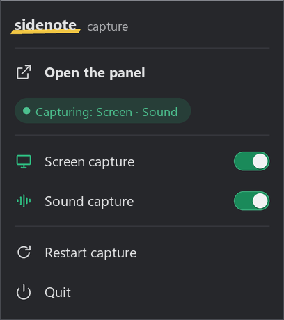

# Sidenote capture program

The capture program runs on the PC whose screen and sound Sidenote reads: Windows, or a Linux desktop with X11. It
sends a frame when the screen changes and settles, the speaker sound for spoken problems, and the list of visible
windows, so that a crop of the problem stops at its window's edge. It connects to the Sidenote server over a WebSocket
and does nothing else.

The app starts it by itself. On a PC that runs the server with Docker (in WSL, or on Linux), `./sidenote install` sets
it up and `./sidenote capture` starts it. To run it on its own, for a server in Kubernetes or on another machine whose
port is forwarded to this PC:

1. Install Python 3.10 or newer ([python.org](https://www.python.org/downloads/); on Windows its installer adds the
   `py` command).
2. Install its packages from the folder of the release's `sidenote-capture-<version>.zip`, or from the repository's
   `client` folder: `py -m pip install -r requirements.txt` on Windows, or on Linux
   `python3 -m pip install -r requirements.txt` in a virtual environment.
3. Start it there, pointing at the server:

   ```powershell
   py capture.py --server ws://127.0.0.1:8777/ingest
   ```

   On Linux, run `python3 capture.py --server ws://127.0.0.1:8777/ingest` in the desktop session. It reads the X11
   screen (in a Wayland session, only what XWayland shows) and the speaker sound through PulseAudio, or PipeWire's
   PulseAudio service.

For a server in a cluster, forward its port to this PC first and keep the forward on 127.0.0.1:
`kubectl --namespace sidenote port-forward svc/sidenote-server 8777:8777`. The server answers only requests addressed
to `127.0.0.1` or `localhost`, which is why the chart has no Ingress
([the Helm chart's guide](https://github.com/kanggu12/sidenote/blob/main/deploy/helm/sidenote/README.md)). A
port-forward ends when the server's pod is replaced: start it again, and the program reconnects by itself. The panel
has no login of its own, so keep the server off public networks.

## Options

| Option | What it does |
|:---|:---|
| `--monitor N` | capture monitor N (`--list-monitors` lists them; 0 takes all of them as one image) |
| `--stitch` | join a long problem into one image while you scroll through it |
| `--no-audio` | capture the screen only |
| `--audio-device NAME` | take the sound from this loopback device instead of the default speaker (any part of its name) |
| `--no-tray` | no icon in the notification area |
| `--fps N` | how often the screen is looked at, per second (default 3) |

## The tray icon

The icon in the notification area has **Open the panel**, **Screen capture**, **Sound capture**, **Restart capture**
and **Quit**, in Korean on a Korean system
([section 18 of the user guide](https://github.com/kanggu12/sidenote/blob/main/docs/README.md#18-panel-labels) lists
each label). The line under **Open the panel** says what is being sent. On Linux the icon appears where the desktop
shows such icons: an AppIndicator, or the X11 tray.



The program sends each frame as it is; the server covers the faces on it before anything reads it
([Security and privacy](https://github.com/kanggu12/sidenote/blob/main/docs/README.md#14-security-and-privacy)).

## Windows it does not send

While the window in front has one of the words of **Skip windows** (**Solver settings** > **Screen**) in its title or
in its program's name, in any case, the program takes no screenshot and sends no frame. The words come from the server
with its other switches, on connect and on every change; until they arrive, it holds the server's default list (the
common password managers and the browsers' private windows). Sound capture goes on.

| System | The window in front | Its title | Its program's name |
|:---|:---|:---|:---|
| Windows | `GetForegroundWindow` | `GetWindowTextW` | the file name of its process (`QueryFullProcessImageNameW`), such as `Bitwarden.exe` |
| Linux with X11 | the root window's `_NET_ACTIVE_WINDOW`, which the window manager keeps | `_NET_WM_NAME`, else `WM_NAME` | `WM_CLASS`, such as `keepassxc KeePassXC` |

A Wayland session tells other programs nothing of its windows, so there nothing is skipped, and the log says so once.
The window is looked at before each screenshot and again after it, so a window brought to the front while a screenshot
was being taken does not go out in it. The title and the name stay in this program: the server hears only that a
window is skipped, and the log says only when a skip started and ended. Meanwhile the line under **Open the panel**
in the tray menu reads **Skipped window**, as does the screen card in the panel. Once the window is no longer in front
the program captures again, and the same problem as before is not taken for a new screen.
